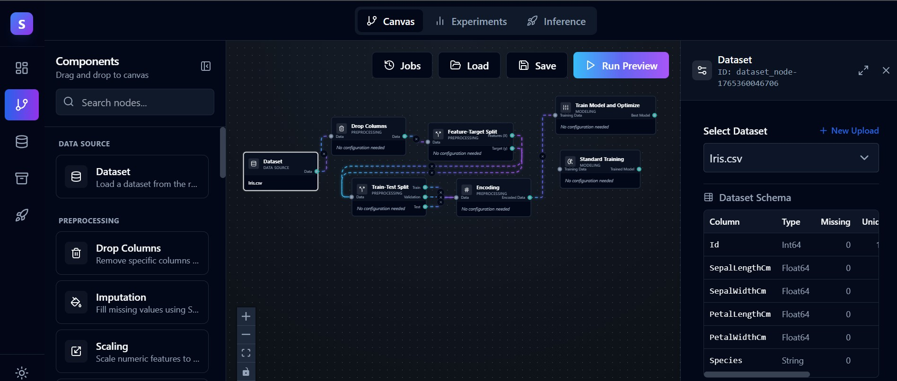
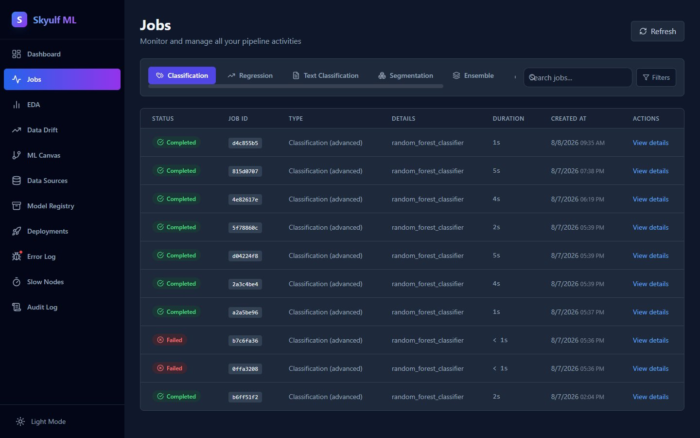
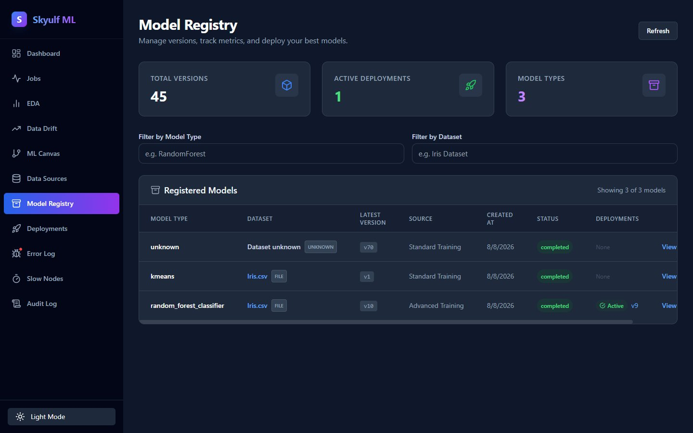
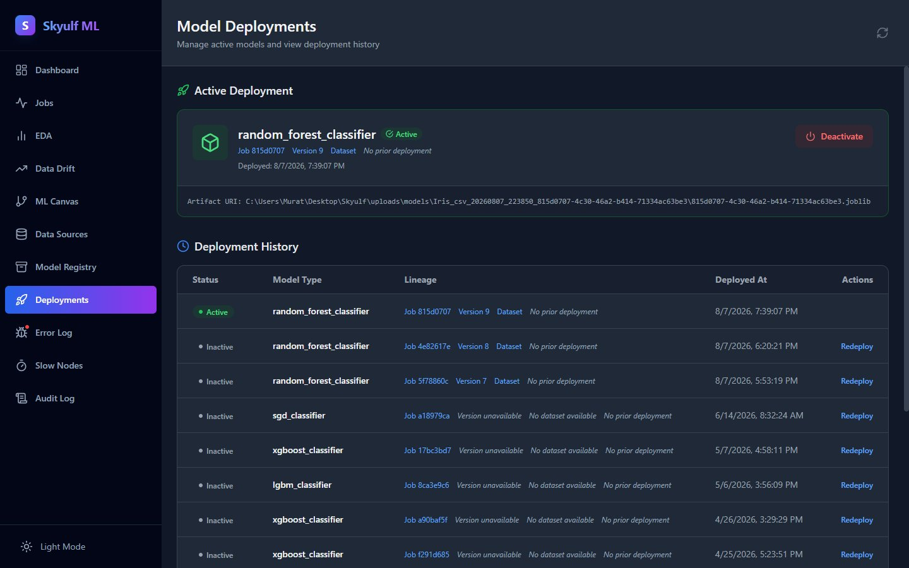
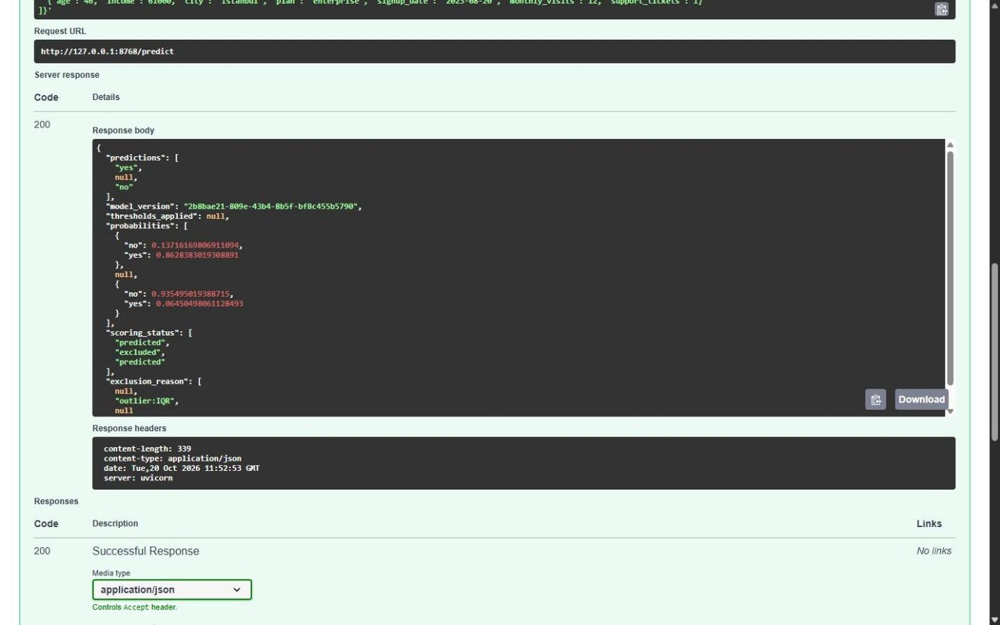

# Skyulf

<p align="center">
  <br/>
  <strong>Kayra — the self-hosted visual MLOps builder, by Skyulf.</strong><br/>
  From a raw file to a trained, served and monitored model, without leaving one workspace.
</p>

<p align="center">
  <a href="https://api.skyulf.com">
    
  </a>
  <a href="https://www.skyulf.com">
    
  </a>
  <a href="https://www.skyulf.com/manual/">
    
  </a>
  <br/>
  <sub>🟢&nbsp;live demo, no signup required</sub>
</p>

<p align="center">
  <a href="https://github.com/flyingriverhorse/Skyulf/actions/workflows/pr_check.yml"></a>
  <a href="https://codecov.io/github/flyingriverhorse/Skyulf"></a>
  <a href="https://app.codacy.com/gh/flyingriverhorse/Skyulf/dashboard?utm_source=gh&utm_medium=referral&utm_content=&utm_campaign=Badge_grade"></a>
  <a href="#quick-start"></a>
  <a href="https://pepy.tech/projects/skyulf-core"></a>
  <a href="#license"></a>
  <a href="CONTRIBUTING.md"></a>
</p>

<p align="center">
  
</p>

Skyulf has two parts that share one engine:

- **Kayra** — a self-hosted web application. Upload data, explore it, build a pipeline on a
  node-based canvas, train and tune models in the background, compare runs, serve the best one
  and watch it for drift. Your data stays on your machine or server.
- **`skyulf-core`** — the standalone Python library behind Kayra (Apache 2.0, on PyPI). Use the
  same pipelines, EDA and models from your own scripts and notebooks.

A model you train does not have to stay inside Skyulf: export it as a
[standalone API and batch project](#take-a-model-anywhere-project-export), or run the whole
lifecycle [directly on Databricks with MLflow](#run-ml-on-databricks-with-mlflow).

## Contents

- [Features](#features)
- [Quick Start](#quick-start)
- [Take a model anywhere: project export](#take-a-model-anywhere-project-export)
- [Run ML on Databricks with MLflow](#run-ml-on-databricks-with-mlflow)
- [Use skyulf-core as a library](#use-skyulf-core-as-a-library)
- [Screenshots](#screenshots)
- [Documentation](#documentation)
- [Development](#development)
- [Contributing](#contributing)
- [License](#license)

## Features

| Area | What you get |
| --- | --- |
| **Data** | Ingest CSV, Excel, JSON, Parquet or S3 (AWS, MinIO). Metadata starts in SQLite with zero config and scales to PostgreSQL. |
| **Exploratory analysis** | One-click profiling with interactive charts, statistical alerts, correlations, outliers, segmentation, decision-tree rule extraction, time-series, geospatial views and causal discovery (DAGs). |
| **Visual pipeline canvas** | Drag-and-drop nodes for cleaning, imputation, encoding, scaling, outlier handling, feature generation, text vectorizers and feature selection. Multi-branch canvases run as parallel jobs. |
| **Training & tuning** | 34 model types: scikit-learn classifiers, regressors and clustering, plus XGBoost and LightGBM. Grid, random and successive-halving search built in, Optuna optional. Voting and stacking ensembles. Jobs run in the background (Celery + Redis, or threads). |
| **Experiments** | Compare runs side by side with metrics, confusion matrices and ROC curves; tune decision thresholds; optional SHAP explanations. |
| **Registry & serving** | Versioned model registry. Promote a version and it is served behind a REST endpoint; the full deployment history is kept. |
| **Project export** | Download any completed version as a standalone project: a FastAPI service and CSV/Parquet batch scoring that run without Kayra. [More below](#take-a-model-anywhere-project-export). |
| **Notebook export** | Turn any canvas pipeline into a self-contained Jupyter notebook, in full (one cell per node) or compact mode, including tuning. |
| **Monitoring** | Data and model drift reports, error log, slow-node profiling and an audit log of every pipeline change. |
| **Databricks & MLflow** | Databricks Asset Bundle template for training, approval, batch and Spark scoring, Model Serving and monitoring; MLflow tracking and registry. [More below](#run-ml-on-databricks-with-mlflow). |
| **Performance** | FastAPI + Polars for ETL; Arrow-based conversion to NumPy for model nodes via `SklearnBridge`. |

## Quick Start

Prerequisites: **Python 3.12** (or Docker).

### 1. One command

- **Windows:** double-click `start.bat`
- **macOS / Linux:** `./start.sh` (or `bash start.sh`)

The script creates a virtual environment, installs dependencies, writes a `.env` with safe defaults
(SQLite, no Redis) and starts the server. Open <http://127.0.0.1:8000> when it is ready.

### 2. Docker Compose

```bash
docker compose up --pull=always --build
```

This starts the FastAPI backend (port 8000), Redis (port 6379) and a Celery worker. Check
<http://127.0.0.1:8000/health>; in development mode the API docs are at <http://127.0.0.1:8000/docs>.

### 3. Manual setup

<details>
<summary>pip or uv, step by step</summary>

**Using uv (faster):**

```bash
uv venv
# Windows: .\.venv\Scripts\Activate.ps1   macOS/Linux: source .venv/bin/activate
uv pip install -r requirements.txt
python run_skyulf.py
```

**Using pip:**

```bash
python -m venv .venv
# Windows: .\.venv\Scripts\Activate.ps1   macOS/Linux: source .venv/bin/activate
pip install --upgrade pip
pip install -r requirements.txt
python run_skyulf.py
```

`run_skyulf.py` starts the FastAPI server.

</details>

<details>
<summary>Optional: run without Celery and Redis</summary>

By default Kayra uses Celery and Redis for background jobs. For simple local use, or where you
cannot run Redis, add this to `.env`:

```ini
USE_CELERY=false
```

Training and ingestion then run in background threads inside the main process.

</details>

<details>
<summary>Optional: S3 storage</summary>

To use S3 for data and artifacts, add these to `.env`:

```ini
AWS_ACCESS_KEY_ID=your_key
AWS_SECRET_ACCESS_KEY=your_secret
AWS_DEFAULT_REGION=us-east-1
AWS_BUCKET_NAME=your-bucket
# Optional: upload local training artifacts to S3
UPLOAD_TO_S3_FOR_LOCAL_FILES=true
# Optional: force local storage even for S3 data
SAVE_S3_ARTIFACTS_LOCALLY=false
```

`AWS_BUCKET_NAME` is the canonical default data-bucket setting and is read from `.env` or the
process environment. The legacy `S3_BUCKET_NAME` name is also accepted. Environment values
override `.env`; when both names are set in the same source, `AWS_BUCKET_NAME` takes precedence.

</details>

For a guided first pipeline, see [QUICKSTART.md](QUICKSTART.md).

## Take a model anywhere: project export

In **Model Registry**, pick a completed version and click **Export project**. You get a ZIP that
runs on any machine with Python, without Kayra, a database or a scheduler:

```text
model.pkl          fitted model + fitted preprocessing (imputers, encoders, scalers, outlier filters)
scoring.py         one prediction path shared by the API and batch
app.py             FastAPI service: /predict, /health, /schema, /docs with typed inputs
batch.py           CSV/Parquet scoring in chunks, original rows and columns kept
wheels/            the matching skyulf-core wheel, so installation never depends on PyPI
requirements.txt   pinned versions · Dockerfile · smoke_test.py · README.md
```

```bash
uv venv && uv pip install -r requirements.txt

# HTTP API, docs at http://127.0.0.1:8000/docs
uv run --no-project uvicorn app:app --port 8000

# batch scoring of a file
uv run --no-project python batch.py --input data.parquet --output scored.parquet
```

Send raw columns as they were in your training data; the saved preprocessing runs before the
model. Classifiers return labels and class probabilities. Rows rejected by a fitted outlier
filter are kept in place and marked `excluded` instead of silently disappearing. See the
[project export quickstart](docs/user_guide/model_project_export_quickstart.md) for the full
flow and what can and cannot be exported.

## Run ML on Databricks with MLflow

Skyulf ships a Databricks Asset Bundle template, so the same preprocessing and models run as
Databricks jobs on your own workspace, with MLflow and Unity Catalog as the model registry:

```bash
databricks bundle init skyulf-core/templates/databricks --output-dir ./generated
```

The generated project covers the full lifecycle, configured in YAML instead of notebooks:

- **Train** one model, a competition of 2-8 candidate algorithms, or a multi-target model set,
  with grid, random, halving or Optuna search and holdout quality gates.
- **Register and approve** versions in MLflow / Unity Catalog with champion and challenger
  aliases and rollback.
- **Score** on a schedule into Delta tables, on a single node or on Spark workers for large tables.
- **Serve** through a Model Serving REST endpoint, call it from SQL with `ai_query`, or look up
  online features by key.
- **Monitor** drift, performance and serving health with Databricks dashboards.

MLflow also works without Databricks: track runs, package models and manage a local registry.
Start with the [integrations index](docs/user_guide/integrations.md) or follow the
[end-to-end Databricks walkthrough](docs/user_guide/databricks_bundle_walkthrough.md).

## Use skyulf-core as a library

```bash
pip install skyulf-core                  # base
pip install "skyulf-core[eda,viz]"       # profiling and charts
pip install "skyulf-core[eda,viz,tuning,preprocessing-imbalanced,modeling-xgboost]"   # full set
# or with uv: uv add "skyulf-core[eda,viz]"
```

### Train, save and reuse a pipeline

```python
import polars as pl
from skyulf import SkyulfPipeline

df = pl.DataFrame({
    "age": [43, 38, None, 52, 61, 29, 47, 55],
    "income": [52000, 61000, 48000, None, 73000, 41000, 58000, 66000],
    "city": ["NY", "LDN", "LDN", "PAR", "NY", "PAR", "NY", "LDN"],
    "purchased": [1, 0, 0, 1, 1, 0, 0, 1],
})

pipeline = SkyulfPipeline({
    "preprocessing": [
        {"name": "split", "transformer": "TrainTestSplitter",
         "params": {"target_column": "purchased", "test_size": 0.25, "random_state": 42}},
        {"name": "impute", "transformer": "SimpleImputer",
         "params": {"columns": ["age", "income"], "strategy": "median"}},
        {"name": "encode", "transformer": "OneHotEncoder",
         "params": {"columns": ["city"], "handle_unknown": "ignore"}},
    ],
    "modeling": {"type": "random_forest_classifier", "params": {"random_state": 42}},
})

metrics = pipeline.fit(df, target_column="purchased")
pipeline.save("model.pkl")
predictions = SkyulfPipeline.load("model.pkl").predict(df.drop("purchased"))
```

Imputation, encoding and the model are fitted on the training split only, so the test split stays
untouched. See [`skyulf-core/README.md`](skyulf-core/README.md) and the
[quickstart notebook](skyulf-core/examples/00_quickstart.ipynb).

### Automated EDA

```python
import polars as pl
from skyulf import EDAAnalyzer, EDAVisualizer

df = pl.read_csv("your_dataset.csv")
profile = EDAAnalyzer(df).analyze(
    target_col="target",
    task_type="Classification",  # optional: "Classification" or "Regression"
    date_col="timestamp",        # optional, if auto-detection fails
)

viz = EDAVisualizer(profile, df)
viz.summary()  # rich terminal dashboard
viz.plot()     # matplotlib charts
```

Time-series, geospatial and causal examples are in the [EDA guide](docs/user_guide/eda_profiling.md).

## Screenshots

<table>
  <tr>
    <td align="center"><br/><sub><b>Background training and tuning</b></sub></td>
    <td align="center"><br/><sub><b>Versioned model registry</b></sub></td>
  </tr>
  <tr>
    <td align="center"><br/><sub><b>One-click deployment with history</b></sub></td>
    <td align="center"><br/><sub><b>Standalone exported model API</b></sub></td>
  </tr>
</table>

## Documentation

The full manual is at **[skyulf.com/manual](https://www.skyulf.com/manual/)**. Good starting points:

| Topic | Guide |
| --- | --- |
| First pipeline in Kayra | [QUICKSTART.md](QUICKSTART.md) |
| EDA and profiling | [EDA guide](docs/user_guide/eda_profiling.md) |
| Text and NLP nodes | [Text & NLP](docs/user_guide/text_nlp.md) |
| Drift monitoring | [Drift monitoring](docs/user_guide/drift_monitoring.md) |
| Standalone model projects | [Project export quickstart](docs/user_guide/model_project_export_quickstart.md) |
| SHAP explanations | [SHAP](docs/user_guide/shap_explainability.md) |
| MLflow and Databricks | [Integrations](docs/user_guide/integrations.md) |
| What changed | [CHANGELOG.md](CHANGELOG.md) and [`changelog/`](changelog/) |

## Development

- Configuration lives in the `backend/config/` package (domain mixins: SQLite, dev CORS, Celery, S3).
- Lifespan hooks initialize the async database engine automatically.
- Tests: `tests/` (backend and integration) and `skyulf-core/tests/` (library).
- [`skyulf-commands.md`](skyulf-commands.md) collects the common dev, quality-check (Ruff + `ty`),
  test, build and release commands.
- [`RELEASING.md`](RELEASING.md) explains the app release (GitHub Release) and the `skyulf-core`
  release (PyPI).

## Contributing

Contributions are welcome. See [CONTRIBUTING.md](CONTRIBUTING.md) for setup and workflow, and read
the [Code of Conduct](CODE_OF_CONDUCT.md). Bug reports, feature ideas and documentation fixes all help.

## License

Skyulf uses a split licensing model to balance open standards with sustainable development:

*   **Backend (FastAPI / API server):** [GNU AGPLv3](LICENSE) (Copyleft) - If you run this as a network service you must release your full stack's source code, or obtain a commercial license.
*   **Frontend (ML Canvas):** [GNU AGPLv3](frontend/ml-canvas/LICENSE) (Copyleft) - Same network-service copyleft requirement.
*   **Core Library (`skyulf-core`):** [Apache 2.0](skyulf-core/LICENSE) (Permissive) - Use freely in any project, open or commercial.

**Commercial Use:**
If you want to run the backend or frontend as part of a proprietary product or SaaS **without** open-sourcing your stack, you need a commercial license exception.
See [`COMMERCIAL-LICENSE.md`](COMMERCIAL-LICENSE.md) for partnership options.

**Existing versions:** Releases v0.5.15 and earlier were published under Apache 2.0. Those versions remain under their original license. AGPLv3 applies from v0.5.16 onwards.

If you'd like to contribute, sponsor, or request a commercial license, please star the repo, open a Discussion or issue, or see `.github/FUNDING.yml` for sponsorship options.

## About the name

Sky is the open space above Earth, where the sun, moon, stars and clouds live. Ulf means "wolf",
with Nordic roots, and the wolf is also a strong symbol in Turkic tradition. Together it fits the
project: independent and built for the community.

## 🤝 Join the Journey

I'm building this because I love it, but I can't do it alone forever.

*   **Try it out:** clone the repo, run it, break it.
*   **Give feedback:** tell me what sucks and what you love.
*   **Contribute:** even a typo fix in the README helps.

Let's build the simplest, most powerful MLOps hub together.

> "Not all those who wander are lost." — J.R.R. Tolkien 

---

© 2025–2026 Murat Unsal — Skyulf Project
SPDX-License-Identifier: AGPL-3.0-or-later (backend/frontend) AND Apache-2.0 (skyulf-core)
