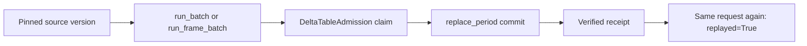

# Publish monthly predictions to Delta

Score one pinned Delta snapshot with a frozen model, atomically replace one
calendar period, retry without a second write, then publish a second month.
The result is a verified Delta commit receipt plus keyed predictions with their
model/run identity. Scheduling remains the caller's responsibility.



## Choose the runner and prepare the runtime

| Runner | Execution | Required model |
| --- | --- | --- |
| `run_batch` | Distributed Spark feature/prediction route | A supported raw `InferenceBundle`; modes `native_features` or `python_pipeline`. |
| `run_frame_batch` | Spark reads a bounded frame; pandas/Polars scores in the Python driver | A registered fitted pipeline, a prepared workflow with `runtime="databricks"`, and `mode="local_pipeline"`. |

Both use the same guarded period-replacement sink. They do not create tables,
evolve schemas, train models, merge keys, start streaming or deploy endpoints.
A recipe's local support does not imply portable/Spark support.

The following notebook cells require a compatible Databricks runtime with its
provided authenticated `spark` session, Delta, Python 3.12+, MLflow support and
matching Skyulf/model dependencies on the driver and any Python workers.
Install `uv pip install "skyulf-core[mlflow]"` in a suitable environment; pin a
published release and resolved dependencies in repeatable jobs; see
[runtime packaging](databricks_deployment.md#runtime-packaging) for builds from a
source checkout.
Do not install local `delta-spark` or a different Spark distribution over a managed
Databricks runtime. A workstation needs separately configured Databricks Connect.

Use an existing development catalog/schema you can provision. Replace the
`demo_catalog.demo_schema` values below before running. Creating tables/models is
an operator setup step; the scoring identity needs catalog/schema use privileges,
source `SELECT`, target/control `SELECT` and `MODIFY`, and model access including
`EXECUTE`. Registration also needs its own creation/write authority. Every writer
must use the same admission authority and preserve its control row.

These cells create new named demo resources. `CREATE TABLE` deliberately fails if
a table already exists; choose fresh demo names rather than overwrite live data.
The examples describe expected Databricks results; local model replay alone does
not establish compatibility or permissions on your selected compute.

## 1. Provision a source, target and admission row

Run this Python cell in the Databricks notebook. The source has three rows:
two in January and one in February. Record keys stay outside the model input.

<!-- skyulf-example: cloud monthly-publication -->
```python
source_table = "demo_catalog.demo_schema.monthly_features"
target_table = "demo_catalog.demo_schema.monthly_predictions"
control_table = "demo_catalog.demo_schema.monthly_prediction_admission"
portable_name = "demo_catalog.demo_schema.monthly_portable_model"
fitted_name = "demo_catalog.demo_schema.monthly_fitted_model"

spark.conf.set("spark.sql.session.timeZone", "UTC")
spark.sql(f"""
CREATE TABLE {source_table} USING DELTA AS
SELECT CAST(1 AS BIGINT) AS customer_id,
       TIMESTAMP '2026-01-10 12:00:00' AS event_time, CAST(9.0 AS DOUBLE) AS x
UNION ALL
SELECT CAST(2 AS BIGINT), TIMESTAMP '2026-01-20 12:00:00', CAST(10.0 AS DOUBLE)
UNION ALL
SELECT CAST(3 AS BIGINT), TIMESTAMP '2026-02-10 12:00:00', CAST(11.0 AS DOUBLE)
""")
spark.sql(f"""
CREATE TABLE {target_table} (
    customer_id BIGINT, event_time TIMESTAMP, prediction DOUBLE,
    run_id STRING, model_name STRING, model_version STRING
) USING DELTA
""")
target_id = spark.sql(f"DESCRIBE DETAIL {target_table}").first()["id"]
spark.sql(
    f"CREATE TABLE {control_table} USING DELTA AS "
    f"SELECT '{target_id}' AS target_id, CAST(NULL AS STRING) AS owner"
)
```

The target schema must match the selected model outputs exactly. Classifiers
also need class-ordered probability columns with their recorded types. The writer
uses the target's column order; it does not add missing columns. The period column
must be Spark `timestamp`, not string, date or `timestamp_ntz`. Keys must be
nonnull and unique inside a selected period. The portable runner also rejects
null period timestamps anywhere in the source.

## 2. Fit and register the two artifact forms

This cell supplies the `bundle` and model identities used below. It fits a real
small pandas model on separate synthetic training rows. It then logs both a
portable package and the whole fitted pipeline so you can choose either runner.
The experiment path must be writable by the current job identity.

<!-- skyulf-example: cloud monthly-publication -->
```python
from datetime import UTC, datetime
from pathlib import Path
from tempfile import mkdtemp

import pandas as pd

from skyulf.data.dataset import SplitDataset
from skyulf.inference.bundle import build_bundle
from skyulf.inference.fitted_pipeline import save_pipeline
from skyulf.integrations.mlflow import TrackingConfig, track_run
from skyulf.integrations.mlflow.models.model import log_model
from skyulf.integrations.mlflow.models.pipeline_model import log_pipeline_model
from skyulf.integrations.mlflow.registration.registry import (
    register_model, resolve_model, load_registered_bundle,
)
from skyulf.pipeline import SkyulfPipeline

frame = pd.DataFrame({
    "x": [1., 2., 3., 4., 5., 6., 7., 8.],
    "target": [2., 4., 6., 8., 10., 12., 14., 16.],
})
pipeline = SkyulfPipeline({
    "preprocessing": [], "modeling": {"type": "linear_regression"},
})
pipeline.fit(
    SplitDataset(train=frame.iloc[:6], test=frame.iloc[6:]), target_column="target",
)
local_path = Path(mkdtemp(prefix="skyulf-monthly-")) / "fitted"
save_pipeline(pipeline, local_path)
bundle = build_bundle(pipeline, input_stage="raw", feature_order=("x",))
endpoints = {"tracking_uri": "databricks", "registry_uri": "databricks-uc"}
tracking = TrackingConfig(
    enabled=True, tracking_uri="databricks", experiment_name="/Shared/monthly-demo",
)
with track_run(tracking, run_name="monthly-demo-models") as run:
    portable_uri = log_model(
        bundle, run_id=run.run_id, artifact_path="portable", tracking_uri="databricks",
    )
    fitted_uri = log_pipeline_model(
        local_path, run_id=run.run_id, artifact_path="fitted", tracking_uri="databricks",
    )
portable_registered = register_model(portable_uri, portable_name, **endpoints)
fitted_registered = register_model(fitted_uri, fitted_name, **endpoints)
selected = resolve_model(portable_name, version=portable_registered.version, **endpoints)
bundle = load_registered_bundle(selected, **endpoints)
assert bundle.semantic_digest == selected.digest
print(selected.model_uri, selected.digest)
```

Inspect **Experiments > /Shared/monthly-demo > monthly-demo-models > Artifacts**
for both packages and **Catalog > Models** for the concrete registered versions.
Registration has not deployed a service or selected a champion. The model name,
version and digest are bound to the actual downloaded package.

## 3. Publish January and retry the unchanged request

Run this cell after setup. Source and target versions are read once and retained
in `january`; version `0` is valid. Capture `as_of` after the source commit exists.
Save the spec and receipt durably in your own job metadata for recovery.

<!-- skyulf-example: cloud monthly-publication -->
```python
from importlib.metadata import version

from skyulf.core.execution import ExecutionOptions
from skyulf.integrations.databricks import BatchSpec, run_batch
from skyulf.integrations.databricks.data.delta_io.delta_admission import DeltaTableAdmission

source_version = int(spark.sql(f"DESCRIBE HISTORY {source_table} LIMIT 1").first()["version"])
target_version = int(spark.sql(f"DESCRIBE HISTORY {target_table} LIMIT 1").first()["version"])
as_of = datetime.now(UTC)
admission = DeltaTableAdmission(spark, control_table)
january = BatchSpec(
    period_start=datetime(2026, 1, 1, tzinfo=UTC),
    period_end=datetime(2026, 2, 1, tzinfo=UTC), as_of=as_of,
    record_key_columns=("customer_id",), output_table=target_table,
    model_name=selected.name, model_version=selected.version,
    model_digest=selected.digest, source_version=source_version,
    code_version=version("skyulf-core"), run_id="monthly-demo-january",
    expected_target_version=target_version, mode="native_features",
)
options = ExecutionOptions("spark")
result = run_batch(
    spark, january, source=source_table, bundle=bundle,
    options=options, admission=admission,
)
assert result.input_count == result.output_count == 2
assert not result.replayed
retry = run_batch(
    spark, january, source=source_table, bundle=bundle,
    options=options, admission=admission,
)
assert retry.replayed and retry.commit_version == result.commit_version
print(result.commit_version, result.manifest)
```

The retry reuses the original expected target version. Do not update the spec or
its run ID to recover an uncertain result. Matching replay finds the original
receipt and makes no second write. The runner still needs the original source
snapshot and bundle to remain readable before it checks the sink receipt.

## 4. Publish February and inspect both periods

Continue the same session. A deliberately new period uses a new run ID and the
reviewed target version from January's successful result. An intervening external
target commit causes a conflict instead of silently replacing it.

<!-- skyulf-example: cloud monthly-publication -->
```python
from dataclasses import replace

february = replace(
    january,
    period_start=datetime(2026, 2, 1, tzinfo=UTC),
    period_end=datetime(2026, 3, 1, tzinfo=UTC),
    run_id="monthly-demo-february", expected_target_version=result.commit_version,
)
second = run_batch(
    spark, february, source=source_table, bundle=bundle,
    options=options, admission=admission,
)
assert second.input_count == second.output_count == 1
rows = spark.sql(f"""
SELECT customer_id, prediction, run_id, model_name, model_version
FROM {target_table} ORDER BY customer_id
""").collect()
assert [row.customer_id for row in rows] == [1, 2, 3]
assert all(abs(row.prediction - expected) < 1e-8
           for row, expected in zip(rows, [18., 20., 22.]))
assert [row.run_id for row in rows] == [
    "monthly-demo-january", "monthly-demo-january", "monthly-demo-february",
]
assert spark.table(control_table).first()["owner"] is None
spark.sql(f"DESCRIBE HISTORY {target_table}").select("version", "userMetadata").show(truncate=False)
```

Expected output preserves January's two original run IDs and adds February's
single row. In Catalog Explorer open the prediction table's **Sample Data** and
**History**. Each publication's Delta `userMetadata` contains its request
fingerprint, pinned source/model identities, cutoff, counts and receipt. An
MLflow training run ID and a prediction publication `run_id` identify different
operations.

## Use a bounded fitted pipeline instead

Use this alternative after cells 1–2 and before publishing any rows, or provision
a separate fresh target/admission pair for it. It scores the same January data
with the saved whole-frame pandas model. All variables come from cells 1–2.

<!-- skyulf-example: cloud fitted-monthly -->
```python
from importlib.metadata import version
from skyulf.integrations.databricks import (
    BatchSpec, InputSource, SourceSpec, WorkflowConfig, ModelSelection,
    OutputSink, prepare_workflow, run_frame_batch,
)
from skyulf.integrations.databricks.data.delta_io.delta_admission import DeltaTableAdmission

source_version = int(spark.sql(f"DESCRIBE HISTORY {source_table} LIMIT 1").first()["version"])
target_version = int(spark.sql(f"DESCRIBE HISTORY {target_table} LIMIT 1").first()["version"])
source = SourceSpec(
    table=source_table, version=source_version,
    period_start=datetime(2026, 1, 1, tzinfo=UTC),
    period_end=datetime(2026, 2, 1, tzinfo=UTC),
    record_key_columns=("customer_id",), input_columns=("x",),
    max_rows=100, max_bytes=1_000_000,
)
workflow = WorkflowConfig(
    runtime="databricks", engine="pandas",
    source=InputSource(
        kind="uc_table", table=source_table, version=source_version,
        max_rows=source.max_rows, max_bytes=source.max_bytes,
    ),
    model=ModelSelection(
        kind="local_pipeline", name=fitted_name,
        version=str(fitted_registered.version), **endpoints,
    ),
    sink=OutputSink(kind="uc_delta", table=target_table),
)
prepared = prepare_workflow(workflow)
local_spec = BatchSpec(
    period_start=source.period_start, period_end=source.period_end,
    as_of=datetime.now(UTC), record_key_columns=source.record_key_columns,
    output_table=target_table, model_name=fitted_name,
    model_version=prepared.preflight.model_version,
    model_digest=prepared.preflight.model_digest, source_version=source_version,
    code_version=version("skyulf-core"), run_id="monthly-demo-local-january",
    expected_target_version=target_version, mode="local_pipeline",
)
local_result = run_frame_batch(
    spark, source, prepared, local_spec,
    admission=DeltaTableAdmission(spark, control_table),
)
assert local_result.output_count == 2
print(local_result.commit_version, local_result.manifest)
```

The source is filtered/projected before bounded driver transfer. Both decoded
rows and local prediction frames must fit the explicit row/byte limits. This is
not a claim about Spark wire-buffer size. `InputSource`, `SourceSpec` and
`BatchSpec` must agree on source, model, target, period and budgets. Repeat the
identical `run_frame_batch` request for receipt replay. For the second period,
replace both `source` and `local_spec` boundaries and retain the same prepared
snapshot/model identity; use a new run ID and the reviewed prior commit version.
See the [SDK](databricks_sdk.md) for preflight, context and saved scoring policies.

## Admission, time and recovery contracts

The portable runner caches predictions when `persist()` is supported. If
Databricks serverless rejects that operation with its specific structured
restriction, it validates/publishes the distributed frame without caching or
`unpersist()`. Separate actions can recompute predictions from the pinned source
and bundle. Other cache errors propagate before publication. This never collects
the source into driver memory.

For local Spark drivers on one host, `LocalTableLock` is an alternative admission
provider. Every publisher must use the same writable lock directory; keep its lock
files while writers may run. OS ownership releases when a process exits. This
provider is rejected on distributed masters, including `local-cluster`; use shared
Delta admission for Databricks jobs.

### Shared Delta admission

`DeltaTableAdmission` coordinates participating publishers through one shared
Delta control table. A second participating publisher cannot acquire ownership
while the first holds the target. Provision the authority once, before starting
publishers:

The walkthrough above provisions this row using the immutable target ID. In a
new application, obtain that ID with `DESCRIBE DETAIL <prediction_table>` and
create one control row with `target_id STRING` and nullable `owner STRING`.
Use a plain `CREATE TABLE`, never an overwrite or an unconditional reset.
The plain CREATE TABLE statement fails if the authority already exists; it does
not overwrite an existing control row. Serverless Spark Connect rejects the
DataFrameWriter errorifexists save mode for this provisioning step.

The provider requires exactly one row with the immutable output table ID and a
nullable string owner. It uses a conditional Delta UPDATE to claim ownership,
checks the committed token before entering, and clears only its own token after
publication and receipt verification. A competing publisher fails with
`BatchConflictError`; the provider does not automatically retry it.

Every publisher must use the same authority. Keep its identity, schema and
target binding fixed. External control-row edits, DDL and writers bypassing this
protocol are outside the guarantee. Grant operators provisioning rights and
publishers only the required read/update access under your platform's policy.

In Unity Catalog, the scoring identity needs `USE CATALOG` and `USE SCHEMA`,
`SELECT` on the source, and `SELECT`/`MODIFY` on the target and control tables.
Loading a registered model additionally needs its own model access, including
`EXECUTE`; table access does not grant model access. Provisioning new tables is
an operator step, so the scoring identity does not need schema-wide creation
rights for an existing source, target and authority.

Admission does not bypass target permissions. A caller may acquire the control
row and still be denied `MODIFY` on the prediction table. The sink preserves the
underlying runtime error as the cause of `DeltaPublishError`, and the admission
context releases its claim when that write fails normally.

Ownership never expires. A driver crash or an uncertain acquisition can leave a
claim behind: inspect the job and prove that the original driver can no longer
publish before an operator clears it. Never clear a live owner's claim to unblock
another job. The sink has no fencing-token mechanism, so time-based expiry would
allow an old publisher to write after a new publisher acquired ownership.

The provider uses Spark SQL parameter markers (Spark 3.4+) without a SparkContext
or data caching requirement. Classic Spark explicitly refreshes the control
table before identity reads. When serverless rejects `REFRESH TABLE` with its
specific unsupported-operation condition, the provider proceeds with fresh
Delta identity/ownership reads; user-managed cache APIs are unavailable there.
Conditional updates and unique-token verification still control ownership.
Other errors propagate. Validate these operations on the selected compute and
with the job's actual permissions.

## Time and reproducibility

The period is half-open: the start is included and the end is excluded. Aware
datetimes are converted to UTC instants independently of the Spark session's
timezone. For a business calendar month, construct boundaries explicitly:

<!-- skyulf-example: illustrative calendar-boundary -->
```python
from zoneinfo import ZoneInfo

zone = ZoneInfo("Europe/Vilnius")
start = datetime(2026, 3, 1, tzinfo=zone)  # 2026-02-28 22:00 UTC
end = datetime(2026, 4, 1, tzinfo=zone)    # 2026-03-31 21:00 UTC
# Pass these as period_start/period_end and business_timezone="Europe/Vilnius".
```

`business_timezone` records calendar intent; it does not reinterpret the supplied
instants. Naive datetimes and nonexistent local DST times are rejected. For an
ambiguous local time, select the intended `fold` when constructing the datetime.

`as_of` is a **snapshot availability cutoff**. The runner checks the selected
Delta version's commit timestamp and then reads that exact `versionAsOf`. A newer
snapshot or expired history fails. This does not establish point-in-time
correctness of upstream feature joins: the source producer must implement its
own historical feature and availability rules. No timestamp-column filter can
retroactively reconstruct overwritten source rows. For a backfill, explicitly
choose the intended model version and source snapshot; scheduler time is never
silently substituted for either the period or cutoff.

The Delta commit's `userMetadata` records the full request fingerprint, UTC
period/cutoff, source table ID/version/commit time, model name/version/digest,
installed Skyulf version, run ID and input/output counts. Only
`run_id`, `model_name` and `model_version` are repeated as prediction
metadata on each output row, alongside the record keys, timestamp and predictions.

## Retries, conflicts and empty periods

- Reuse the **same spec and logical run ID** for a retry. A matching committed
  receipt returns its original version and counts with `replayed=True`. It does
  not write again, even if a newer run has since recomputed the same period.
  The runner still reads and validates the source and bundle before checking
  the sink receipt, so retries require those inputs to remain available.
- Reusing a run ID with a changed request raises `BatchConflictError`.
- To intentionally recompute a period, choose a new run ID and explicitly set
  `expected_target_version` to the version you have reviewed. Any intervening
  target commit makes that expectation stale. Do not automatically refresh it
  and retry a conflict: that would silently authorize replacing another run.
- Empty output fails unless `allow_empty=True`. With that explicit setting,
  the same atomic replacement removes the selected period and records a receipt.
  Other periods remain unchanged. Out-of-period/null output and incorrect run
  metadata are rejected before writing.
- Success is returned only after verifying the committed receipt. If the client
  loses contact after commit, the outcome may be unknown: retry the unchanged
  request to check the receipt. Preserve Delta history and transaction retention
  for the supported retry window; this is not unlimited replay storage.

The first mode is `replace_period`. Append, key `MERGE`, automatic schema
evolution, streaming and endpoint deployment remain unsupported here. The sink
helper is lower-level: direct callers must supply output and a manifest with
the same provenance guarantees as `run_batch`.

| Setting or outcome | Default, meaning and action |
| --- | --- |
| `period_column` | `"event_time"`; the source and target must use the same Spark timestamp column. |
| `business_timezone` | `"UTC"`; records calendar intent, while supplied aware boundaries determine the instants. |
| `mode` | `"native_features"`; select `"python_pipeline"` for supported portable worker FE, or `"local_pipeline"` only with `run_frame_batch`. |
| `publish_mode` | `"replace_period"`; replaces exactly the selected half-open interval. |
| `allow_empty` | `False`; use `True` only when deliberately removing the selected period's existing rows. |
| Same committed request | Returns the original receipt with `replayed=True`; no new data commit. A new empty request is not an automatic no-op. |
| `BatchConflictError` | Review run-ID reuse, expected target version and control ownership. Do not automatically refresh expectations or clear another writer's owner. |
| Schema/type or key failure | Correct the source or provision an exactly compatible fresh target; no automatic evolution or duplicate-key reconciliation. |
| Snapshot newer than `as_of`, or expired history | Supply the intended available snapshot/cutoff and preserve retention. Do not substitute the latest source silently. |
| `DeltaPublishError` or permission failure | Inspect the underlying runtime cause and table/model privileges. If commit outcome is uncertain, retry the unchanged request to inspect its receipt. |

## Validate a new destination

Use an isolated development destination with the same schema and access policy as
the planned target. Publish one small pinned period, repeat the identical request,
and verify that the receipt identifies the original commit. Then publish a second
period and confirm that earlier keys and predictions remain unchanged. Exercise
empty-period behavior explicitly before enabling replacement of production data.

Check source/target versions, model identity, keyed output values and admission
release after a failure. Local filesystem behavior does not establish UC permissions
or a distributed driver's ownership guarantees. Use shared Delta admission for
jobs that do not share a single host.

Relevant upstream behavior:
[Delta selective overwrite and idempotent writes](https://docs.delta.io/delta-batch/) and
[Delta concurrency control](https://docs.delta.io/concurrency-control/).
