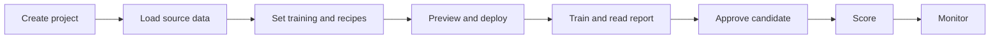

# A Databricks project from source rows to predictions

Follow one project through data preparation, training, publication and monitoring.
The running example predicts numeric `claim_amount` from `income` and `age` for
120 customers. It uses a single pandas model and whole-frame scoring on Databricks.
Optional chapters explain how feature tables, serving and rollout attach to this
same lifecycle. The [glossary](databricks_glossary.md) defines the terms; the
[troubleshooting guide](databricks_troubleshooting.md) starts from error messages.

Four finished projects built from this template on `samples.nyctaxi.trips` are in the
[NYC taxi examples](https://github.com/flyingriverhorse/Skyulf/tree/master/skyulf-core/templates/databricks/examples/nyctaxi):
a single model with Spark scoring, a single model served online with feature lookups,
a model competition, and a model set with combined scoring. Each has its setup answers,
and one SQL file creates their tables. To copy the closest one instead of following
this guide, see
[start from the closest example](databricks_project_setup.md#start-from-the-closest-example).

Commands run from your generated project unless a step says otherwise. Replace
`YOUR_PROFILE`, workspace host and the approved catalog/schema with your own.
Examples of expected output are expectations, not claims about your workspace.
No input data is created by `bundle init` or deployment.

| Stage | Result to inspect | Detailed reference |
| --- | --- | --- |
| Prepare data | CDF Delta table and unique record keys | [Feature tables and merges](databricks_features.md) |
| Configure training | Resolved source, split, models and recipes | [Every training field](databricks_training_config.md) |
| Prepare features | Fixed pre-split rules and fitted transformations | [Preprocessing catalog](preprocessing_recipes.md) |
| Fit and decide | Candidate version, protected holdout and decision | [Training reports](databricks_training_reports.md), [approve or roll back](databricks_lifecycle.md) |
| Score | Concrete model, source watermark and Delta receipt | [Scoring guide](databricks_scoring.md) |
| Observe | Saved drift/performance evidence and retraining decision | [Monitoring overview](databricks_monitoring.md) |

The generated `START_HERE.md` is the short offline path. `TRAINING.md`,
`SCORING.md` and the other topic files remain bound to that project's revision.
The public site can describe a newer release; follow the upgrade chapter before
changing runtime pins.

The chapters follow one path from a new project to monitored predictions:



## 1. Check prerequisites

### When you need it

Before creating resources or choosing a deployment identity.

### What to edit

Use an existing workspace, catalog and schema you are allowed to use. The
deployment identity needs rights to manage the generated jobs. The jobs' Run-as
identity needs source reads, output/metadata writes, model registry and MLflow
access, plus rights to start downstream jobs. Monitoring has its own store and
reference permissions. Configure these in `deployment/targets.yml` and
`deployment/variables.yml`; a successful local preview does not test them.

Use an authenticated Databricks CLI and a Core release matching the template.
Generated jobs install `deployment/requirements.txt`; see
[runtime packaging](databricks_deployment.md#runtime-packaging).

### The command

```powershell
databricks version
databricks auth describe --profile YOUR_PROFILE
```

### What you should see

The profile resolves to your intended workspace and identity. Avoid copying access tokens into
project configuration.

### Common errors and fixes

A different host or principal means the wrong profile is active. Fix authentication before
deployment; do not treat local package installation as proof of cloud permissions.

## 2. Create the project

Detailed reference: [Setup modes, generated files and preview](databricks_project_setup.md).

### When you need it

Once per new project. Quick and detailed setup generate the same project for the same answers.

### What to edit

The answer file below selects `single_model`, regression and the source used in
chapter 3. Quick setup is the default. Without an answer file, the wizard asks
essential applicable questions; select detailed for model/candidate/branch,
search, compute and deployment choices. Defaults remain editable in generated
YAML. Competition compares candidates for one target; multi-target trains separate
targets and packages one coherent model set.

### The command

From the Skyulf checkout, save this as `quick-init.json`. Omitting `setup_mode`
selects quick setup; the explicit answers avoid prompting:

```json
{
  "project_name": "claim_demo",
  "catalog": "workspace",
  "schema": "skyulf_demo",
  "training_layout": "single_model",
  "task": "regression",
  "source_table_name": "customer_observations",
  "record_key_columns": "customer_id",
  "input_columns": "income, age",
  "target_column": "claim_amount"
}
```

```powershell
databricks bundle init skyulf-core/templates/databricks --config-file quick-init.json --output-dir ./generated
cd generated/claim_demo
uv pip install -r deployment/train-requirements.txt
```

### What you should see

A `generated/claim_demo` directory containing configuration, jobs, Python extensions and topic
guides. No tables, models or endpoints are created by initialization.

### Common errors and fixes

Run later commands from `generated/claim_demo`. Do not add a second `workflow.json` or Python model
declaration beside the generated YAML owners.

## 3. Supply data, directly or through feature groups

Detailed reference: [Feature tables and merge contracts](databricks_features.md).

### When you need it

Before training or scoring can read real rows.

### What to edit

For this tutorial keep `config/features.yml` at `groups: {}`. There is no feature
job and no merged table: training and scoring read `customer_observations` directly.
The catalog/schema must already exist. Create the example table once below, or
use a table with the same schema and update the source name in both configurations.

If your inputs must first be assembled, follow [the feature-table tutorial](databricks_features.md):
each group reads its own source, calls a Spark transform and writes a feature
table; the merge joins those tables onto the base observations. Then explicitly
set the merged table as `training_table` and `score_source_table`. Feature groups
do not change those sources automatically. This optional path is separate from
fitted preprocessing and online feature lookup.

### The command

This example predicts a numeric `claim_amount` from `income` and `age`, keyed by
`customer_id`. Use an existing authorized Delta table with those columns, or
create the following demonstration table in a schema you own. Run this SQL once
in Databricks; substitute your catalog/schema in both the SQL and the bindings
below. `CREATE TABLE` deliberately fails if the name is already in use.

```sql
CREATE TABLE workspace.skyulf_demo.customer_observations
USING DELTA
TBLPROPERTIES ('delta.enableChangeDataFeed' = 'true')
AS SELECT
  id AS customer_id,
  CAST(20000 + id * 350 AS DOUBLE) AS income,
  CAST(20 + id % 45 AS DOUBLE) AS age,
  CAST(50 + id * 7 + id % 3 AS DOUBLE) AS claim_amount
FROM range(120);
```

Expected: 120 unique BIGINT keys, two DOUBLE inputs and a DOUBLE label. This is
an execution example, not a realistic business benchmark. Record keys identify
requests; keep them out of `input_columns` unless they are genuine features.
The rules for record keys, labels and source windows are in
[training data](databricks_training_data.md#record-identity-and-result-availability).

### What you should see

The source has 120 distinct nonmissing BIGINT `customer_id` values. `income`, `age` and
`claim_amount` are DOUBLE columns. Record keys identify outputs and stay outside model inputs.

### Common errors and fixes

An existing table name makes `CREATE TABLE` fail deliberately. Choose a new owned name rather than
replacing data. Enable CDF before new scoring changes arrive. A timestamp can be a feature-join key
but is not a supported single-model prediction record key; use a stable STRING or BIGINT ID. See
[prepare the source table](databricks_training_data.md#prepare-the-source-table).

## 4. Choose training data, model and policy

Detailed reference: [Training rows and holdout](databricks_training_data.md),
[model catalog](databricks_model_catalog.md), [search strategies](databricks_tuning.md) and
[decision thresholds](databricks_decision_thresholds.md).

### When you need it

Before each new fit when changing data selection, evaluation, estimator or recipe.

### What to edit

Edit `config/training.yml`. The generated table bindings and model entry already
match the answer file. Merge this fragment into `defaults`; keep the other generated
settings and the `models` mapping:

```yaml
defaults:
  input_columns: [income, age]
  target_column: claim_amount
  pre_split_recipe: known_income
  preprocessing_recipe: claim_inputs
  preprocessing_probe: true
```

The defaults use linear regression with a bounded search. Keep them for this run,
or remove the model's `tuning` block to fit fixed parameters. The
[training field tables](databricks_training_config.md#training-fields) explain all
accepted settings, types, defaults, inheritance and layout restrictions. Use
that page's complete three-layout files when changing layout.
For another algorithm, use the [model catalog](databricks_model_catalog.md): each
card has its parameters, default search space and YAML selection. The
[search and ensemble guide](databricks_tuning.md) explains strategy controls,
CV, budgets and how to configure voting or stacking members.

### The command

There is no cloud action in this chapter. Complete the next two recipe files
before running `python src/tools/preview.py --action train` in chapter 7.

### What you should see

#### Training data flow

The job pins a Delta source version, selects the configured window and eligible
sample, applies fixed training filters, creates the final split, and then fits
preprocessing/model parameters inside training folds. Holdout rows stay outside
search and fitting. Label availability filtering is independent of observation
time and split policy.

Review `training_window_mode`, optional `training_sample_rows`, `split_strategy`
and `cv` separately. Random splitting needs no event dates. Temporal splitting
requires the configured time column and boundaries. Null `training_version`
resolves latest once at invocation; a concrete version pins that snapshot.
A rolling window changes at invocation, while a fixed window keeps its boundaries.

#### Three independent decisions

| Setting | Location | Meaning |
| --- | --- | --- |
| `promotion_policy` | Training policy, or inference `model_set` policy | `manual_approval` waits for an operator; `automatic` applies saved quality gates |
| `score_model_selection` | `config/inference.yml` | Resolve the controlled champion or use a pinned `model_version` |
| `score_handoff` | `config/inference.yml` | `after_alias_change` starts scoring after a successful champion transition; `disabled` leaves scoring to its own trigger |

Manual approval does not imply manual scoring. A pinned scorer keeps using its
pinned version even after champion changes. Rejection and training without a
champion transition do not trigger score handoff.

### Common errors and fixes

Quick setup's manual policy leaves `quality_threshold` unset. This allows
candidate registration and pinned scoring, but first-champion approval needs an
absolute quality limit chosen **before training**. To exercise approval in this
synthetic example, add `quality_threshold: 5.0` under defaults; heldout RMSE must
then be at most 5.0. Choose a meaningful business limit for real data.
Editing it after the fit does not replace the candidate's saved policy.

## 5. Set fixed pre-split eligibility

Detailed reference:
[Custom pre-split filters and executed examples](databricks_custom_pre_split.md).

### When you need it

When fixed cleanup or eligibility rules must run before holdout and CV splitting.

### What to edit

Replace `config/pre_split.yml` with the complete file below. The previous chapter
already selects `known_income`. It converts `-999` to missing income and excludes
those observations. It learns no means, quantiles or category vocabularies.

If another recipe filters missing `claim_amount`, set
`skip_target_pre_split_steps: true` in `config/scoring.yml` **before preview**
when you intend scoring to skip that label-dependent filter. Preview checks the
decision even for training. This tutorial's income-only filter needs no such
switch; actual labels are not required for prediction.

### The command

For example, normalize a sentinel before testing training eligibility:

```yaml
version: 1
recipes:
  default: []
  known_income:
    - name: income_sentinel
      transformer: ValueReplacement
      params: {columns: [income], to_replace: -999, value: null}
    - name: known_income
      transformer: DropMissingRows
      params: {subset: [income]}
```

Place this in `config/pre_split.yml` and select `pre_split_recipe: known_income`.
Do not repeat the same normalization in preprocessing. With the generated
`mode: pre_split`, scoring normalizes the sentinel, then excludes that
row under `known_income`. The response retains its key with a missing prediction,
`scoring_status="excluded"` and `exclusion_reason="pre_split:known_income"`.
The estimator receives only eligible rows. To predict for missing income, change
the saved scoring eligibility/mode deliberately and include a fitted imputer,
then train/package a new version; adding an imputer alone does not override this
eligibility rule. Keep learned statistics after splitting.

### What you should see

All 120 demo rows pass the filter. A future row with income -999 retains its key in scoring output,
with no estimate and the explicit exclusion status described above.

### Common errors and fixes

Keep learned imputers/scalers/encoders in preprocessing. Pre-split supports only the
[eight admitted built-ins and declared fixed filters](preprocessing_recipes.md#pre-split-admission-and-scoring).
Deduplication does not repair duplicate record IDs and does not remember earlier scoring batches.
Separate target-reading and feature-only filters if the latter must remain active at scoring time.

## 6. Set fitted preprocessing

### When you need it

When inputs need learned filling, scaling, encoding or other model transformations.

### What to edit

Replace `config/preprocessing.yml` with this complete file. `claim_inputs` is
selected by chapter 4. The income filter is already in pre-split; this recipe
fills missing age and scales the two numeric inputs.

<!-- example:claim-preprocessing -->
```yaml
version: 1
recipes:
  default: []
  claim_inputs:
    - name: age_fill
      transformer: SimpleImputer
      params: {columns: [age], strategy: median}
    - name: numeric_scale
      transformer: StandardScaler
      params: {columns: [income, age]}
```

The [catalog](preprocessing_recipes.md) gives each transform's parameters,
defaults, minimal YAML, common mistake and saved-state behavior. Its customer
classification example additionally covers group imputation and unseen categories.

### The command

After both recipe files exist, inspect their resolved definitions:

```powershell
python src/tools/preview.py --list-preprocessors
```

### What you should see

The selected order is age imputation, then scaling. Preview resolves declarations; only training
learns medians and scale statistics. Each CV fold fits its own state; holdout and prediction reuse
saved state.

### Common errors and fixes

Adding a YAML step does not alter an already registered model. Train a new version. Do not include
record IDs or the target in scaler columns, and do not define the same phase in YAML and a Python
builder.

## 7. Check locally and deploy

Detailed reference: [Deployment identities, permissions and compute](databricks_deployment.md).

### When you need it

After configuration changes and before any job run.

### What to edit

Set workspace, namespace, identity and paused schedule bindings for the shared `test` target. Keep
the package pin matched to this template.

### The command

For this example use shared target `test`. In `deployment/targets.yml`, set its
`workspace.host` to your workspace URL. In `deployment/variables.yml`, set
`test_catalog` to `workspace` and `test_input_schema`, `test_output_schema` and
`test_metadata_schema` to your approved `skyulf_demo` schema. The target root
must be a directory your deployment identity controls. Replace `YOUR_PROFILE`
below with the authenticated CLI profile for that workspace.

Install the generated training requirements in your local preview environment.
There is no project-wheel or `dist/` build step. Run:

```powershell
uv pip install -r deployment/train-requirements.txt
python src/tools/smoke.py
python src/tools/preview.py
python src/tools/preview.py --action train
python src/tools/preview.py --action score
```

Use the [local tools reference](databricks_project_setup.md#local-tools-and-preview)
for preview's binding flags, defaults and scope; the generated
`src/tools/README.md` keeps the same short reference beside the scripts.
Then validate and deploy from the generated directory:

```powershell
databricks bundle validate --strict -t test --profile YOUR_PROFILE
databricks bundle deploy -t test --profile YOUR_PROFILE
```

Choose manual schedules while learning the workflow. A scheduled job can start
after deployment when its pause status is `UNPAUSED`.

### What you should see

Smoke and train/score preview succeed. Strict validation resolves the resources. Deployment creates
`claim_demo_train`, `claim_demo_score` and `claim_demo_monitoring`; it does not fit a model. No
feature job appears with empty groups.

### Common errors and fixes

Resolve every `REPLACE_*` value. A source field error belongs to configuration; a missing import
belongs to the generated dependency files. Preview executes trusted project factories but does not
read Delta rows. See [exact-message fixes](databricks_troubleshooting.md).

## 8. Train, inspect and decide

Detailed reference: [Training reports](databricks_training_reports.md),
[approve, reject and roll back](databricks_lifecycle.md),
[interrupted alias recovery](databricks_lifecycle_recovery.md).

### When you need it

When you want a new candidate or an evidence-based activation decision.

### What to edit

The reviewed YAML and source snapshot define this training run. Keep manual promotion for the first
exercise; a registered candidate is usable by pinned scoring without becoming champion.

### The command

```powershell
databricks bundle run train -t test --profile YOUR_PROFILE
```

Open **Workflows > train run > training_report > Output**. The
[training reports guide](databricks_training_reports.md) explains the task
graph, the notebook output and the saved input evidence. Chapter 4 turned on
`preprocessing_probe`; [preprocessing diagnostics](preprocessing_context.md#how-to-read-the-report)
explains where its report is and how to read it.

The report lists the next actions with their exact parameters. Run them on the
same train job; they reuse the saved candidate and do not fit a new model. For
the first candidate of a new model, the expected champion is `none`. For
example, **only when the report actually returns candidate `1` and expected
champion `none`**:

```powershell
databricks bundle run train -t test --profile YOUR_PROFILE --params lifecycle_action=approve,candidate_version=1,expected_champion_version=none
```

[Operator actions](databricks_lifecycle.md#operator-actions-through-run-now)
explains every parameter, the comparison digest and the promotion receipt. To
reject a candidate or undo a promotion, follow
[reject or roll back](databricks_lifecycle.md#reject-a-candidate-or-roll-back-a-promotion).

### What you should see

The report shows the candidate version, protected holdout metrics, the quality
decision and the next actions. After approval it shows the promotion receipt and
the new champion. Keep that receipt for a later rollback. If score handoff is
enabled, follow the child score run and inspect its publication separately; an
approval result does not imply a score run occurred.

### Common errors and fixes

A failed quality gate or a changed champion stops an approval. Inspect the
current aliases and the new report before deciding again; do not start another
fit only to approve. Copy concrete versions from the report; do not type an alias
where a version is requested.

If a training task fails, open that task and its MLflow run.
`training_snapshot.json` records the pinned source and the input, split and
budget settings; `training_pipeline_config.json` records the original pipeline
input and saved project source. Keep source Delta history and the recorded
dependencies available for replay. A direct SDK replay rebuilds `TrainingSpec`
from the snapshot and passes the original pipeline configuration to
`train_candidate`. Do not substitute `pipeline_config.json`, which can already
contain projected pre-split transformations. Restore the matching YAML and Python
in a separate copy; do not overwrite newer project source to inspect a failed run.

## 9. Score and inspect published rows

### When you need it

After a concrete candidate exists, and whenever new source rows are ready.

### What to edit

In `config/inference.yml`, keep `score_model_selection: pinned_version` and set `model_version` to
the actual result. The default is version "1". Redeploy changes before running. See
[scoring](databricks_scoring.md) for the complete graph, business rules and layout differences.

### The command

#### Score and inspect the demonstration rows

Quick setup defaults to `score_model_selection: pinned_version` and writes
`model_version: "1"` into `config/inference.yml`. Replace that version with the
actual registered result and redeploy if necessary. A pinned scorer can run a
registered candidate without promoting it; choosing `champion` requires the
successful activation described above.

```powershell
databricks bundle run score -t test --profile YOUR_PROFILE
```

Open **Jobs & Pipelines > claim_demo_score > latest run > score > Output**.
Inspect its concrete model version, source version, prediction table, counts and
commit receipt. Default projects have no `scoring_report` task; that final report
appears when optional CDF expiry recovery is enabled.

With the example's shared `test` bindings, inspect the named output:

```sql
SELECT COUNT(*) AS predictions,
       COUNT(DISTINCT customer_id) AS distinct_keys
FROM workspace.skyulf_demo.claim_demo_predictions;

SELECT * FROM workspace.skyulf_demo.claim_demo_predictions
ORDER BY customer_id LIMIT 5;
```

For the initial unchanged 120-row source, both counts should be 120. This checks
publication, not holdout quality: the final holdout metrics come from training.
Repeat `score` without changing the source; expect a no-op with the same 120
stored rows. For incremental acceptance, append new unique keys to the CDF
source, run score again and verify that only those keys add rows.

### What you should see

#### What happens to existing predictions?

Changing a model alias does not itself rewrite a prediction table. Score resolves
one concrete model/set version and applies the configured change policy. Append
mode preserves older rows and their provenance; a configured model-change full
rebuild recomputes the current snapshot into a versioned generation and switches
the stable prediction view only after success. The previous generation remains.
Schema changes need a compatible destination. Model changes involving carried
temporal history require rebuilding the corresponding history, not mixing states.

#### Aliases and results to inspect

Inspect the concrete registered candidate, `champion`, `challenger`, preserved
previous aliases and promotion/rejection receipts. A registered version can exist
after a later failure without having become champion. A scoring result should
identify source watermark, model/version, row counts, no-op/rebuild outcome and
Delta commit receipt. Match outputs by record keys.

### Common errors and fixes

#### Recovery and schedules

After a scoring failure, inspect the target receipt before retrying. The writer
can recognize an acknowledged or uncertain prior commit; deleting state or
inventing a new watermark can duplicate work. Recovery options are explicit and
do not convert arbitrary source updates/deletes into incremental inserts.

Train and score schedules are independent in deployment variables. A paused
schedule prevents clock triggers, not already queued or manually started runs.
Both jobs serialize their own active runs; protect registry and output ownership
from outside writers too. A successful no-op score is different from a queued job.

##### Configure independent clocks and training data

Use training schedule settings for when to attempt fitting, scoring schedule settings for when to
inspect new input, and training-window settings for which observations are eligible. The cron
timezone does not define the source timestamp timezone. Preview rolling boundaries and result
availability cutoffs before activating a schedule. See
[source windows](databricks_training_data.md#source-windows-are-independent-of-splitting-and-scheduling)
for the detailed contract.

## 10. Observe and evaluate retraining

Detailed reference: [Store setup](databricks_monitoring_setup.md),
[enrollment and references](databricks_monitoring_enrollment.md),
[delayed labels](databricks_monitoring_labels.md), [drift](databricks_drift.md),
[performance loss](databricks_performance.md), [retraining guards](databricks_retraining.md) and
[dashboard interpretation](databricks_monitoring_dashboard.md).

### When you need it

After scoring has committed, or when delayed labels make a later observation useful.

### What to edit

Configure the shared monitoring catalog/schema and optional label source in
deployment variables. Keep schedules paused until references are prepared. The
[monitoring overview](databricks_monitoring.md) covers store setup, reference
preparation, label joins, drift/performance policies and the dashboard. A first
pinned candidate that was never activated can need reference preparation after
scoring enrollment.

### The command

When an enrolled identity lacks its reference, prepare it explicitly:

```powershell
databricks bundle run monitoring -t test --profile YOUR_PROFILE --params monitoring_action=prepare_references
```

Then retry the same score run to finish its monitoring handoff, or run the separate
monitoring job with its ordinary observe action. Do not delete committed predictions.

### What you should see

#### Inspect the separate monitoring run

Open the score run's `monitor_model` child link when monitoring is enabled. In
the separate monitoring job, inspect `monitor_model`, `monitoring_report` and
`evaluate_retraining`. The last task can legitimately decide not to retrain.
An initial inventory needs the project's central store and reference setup;
follow [store setup](databricks_monitoring_setup.md) before unpausing its schedule.

Without a label source, drift may be available while observed performance is
unavailable. Without configured performance policies there is no policy decision.
Dashboard refresh reads stored observations; it does not create measurements.
Use model/version/context filters to inspect the newly enrolled identity.

### Common errors and fixes

If scoring committed but the monitoring child failed, inspect both stages.
`Spark reference is not prepared; run prepare_spark_monitoring_reference first.`
means the reference setup above is missing, not that the predictions disappeared.
Retries must retain the saved source/model identity and receipt. No labels means
performance is unavailable. Dashboard refresh rereads stored observations and cannot
create absent measurements. Retraining needs its explicit policy and freshness,
coverage and cooldown guards; it still passes normal model-quality gates.

## 11. Optionally serve online and increase traffic

Detailed reference: [Endpoint and SQL queries](databricks_serving.md),
[online features](databricks_online_features.md), [daily rollout](databricks_serving_rollout.md) and
[serving observations](databricks_serving_monitoring.md).

### When you need it

Only when consumers need an HTTP/SQL endpoint rather than a Delta prediction table.

### What to edit

Follow the project's `SERVING.md` for concrete model selection and endpoint
creation. [Online feature lookup](databricks_online_features.md) adds key-based
retrieval; [gradual rollout](databricks_serving_rollout.md) controls traffic between
served versions. These are separate choices. Online publication syncs Delta
features to the selected online store; it does not send prediction requests.
Lakebase provisioning is explicit, not a side effect of selecting serving.

### The command

Use the named setup/run commands in those guides after completing their
configuration. Validate and deploy their generated resources with the same target:

```powershell
databricks bundle validate --strict -t test --profile YOUR_PROFILE
databricks bundle deploy -t test --profile YOUR_PROFILE
```

Deployment alone is not a request test. Send the documented request only after
the endpoint and, when used, online publication report ready.

### What you should see

A request identifies the concrete served model and returns its prediction. The rollout controller
advances traffic only with sufficient passing evidence; missing checks hold traffic. Final champion
promotion follows the configured full-traffic observation period.

### Common errors and fixes

Daily traffic rollout does not apply to batch, incremental Delta scoring or Spark worker inference.
Missing/stale online features obey the selected lookup policy. Do not infer endpoint readiness from
a successful training or publication job. This optional endpoint path is not executed by the
baseline tutorial.

## 12. Upgrade an existing generated project

Detailed reference: [Project upgrade and migration](databricks_project_upgrade.md).

### When you need it

When adopting a newer Core/template release.

### What to edit

Follow the [upgrade guide](databricks_project_upgrade.md). It lists the release
notes to read, the files to compare and the Core pin to change.

### The command

```powershell
uv pip install -r deployment/train-requirements.txt
python src/tools/smoke.py
python src/tools/preview.py --action train
python src/tools/preview.py --action score
databricks bundle validate --strict -t test --profile YOUR_PROFILE
```

Deploy to your test target, exercise the affected fit/load/score path, and review
receipts before upgrading other targets.

### What you should see

The new runtime, generated graph and saved artifact requirements agree. See
[what you should see](databricks_project_upgrade.md#what-you-should-see).

### Common errors and fixes

An old deployed graph and a new runtime fail a workflow-contract check. Deploy
the matching files together; see the
[upgrade errors](databricks_project_upgrade.md#common-errors-and-fixes).
