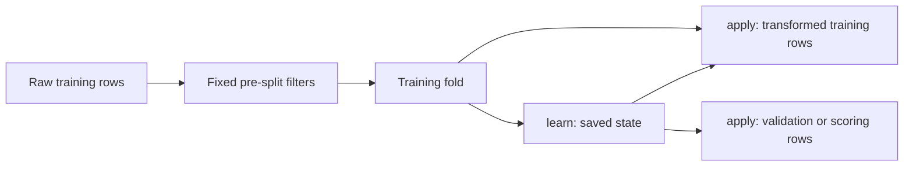

# Write custom preprocessing steps

## When you need it

Use a custom factory when the [built-in preprocessing catalog](preprocessing_recipes.md)
does not express your calculation. This page covers fixed and learned column
transformations in `config/preprocessing.yml`. Fixed row filters that run before
the split have their own page: [write your own pre-split filter](databricks_custom_pre_split.md).

Shipped factories live in `src/features/preprocessing.py` and are selected as
`preprocessing.<factory>`, for example `preprocessing.frequency_encoding`. Add your
own factory to that file, or keep a larger group in its own module under
`src/features/` and select it as `<file>.<factory>`. For example, factory
`clip_outliers` in `src/features/income_rules.py` is `income_rules.clip_outliers`.
Paths are relative to `src/features`; `preprocessing`, `pre_split`, `scoring` and
`groups` are the generated modules.



A `column_step` applies a fixed function without learning state. A
`fitted_step` learns separately inside each fold and reuses that state during
apply. A `filter_step` supplies the fixed mask before splitting; see
[pre-split filters](databricks_custom_pre_split.md).


## What to edit

### Custom preprocessing recipes

Select per-step columns when mixing numeric and categorical features. Generated
projects contain custom Python examples in `src/features/`. The YAML files own
the ordered recipe lists; Python owns only the selected functions/factories:

| File | Owns |
| --- | --- |
| `config/pre_split.yml` | Fixed eligibility recipes |
| `config/preprocessing.yml` | Learned preprocessing recipes |
| `src/features/preprocessing.py` | Shipped transformation factories, selected as `preprocessing.<factory>` |
| `src/features/pre_split.py` | Shipped filter factories, selected as `pre_split.<factory>` |
| `src/features/<file>.py` | Your own module of factories, selected as `<file>.<factory>` |

For example, select the shipped frequency encoder in `config/preprocessing.yml`:

```yaml
version: 1
recipes:
  default:
    - custom: preprocessing.frequency_encoding
      params: {columns: [category]}
```

Select `preprocessing_recipe: default` for the model. To add a built-in node, add
its `name`, `transformer` and `params` entry to that same ordered list. Customize
the Python factory when the calculation itself must change. The generated
`PREPROCESSING.md` explains factory names, assets and advanced class examples.

Frequency encoding learns `count / training_rows` per observed string category.
For training values `["A", "A", "B", null]`, scoring `["A", "B", "NEW", null]`
produces `[0.5, 0.25, 0.0, 0.0]`. It replaces selected columns in place, preserving
other columns and row order. Each CV fold learns its own mapping; saved-model
inference never recomputes frequencies on the score batch. Missing/unseen values
map to zero. Cast numeric category identifiers to strings upstream if needed.
Select these columns in workflow `input_columns`, excluding target/record keys.

```bash
python src/tools/preview.py --action train
```

See the [local tools reference](databricks_project_setup.md#local-tools-and-preview)
or the generated `src/tools/README.md` for preview flags, defaults and scope.

### Writing your own step

The function helpers build ordinary Core steps: `column_step` produces
`ColumnFunction`, `fitted_step` produces `FittedFunction`, and `filter_step`
produces `RowFilterFunction`. The YAML factory receives keyword parameters and
returns one step dictionary; Skyulf invokes the callbacks later with the rows.

For scikit-learn users: **learn is fit, apply is transform, and the saved state
dictionary contains the fitted attributes**. Keep these public helper names;
the descriptive callback names below explain the calculation without changing
the API used by existing projects.

#### Function signatures and execution

These are the helper signatures. Optional `inference_context` declares row,
group, window or global dependence for diagnostics. Alone it does not grant
Spark or REST serving admission: training lints and probes your steps first, and
`"row"` is optional there while `group`, `window` and `global` stay rejected. See
[Admit your own row steps](databricks_spark_scoring.md#admit-your-own-row-steps-opt-in)
and, when a step is rejected,
[When the probe fails](databricks_spark_scoring.md#when-the-probe-fails).

```text
column_step(name, function, *, output, replace=False, params=None, inference_context=None)
fitted_step(name, learn, apply, *, output, replace=False, params=None, inference_context=None)
filter_step(name, function, *, columns, params=None, inference_context=None)
```

| Helper | Callback signatures you write | Required return | When Skyulf calls it |
| --- | --- | --- | --- |
| `column_step` | `function(df)`; with nonempty params, `function(df, params)` | Series, DataFrame, NumPy array or list, with one value per input row per output column | Transform training rows in each CV fold/final fit, validation rows and scoring rows; no statistics are learned |
| `fitted_step` learning | `learn(df, y)`; with nonempty params, `learn(df, y, params)` | A JSON-compatible dict with string keys, no NaN or infinity | Each CV training fold and final training fit; never refit on validation or scoring rows |
| `fitted_step` applying | `apply(df, state)`; with nonempty params, `apply(df, state, params)` | The same column-return contract as `column_step` | Transform training/validation/scoring rows with that fit's saved state |
| `filter_step` | `function(df)`; with nonempty params, `function(df, params)` | A pandas Boolean Series with exactly one non-null True/False per row, aligned to `df.index` | Generated pre-split eligibility before train/holdout splitting; optionally reused by the saved scoring policy before prediction |

`df` is a private pandas DataFrame copy even for a Polars pipeline. Column/fitted
callbacks do not see the target column in `df`; `y` is a private training target
passed to `learn` (or `None` if no target is supplied). `state` is exactly the
learned dictionary restored from the artifact. `params` is the helper's saved
user-configuration dictionary, passed as the **last positional argument only
when nonempty**. With `params=None` or `{}`, omit that argument in your callback
signature or give it a default. YAML `params` first configures the factory; the
factory explicitly passes its callback parameters into the helper.

For column outputs, preserve row count/order and any pandas index; return as
many columns as `output` declares. A Series names one output; a DataFrame/array
supplies outputs in the declared order. `output` supplies the final column names.
Use `replace=True` only when replacing existing columns; a callback must not
replace the target. Filter callbacks instead may read declared target columns
when explicitly configured, but remain fixed row-local rules with no learning:
see [target-reading filters](databricks_custom_pre_split.md#filters-that-read-the-target)
for the saved scoring skip choice. Filters preserve every retained value and row order.

#### One output: the shipped log feature

This is the generated `src/features/preprocessing.py` example. It adds a column
and leaves `income` unchanged. Its callback has nothing to learn.

<!-- example:custom-log-code -->
```python
import numpy as np

from skyulf.preprocessing import column_step


def log1p_value(df, params):
    """Return log(1 + value); negative values count as 0."""
    return np.log1p(df[params["column"]].clip(lower=0))


def log_feature(column):
    """Add log_<column> next to the original column."""
    return column_step(
        f"log_{column}", log1p_value, output=f"log_{column}", params={"column": column}
    )
```

<!-- example:custom-log-recipe -->
```yaml
version: 1
recipes:
  default: []
  with_log:
    - custom: preprocessing.log_feature
      params: {column: income}
```

Select `preprocessing_recipe: with_log` and include `income` in `input_columns`.
For income `[-2, 0, 3, null]`, `log_income` is `[0, 0, 1.3862943611, NaN]`:
negative values are clipped to zero and missing values stay missing. A model
that cannot accept missing values needs a later imputation step in its recipe.

#### Two outputs: a custom budget calculation

Create `src/features/budget.py`. This example
adds a net amount and an expense ratio. Zero or missing income makes the ratio
missing; this example does not invent a denominator or fill that value.

<!-- example:custom-budget-code -->
```python
import pandas as pd

from skyulf.preprocessing import column_step


def budget_values(df, params):
    """Return net income and expense share in the original row order."""
    income = df[params["income"]]
    expenses = df[params["expenses"]]
    denominator = income.where(income.ne(0))
    return pd.DataFrame(
        {"net_income": income - expenses, "expense_share": expenses / denominator}
    )


def budget_columns(income="income", expenses="expenses"):
    """Add two fixed calculations without learning population statistics."""
    return column_step(
        "budget_columns",
        budget_values,
        output=["net_income", "expense_share"],
        params={"income": income, "expenses": expenses},
    )
```

<!-- example:custom-budget-recipe -->
```yaml
version: 1
recipes:
  default: []
  with_budget:
    - custom: budget.budget_columns
      params: {income: income, expenses: expenses}
```

Select `preprocessing_recipe: with_budget` and input columns `income, expenses`.
Rows `(income, expenses)` of `(100, 25)`, `(80, 40)`, `(0, 10)` and `(null, 5)`
produce `(net_income, expense_share)` of `(75, 0.25)`, `(40, 0.5)`, `(-10, NaN)`
and `(NaN, NaN)`. The two original columns and row order remain unchanged. Add
appropriate missing-value handling before an estimator that requires finite inputs.

#### Learned mapping: the shipped frequency encoder

These are the actual generated `preprocessing.py` callbacks and factory. The
factory connects learning and applying; its `columns` list is saved as callback
params. You normally select the existing factory instead of copying it elsewhere.

<!-- example:custom-frequency-code -->
```python
import pandas as pd

from skyulf.preprocessing import fitted_step


def learn_frequencies(df, y, params):
    """Learn: share of training rows per category (null is not a category)."""
    if len(df) == 0:
        raise ValueError("Frequency encoding requires nonempty training rows.")
    return {column: (df[column].value_counts() / len(df)).to_dict() for column in params["columns"]}


def apply_frequencies(df, state, params):
    """Apply: look up the saved share; unseen or null categories get 0."""
    return pd.DataFrame(
        {
            column: df[column].map(state[column]).astype(float).fillna(0.0)
            for column in params["columns"]
        }
    )


def frequency_encoding(columns):
    """Replace string category columns with their training frequency."""
    if not isinstance(columns, (list, tuple)) or not columns:
        raise ValueError("Frequency columns must be a nonempty list of column names.")
    if any(not isinstance(column, str) or not column for column in columns):
        raise ValueError("Frequency columns must be nonempty column names.")
    if len(set(columns)) != len(columns):
        raise ValueError("Frequency columns must be unique.")
    columns = list(columns)
    return fitted_step(
        "frequency_encoding",
        learn_frequencies,
        apply_frequencies,
        output=columns,
        replace=True,
        params={"columns": columns},
    )
```

<!-- example:custom-frequency-recipe -->
```yaml
version: 1
recipes:
  default: []
  with_frequency:
    - custom: preprocessing.frequency_encoding
      params: {columns: [category]}
```

Select `preprocessing_recipe: with_frequency` with `category` as a raw input.
Training on `['A', 'A', 'B', null]` learns
`{'category': {'A': 0.5, 'B': 0.25}}`. The denominator includes all four training
rows, while null is not a category. Applying to `['A', 'B', 'NEW', null]` returns
`[0.5, 0.25, 0.0, 0.0]`. Repeated or differently sized score batches reuse those
same fractions. Saved-model loading restores the mapping and Python source;
it does not count the incoming categories again. Use string category values so
the learned dictionary has valid string keys.

#### Learned category groups: learn and apply without numeric encoding

The generated `rare_categories` example separates the same two phases but keeps
text. It is useful before a numeric encoder when rare and unseen categories
should share a deliberate fallback value.

<!-- example:custom-rare-code -->
```python
from skyulf.preprocessing import fitted_step


def learn_common_categories(df, y, params):
    """Learn: categories that cover at least min_share of the training rows."""
    shares = df[params["column"]].value_counts() / len(df)
    common = shares[shares >= params["min_share"]].index
    return {"keep": sorted(str(category) for category in common)}


def apply_common_categories(df, state, params):
    """Apply: keep learned categories and nulls; everything else becomes `other`."""
    values = df[params["column"]].astype(object)  # object: "Other" is allowed as a value
    keep = values.isna() | values.astype(str).isin(state["keep"])
    return values.where(keep, params["other"])


def rare_categories(column, min_share=0.05, other="Other"):
    """Replace categories seen in less than min_share of training rows with `other`."""
    if not 0 < min_share < 1:
        raise ValueError("min_share must be between 0 and 1, e.g. 0.05 for 5%.")
    params = {"column": column, "min_share": min_share, "other": other}
    return fitted_step(
        f"rare_{column}",
        learn_common_categories,
        apply_common_categories,
        output=column,
        replace=True,
        params=params,
    )
```

<!-- example:custom-rare-recipe -->
```yaml
version: 1
recipes:
  default: []
  grouped_categories:
    - custom: preprocessing.rare_categories
      params: {column: city, min_share: 0.3, other: Other}
    - custom: preprocessing.frequency_encoding
      params: {columns: [city]}
```

Select `preprocessing_recipe: grouped_categories` and include `city` in the
raw inputs. With training cities `['London', 'London', 'London', 'Paris', 'Oslo']`,
`learn_common_categories` saves `{'keep': ['London']}` at `min_share: 0.3`.
Applying the rare-category step to `['London', 'Paris', 'Tokyo', null]` gives
`['London', 'Other', 'Other', null]`; null stays null and the unseen city uses
`Other`. In the complete recipe, the following frequency step learns from the
**transformed training rows**, so the final four values are `[0.6, 0.4, 0.4, 0.0]`.
This demonstrates ordered steps; neither mapping is relearned during scoring.

For fixed row eligibility, the
[pre-split filter page](databricks_custom_pre_split.md)
shows the third helper. The shipped alternatives are `pre_split.value_range`,
`pre_split.allowed_values` and `pre_split.minimum_completeness`: select the factory
with `custom:` in `config/pre_split.yml`, not the callback that takes `df`.

#### Learning from the target: a small category-mean example

Create `src/features/target_mean.py`. This educational example uses the
training `y` to learn a mean per string category. Its apply function receives no
target; missing or unseen categories use the saved global training mean.

<!-- example:custom-target-mean-code -->
```python
import pandas as pd

from skyulf.preprocessing import fitted_step


def learn_target_means(df, y, params):
    """Learn category means and a fallback from this training fold's targets."""
    if y is None:
        raise ValueError("Target-mean encoding requires training targets.")
    labels = pd.Series(y, index=df.index, dtype=float)
    means = labels.groupby(df[params["column"]]).mean().to_dict()
    return {"means": means, "fallback": float(labels.mean())}


def apply_target_means(df, state, params):
    """Use saved means without reading or requiring scoring targets."""
    return df[params["column"]].map(state["means"]).fillna(state["fallback"])


def target_mean(column):
    """Replace a string category with its learned target mean."""
    return fitted_step(
        f"target_mean_{column}",
        learn_target_means,
        apply_target_means,
        output=column,
        replace=True,
        params={"column": column},
    )
```

<!-- example:custom-target-mean-recipe -->
```yaml
version: 1
recipes:
  default: []
  with_target_mean:
    - custom: target_mean.target_mean
      params: {column: category}
```

Select `preprocessing_recipe: with_target_mean` with input `category` and your
normal target column. For categories `['A', 'A', 'B', 'B']` with targets
`[0, 1, 2, 3]`, the state is
`{'means': {'A': 0.5, 'B': 2.5}, 'fallback': 1.5}`. Applying to
`['A', 'B', 'NEW', null]` without `y` returns `[0.5, 2.5, 1.5, 1.5]`.

Cross-validation learns from each fold's training rows, so that mapping does
not read validation targets. This does **not** make a naive target encoder
universally leakage-safe: transforming its own training rows with their fitted
category mean can overfit, especially for singleton categories. This tiny helper
has no internal out-of-fold encoding, smoothing or time-aware exclusion. Use
an appropriately validated [target-encoding recipe](preprocessing_recipes.md)
and splitting policy for real target-dependent feature engineering. Never build
this mapping on the entire dataset before splitting.

#### Clipping with learned bounds

The next example creates a new fitted factory rather than selecting a shipped one.

<!-- example:custom-clipping-code -->
```python
# src/features/income_rules.py
from skyulf.preprocessing import fitted_step


def learn_bounds(df, y, params):
    """Learn clip limits from the training fold only."""
    values = df[params["column"]]
    return {"low": float(values.quantile(0.01)), "high": float(values.quantile(0.99))}


def clip_values(df, state, params):
    """Clip every later batch with the saved training limits."""
    return df[params["column"]].clip(state["low"], state["high"])


def clip_outliers(column):
    """Replace column with its value clipped to training 1%-99% quantiles."""
    params = {"column": column}
    return fitted_step(f"clip_{column}", learn_bounds, clip_values,
                       output=column, replace=True, params=params)
```

Select that factory in `config/preprocessing.yml`:

<!-- example:custom-clipping-recipe -->
```yaml
version: 1
recipes:
  default: []
  custom_clip:
    - custom: income_rules.clip_outliers
      params: {column: income}
```

The dotted path starts at `src/features/`: `income_rules` means
`src/features/income_rules.py`, and `clip_outliers` is the top-level factory in
that file. The loader calls `clip_outliers(column="income")`; it does not pass rows
to the factory. A module in a subfolder also needs that folder's `__init__.py`.

Set `preprocessing_recipe: custom_clip` under `defaults` or the selected model in
`config/training.yml`, and include `income` in `input_columns`. The empty `default`
recipe does not activate `custom_clip`; neither does merely creating the Python
file. After saving both files, run these commands from the generated project:

```powershell
python src/tools/smoke.py
python src/tools/preview.py --action train
python src/tools/preview.py --action score
```

Smoke checks syntax and declarations without executing the factory. Training
preview resolves the selected `clip_income` step; score preview checks the
configured scoring workflow. Neither command fits quantiles or predicts rows.
For training incomes `[10, 20, 30, 40]`, the fitted bounds are `10.3` and `39.7`;
later incomes `[-1000, 1000]` clip to those saved bounds.

`learn` runs on the training rows of every CV fold and of the final fit; its
dict is saved with the model and `apply` reuses it for validation and scoring
rows; validation/scoring rows do not fit those quantiles. `y` is the training
target; the target column is
removed from `df` in both functions, so `apply` can never depend on it. Rules:

- Use top-level `def` functions, not lambdas or nested functions.
- `df` is a pandas copy, also for Polars models; changing it has no effect.
- Return one value per row in the same order. Filters return True/False per
  row; decide missing values explicitly, e.g. `(df["x"] > 0).fillna(False)`.
- Learned dicts must be JSON-like: string keys and no NaN. NumPy numbers are
  converted automatically.
- Nonempty `params={...}` is passed to every function as its last argument;
  empty params are omitted from the callback call.
- Use `replace=True` to overwrite existing columns; otherwise outputs must be new.

Errors name the failing function, e.g. `Project function ...:learn_bounds failed:
KeyError: 'income'`.

Most former Calculator/Applier pairs fit in these helpers. The advanced
`custom_step` factory [below](#advanced-a-calculatorapplier-class-pair) instead
connects `Calculator.fit(X, y, config)` to `Applier.apply(X, y, state)`. Choose
that class pair only when the learned state is not a small dict
(for example a fitted scikit-learn object), the step changes the number of rows
during preprocessing, or it needs native Polars/Spark code for performance.
These helper steps are project code only: the web canvas and backend API reject
them, because a graph must never name an arbitrary server function.

#### Advanced: a Calculator/Applier class pair

This is the shipped `preprocessing.rare_categories` step written as a class pair.
The class version receives pandas **or** Polars (`X.to_native()`), rebuilds the whole
table itself and can keep native Polars code. Prefer `fitted_step` unless you need
that, a learned state that is not a small dict, or a step that removes columns or rows.

<!-- example:custom-class-code -->
```python
# src/features/rare_class_step.py
import polars as pl

from skyulf.inference.project_code import custom_step
from skyulf.preprocessing.base import BaseApplier, BaseCalculator, apply_method, fit_method


class RareCategoryCalculator(BaseCalculator):
    """fit(): runs on the training rows of every CV fold and returns what it learned."""

    @fit_method
    def fit(self, X, y, config):
        """Learn the categories covering at least min_share of the training rows."""
        native = X.to_native() if hasattr(X, "to_native") else X
        values = native[config["column"]]
        values = values.to_pandas() if isinstance(values, pl.Series) else values
        shares = values.value_counts() / len(values)
        common = shares[shares >= config["min_share"]].index
        return {
            "column": config["column"],
            "other": config["other"],
            "keep": sorted(str(category) for category in common),
        }


class RareCategoryApplier(BaseApplier):
    """apply(): runs on train, test and scoring rows using only the saved fit() result."""

    @apply_method
    def apply(self, X, y, state):
        """Replace categories not in the saved list with `other`; nulls stay null."""
        native = X.to_native() if hasattr(X, "to_native") else X
        if isinstance(native, pl.DataFrame):
            return _apply_polars(native, state)
        return _apply_pandas(native, state)


def _apply_polars(frame, state):
    """Native Polars expression: no conversion to pandas."""
    column = pl.col(state["column"])
    keep = column.is_null() | column.cast(pl.Utf8).is_in(state["keep"])
    replaced = pl.when(keep).then(column.cast(pl.Utf8)).otherwise(pl.lit(state["other"]))
    return frame.with_columns(replaced.alias(state["column"]))


def _apply_pandas(frame, state):
    """Pandas version; returns a copy so the caller's table is never changed."""
    values = frame[state["column"]].astype(object)
    keep = values.isna() | values.astype(str).isin(state["keep"])
    result = frame.copy()
    result[state["column"]] = values.where(keep, state["other"])
    return result


def class_rare_categories(column, min_share=0.05, other="Other"):
    """Build the step: replace rare categories in column with `other`."""
    if not 0 < min_share < 1:
        raise ValueError("min_share must be between 0 and 1, e.g. 0.05 for 5%.")
    return custom_step(
        f"class_rare_{column}",
        RareCategoryCalculator,
        RareCategoryApplier,
        params={"column": column, "min_share": min_share, "other": other},
    )
```

Select it in `config/preprocessing.yml`:

```yaml
version: 1
recipes:
  default: []
  rare_city_class:
    - custom: rare_class_step.class_rare_categories
      params: {column: city, min_share: 0.05}
```

Training saves the exact Python source with the fitted artifact. Both local
and MLflow loading restore this saved source, including custom classes. Changing
the project file affects future training; score, approve and rollback continue
using saved model code/state. Different source versions use distinct package
identities. All Python files under `src/features/` are captured in a bounded
64 KiB snapshot, excluding root `groups/` producers. Use relative imports and an
`__init__.py` in every subpackage. Declared assets can be captured as described
below; third-party dependencies must be installed explicitly in both training
and scoring environments. Keep job entrypoints outside the feature package.
Only load trusted code/models, as with existing pickle artifacts. Historical
feature context and post-prediction business rules have their own configuration.

<span id="write-your-own-pre-split-filter"></span>
### Pre-split filters

Fixed row filters built with `filter_step` have their own page:
[write your own pre-split filter](databricks_custom_pre_split.md).

### Does `custom:` work for every custom function?

It is a general selector, not a special case for `log_feature`. The example calls
`src/features/preprocessing.py` -> `log_feature(column="income")` to **build one
step**. That factory returns `column_step(...)`; Skyulf later calls its calculation
function with the actual rows. YAML does not pass a DataFrame into the factory.

| Custom work | Factory returns | Selected from |
| --- | --- | --- |
| Fixed formula producing one or more columns | `column_step(...)` | `preprocessing.yml` |
| Transformation learning state from training rows | `fitted_step(...)` | `preprocessing.yml` |
| Fixed row eligibility mask | `filter_step(...)` | `pre_split.yml` |
| Advanced Calculator/Applier pair | `custom_step(...)` | Its supported phase; see [a class pair](#advanced-a-calculatorapplier-class-pair) |
| Spark aggregation producing a feature table | Spark DataFrame | `features.yml` -> `groups`, using `file.py:function` |

The factory must be a top-level function defined in the referenced captured
project module, accept the YAML `params` as keyword arguments, and return **one
valid Core step dictionary**. Select multiple factories as separate YAML entries.
A raw `def transform(df)` returning a DataFrame, a sklearn transformer instance,
a list of steps or a lambda is not a valid `custom:` factory. Wrap the calculation
using the matching helper; do not rewrite its business logic inside the loader.

Calculation functions used by the helpers must also be saved top-level functions.
`column_step`/`fitted_step` preserve rows and return one value per row per declared
output; their callbacks receive pandas frames. A fitted step separates learning
from applying a saved, JSON-compatible state dictionary. `filter_step` returns
one non-null Boolean per input row, uses fixed row-local rules and changes no
values. Pre-split is not a place to fit a scaler or learn population statistics.
Declare external dependencies in the project's deployment requirements and
package declared assets; YAML does not install packages or capture live services.

These custom examples work in the local pipeline. Spark batch and REST serving
require a supported fitted pipeline; an arbitrary custom function is not
automatically admitted for those runtimes. Check the scope in
[feature tables](databricks_features.md) and [serving](databricks_serving.md).

Keep named recipes under `recipes` in each phase YAML file and select one
per model using `preprocessing_recipe`. Competition can select different
preprocessing recipes per candidate while sharing pre-split eligibility.
Independent-target projects can select preprocessing and pre-split recipes per
model. Both YAML files require `version: 1` and a `default` recipe; `none` means
no steps. Recipes prefixed `example_` remain inactive until selected. Do not add
Python `build_preprocessing` or `build_pre_split_steps` builders for a phase owned
by YAML. Existing Python-only projects continue to work without these YAML files.

Check the resolved project before training:

```powershell
python src/tools/smoke.py
python src/tools/preview.py --action train
python src/tools/preview.py --list-preprocessors
```

Smoke validates the declarations without calling custom factories; preview
resolves the selected recipes and executes trusted factories. Keep I/O out of
module imports and factories.

The saved model contains resolved steps, fitted state, captured YAML declarations
and project Python. Prediction does not re-read current recipe files or fit new
means.
Edits apply to newly trained model versions. Upstream Spark feature jobs are
separate: a model trained on a merged table still needs those input features;
it does not automatically execute the upstream joins from a raw table.

## The command

From the generated project directory, with its pinned dependencies installed:

```powershell
python src/tools/smoke.py
python src/tools/preview.py --action train
python src/tools/preview.py --action score
```

Smoke parses the package; preview resolves trusted factories. A real training run is needed to learn
and save state. Follow [training and reports](databricks_training_reports.md) for that step.

### Try the callbacks locally before training

Smoke and preview check declarations and resolve factories; they do not run
`learn` or `apply` on rows. After creating the clipping file above, run this
literal example from the generated project root with its pinned dependencies.
It uses the shipped frequency encoder and your `income_rules.py`
factory. `fit_transform` returns the transformed training frame and metrics;
`transform` returns only the transformed scoring frame.

<!-- example:custom-local-try -->
```python
import sys
from pathlib import Path

import pandas as pd

from skyulf.preprocessing import FeatureEngineer

sys.path.insert(0, str(Path("src/features").resolve()))
from preprocessing import frequency_encoding
from income_rules import clip_outliers

engineer = FeatureEngineer([frequency_encoding(["city"]), clip_outliers("income")])
training = pd.DataFrame(
    {"city": ["A", "A", "B", None], "income": [10.0, 20.0, 30.0, 40.0]}
)
transformed_train, _ = engineer.fit_transform(training)
scoring = pd.DataFrame(
    {"city": ["A", "NEW", None, "B"], "income": [-1000.0, 1000.0, 25.0, None]}
)
transformed_score = engineer.transform(scoring)
print(transformed_score)
```

Expected `city` values are `[0.5, 0.0, 0.0, 0.25]`; expected `income` values are
`[10.3, 39.7, 25.0, NaN]`. These are the training frequencies and saved quantile
bounds, not statistics recomputed from the scoring frame. This local exercise
runs real callbacks, but does not register a model, contact Databricks or certify
Spark/REST execution. The generated training workflow captures the project
source when it later trains and saves the actual model.

For a fixed lookup file or third-party package, follow
[captured source, assets and dependencies](#captured-source-assets-and-dependencies).
Use `inference_context="row"`, `"group"` or `"window"` only when it accurately
describes your callback's input dependence; the declaration is metadata, not a
worker or serving certificate. See [inference context](preprocessing_context.md)
for the separate admission boundary.

## What you should see

The examples above show expected outputs, saved learned state and clipping bounds. After reload,
predictions use the captured recipe and source, even if the editable project has changed.

### Captured source, assets and dependencies

Training freezes `src/features/`, excluding the root `groups/` directory, as a versioned 64 KiB
package snapshot. Spark producers in `groups/` execute separately in the feature job. Keep custom
model functions in their phase modules; do not import producers from model recipes. See
[feature tables](databricks_features.md) for the stage boundary. Declare bounded data files in
`src/features/assets.json` as `files: [...]` (the file itself uses JSON), and read them with
`read_project_asset` from `skyulf.inference.project_package`. Paths stay inside the package;
symlinks are rejected. Code, captured recipe declarations, assets and exact dependency pins share
the snapshot budget. Use `distribution==version` in `src/features/requirements.txt` and install
those versions in training/scoring environments; loading verifies them without installing.

YAML and Python edits apply to the next training load. Saved models retain resolved settings, recipe
declarations, fitted preprocessing and frozen source; scoring and lifecycle replay do not reread
editable YAML or Python. Changing rules/assets/pins requires a new model.

```powershell
python src/tools/smoke.py
python src/tools/preview.py --action train
```

## Common errors and fixes

| Symptom | Fix |
| --- | --- |
| A custom factory cannot be resolved | Use a path relative to `src/features/`, ending in the factory name; retain `__init__.py` in subpackages. |
| A target-reading filter prevents unlabeled scoring | See [pre-split filters](databricks_custom_pre_split.md#common-errors-and-fixes). |
| A helper changes row count or ordering | Return one value per input row, or a fixed filter mask. Use supported advanced contracts for other transformations. |
| Edits do not alter an existing model | Train a new version; saved source and fitted state are immutable inputs to scoring. |
| Reload rejects dependencies or the source package | Keep exact pins, package-local asset paths and the snapshot budget; installing packages is an explicit environment step. |

See [context and diagnostics](preprocessing_context.md) for group/window operations and
[feature tables](databricks_features.md) for Spark producers that run before the model pipeline.
