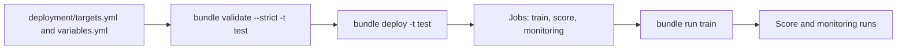

# Deploy a project with your CLI or CI pipeline

## When you need it

This project is a standard Databricks Bundle. Deploy it with your own CLI profile
or existing CI/CD service account. No GitHub workflow or company adapter is
required or generated. Authentication stays in the CLI/CI environment; do not
put tokens or passwords in these files.

This page covers project deployment, identities, access, compute and retry
settings. Use [endpoint setup](databricks_serving.md) to expose a registered
model, and [project upgrades](databricks_project_upgrade.md) to migrate an
existing generated layout.



Deploy only creates or updates job definitions and uploads files. Running a job
is a separate step.

## What to edit

### Files and environments

`databricks.yml` includes `deployment/variables.yml`, `deployment/targets.yml`
and the job files under `resources/`. Optional feature/online selections add
separate jobs to the three standard jobs. Keep the `train`, `score` and `monitoring` job keys:
changing them can recreate deployed jobs and lose their history.

| Target | Intended use | Output/model names | Workspace files |
| --- | --- | --- | --- |
| `test`, `syst`, `prod` | Shared deployment, usually through existing CI/CD | Shared names | Team-managed project directory |
| `test_development`, `syst_development`, `prod_development` | Optional personal work in the selected environment | `_<env>_dev_<user-id>` suffix | Personal directory per environment |

There is no separate `dev` target. With personal targets enabled,
`test_development` is the only default. Otherwise no target is default: select
`test`, `syst` or `prod` explicitly with `-t`. Shared targets use production mode,
including `test`:
the name `test` describes the environment, not a personal development deployment.
Different targets may use one workspace with different catalogs/schemas, or
different workspaces. Configure distinct shared destinations when environments
use the same workspace. The template does not create catalogs, schemas, users or
service principals.

The `personal_development_targets` answer controls whether the three additional
personal targets are generated. Detailed setup asks it; quick setup and an
answer file without it keep `false`. Read the generated
`deployment/README.md` for the project's selected value. Personal targets do not receive shared
service-principal identities or shared job ACL overrides. Their resolved suffix
uses the workspace user ID, not just an email prefix, so two users named `alice`
cannot share output/model names accidentally. Use each developer's own profile;
one shared service account represents one identity, not several developers.

Personal job names are `dev_<user>_train`, `dev_<user>_score` and
`dev_<user>_monitoring`, without a project or environment label. Shared
test/syst/prod jobs keep `<project>_train`, `<project>_score` and
`<project>_monitoring`, without a user prefix. Environment-specific roots and output
suffixes keep targets distinct when users choose to share one workspace.

Personal names isolate deployments; they do not replace Unity Catalog grants.
Reading production inputs still requires permission. Personal model/output
schemas must also allow that developer's writes. If the company disallows writes
in production schemas, set the environment's development output and metadata
schema variables to approved sandbox schemas while retaining the source schema.
Do not give personal accounts production model ownership to make a trial work.

### Deployment identity and run identity

The credentials executing `bundle deploy` are the deployment identity. Job
`run_as` controls execution. The `deployment_identity` answer selects the shared
job behavior. Detailed setup asks it; quick setup keeps `deployer`.

| Choice | Shared train/score/monitoring configuration |
| --- | --- |
| `deployer` | Emit no `run_as` override; preserve standard job ownership or externally managed identity |
| `shared_service_principal` | All three jobs use `shared_service_principal` |
| `separate_service_principals` | Train uses `train_service_principal`; score and monitoring use `score_service_principal` |

Monitoring reuses the scoring identity in separate mode. Arrange its monitoring
source reads and evidence-store writes explicitly; this does not require model
ownership. There is no additional monitoring principal to configure.

The optional `online_serving_setup`, `online_publication` and `daily_rollout`
jobs get no `run_as` override in any mode. They run as the deploying identity,
even with `shared_service_principal`. Add a job-level `run_as` under the target
in `targets.yml` if they must run as a service principal.

For explicit service principals, configure application IDs, not account display
names. A deployment service account may also be the shared run identity. Separate
deployment and execution accounts are supported, not required. Override the
identity variables under the corresponding target when each environment has its
own accounts. The deployer needs permission to use the selected run identity.
`deployer` is an omission of configuration, not a command to change an existing
job's owner or reset an existing run identity. Inspect existing jobs on migration.

For a user-based shared installation, edit that target's job-level `run_as` to
`user_name` instead of `service_principal_name`; do not specify both keys. Personal
targets already use their normal deployment identity without inheriting shared
overrides. Keep identities at job scope so later unrelated resource types do not
inherit execution settings they cannot support.

### Job access

Every target grants `CAN_MANAGE` to the deploying identity and to
`${var.pipeline_owner}`. Entries here apply to every job in that target,
including optional feature and online jobs. Shared `test`, `syst` and `prod`
targets also grant `CAN_VIEW` to a workspace group when detailed setup was given
one. Personal targets have their own list, with the two managers only:

```yaml
permissions:
  - level: CAN_MANAGE
    user_name: ${workspace.current_user.userName}
  - level: CAN_MANAGE
    user_name: ${var.pipeline_owner}
  - level: CAN_VIEW
    group_name: "YOUR_ENVIRONMENT_VIEWERS"
```

`pipeline_owner` is a variable in `deployment/variables.yml`. Its default is the
setup answer, or the deploying user when the answer was blank; listing the same
user twice is accepted. CI/CD can set it per deployment with
`--var pipeline_owner=<email>` or `BUNDLE_VAR_pipeline_owner`. Change a view
group by editing `group_name` in `deployment/targets.yml`; remove the entry to
grant none.
When CI deploys as a service principal, `current_user.userName` is its
application ID: change that entry's `user_name` key to `service_principal_name`.

Use the optional per-job lists below when the jobs need different access.
Avoid duplicating the same principal at target and job scope.

`manage_job_permissions` controls the explicit shared job ACL resources for
train, score and monitoring. Detailed setup asks it; quick setup keeps `false`.
When false, a new project omits explicit shared job ACL resources so your existing
deployment/platform setup can manage them. Changing an existing deployment from
managed to external ACLs requires an intentional state/permission handoff: removing
a previously managed permissions resource can reset existing nonadmin access.
Review the deployment plan before changing this choice. When true, configure the
`train_permissions`, `score_permissions` and `monitoring_permissions` lists in
`variables.yml` or per-target variable overrides.
The default lists are empty; they do not create operator access.

For example, a train ACL can contain:

```yaml
train_permissions:
  type: complex
  default:
    - group_name: YOUR_JOB_MANAGERS
      level: CAN_MANAGE
    - group_name: YOUR_LIFECYCLE_OPERATORS
      level: CAN_MANAGE_RUN
    - group_name: YOUR_JOB_VIEWERS
      level: CAN_VIEW
```

Use existing groups. Keep broad management privileges limited to trusted job/code
maintainers. `CAN_MANAGE_RUN` applies to the whole train job, including its
supported train/approve/reject/rollback parameters; it is not an approve-only role.
Job access does not grant data or model access to the caller.

Job-to-job calls run under the caller's execution identity. Arrange
`CAN_MANAGE_RUN` on each called job where the workflow requires it, through the
corresponding permissions list or existing external governance:

| Calling Run as identity | Called job / ACL list | When required |
| --- | --- | --- |
| Train | Score / `score_permissions` | Automatic score handoff |
| Score, or another authorized producer | Monitoring / `monitoring_permissions` | Submitting independent monitoring requests |
| Monitoring (the score principal in separate mode) | Train / `train_permissions` | Opting into `on_drift=retrain` |

Each child retains its configured `run_as`; invocation does not transfer the
caller's data/model privileges. No cross-job grants are added automatically.
Granting monitoring access to run train permits the whole train lifecycle,
including approve/reject/rollback parameters. Keep `on_drift=disabled` unless
that authority is acceptable; the setting alone is not a permission boundary.
See [Databricks job privileges](https://docs.databricks.com/aws/en/jobs/privileges).

### Data, model and experiment access

Configure Unity Catalog and workspace access with your existing governance
process. The Bundle does not silently create UC objects, transfer ownership or
grant privileges on existing resources.

| Execution identity | Required access to arrange |
| --- | --- |
| Train/lifecycle | Read training inputs; create/register model versions in the model schema; own the models whose aliases it changes; write the project's MLflow experiment |
| Score | Read scoring inputs; execute/read the pinned registered models and their artifacts; create/write prediction tables, generations and views in the designated output schema |
| Monitoring | Read configured source, prediction and label tables; read/write the central monitoring store and references; write monitoring reports to the configured experiment; use serverless compute |
| All three | Use the required catalogs/schemas and read deployed code/wheel assets; train/score also need their selected serverless compute or approved cluster policy |

Grant experiment access explicitly through your workspace governance, or manage
an experiment resource at exactly `${workspace.root_path}/experiment` in a
separate approved Bundle resource file. An experiment's workspace permissions
and a UC model's privileges are different controls. Keep model/schema creation
and grants optional and explicit; do not take over existing objects on deploy.

For enforced writer separation, the score/monitoring identity must not own the registered models or
inherit model ownership through a group. Broader inherited permissions can defeat
the intended separation even with different service principal IDs. A single
account can run the project, but it cannot prove that scoring is forbidden from
changing aliases. Keep the existing one-run train/score queues and ensure another
job or operator is not independently writing the same aliases/output namespace.

### Runtime packaging

`deployment/requirements.txt` records the generated `skyulf-core[mlflow]` release
pin (for example, `==0.9.3`) from the package index.
Change that one version to a published release to upgrade Core, then redeploy.
Serverless environments and policy-cluster task libraries load the same shared
requirements; monitoring and optional online jobs inherit the same Core pin.
Ensure each job can reach the package index.

Use the Core release that matches the template you generated from. A project
generated from an unreleased source checkout needs a Core build of that same
checkout on every job and locally; a different published release can lack the
APIs and YAML support that smoke, preview, training and scoring use. Package
installation alone does not establish runtime compatibility. Install
`deployment/train-requirements.txt` locally for smoke and preview tools.
Saved models retain exact producer runtime checks and certified worker source
snapshots; validate compatibility or retrain before upgrading production.

`deployment/requirements.txt` is shared by all jobs and includes exact project
pins from `src/features/requirements.txt`. It also includes the packages of the
models and ensembles selected at generation. Optuna and `optuna-integration` are
pinned only when the `optuna` search strategy was chosen. Update those pins
when changing model, ensemble or search declarations in `config/training.yml`.
`deployment/train-requirements.txt` adds training-only report packages. These
direct pins do not fully lock transitive dependencies.

Override `job_tags` through target variables. For train and score, configure
`serverless_environment_version` and `serverless_budget_policy_id`, or
policy-cluster `spark_version`, `node_type_id`, `min_workers` and `max_workers`.

Monitoring always uses an independent serverless environment, including when
train/score use policy clusters. Configure `monitoring_environment_version`
(default `4`) and `monitoring_budget_policy_id` (default blank) separately.
Train/score runtime and budget overrides do not affect monitoring. A blank budget
policy uses workspace defaults. Set the monitor's approved policy even when the
model jobs use a classic cluster policy. Validate runtime/package compatibility,
serverless availability and policy access in the intended workspace before use;
local Bundle validation only verifies the generated settings.

Training/scoring schedules and source-window rules are independent. See
[training source windows](databricks_training_data.md) for snapshot selection,
calendar windows, availability cutoffs and their relationship to CV/sampling.
Shared scheduled targets can run after deployment; personal targets start paused.
Test the target's identities and permissions before enabling schedules.

`retraining_mode` and `scoring_mode` are asked only in detailed setup. Quick
setup keeps both `manual`, so the train and score jobs have no schedule.

| Schedule | Variables in `deployment/variables.yml` |
| --- | --- |
| Training, when `retraining_mode: scheduled` was answered | `retraining_cron_expression`, `retraining_timezone_id`, `retraining_pause_status` |
| Scoring, when `scoring_mode: scheduled` was answered | `scoring_cron_expression`, `scoring_timezone_id`, `scoring_pause_status` |
| Monitoring | `monitoring_cron` (UTC; default `0 0 * * * ?`) and `monitoring_pause_status` (default `PAUSED`) |

Training and scoring use Quartz cron expressions and IANA timezones. Their pause
values are `PAUSED` or `UNPAUSED`; manual runs remain separate. Personal target
overrides explicitly pause generated clocks. Set each target's values deliberately
and redeploy when changing a schedule.

### Job resource files

Training/lifecycle tasks live in `resources/train.job.yml`; batch scoring lives
in `resources/score.job.yml`. The root `databricks.yml` includes them through
`resources/*.yml`. Each job has its own schedule and compute settings. Training
calls scoring through `${resources.jobs.score.id}` when handoff is enabled.
`resources/monitoring.job.yml` holds the monitoring job. Optional selections add
`online_serving_setup.job.yml`, `online_publication.job.yml` and
`daily_rollout.job.yml`; local tools can add `features.job.yml` and dashboard
overlays.

### Inference runtime

Training uses the selected pandas or Polars engine and remains bounded by
`max_rows` and `max_input_mb` in `config/training.yml`, including when scoring
uses Spark; see [local input
limits](databricks_training_data.md#local-input-limits). Monitoring uses its
independent Spark/serverless path in every layout.

| Generated choice | Score execution | Environment manager |
| --- | --- | --- |
| `batch_compute: single_node` | Local pandas/Polars under row and byte bounds | Project task environment |
| `batch_compute: spark`, serverless | `mlflow.pyfunc.spark_udf` | `local`, using the declared environment |
| `batch_compute: spark`, policy cluster | `mlflow.pyfunc.spark_udf` | `virtualenv`, installing the recorded wheel and pins |

The Spark default prediction batch size is 10000. A manager failure stops
scoring without silently changing managers. For certificates, admitted fitted
recipes, model-set composition and result receipts, read
[distributed scoring](databricks_scoring.md) and
[feature-table inference boundaries](databricks_features.md).

## The command

### Install locally and check the source

Run from the generated project root, before the validate/deploy commands below:

```powershell
uv pip install -r deployment/train-requirements.txt
```

Source tables must already exist. Enable Delta Change Data Feed on the scoring
source before new rows arrive; the default `initial_scoring: full_snapshot`
processes existing rows. Choose `from_now` before the first score to establish
a zero-row checkpoint; see [scoring start](databricks_scoring.md#start-with-new-records-only).
Record keys must be unique, nonnull STRING/BIGINT columns. See
[scoring](databricks_scoring.md) for publication, receipts and recovery.

### Configure once, then validate

Setup does not ask for the model and data catalog/schema names. It generates
editable bindings for test/syst/prod in `variables.yml` with `REPLACE_*`
placeholders. The separate monitoring store catalog and schema are asked in both
setup modes; see [monitoring store setup](databricks_monitoring_setup.md).
An initialization JSON file may still provide `catalog` and `schema` to prefill
shared test values. These settings reference existing UC objects; they do not
create them.

1. Set the same workspace `host` in each shared/personal environment pair in
   `targets.yml`. Host is a literal because the CLI
   needs it before resolving Bundle variables for authentication.
2. Set `<env>_catalog`, `<env>_input_schema`, `<env>_output_schema` and
   `<env>_metadata_schema` in `variables.yml`, or supply these scalar variables
   with `BUNDLE_VAR_<name>` / `--var` in your existing pipeline. Personal targets
   share the environment catalog, but have separate `<env>_development_input_schema`,
   `<env>_development_output_schema` and `<env>_development_metadata_schema` values.
   Point these at approved development schemas, or reuse the shared input schema
   if that matches your access policy.
3. Set `<env>_root_path` to a directory managed by your team. The proposed
   `/Workspace/Projects/<project>/<env>` path must have suitable access
   controls; its name does not create an ACL. Avoid a personal deployer's home
   and folders writable by unrelated users for a shared production deployment.
4. Configure the chosen identities and access described above. Review the published Core pin
   and optional dependencies in `requirements.txt` and `train-requirements.txt`.
   This generated project does not require a project wheel or a `dist/` build.

The shared `test` example is below. If personal targets were generated, choose
`test_development` for your personal namespace instead.

```sh
databricks bundle validate --strict -t test --profile YOUR_TEST_PROFILE
databricks bundle deploy -t test --profile YOUR_TEST_PROFILE
```

With personal targets enabled, a user already authorized for the production
workspace can deploy a personal trial there:

```sh
databricks bundle validate --strict -t prod_development --profile YOUR_PROD_DEV_PROFILE
databricks bundle deploy -t prod_development --profile YOUR_PROD_DEV_PROFILE
databricks bundle run -t prod_development --profile YOUR_PROD_DEV_PROFILE train
```

Scheduled train and score triggers, when enabled, and the monitoring trigger
start PAUSED for every personal target. Personal monitoring enrollment and
automatic retraining are disabled. Manual train/score runs still work.
The target explicitly overrides schedule
variables, because a pause preset alone cannot override an explicit job schedule.
Only enable a personal schedule intentionally in that target's variables.
Shared targets retain the initializer's schedule choices.

An external pipeline uses the same project and standard commands after its own
authentication step:

```sh
databricks bundle validate --strict -t prod
databricks bundle deploy -t prod
```

Deploy updates definitions; running any of the jobs is a separate pipeline decision.
Bundle variables are deployment-time settings. Use job parameters for individual
run inputs, not new deployment-variable values on a previously deployed job.

## What you should see

Deployment creates the train, score and monitoring jobs and uploads their code
and configuration. Optional feature/online jobs are separate choices. Training
and scoring clocks are independent; monitoring starts paused until its
[reference and store setup](databricks_monitoring_setup.md) is verified.
A deploy updates definitions; it does not run training or score automatically.

### Time limits, retries and notifications

Operational settings live in `variables.yml`; initialization asks no extra
questions. Override them under a target's `variables` when environments differ.

| Variable | Default | Meaning |
| --- | --- | --- |
| `train_timeout_seconds`, `score_timeout_seconds` | `0` | Whole-job limit; zero means unlimited |
| `train_task_timeout_seconds`, `score_task_timeout_seconds` | `0` | Notebook-task limit; zero means unlimited |
| `score_max_retries` | `0` | Optional finite score retries after failure |
| `score_min_retry_interval_millis` | `60000` | Minimum interval between score attempts |
| `train_health_rules`, `score_health_rules` | `[]` | Optional duration-warning rules |
| `train_email_notifications`, `score_email_notifications` | `{}` | Optional event-to-email mappings |
| `train_webhook_notifications`, `score_webhook_notifications` | `{}` | Optional event-to-notification-destination mappings |
| `monitoring_timeout_seconds` | `7200` | Whole monitoring job limit; optional online and rollout jobs reuse it |
| `monitoring_task_timeout_seconds` | `3600` | Monitoring task limit; optional online and rollout tasks reuse it |
| `monitoring_max_retries` | `1` | Retries for each monitoring task, 60 seconds apart |

Choose limits from measured project runs. A duration warning does not stop the
job; a timeout does. The task limit also applies to generated model/SHAP tasks
after `refresh_training_graph.py`. The train job includes its automatic score
handoff, so leave time for that child run when configuring its whole-job limit.

For example, add these values under `targets.test.variables` in `targets.yml`:

```yaml
train_timeout_seconds: 14400
train_task_timeout_seconds: 7200
score_timeout_seconds: 3600
score_task_timeout_seconds: 3000
score_max_retries: 2
score_min_retry_interval_millis: 60000
train_health_rules:
  - metric: RUN_DURATION_SECONDS
    op: GREATER_THAN
    value: 10800
train_email_notifications:
  on_failure: ["YOUR_ONCALL_EMAIL"]
  on_duration_warning_threshold_exceeded: ["YOUR_ONCALL_EMAIL"]
score_email_notifications:
  on_failure: ["YOUR_ONCALL_EMAIL"]
score_webhook_notifications:
  on_failure:
    - id: "YOUR_EXISTING_NOTIFICATION_DESTINATION_ID"
```

Webhook values are existing workspace destination IDs, not URLs or secrets.
No destination is created and no recipient is added by default. Configure
duration events alongside a health rule. Job-level failure notifications report
the final failed job, rather than every failed retry attempt. See the official
[notification settings](https://docs.databricks.com/aws/en/jobs/notifications).
Global defaults apply to personal targets too; use target overrides to keep
personal trials separate from shared on-call recipients.

Lifecycle tasks and the automatic handoff always have zero retries. Existing
runtime guards also reject lifecycle repair/retry before mutations. Scoring
retries are opt-in, finite (never `-1`), and do not retry timeouts. Serverless
automatic optimization remains disabled so it cannot add hidden attempts. See
[Databricks task retry settings](https://docs.databricks.com/aws/en/jobs/configure-task).

Train and score notebook tasks default to `max_retries: 0`; their serverless
tasks also set `disable_auto_optimization: true`. The optional
`online_serving_setup`, `online_publication` and `daily_rollout` tasks always use
`max_retries: 0` with automatic optimization disabled. Monitoring tasks are the
exception: they retry once by default through `monitoring_max_retries`. A
retried monitoring attempt does not duplicate saved observations, because exact
retries deduplicate. A new training run can register another
candidate version. Inspect run evidence and registry state before rerunning;
these guards do not promise exactly-once training. See
[Databricks serverless retry behavior](https://docs.databricks.com/aws/en/jobs/run-serverless-jobs).

When `rescore_when_history_expires: true` was selected during initialization, the
same notebook timeout and retry settings also apply to `recover_predictions`
and `scoring_report`. These tasks use the existing score job's identity,
single-run queue, compute and notifications. The `recovery_needed` condition
does not run a notebook or retry scoring. Recovery consumes the score task's
pinned request; an exact already committed recovery is a no-op. The final report
joins the ordinary and recovery branches with `NONE_FAILED`, so failed recovery
does not publish a success report.

Enable score retries only while the job remains the sole output writer and the
configured model/source policies suit another attempt. An attempt re-evaluates
the configured model selector and current source watermark; it is not an exact
replay of the failed snapshot. Use a concrete `score_model_version` when recovery
must keep the same model. An uncertain write, foreign commit, source replacement
or incompatible schema requires inspecting the receipt/history and fixing the
cause; retries do not bypass those guards. Expired CDF also requires operator
action unless optional CDF recovery is enabled and the expiry is recognized.
A timeout cannot undo an
already committed write or alias change.

If training/promotion succeeded and only scoring failed, inspect the child run
and run **only the score job** after fixing the error. Use Run with different
settings on score to enter the concrete version recorded by the failed attempt,
or leave it blank to deliberately use the configured selector. Do not rerun train
or approve just to recover predictions. Single/competition versions identify the
selected model; multi-target versions identify the complete model set. An
unchanged successful replay produces no new prediction writes.

The score output shows the source table and end version, output table, selected
model/version, row counts, commit version and no-op status. Previous-write
provenance stays labeled separately on a no-op. Raw JSON remains available for
automation. These settings and summaries are covered locally; actual timeout,
retry scheduling and notification delivery require workspace verification.

## Common errors and fixes

### Existing deployments and verification limits

Moving a deployment root points the CLI at new Bundle state; do not deploy a
second writer by accident. To change roots or targets of a deployed project,
follow [project upgrades](databricks_project_upgrade.md). To remove a
deployment, see [teardown](databricks_teardown.md).

Local rendering and strict resolution tests verify configuration, distinct user
namespaces, paused personal schedules and identity/ACL wiring. They do not prove
real workspace grants, source access, job ownership, model alias denial or queue
behavior. Verify those with the intended accounts before treating writer
separation as enforced in production.

| Symptom | Fix |
| --- | --- |
| Unresolved `REPLACE_*` values or authentication failure | Set literal target hosts and environment catalog/schema variables; select the intended CLI profile |
| Missing input/output privileges | Test the actual `run_as` identity and UC grants, not only the deployer's access |
| A personal run writes to shared output | Inspect the resolved target and user-ID suffix; use an approved development schema |
| A deployment appears to create duplicate jobs | Preserve resource keys, bundle identity and workspace root; review the migration before deploying |
| Model/runtime admission or worker startup fails | Use the template's matching release and verify exact producer/worker compatibility |
| Training succeeded but score failed | Inspect the child run and rerun score only with the intended concrete model version |

For policy-cluster train/score, review the approved cluster policy, runtime,
node type and cost tag. The checkout's
`skyulf-core/templates/databricks/examples/policy-init.example.json` is a starting
point. Serverless train/score defaults to Python environment 4; check pinned
dependency support in the actual workspace. Monitoring has its own environment
and budget-policy settings regardless of that choice.
