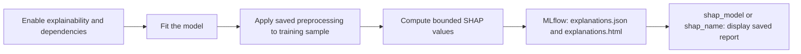

# Find and read SHAP explanations

## When you need it

Use SHAP to inspect which transformed features influenced a fitted model's output. It explains model
behavior; it is not a quality gate or proof that a feature causes an outcome.
[Evaluation charts](databricks_training_reports.md#optional-evaluation-charts) answer a different
question: how well predictions match known outcomes.

**Quick setup leaves SHAP off and does not ask the SHAP questions.** If you
cannot find a `shap_*` task, first check how the project was generated.
Detailed setup asks `shap_enabled`, default `false`.



`shap_name` stands for each concrete `shap_<name>` task of a competition or
model set. The SHAP leaf displays an existing report. Computation happens during fit;
opening the leaf does not retrain or explain new score requests.

## What to edit

For a new project, choose **detailed** setup, enable `shap_enabled` and set its
three budgets. This adds the config, dependencies and matching report tasks.
For an existing project, complete all three changes below.

### Enable computation and dependencies

Merge this fragment into `config/training.yml`:

```yaml
defaults:
  explainability:
    method: shap
    max_samples: 100
    max_features: 30
    max_display_samples: 3
```

These settings apply to each single model, competition candidate or model-set
branch. A named model's `explainability` mapping replaces the shared mapping;
include every override you need. Omit the field or set it to `null` to disable
computation. The example uses the generated defaults. The direct Core config
defaults to 10 display samples, capped by `max_samples`, if that key is absent.

Keep these exact template dependencies in `deployment/train-requirements.txt`:

```text
shap==0.49.1
matplotlib==3.10.0
```

The generated training environment installs that file on serverless and policy
clusters. Scoring does not compute SHAP and does not need these packages for
that purpose. A local installation alone does not update deployed job libraries.

### Add the report leaf if it was omitted

Projects generated with SHAP off omit `src/jobs/shap_report.py` and the SHAP
tasks. Generate a separate project with the same layout and SHAP enabled, then
review and copy the missing notebook, training requirements and relevant task
fragment as described in [project upgrades](databricks_project_upgrade.md).

For a single-model project, the task fragment under the existing train job's
`tasks` is:

```yaml
- <<: *lifecycle_task
  task_key: shap_model
  depends_on:
    - task_key: train_and_tune
  notebook_task:
    notebook_path: ../src/jobs/shap_report.py
    base_parameters:
      <<: *lifecycle_parameters
      reference_json: '{{tasks.train_and_tune.values.reference_json}}'
      tracking_uri: '{{tasks.initialize_run.values.tracking_uri}}'
```

This is a fragment for a generated graph: its two YAML anchors already exist
there. For competition/model-set branches, use `shap_<name>`, depend on
`train_<name>` and reference that exact task's `reference_json`.
Keep the SHAP task as an independent leaf with no outgoing dependencies.
`refresh_training_graph.py` can replicate an existing SHAP leaf when branches
change; it does not invent a leaf if the graph has none.

| Budget | Allowed value | Effect |
| --- | --- | --- |
| `max_samples` | 1–200; generated default 100 | Maximum training rows used for SHAP computation. Larger values can be expensive, especially for generic explainers. |
| `max_features` | 1–50; default 30 | Guard on transformed input width. It does **not** select the top features or drop columns; exceeding it produces `unavailable`. |
| `max_display_samples` | 0–50, no greater than `max_samples`; generated default 3 | Number of saved sample waterfalls. Zero keeps global importance without sample waterfalls. |

Budgets apply per fitted model: eight candidates can each compute an
explanation. Samples are training inputs transformed with saved preprocessing;
holdout labels, record keys and time/target metadata are not explanation features.

## The command

From the generated project root, after merging all required files:

```powershell
uv pip install -r deployment/train-requirements.txt
python src/tools/smoke.py
python src/tools/preview.py --action train
databricks bundle validate --strict -t test --profile YOUR_PROFILE
databricks bundle deploy -t test --profile YOUR_PROFILE
databricks bundle run train -t test --profile YOUR_PROFILE
```

Use your target/profile. Smoke and preview check declarations, not SHAP
computation. New settings affect a new fitting run; old runs are not backfilled.

## What you should see

Start with **Workflows > Jobs > your train run > training_report > Output >
Where to look** for the saved per-model report links and statuses. For the
full explanation, open:

| Layout | Notebook output | MLflow artifacts |
| --- | --- | --- |
| Single model | `shap_model > Output` | Fitting run > Artifacts > `explanations.json` and `explanations.html` |
| Competition | Each `shap_<name> > Output` | Each candidate's fitting run; the selected winner's report is also copied to the parent with its child-run provenance |
| Model set | Each `shap_<name> > Output` | That branch's fitting run, not one explanation of the combined business output |

The portable HTML contains embedded PNG images, run/model identity and a
workspace-relative MLflow link. It needs no JavaScript or CDN; a downloaded
copy's relative link needs the original workspace to navigate back to the run.
It may contain transformed sample feature
values, so use the experiment's existing access and retention controls.

Read **mean absolute importance** as average contribution magnitude on the
sample: a taller bar means more influence, not a positive or negative effect.
Read a **waterfall** from its base value through the feature contributions to
the explained output. Red contributions increase it; blue contributions
decrease it. The units belong to the explainer: a classifier can show raw
scores/log-odds rather than probability percentage points. Do not compare
unrelated models' bars without matching output units and sample populations.

Binary sample plots use class index 1. For multiclass explanations the helper
uses the predicted class when available (otherwise class 0); global magnitude
averages absolute contributions over classes. A sample number is a position
in the report, not a business key. Correlated features and training-population
choices affect attribution; SHAP is not causal evidence.

## Common errors and fixes

| Symptom or saved reason | What it means and what to do |
| --- | --- |
| No `shap_*` task | Quick/default setup omitted it. Add config, pinned dependencies, notebook and task, then validate/deploy; the YAML flag alone cannot create a task. |
| No explanation artifact | Check whether explainability was off in the fitting run, or whether fit failed before saving it. Absence alone is not a successful explanation. |
| `feature_limit_exceeded` | Transformed width exceeds the guard. Inspect encoded/generated columns; raise the guard only within 50, or train a deliberately smaller feature set. |
| `empty_training_frame`, `missing_input_columns` | No usable training sample or missing saved input columns. Repair the source/split/feature contract before retraining. |
| `inference_transform_unavailable`, `row_count_changed`, `feature_schema_mismatch` | Saved preprocessing cannot produce the expected row-preserving feature frame. Inspect the transform and context requirements. |
| `model_unavailable`, `shap_unavailable` | No usable estimator/explainer result. Check training logs, model compatibility and installed dependencies; a supported training model need not be supported by the selected SHAP explainer. |
| `shap_feature_schema_mismatch`, `invalid_shap_result` | Returned SHAP columns or finite JSON values do not match the saved contract. Keep the failure evidence and investigate the estimator/dependency combination. |
| `report_status: unavailable` | Numerical evidence may exist while rendering failed. Inspect `report_reason`, the JSON artifact and plotting dependencies. |
| SHAP leaf fails after fitting | The independent leaf can fail the overall job without undoing a model decision or retraining. Inspect saved artifacts before retrying; do not repair a lifecycle invocation merely to regenerate a chart. |

`status: completed` means SHAP values were saved, not that the model is accurate
or suitable for promotion. Unavailable explanations preserve their reason and
do not replace the saved evaluation metrics or quality policy.
