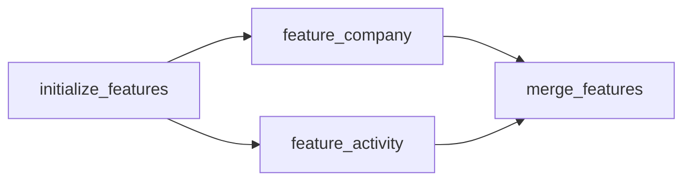

# Prepare feature tables for training and scoring

You can train and score directly from an existing Delta table. Feature tables
and a merged table are optional. With the generated `config/features.yml` left
as `version: 1` and `groups: {}`, Skyulf creates no feature job and no merged
table: training reads `training_table`, and scoring reads `score_source_table`.

Model count and feature-group count are independent: several models can share
the same group outputs and merged observation table.

Use this guide when features come from separate sources or require upstream
Spark calculations. The example builds company and activity features, joins
them to observations, then shows how to select the result for a model. The YAML
and generated graph can be checked locally; the SQL, Spark transforms and Delta
results below are **expected workspace behavior**, not a claim that these
example tables have been created in your workspace.

## Choose a data route

| What you have or need | Configure | What it produces |
| --- | --- | --- |
| One Delta table with all model inputs | `training.yml` and `inference.yml`; leave feature groups empty | No additional feature table or merge. |
| Separate sources to calculate and join | `features.yml` plus `src/features/groups/*.py` | One Delta output per group and one merged observation table. |
| Existing UC feature tables to bind to a saved model | `training.yml` → `feature_lookup` | Native Feature Engineering lookup during training and batch scoring; no explicit merged table required. |
| Endpoint requests carrying entity keys rather than all feature values | `feature_lookup`, `online_features`, and `serving.yml` | Native lookup from an explicitly provisioned/published online store before saved prediction. |

These routes can compose. A group job can produce an offline feature table that
another workflow registers or publishes. Producing an ordinary Delta table does
not declare UC primary keys, provision an online store, publish it, or deploy an
endpoint. See [online features](databricks_online_features.md) for that workflow.

### Ready training table (no feature groups)

When an upstream pipeline already writes one regular Delta table with the target,
the raw inputs and a record key, use it directly and leave `config/features.yml`
disabled; no feature job is generated. Keep inputs raw (imputation and encoding
are fitted by the model), and point both `training_table` and
`score_source_table` at the table. Their placeholders vary the table per target:

```yaml
# config/training.yml
defaults:
  training_table: "{catalog}.{input_schema}.observations{resource_suffix}"
  record_key_columns: [entity_id, observed_on]
```

A natural composite key works as long as every part is a non-null `STRING` or
`BIGINT` and the parts are unique together. Store a date part as a string or
integer when writing the table, for example
`date_format(observed_on, 'yyyy-MM-dd') AS observed_on`. A separate
`observation_id` is needed only when feature-group joins require the date as a
`DATE` column while the model needs a string or integer key.

Keep learned imputers, scalers, category statistics and selectors in
[preprocessing.yml](preprocessing_recipes.md), where fitting occurs inside the
training partition/fold. Use upstream groups for fixed formulas, domain
aggregations and time-correct source preparation.

## 1. Define observation identity and create the inputs

Run the following SQL on Databricks in a schema you own. Replace
`workspace.demo` consistently with your catalog/schema. The example names must
be unused: these `CREATE TABLE` statements intentionally do not replace existing
tables. The job's Run-as identity needs access to the input tables and permission
to create/write the three output tables in that schema.

There are two identities in this example:

- `(company_id, observed_at)` is the **feature join grain**: one observation per
  company and date. Both keys must be nonmissing and the pair unique in the base
  and each produced group.
- `observation_id` is a stable, unique, nonmissing **prediction record key**.
  It is `BIGINT`, kept outside model inputs. Do not use `observed_at` as a scoring
  record key: date/timestamp keys are not supported by the prediction publisher.
  A company can have many observations, so company_id alone is not the record key.

```sql
CREATE SCHEMA IF NOT EXISTS workspace.demo;

CREATE TABLE workspace.demo.company_observations (
  observation_id BIGINT,
  company_id BIGINT,
  observed_at DATE,
  churn BIGINT
) USING DELTA TBLPROPERTIES ('delta.enableChangeDataFeed' = 'true');

INSERT INTO workspace.demo.company_observations VALUES
  (101, 1, DATE '2026-01-31', 0),
  (102, 1, DATE '2026-02-28', 1),
  (103, 2, DATE '2026-01-31', 0),
  (104, 2, DATE '2026-02-28', 1);

CREATE TABLE workspace.demo.company_source (
  company_id BIGINT,
  observed_at DATE,
  employee_count BIGINT
) USING DELTA;

INSERT INTO workspace.demo.company_source VALUES
  (1, DATE '2026-01-31', 10),
  (1, DATE '2026-02-28', 12),
  (2, DATE '2026-01-31', 20),
  (2, DATE '2026-02-28', 21);

CREATE TABLE workspace.demo.activity_source (
  company_id BIGINT,
  observed_at DATE,
  amount DOUBLE
) USING DELTA;

INSERT INTO workspace.demo.activity_source VALUES
  (1, DATE '2026-01-25', 40.0),
  (1, DATE '2026-01-25', 60.0),
  (1, DATE '2026-02-25', 150.0),
  (2, DATE '2026-01-20', 20.0),
  (2, DATE '2026-02-20', 70.0);
```

The four base rows are enough to inspect joins; they are **not a training-quality
or split/CV example**. Supply a larger representative labeled population before
training. The activity dates here represent when the aggregate was available,
not raw transaction times from which a monthly cutoff is inferred. Define
windows, late-arrival handling and historical availability explicitly in real
source preparation.

No implicit string parsing, timezone conversion or duplicate removal runs.
Use date/timestamp columns with the same types across all participating tables.

All input tables must be Delta. The group sources need not already have CDF;
the feature publisher requires/enables it on its outputs. The scoring source
must have CDF before incremental scoring starts.

## 2. Configure two groups and the merge

Replace the entire contents of `config/features.yml` with this file. Do not
append it to the disabled `groups: {}` mapping.

```yaml
version: 1
base_table: workspace.demo.company_observations
output_table: workspace.demo.company_merged
keys: [company_id]
timestamp: observed_at
groups:
  company:
    source_table: workspace.demo.company_source
    output_table: workspace.demo.company_features
    transform: src/features/groups/company.py:compute_features
    columns: [employee_count]
    lookup: exact
    allow_missing: false
  activity:
    source_table: workspace.demo.activity_source
    output_table: workspace.demo.activity_features
    transform: src/features/groups/activity.py:compute_features
    columns: [monthly_amount, transaction_count]
    lookup: asof
    allow_missing: false
```

These table names are exact three-part names. Unlike training/inference table
settings, this file does not expand `{catalog}` placeholders or add a deployment
suffix. Choose separate names for each environment. Every output must differ
from every input and other output, with one owning producer.

| Field | Type / default | What you configure |
| --- | --- | --- |
| `version` | Integer, required `1` | Feature configuration format. |
| `groups` | Mapping, required; `{}` disables production unless `base_transform` is set | Up to 20 groups. Disabled configuration contains only version and groups. |
| `base_table` | String, required when enabled | Existing observations and labels, used as they are unless `base_transform` is set. |
| `base_transform` | Optional `src/features/module.py:function` | Runs on the pinned base before the joins and may derive the target and record keys; see [Derive labels and keys](#derive-labels-and-keys-with-base_transform). |
| `output_table` | String, required when enabled | Destination for the merged base and features. |
| `keys` | Nonempty distinct string list | Entity keys used by every group join. |
| `timestamp` | String, required when enabled | A separate date/timestamp column, already typed consistently across inputs. |
| `groups.<name>` | Lowercase identifier, 1–50 characters | Domain/task name; independent of the Python filename. |
| `source_table`, `output_table` | Required three-part table names | Group input and persisted output. |
| `transform` | Required `src/features/groups/module.py:function` | Contained Python module and callable. |
| `columns` | Required nonempty distinct string list | Features only; exclude keys, timestamp and labels. |
| `lookup` | `exact` default, or `asof` | Exact matches key and time; asof selects the latest feature time at or before the base time. |
| `allow_missing` | Boolean, default `false` | Permit unmatched observations with null features, or fail the merge. |

### Derive labels and keys with base_transform

When the raw source has no ready target or record key, for example a birth date
instead of an age, or a `DATE` that the model cannot use as a key, add one
project function instead of a separate preparation job:

```yaml
version: 1
base_table: "workspace.demo.raw_observations"
base_transform: src/features/base.py:prepare
output_table: "workspace.demo.observations"
keys: [entity_id, observed_on]   # observed_on: a yyyy-MM-dd string made by prepare()
timestamp: observed_date         # stays DATE for the feature grain and group joins
groups: {}                       # optional; groups still join on keys + timestamp
```

```python
# src/features/base.py
from pyspark.sql import functions as F


def prepare(frame):
    """Derive the target and a string date key from the pinned raw rows."""
    return frame.select(
        F.col("entity_id").cast("string").alias("entity_id"),
        F.date_format("observed_date", "yyyy-MM-dd").alias("observed_on"),
        "observed_date",
        F.round(F.months_between("observed_date", "birth_date") / 12, 2).alias("age"),
        "region_code",
        "employee_count",
    )
```

The job pins the base version and the function's code at `initialize_features`,
runs `prepare()` in `merge_features`, checks that keys plus timestamp are non-null
and unique, and publishes `output_table`. With no groups the job has only these
two tasks. Point `training_table` at `output_table` and use
`record_key_columns: [entity_id, observed_on]`. Keep `prepare()` free of learned
statistics (means, encodings); those belong in `preprocessing.yml`. Run
`python src/tools/refresh_feature_graph.py` after enabling it.

An asof match has no built-in maximum age in this group-merge implementation.
Use explicit source rules when old feature values must expire. A matching row
whose feature value is null still counts as a match; `allow_missing` controls
missing **records**, not missing cells.

## 3. Keep the Spark transforms small and explicit

The generated project already contains these editable files. Confirm their
columns match your configuration. Each function receives its pinned source
Spark DataFrame and must return exactly the keys, timestamp and declared
feature columns.

`src/features/groups/company.py`:

```python
def compute_features(frame):
    """Select one company snapshot at each declared observation date."""
    return frame.select("company_id", "observed_at", "employee_count")
```

`src/features/groups/activity.py`:

```python
from pyspark.sql import functions as F


def compute_features(frame):
    """Aggregate the supplied transactions at their declared availability grain."""
    return frame.groupBy("company_id", "observed_at").agg(
        F.sum("amount").alias("monthly_amount"),
        F.count(F.lit(1)).alias("transaction_count"),
    )
```

Group functions accept only `frame`; feature-group configuration has no `params`
field. Keep fixed business constants in the module. The file path before `:` in
`transform` is relative to the project root and the name after it is the callable.
Do not call `spark.table`, `toPandas`, `collect` or a table writer inside the
function: the job owns pinned reads, validation and publication. Source rows
may repeat the key/time when aggregation combines them, but returned rows must
be unique and contain no label columns. Activity sums all-null amounts as null;
its transaction count still includes those rows. An asof match selects one latest
available row, not the sum of all prior months, and it does not fill gaps with zero.

One file can produce several features. The group name does not have to match
its filename. Do not return `observation_id` from these group functions: it
belongs to the base observation, while the shared features use company/time.

The run pins input Delta versions and hashes the declared transform file. It
does not freeze extra network calls, hidden table reads or undeclared helper
files. Keep calculations based on the supplied frame. The root `groups/`
directory is excluded from the saved model's captured recipe package; keep
model callbacks in `preprocessing.py`, `pre_split.py` or `custom/`, and do not
import group functions from those modules. Keep Spark dependencies in
`deployment/requirements.txt`. Groups need no `__init__.py`; smoke still checks
their syntax. The transform entry point is one contained Python module, not a
general dependency graph. Saved model versions retain their original snapshots.

## 4. Generate and run the feature job

From the generated project root:

```powershell
python src/tools/refresh_feature_graph.py
python src/tools/smoke.py
databricks bundle validate --strict -t test --profile YOUR_PROFILE
databricks bundle deploy -t test --profile YOUR_PROFILE
databricks bundle run features -t test --profile YOUR_PROFILE
```

Replace `YOUR_PROFILE` with your configured profile. Refresh is local: it reads
and validates `config/features.yml`, then creates `resources/features.job.yml`
and its thin notebook. That file defines no `targets:`. When the train job has a
per-target `run_as` or `permissions` in `deployment/targets.yml`, refresh prints the
matching `features` entries to merge into the same targets, and smoke fails until
they are there (or, after feature groups are turned off, until leftover `features`
entries are removed, because Bundle would otherwise create an empty job).
Smoke does not read `config/features.yml`; it checks the
training configuration and the Python syntax of `src/`, including the group
modules. Neither reads Delta data or executes Spark transformations.
Refresh after changing feature configuration or inherited deployment controls,
then redeploy. A stale graph/config digest fails before reading source records.

The graph should contain:



Independent groups can run concurrently. The graph inherits training compute,
Run-as/permissions, time limits and notification settings. It is a separate job;
finishing it does not trigger training, scoring or promotion automatically.

Inspect each group task's `receipt_json` and the merge output for table/version,
row count and reuse evidence. Initialization records source versions and
transform hashes. Expected results for the sample inputs are four rows in each
group output and four rows in the merged table:

```sql
SELECT observation_id, company_id, observed_at, employee_count,
       monthly_amount, transaction_count, churn
FROM workspace.demo.company_merged
ORDER BY observation_id;
```

| observation_id | company_id | observed_at | employee_count | monthly_amount | transaction_count | churn |
| --- | --- | --- | --- | --- | --- | --- |
| 101 | 1 | 2026-01-31 | 10 | 100.0 | 2 | 0 |
| 102 | 1 | 2026-02-28 | 12 | 150.0 | 1 | 1 |
| 103 | 2 | 2026-01-31 | 20 | 20.0 | 1 | 0 |
| 104 | 2 | 2026-02-28 | 21 | 70.0 | 1 | 1 |

This table is the expected result of the shown joins. January company 1 receives
the January 25 activity total, not the later February 25 total. The merge keeps
all base columns, including observation_id and churn; it adds only the declared
features. Every join checks row count. Duplicate/null join keys, overlapping
feature names, inconsistent key/time types, or missing required matches stop
publication.

Missing output tables are created as Delta with CDF enabled. Later runs upsert changed keys and
retain older observations; they do not propagate source deletes or evolve output schemas implicitly.
Existing outputs need matching schema and CDF. A source correction can therefore produce UPDATE
events in the merged scoring source: apply the
[scoring source-change policy](databricks_scoring.md#source-changes-are-separate-from-model-changes)
intentionally rather than assuming every feature refresh is append-only.

## 5. Point training and scoring at the result

Merge this **fragment** into the existing classification `config/training.yml`,
retaining its model, registry, split, quality and resource settings:

```yaml
defaults:
  training_table: workspace.demo.company_merged
  record_key_columns: [observation_id]
  input_columns: [employee_count, monthly_amount, transaction_count]
  target_column: churn
```

In `config/inference.yml`, update these two fields, retaining the other settings:

```yaml
score_source_table: workspace.demo.company_merged
prediction_table: "{catalog}.{output_schema}.company_predictions{resource_suffix}"
```

Once there are enough representative rows for the configured split/CV, run the
normal training workflow and approve/select a saved version before scoring.
For independent-target layouts, check model-level input/target overrides as
well as defaults. The merged table may contain labels; labels are not model
inputs. A separate unlabeled observation/merge table can be the scoring source.

Choose one owner for each transformation. Do not scale or impute from the whole
merged population and then repeat it in the saved model. Add learned missing
value handling to `config/preprocessing.yml`. See the
[training field reference](databricks_training_config.md) for split, sampling,
limits and per-model settings.

To add a domain, create `src/features/groups/balances.py` with
`compute_features(frame)`, add `groups.balances` with its source, destination,
transform and distinct feature names, then refresh and redeploy. Do not add this
upstream folder to `src/features/__init__.py` or import it from model recipes.

## Refresh selected groups and repair a failed run

To recompute activity while reusing the currently stored company features:

```powershell
databricks bundle run features -t test --profile YOUR_PROFILE --params selected_groups=activity
```

`selected_groups=*` is the default and computes every group. A comma-separated
list chooses groups; an empty selection reuses all group outputs. Reused tables
must already exist. Initialization pins their versions, and merge uses those
pinned versions. An unknown group name fails.

If a group task fails, inspect its input version, transform hash and exception.
Repair only when the saved graph/code/input evidence still applies. Changed
configuration or transform code needs a new run; retrying a stale receipt is
not a way to accept a new calculation. A completed group output can exist even
when a later group or merge fails, so inspect the receipts instead of assuming
all writes form one multi-table transaction. In **Repair run**, rerun the failed
group and dependent merge while keeping the original pinned inputs. External
writes to the feature destinations are unsupported; serialized job runs do not
lock unrelated producers.

Each new run also pins the output table identities and records a publication
generation. A newer run that starts publishing any group or the merged output
supersedes an older run. Repairing that older run then fails before it can
overwrite newer values; start a fresh run instead. This includes newer runs
that failed partway through publication. Old saved mutation snapshots without
generation evidence must also restart from initialization.

Retrying the same current snapshot is supported after a lost write response,
provided its transforms are deterministic. Keep one owning, serialized
producer for these tables. The generation check detects stale repairs; it is
not a distributed lock against simultaneous external writers. Existing outputs
receive a publication-intent table property before the merge, which can add a
metadata-only Delta history version even when no rows change.

## Bind existing UC features instead of materializing a merge

Use `feature_lookup` when the model should retain native lookup lineage. The
following **training defaults fragment** uses an existing base table containing
observation_id, company_id, observed_at and churn, but not the fetched features:

```yaml
engine: pandas
training_table: "{catalog}.{input_schema}.company_observations"
record_key_columns: [observation_id]
input_columns: [monthly_amount, transaction_count]
target_column: churn
feature_lookup:
  lookups:
    - table_name: "{catalog}.{input_schema}.company_activity_history"
      lookup_key: [company_id]
      feature_names: [monthly_amount, transaction_count]
      timestamp_lookup_key: observed_at
      timestamp_type: date
      lookback_seconds: 2678400
```

Set `batch_compute: spark` in `config/inference.yml` for this offline batch
route and score from the corresponding observation table. The example's
lookback is 31 days. For a non-temporal exact lookup, omit timestamp and lookback
fields. Any direct model inputs not fetched must be present in the base table.
Fetched features must be listed in input_columns and must not also exist there.

The feature table must already be a valid UC feature table with declared primary
keys; historical lookup additionally needs the appropriate TIMESERIES key.
The ordinary group output above does not add those catalog constraints. Install
the matching Feature Engineering dependency in `deployment/requirements.txt`
(the generated feature-store integration pins
`databricks-feature-engineering==0.18.1`). Native lookup uses the saved model's
feature binding and `score_batch`, not the ordinary merged-table pyfunc route.

The saved `training_snapshot` binding records feature-table IDs/versions. When a
feature table advances, scoring accepts it only if its identity and schema
still match and a distributed comparison proves both retained snapshots
contain exactly the same rows, including duplicates. This permits
data-preserving maintenance such as compaction. Actual data or schema changes
require refreshed training and an explicit rebuild/new prediction target.
Missing historical snapshots fail validation; retain the training versions
needed for this check.

The equality proof can scan both complete feature-table snapshots. It is
repeated on later scoring calls while the current version differs from the
saved training version; there is no persistent proof cache. Plan for this cost
on large feature tables. Before/after version checks detect concurrent writes;
they do not lock the tables: the SDK provides no lookup `versionAsOf` argument.
Keep those tables stable during training/scoring. Nullable integer/Boolean transport needing the
post-lookup encoder is not admitted by this adapter. Driver training limits still apply even though
lookup and batch scoring use Spark.

Preparation records the base Delta version and every feature table's ID/version,
then validates actual null/duplicate keys and matching key/timestamp types before
SDK joins. Splitting retains record/time/weight metadata, which is excluded from
the logged model's inputs. Separate tasks reconstruct native TrainingSet lineage
from the same frozen declaration; scoring reuses fitted preprocessing.
Single-model and competition winners retain that lineage. A set combines only
compatible component lookups: conflicting versions, key/time semantics or
direct/fetched input meanings fail. Scoring validates the complete package,
exact named prediction schema and record-key/cardinality preservation.
Spark batch monitoring reconstructs the scored keys' feature values using the
same saved lookup evidence; native-feature monitoring supports Spark
batch only. Keep feature tables stable during monitoring as well as training/scoring.

The library's optional `feature-store` extra requires SDK 0.18.1 or later within
major version zero; the chosen runtime must support that SDK. Match active MLflow
tracking/registry URIs to the project's explicit URIs before native scoring.
The SDK downloads the concrete model URI in that context; aliases resolve first.
For distributed estimator admission, worker budgets and declarative weighted
composition, see [distributed scoring](databricks_spark_scoring.md).

For latest-value endpoint lookup, follow [online feature setup](databricks_online_features.md).
That path adds explicit required-feature/freshness guards, publication into an
existing online store and endpoint admission. Current generated online policy
transport supports pandas single-model/competition training and non-temporal
lookup; it is not a historical asof endpoint or a multi-target online flow.

## Common errors and fixes

| Symptom | Check and fix |
| --- | --- |
| No `features` job after init | Empty groups deliberately disables it. Configure groups and run refresh_feature_graph. |
| Graph digest mismatch | Refresh locally after configuration changes, then redeploy matching resources. |
| Feature key/timestamp not unique | Correct the producer's grain; do not silently discard observations to make a join pass. |
| Missing observation match | Check exact/asof choice, dates and key types. Set allow_missing only if null features are acceptable. |
| Feature column overlaps base/group | Give each output feature one owner or rename it explicitly upstream. |
| Scoring rejects observed_at as a record key | Keep date/time for feature joins; use the stable BIGINT observation_id for scoring. |
| Updated feature rows make scoring fail | Ordinary single-model scoring rejects source updates/deletes; review correction/rebuild behavior before publishing changed historical inputs. |
| A saved model cannot import a group function | Groups are upstream code, excluded from the model recipe snapshot. Move model callbacks to the captured phase/custom modules. |

Platform details:
[point-in-time lookup](https://docs.databricks.com/aws/en/machine-learning/feature-store/time-series),
[task dependencies](https://docs.databricks.com/aws/en/jobs/run-if),
[repairing tasks](https://docs.databricks.com/aws/en/jobs/repair-job-failures),
[Delta upserts](https://docs.delta.io/delta-update/), and
[Feature Engineering compatibility](https://docs.databricks.com/aws/en/release-notes/feature-store/databricks-feature-store).
