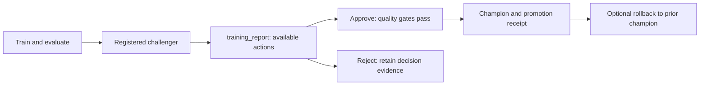

# Approve, reject and roll back model versions

## When you need it

A registered candidate is not automatically the production champion. Use the serialized train job to
apply the saved quality policy and record an operator decision.
[Daily serving traffic rollout](databricks_serving_rollout.md) is a separate endpoint operation.



This shows manual approval. Automatic policy applies the same saved quality
gates without an operator approval run. First-champion initialization has no
prior champion to restore.

## What to edit

### Independent scoring and promotion policies

Generated Bundles and direct `run_action` callers separate these decisions:

| `score_model_selection` | `promotion_policy` | Behavior |
| --- | --- | --- |
| `pinned_version` | `manual_approval` | Register/evaluate the contender; score keeps the configured version |
| `pinned_version` | `automatic` | Apply promotion gates; score still keeps the configured version |
| `champion` | `manual_approval` | Register/evaluate the contender; score follows the existing champion |
| `champion` | `automatic` | Apply promotion gates; the next score follows the resulting champion |

For example, a library configuration containing `model_version: "2"`,
`score_model_selection: "pinned_version"` and `promotion_policy: "automatic"`
continues scoring with v2 after a successful promotion of v4. Selecting
`champion` instead resolves the controlled alias once per score run. A missing
champion fails before output preparation; there is no fallback to latest.

Set both fields together; a partial configuration fails before training or
scoring. Generated projects also require `follow_champion`. Automatic promotion
requires `quality_threshold`, including when scoring is pinned. Scoring never
updates the caller's configured version. Moving from the single
`model_selection_mode` field is covered in
[project upgrades](databricks_project_upgrade.md#selection-and-promotion-policy-fields).

### Additional quality gates

Keep one selection `metric`. Optionally add `quality_gates` directly to
`config/training.yml` defaults; no extra initializer question is needed. For example,
merge these regression policy fields into your existing configuration:

```json
{
  "metric": "heldout_rmse",
  "quality_threshold": 5.0,
  "min_improvement": 0.2,
  "quality_gates": {"heldout_mae": 3.0, "heldout_r2": 0.7}
}
```

These illustrative bounds require RMSE <= 5, MAE <= 3 and R2 >= 0.7.
Choose bounds appropriate to your target's units and business requirements;
generated projects keep the quality threshold unset. Every bound must pass.
For later champions, RMSE must additionally improve by at least **0.2 absolute
units** on the same holdout. A tie never qualifies, even with minimum improvement 0.
The first champion still needs an explicit selection-metric quality threshold.

For classification, a policy might select `heldout_f1` with threshold 0.8 and
add `{"heldout_recall": 0.9, "heldout_log_loss": 0.5}`. Classification score
bounds are in [0, 1], except Matthews correlation [-1, 1]; error/loss bounds
are nonnegative, while R2/explained variance may be negative but cannot exceed 1.
The existing metric definition determines whether a lower or higher value wins.
Use weighted metrics for multiclass models. An unavailable metric, such as
binary ROC AUC on a one-class holdout, fails its gate; it is never silently ignored.
These bounds do **not** set classification probability decision thresholds or tune them.

The comparison/final notebook reports show each bound, observed value and
failure reason. MLflow retains the policy in `candidate_comparison.json`, all
gate outcomes in `quality_gates.json`, and per-gate version tags.
Version tags identify their event; use
`quality_gate_event` to distinguish current gates from retained older outcomes.
Approval requires the saved policy unchanged and re-evaluates it before changing aliases.
Omitting `quality_gates` preserves the single-gate policy and historical receipt
digests. SDK callers should use the returned `comparison_sha256`; when explicitly
serializing a report for evidence, use `comparison_payload`/`comparison_digest`
from `skyulf.integrations.mlflow.lifecycle.validation` instead of hashing `dataclasses.asdict`.

In both modes, registration nominates `@challenger` before comparison. A tied
or worse candidate retains that alias with `validation_status=rejected` and
a reason; comparison errors retain it with `validation_status=error`.
New contenders replace the pointer without deleting earlier version evidence.
Manual approval records these results without automatically promoting the candidate.
Training resolves the current champion; a stale explicit `champion_version`
fails before fit. Generic Core training remains alias-free unless a caller
supplies the explicit `on_registered` lifecycle callback.

### Models that exclude rows

Fitted outlier steps (`IQR`, `ZScore`, `EllipticEnvelope`, `ManualBounds`) and
`PowerTransformer` can leave a holdout row without a prediction (see
[rows that are not scored](databricks_spark_scoring.md#rows-that-are-not-scored)).
For such a model, training computes every metric on the scored rows only and
records how many rows that is:

| Metric | Meaning |
| --- | --- |
| `heldout_total_rows` | Holdout rows given to the model |
| `heldout_scored_rows` | Rows that received a prediction |
| `heldout_excluded_rows` | Rows excluded by an outlier or invalid-value step |
| `heldout_scored_fraction` | `heldout_scored_rows / heldout_total_rows` |

A model that skips difficult rows can look better than it is, so two coverage
rules apply by default. Both are policy fields in `config/training.yml`, next to
`min_improvement`:

```yaml
min_scored_fraction: 0.90   # null turns this rule off
max_coverage_drop: 0.05     # 0.05 = five percentage points; null turns it off
```

1. **Minimum coverage (`min_scored_fraction`).** At least this fraction of the
   holdout rows must be scored. A candidate below it is rejected, even if its
   metrics pass. The default is `0.90`.
2. **No large drop against the champion (`max_coverage_drop`).** The
   candidate's coverage may be at most this much lower than the champion's.
   With a champion at 99% coverage and the default `0.05`, a candidate at 96%
   can be compared, but one at 93% is rejected even though it passes the 90%
   rule.

Both values accept a number from 0 to 1, or `null` to turn the rule off. They
sit wherever `min_improvement` is set: once for a single model or a competition,
and separately for each multi-target branch. Generation writes the defaults; to
change them before generation, put `min_scored_fraction` and
`max_coverage_drop` (or `branch_N_min_scored_fraction` and
`branch_N_max_coverage_drop` for branch `N`) in the answer file. The setup
wizard does not ask for them. A `quality_gates` entry for
`heldout_scored_fraction` remains possible as an additional bound; the stricter
of the two applies. Models without an excluding step always score 100% of the
rows, so these rules never reject them.

When both rules pass, the candidate and the champion are compared on the
holdout rows that **both** scored. Refitted outlier bounds move slightly with
every retraining, so the two models rarely exclude exactly the same rows;
comparing only the shared rows keeps the comparison fair. Each model's own
coverage is checked separately against the two rules above, never on the
shared rows. A model without any excluding step has a coverage of 100%, so
replacing it with one that excludes rows is limited by the same 5-point margin.

Training runs and model versions share readable metadata: `train_data_version`,
`test_data_version`, `train_data_destination`, `test_data_destination`,
`model_type`, `candidate_date_tag`, and `engine`. Optional `risk_category` is
editable in `config/training.yml` defaults. Since fit and evaluation split one Delta snapshot,
their table names and versions match; `train_start`, `test_start`, and
`data_end` explain the split. The exact dataset identity is saved in
`training_data.json`. Run tags use `task=training`.

Validation reasons use plain English. Technical event tags retain unique IDs
and evidence hashes for rollback/recovery; their JSON fields are `action`,
`from_version`, `proof`, `parent`, `state`, and `previous`. `from_version`
identifies the version previously held by the affected alias, not necessarily
the previous champion. These are audit records,
not settings to edit. Earlier compact receipts remain supported.


### Set quality and activation

A `multi_target` project approves, rejects and rolls back the complete model set,
not one component. The set has its own `promotion_policy` in
`config/inference.yml` > `model_set`; branch policies stay manual. A replacement
set needs every branch to pass its absolute gates, no branch to regress and at
least one branch to improve by its `min_improvement`. The
[model set guide](databricks_model_sets.md#quality-policy-and-replacement-rule)
owns the rule, the set aliases and set scoring.

## The command

### Operator actions through Run now

The existing `train` job is the serialized lifecycle writer. Use this same
procedure for a single model, the competition winner or a complete model set.
A model set shows the same blocks in **training_report > Output**; its
`candidate_version` is the set version.

1. Open **Workflows > Jobs > your project's train job > the finished run >
   training_report > Output**. Review the comparison and decision first.
2. Find **Available action: approve**, **Available action: reject**, or
   **If rollback is needed**. For rollback, expand **Show parameters only if
   you want to roll back**. Copy the displayed parameter values, including
   the complete `promotion_receipt_json` when present.
3. On the **same train job**, choose **Run now with different parameters**
   (called **Run with different settings** in the report). Set the listed
   `lifecycle_action` and evidence values. Clear unrelated operator fields;
   for `reject`, enter your own `rejection_reason`. Leave the other job
   parameters empty; the five lifecycle fields are the only job parameters.
4. Open the new run's **training_report > Output** to inspect the action result,
   receipt and any next action. A failed gate or stale champion stops the action;
   starting an approval run does not guarantee promotion.

For reference, these are the fields the report provides:

| Action | Required job parameters |
| --- | --- |
| `train` | No operator evidence; leave other parameters empty |
| `approve` | `candidate_version`, `expected_champion_version`; comparison proof resolves automatically |
| `reject` | Same as approve, plus `rejection_reason` |
| `rollback` | `promotion_receipt_json`, `expected_champion_version` |
| `approve` over an unloadable champion | As approve, plus `allow_unloadable_champion=true`; only when the report offers it |

For a single model or competition winner, manual training returns copyable
`next_actions.approve` and `next_actions.reject` fields. A model set's
`next_actions` field is a list of sentences; copy its values from the report
blocks. Review the comparison and copy its exact values; add a reason for
rejection. `expected_champion_version=none` explicitly selects first-champion
initialization; an empty value fails. Configure the metric and absolute quality
threshold **before training** so saved evidence matches the approval policy.
A completed single-model promotion returns `next_actions.rollback`, including
its complete receipt JSON; a set shows it in the rollback block. Copy that
receipt rather than reconstructing it from alias names.
These operator actions reuse the existing candidate; they do not fit a model.

For rollback, **Required current champion** and `expected_champion_version`
are a safety check: the alias must still point to that version. **Restore
version** is the prior version recorded inside the promotion receipt. For
example, a receipt for v2 -> v4 expects current champion v4 and restores v2.
Do not put v2 in `expected_champion_version`.

### Champion from an older Core release

A saved model loads only under the exact runtime that produced it (Skyulf Core,
scikit-learn, numpy, pandas and the other pinned packages). After a Core upgrade
the comparison cannot score the old champion, so it reports
`reason: champion_runtime_unavailable` instead of failing. Automatic promotion
holds, and the report shows an approve block with
`allow_unloadable_champion: true` and the warning **The champion was not compared**.

Run the train job with those values only after reviewing the candidate's own
metrics. The override is accepted only for `approve`, only as the exact value
`true`, only while the champion still cannot be loaded, and only when the
candidate passes a configured `quality_threshold` and any `quality_gates`. The
saved comparison records that the champion was not measured. It works under
either promotion policy. Model sets do not support it: their training stops
with a message naming the release that produced the champion set.

Rolling back to a champion from the older release restores its alias, but the
current score job cannot load it; keep that release's runtime if you need it.

`follow_champion` is a deploy-time setting in `config/inference.yml`, not a Run now parameter.
Changing it needs the matching deployed job parameters and a redeploy; see
[schedules and handoff](databricks_scoring.md#schedules-handoff-and-execution-engines).
`true` requests the existing score job after a successful initialization, promotion or
rollback. `false` leaves scoring to an explicit score run or its schedule. Rejection and training
without a champion transition never trigger score. Handoff preserves the score selector: a pinned
scorer still uses its configured version even after champion changes.

The project has separate train, score and monitoring jobs. The train graph runs the lifecycle
phases, then `scoring_requested` checks the verified handoff and `run_batch_scoring` conditionally
invokes the score job. Train and score queue runs with `max_concurrent_runs: 1`. Score's fixed
notebook role ignores inherited lifecycle parameters and cannot dispatch alias actions; this is
input isolation, not a replacement for exclusive registry write permissions. A failed/uncertain
alias action never publishes a successful score request. If the alias change succeeded but score
failed, retry score directly; no retraining is needed.

The score entrypoint filters inherited parent-job evidence before dispatching
score. Validate permissions and compute dependencies in each deployment target.

### Approve an existing candidate without training

Use an explicit manual policy and the comparison returned by the earlier
training job. Review that saved result before passing its version and digest:

```python
from skyulf.integrations.databricks.lifecycle.workflow import run_action

# candidate is the result of an earlier training job; no training runs here.
comparison_sha256 = candidate.comparison_sha256
receipt = run_action(
    spark,
    config,  # promotion_policy="manual_approval" and both independent fields
    "approve",
    candidate_version=candidate.model_version,
    comparison_sha256=comparison_sha256,
    expected_champion_version=candidate.comparison.champion_version,
)
```

Approval downloads `candidate_comparison.json` and `candidate_training_spec.json`
from the run associated with that registered version. It verifies the digest,
current metric policy, expected champion and controlled challenger receipt.
It then reads the original Delta version and evaluation window and rechecks
quality using the existing Core comparison/promotion services. The original
engine is preserved; current read budgets may tighten the saved limits.

The action does not train, register or upload a model, rewrite `model_version`,
or publish predictions. A later score run follows the configured selector.
Retrying an unchanged successful approval returns its original committed
receipt; changed champion, pending writes or incompatible evidence fail.
A training run without a saved `candidate_training_spec.json` cannot be
approved this way; there is no fallback to current training dates.
Use the same externally serialized lifecycle writer as training. The Bundle
train job provides that path; its score handoff follows the deployed setting.

### Reject a candidate or roll back a promotion

To decline the candidate above, use the same version and evidence digest with
an explicit manual policy. This is an alternative to approving that candidate:

```python
decision = run_action(
    spark,
    config,
    "reject",
    candidate_version=candidate.model_version,
    comparison_sha256=comparison_sha256,
    expected_champion_version=candidate.comparison.champion_version,
    rejection_reason="Business review requires another candidate",
)
```

Rejection retains both aliases and the evaluation metrics/status. It records
`approval_status=rejected` and the human-readable `approval_reason` separately.
The reason must be nonempty and at most 256 UTF-8 bytes. A rejected version
cannot be implicitly approved, restaged, renominated or made the first champion.
There is no reopen action; a later training run creates a new candidate.
Neither rejection nor rollback reads training rows, fits or registers a model.

To undo an earlier completed promotion, pass that promotion's receipt:

```python
reversal = run_action(
    spark,
    config,
    "rollback",
    promotion_receipt=receipt,  # kind="promotion", not first-champion initialization
    expected_champion_version=receipt.new_version,
)
```

Rollback is available under either promotion policy. It restores the previous
champion only when the saved transition still matches controlled registry state.
A separately verified challenger is retained. Repeating an unchanged rejection
or rollback returns the same committed receipt; incompatible evidence,
conflicting alias state and unresolved writes stop the action.

All lifecycle actions must use the same externally serialized writer as training. No additional
control table is created. Direct `run_action` calls do not launch score or rewrite its version pin;
the Bundle adapter can request score afterward. A later `champion` score follows the restored alias;
a `pinned_version` score continues using its configured version. Rollback does not undo predictions
already written; scoring's model-change policy still applies.

## What you should see

### Recent challenger history

The Core lifecycle keeps the last displaced contender as `previous_challenger`:

| Action | Champion | Challenger | Previous challenger |
| --- | --- | --- | --- |
| Starting state | v2 | v3 | unset |
| Nominate v4 | v2 | v4 | v3 |
| Repeat nomination of v4 | v2 | v4 | v3 |
| Promote v4 | v4 | unset | v3 |

Only replacing an existing contender rotates this pointer. Evaluation and
promotion retain it, and promotion still puts the old champion in
`previous_champion`. If the historical version becomes champion through
rollback, or becomes challenger again, its history alias is cleared. The
version and its earlier event records remain available.

This alias is neither a complete history nor a scoring fallback. It creates
no table or job. History changes share the lifecycle's pending-event checks
and writer ownership; manual alias/receipt disagreement stops further actions,
including retries. Partial writes require reconciliation before proceeding.

With `score_model_selection=champion`, score resolves the alias once to a
concrete version per run, under either promotion policy. Only the serialized
train job identity may write this
model's aliases; other alias-write grants must be removed before training.
Alias promotion and Delta scoring are separate transactions. If scoring fails
after promotion, the last successful prediction output remains and the score
job must be retried. Unknown alias outcomes need receipt reconciliation.
Skyulf marks an alias transition as pending before writing it; automatic
training and scoring stop until that pending event is reconciled. An existing
champion alias set outside this controlled lifecycle also needs reconciliation
before controlled champion scoring or promotion can use it.
For a failed controlled operation, use the
[alias recovery procedure](databricks_lifecycle_recovery.md)
with the original destination version, pending event ID and shared admission.
It completes fully applied changes or aborts untouched changes; mixed roles
remain blocked for operator inspection. It does not change serving traffic or
prediction tables, and it cannot adopt an uncontrolled alias automatically.

For example, a regression project can select its gate in the generated config:

```json
{
  "engine": "polars",
  "score_model_selection": "champion",
  "promotion_policy": "automatic",
  "score_handoff": "after_alias_change",
  "metric": "heldout_rmse",
  "min_improvement": 0.1,
  "quality_threshold": 5.0,
  "model_change_mode": "incremental_append"
}
```

These example values mean RMSE must be at most `5.0`; a later candidate must
reduce champion's RMSE by at least `0.1` on the same holdout. Improvement is
an absolute metric difference, not a percentage. Skyulf derives the direction
from the metric: RMSE/MAE/log loss are minimized, while R-squared/accuracy/F1 are
maximized. Use a metric supported by the configured model task. The first
comparison reports `reason=no_champion` and `eligible=false` because no
baseline exists; successful bootstrap is recorded separately as
`result.alias_change.kind=initial` in the Bundle output after the absolute gate passes.

If promotion succeeds but scoring fails, the train job reports a failed
dependent score task. Correct the scoring problem and run `score` again;
retraining is unnecessary. Full-rebuild output continues to expose the last
successfully activated generation during this recovery.

## Common errors and fixes

| Symptom | Fix |
| --- | --- |
| First approval lacks a quality threshold | Set an absolute bound before training; saved policy cannot be replaced by editing YAML afterwards. |
| Champion changed since review | Inspect a fresh comparison; the expected champion must match current controlled state. |
| Alias write outcome is uncertain | Reconcile the original pending event before another lifecycle action. |
| Promotion succeeded but scoring failed | Correct and retry score; no new training is required. |
| A rejected candidate cannot be approved | Train a new candidate; rejection is not a temporary hold. |

Direct SDK snippets above assume existing `spark`, validated `config` and the returned training
`candidate`. Use its returned comparison digest; a generic dataclass hash can differ from the saved
canonical evidence.
