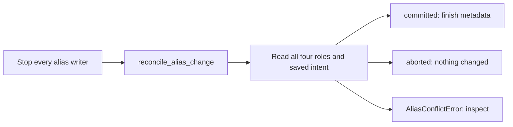

# Recover an interrupted model alias operation

## When you need it

Looking for a normal rollback after a completed promotion? Follow
[the training_report and Run now steps](databricks_lifecycle.md#operator-actions-through-run-now).

An `AliasOutcomeUnknownError` or a pending alias event means a registry write
may have succeeded before its response was received. Further controlled training,
promotion and champion scoring can remain blocked until that event is reconciled.
This procedure concerns registry aliases; a failed score or dashboard refresh
after a confirmed promotion does not by itself require alias recovery.

## What to edit

First stop every job and manual operation that can write the model's aliases.
Confirm the original run has terminated and cannot retry. Preserve its inputs,
logs, model/version tags and all four role assignments: `champion`, `challenger`,
`previous_champion`, `previous_challenger`.

Obtain the original destination version and event ID from the failed operation's
logs, `pending_alias_event` and `promotion_<event_id>`. New operations save their
intent in `alias_intent` plus numbered chunks before publishing the pending marker.
Run recovery with the same Skyulf Core version as the jobs that wrote the intent.
Use the same admission authority as the original writers; do not invent a new lock
or clear the pending marker just to make a job run.

## The command

The [MLflow registry recovery procedure](mlflow_registry.md#recover-an-interrupted-alias-operation)
contains the SDK call with its required `admission`, destination version and event
ID. Run that call from an authorized operator environment while writers remain
stopped. There is no Bundle `lifecycle_action=recover` convenience action.
The recovery API validates observed state against the saved intent; it does not
set or delete aliases for you.

For a normal candidate decision whose outcome is known, use the train job's
[approve/reject/rollback actions](databricks_lifecycle.md#operator-actions-through-run-now).
Do not substitute rollback for reconciliation of an unknown outcome.

## What you should see

| Result | Meaning | Next step |
| --- | --- | --- |
| `committed` | Intended role changes already exist; metadata is completed and verified, then this pending marker is cleared. | Read the controlled champion and resume the appropriate downstream operation. |
| `aborted` | Roles and owned metadata still match their starting values; no promotion is completed. | Review and retry the original business operation with fresh checks if still wanted. |
| `AliasConflictError` | Mixed roles, unexpected changes or contradictory metadata prevent automatic reconciliation. | Keep writers stopped and inspect the complete intent and observed state. |

An unchanged retry of an already completed repair returns the same outcome.
Unchanged aliases alone do not prove completion of metadata-only actions such as
rejection. Recovery does not undo prediction rows, endpoint traffic or tables.

## Common errors and fixes

| Symptom | Fix |
| --- | --- |
| Another writer still owns admission | Verify that exact owner's run state; follow the registry guide's conditional recovery procedure. Never release a different owner's claim. |
| Only some roles changed | Compare every role and marker with the saved plan under exclusive operator control; follow the documented manual procedure before retrying reconciliation. |
| `Alias intent digest differs from its stored chunks` and the `alias_intent` manifest shows `"encoding":"json-framed-v1"` | The operator environment runs an older Core that cannot read framed chunks. This is a version mismatch, not corruption. Install the writers' Core version and retry. |
| An old event has no complete intent | Automatic recovery is unavailable. Restore from verified original evidence with the platform owner; keep the model blocked if that evidence is insufficient. |
| An old intent was replaced by a newer operation | The latest snapshot cannot repair the earlier event. Use the original durable evidence. |
| A tag budget error occurs | Preserve current control receipts and pending evidence; review the registry guide before retiring obsolete audit tags. |

Return to [model lifecycle decisions](databricks_lifecycle.md) only after reading
back a consistent controlled state.
