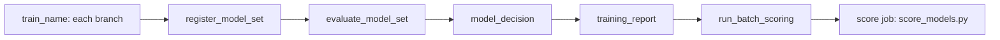

# Train, approve and score a multi-target model set

## When you need it

Use a model set when one project trains several models for different targets
and you want to approve, roll back and score them together. A customer dataset
can, for example, train a purchase classifier, a spending regressor and a
visit-count ensemble. Each model stays useful on its own. Different targets
have different metrics, so their scores are never ranked against each other.

Choose `training_layout=multi_target` when you generate the project. The
`single_model` and `model_competition` layouts do not create a set.

A set is one registered model whose version holds every component's exact fitted
artifact. It records each component's model name, version and digest. It also
captures `src/features/`, the combined rules and the typed record keys. Scoring
and approval load these saved assets, so editing project files cannot change an
existing set. Packaging changed rules creates a new set candidate.



`train_name` stands for each concrete `train_<name>` task. `run_batch_scoring`
starts the score job only when `score_handoff` requests it after a set alias
change. See [training reports](databricks_training_reports.md#training-graph-and-notebook-files)
for the notebook behind each task.

## What to edit

### Configure the branches

Each branch is a named entry under `models` in `config/training.yml`. Shared
source, keys and budgets belong under `defaults`. A branch can override its
target, input columns, preprocessing recipe, estimator, search/CV, split and
quality settings. It registers its own component model.

The train job resolves one Delta table version before training starts. Branches
read that same snapshot within their own row/byte budgets. Missing labels are
excluded per target before sampling and splitting, so a missing spending label
cannot remove a labeled purchase example. Every target column is forbidden as a
model input to prevent cross-target leakage. Learned preprocessing is fitted
inside the training folds and the final holdout stays separate.

All branches are required. If one fails, the run stops and earlier component
versions remain available for inspection. MLflow records a parent run and a
linked child run for each branch. Branches keep `promotion_policy=manual_approval`
and `score_handoff=disabled`; the set has its own promotion policy.

Select recipes per branch. Declare named lists under `recipes` in
`config/preprocessing.yml` and `config/pre_split.yml`. Keep custom factories in
`src/features/preprocessing.py` and `src/features/pre_split.py`:

```yaml
models:
  revenue:
    preprocessing_recipe: revenue_features
    pre_split_recipe: complete_inputs
```

Branches can share one recipe and still learn separate fitted state. Missing
names and duplicate configuration owners fail before data is read. Do not define
the same recipe in both Python and YAML.

After adding, removing or renaming entries in `models`, run
`python src/tools/refresh_training_graph.py` and redeploy. An old deployed graph
with a changed model list is rejected before any model is trained.

### Set the model_set block

`config/inference.yml` > `model_set` declares the set. Detailed setup asks
`model_set_name`, `model_set_table_name`, `model_set_output_mode` and
`model_set_promotion_policy`; quick setup writes editable defaults.

| Field | Default | Effect |
| --- | --- | --- |
| `model_name` | `<project_name>_set` in the metadata schema | Registered set identity. Required. |
| `prediction_table` | `<project_name>_set_scores` in the output schema | Physical result table. Required. |
| `promotion_policy` | `manual_approval` | `manual_approval` or `automatic` set activation. |
| `combined_rules_path` | `../features` | Package containing `build_combined_rules()`, captured with the next set. |
| `composition_config` | Absent | Declarative alternative to `combined_rules_path`; the two cannot coexist. |
| `source_change_policy` | `reject` | `reject` or `rebuild_on_change` for source updates and deletes. |
| `publication` | `mode: all` | Output mode and optional views. |

Names gain the target catalog, schema and deployment suffix. Unknown fields are
rejected.

### Choose the output mode

| `publication.mode` | Stored values | Consumer access |
| --- | --- | --- |
| `all` (default) | Every component output and combined rule result | One prediction table |
| `combined_only` | Combined results, keys, rule outcomes and set provenance | One prediction table; needs saved combined rules |
| `separate_views` | All results, written once | Component views and an optional combined view |

`combined_only` still computes every component; it only stores the combined
results. An empty rule list fails. Changing between `combined_only` and a full
schema needs a fresh table.

For `separate_views`, setup also asks `model_view_prefix` and
`combined_view_name`. Blank names give `<project_name>_predictions_<branch>`
and `<project_name>_business_results`. To pick names per branch, merge this
fragment into `model_set`:

```yaml
publication:
  mode: separate_views
  model_views:
    revenue: "{catalog}.{output_schema}.revenue_predictions{resource_suffix}"
    cost: "{catalog}.{output_schema}.cost_predictions{resource_suffix}"
  combined_view: "{catalog}.{output_schema}.profit_results{resource_suffix}"
```

Replace `revenue` and `cost` with real branch names. Omitted `model_views`
creates a view for every branch; `{}` creates none. A combined view exists only
when the saved set has combined rules. Views are projections of one Delta table,
not separate copies. They keep record keys, status/output fields and set
provenance. View setup runs before the data write, so a failure can leave views
over empty or previous data, but no partial new result. Existing views must
match their recorded projection; use new names to change them. Removing
configuration does not delete catalog objects, and unrelated objects are never
replaced.

### Write combined rules

In `src/features/scoring.py`, `build_model_rules()` sets each component's
eligibility and output rules. `build_combined_rules()` sets calculations across
component results; its default empty list adds none. Both run during set
scoring.

A combined rule declares a function, rule version, parameters, output column
types and `required_components`. The function receives
`(inputs, predictions, params)` and returns a pandas DataFrame with exactly the
declared columns. `inputs` holds only the set's keys and component input
columns. Component results are named like `revenue__prediction`. An excluded
required component makes the rule ineligible for that row; an unrelated
component's exclusion does not. Missing predictions are never replaced with
zero. A rule exception fails the job before new results are published.

Declare rule dependencies as exact pins in `src/features/requirements.txt`. The
saved set includes them and rejects pins that conflict with a component.

<span id="declarative-composition"></span>

`composition_config` is the declarative alternative. It supports
`weighted_sum` and `weighted_mean` over named numeric component outputs, with
finite weights and one `float64` output column. `weighted_mean` needs
nonnegative weights with a positive sum. Put this mapping under
`model_set.composition_config` and remove `combined_rules_path`:

```yaml
outputs:
  - name: combined_score
    version: '1'
    operation: weighted_mean
    params:
      inputs: [revenue__prediction, value__prediction]
      weights: [0.7, 0.3]
    columns:
      - name: combined_score
        dtype: float64
    required_components: [revenue, value]
```

Weights do not convert units. Check that the combination has a business meaning.

## Quality policy and replacement rule

Set each branch's `metric`, `quality_threshold`, optional `quality_gates` and
`min_improvement` in its `models` entry. Every branch needs a primary
`quality_threshold` before a set can be activated:

```yaml
models:
  revenue:
    metric: heldout_rmse
    quality_threshold: 10.0  # RMSE must be <= 10.
    quality_gates:
      heldout_r2: 0.8       # R2 must also be >= 0.8.
    min_improvement: 0.0
```

A classifier can use `metric: heldout_f1` with `quality_threshold: 0.8`.
Ensembles use the same policy fields. These limits are examples, not advice.

- **First set:** every branch must pass its absolute gates.
- **Replacement:** every branch must still pass its absolute gates. No branch
  may regress on its selected metric against its counterpart in the pinned
  champion set. At least one branch must improve by its `min_improvement`, with
  a positive gain even when the minimum is zero. Tied branches are allowed.
- **All tied:** the set stays challenger.

For example, lower revenue RMSE with unchanged risk accuracy can promote the
complete set. Components are evaluated on their saved holdout rows. Policies,
comparison digests and the expected set champion are frozen into the package,
so editing `training.yml` cannot relax a registered candidate. A replacement
needs the same branch names and registered component names; use a new set for a
changed layout. Independent component aliases cannot change the baseline.

With `promotion_policy: automatic`, gates are checked after packaging. A passing
set becomes champion. A failed gate leaves the champion unchanged; the report and
`model_set_quality/.../decision.json` list the failed components. Missing
evidence, changed baselines and execution errors fail the job.

## The command

### Approve, reject or roll back a set

Use the same procedure as a single model: open the train run's
**training_report > Output**, copy the values from **Available action: approve**,
**Available action: reject** or **If rollback is needed**, and start the same
train job with **Run now with different parameters**. The
[operator steps](databricks_lifecycle.md#operator-actions-through-run-now) give
each click and field.

| Action | Set-specific behavior |
| --- | --- |
| `approve` | Offered for a pending `manual_approval` set whose quality passed. Runs every component and rule on a bounded scoring-source snapshot, requires at least one result from each, then rechecks saved quality. |
| `reject` | Offered for a pending `manual_approval` set, even when quality failed. Needs `rejection_reason`. Runs no training or scoring. |
| `rollback` | Offered after a set promotion, not after the first activation or a rollback. Restores the complete prior set. |

`candidate_version` is the set version, not a component version.
`expected_champion_version` is the set champion recorded at evaluation, or
`none` for the first set. The set's `next_actions` field is a list of sentences;
copy parameter values from the report blocks. **Decision details (JSON)** below
the blocks shows per-component quality.

Aliases belong to the set; component aliases stay unchanged:

- Every completed candidate becomes the set's `challenger`. A newer candidate
  moves the displaced one to `previous_challenger`.
- Approval removes the promoted version's `challenger` alias and keeps the old
  champion as `previous_champion`.
- A rejected set stays `challenger` until a newer candidate replaces it. Its
  `approval_status=rejected` blocks later approval. An identical repeat reuses
  the receipt; a changed reason, candidate or champion fails.
- Rollback restores the whole prior set and keeps an unrelated current
  challenger. A stale or manually changed alias blocks it.

### Score the set

The `score` job runs `src/jobs/score_models.py`. It resolves the set champion
once per run, or uses `score_model_version` as a concrete **set** version. Do
not try to replace one component through that parameter.

Components and rules join on unique, non-null integer, string or boolean keys.
One Delta commit holds the complete result with set provenance. A component or
rule exception fails before the commit, and earlier output stays intact. Train
and score use `max_concurrent_runs: 1` and must own set alias changes and
prediction-table writes exclusively.

- **Append** keeps older rows with their original set version.
- **Full rebuild** replaces the compatible output table when the selected set
  changes, even without new input. Changes that involve temporal carry history
  require full rebuild.
- **`source_change_policy: rebuild_on_change`**: when CDF shows an update or
  delete, the selected set rescores all current rows, recomputes rules and
  resets temporal history. Deleted records disappear. New inserts alone still
  append. The full snapshot must fit the row/byte limits. Receipts record
  `source_change_policy`, `source_rebuilt` and `write_mode`.

Single-model scoring has no `rebuild_on_change`; it rejects source updates and
deletes. See [source changes](databricks_scoring.md#source-changes-are-separate-from-model-changes).

### Spark scoring

With `inference_mode: spark`, every component must pass Spark admission. Admission runs at
activation (manual approval or automatic promotion) and again at scoring. Independent outputs and
`composition_config` with `weighted_sum`/`weighted_mean` are admitted. Function rules from
`build_combined_rules()` are not. Component scoring rules from `build_model_rules()` also block
Spark. See the [Spark support table](databricks_spark_scoring.md#what-spark-scoring-supports).

### Train branches from the Python SDK

`TrainingBranch` binds a `TrainingSpec`, pipeline, registered model, metric and
gates. `train_branches` trains the branches in order and returns a
`BranchTrainingResult` with `parent_run_id`, pinned source identity,
`components` and `plan_sha256`. Branches must share one source version and keys,
have distinct targets and models, and exclude sibling targets from features.
The coordinator does not move aliases. The YAML fields above are not SDK
keyword arguments.

This Databricks cell assumes version `12` of the named table with unique
`event_id`, numeric inputs `feature_a`/`feature_b` and numeric labels
`revenue_target`/`cost_target`. Replace the names and version:

<!-- skyulf-example: cloud multi-target-training -->
```python
from dataclasses import replace
from skyulf.integrations.databricks import (
    TrainingSpec, TrainingBranch, train_branches,
)

branch_spec = TrainingSpec(
    table="catalog.schema.labeled_events", version=12,
    record_key_columns=("event_id",), input_columns=("feature_a", "feature_b"),
    target_column="revenue_target", split_strategy="random", test_size=0.2,
    random_state=42, drop_missing_labels=True,
    max_rows=10_000, max_bytes=32_000_000,
)
branch_pipeline = {"preprocessing": [], "modeling": {"type": "linear_regression"}}
branches = tuple(
    TrainingBranch(
        name=name, spec=replace(branch_spec, target_column=f"{name}_target"),
        pipeline=branch_pipeline, model_name=f"catalog.schema.{name}_model",
        metric="heldout_rmse", min_improvement=0.0,
    )
    for name in ("revenue", "cost")
)
trained = train_branches(
    spark, branches, tracking_uri="databricks", registry_uri="databricks-uc",
    experiment_name="/Shared/multi-target-demo",
    artifact_path="artifacts/multi-target-demo",
)
print(trained.parent_run_id, trained.source_version, trained.components.keys())
```

Expect both component names in the result. In MLflow, inspect the parent's saved
plan and each child run's holdout and model artifacts. Replaying a saved plan
keeps the source version and split settings but is a new attempt; it can create
new model versions.

## What you should see

Each registered set version has the tags `model_set_model_count` and
`model_set_<branch>_name`, `model_set_<branch>_version` and
`model_set_<branch>_type`. Long names continue in `_name_2`, `_name_3` and so
on. These tags are for display; the saved manifest is the execution authority.

The final `training_report` task (`models_report.py`) shows **Where to look**,
the set version, the operator blocks and **Decision details (JSON)**. Score
results are in the score job's `score` task.

## Common errors and fixes

| Symptom | Fix |
| --- | --- |
| `Scoring rule '...' raised KeyError` during approval or scoring | The shared `scoring.py` rules run for every component with only that component's input columns. Read only columns all components receive. |
| Replacement stays challenger | No branch improved by its `min_improvement`; ties alone never promote. |
| Replacement fails quality | A branch regressed or failed an absolute gate; read the failed components in the report. |
| Changed branch names are rejected | A replacement needs the same branches and component names; create a new set for a new layout. |
| `combined_only` fails | Add saved combined rules, then train and package a new set. |
| Editing rules has no effect | Train and package a new set; scoring uses the saved rules. |
| Spark admission rejects the set | Remove function rules and component scoring rules, or use `inference_mode: local`. |
| Update or delete fails scoring | Choose `source_change_policy: rebuild_on_change` deliberately. |
