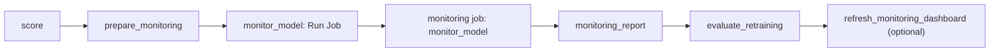

# Monitor deployed models

## When you need it

Monitoring checks models after they score. It compares production inputs with
the training population (drift and data quality), matches delayed outcomes to
saved predictions (performance), and can request guarded retraining. Results are
saved in one shared Delta store and shown on one shared dashboard. It works the
same for single-model, competition and model-set projects.

Monitoring is optional. It runs only when the project has a monitoring
destination and `monitoring_enabled: "true"`. Setup asks for the destination;
a blank answer creates a project that trains and scores without monitoring. See
[the setup questions](databricks_project_setup.md#monitoring-destination).

## How monitoring runs

A successful score hands its receipt to the separate monitoring job. That job
measures and saves the evidence, shows it in `monitoring_report`, and applies
any retraining policy you enabled. The dashboard refresh task exists only after
you configure it. The monitoring job also has its own schedule, which starts
paused, to revisit delayed outcomes without a new score. Monitoring runs only in
shared production-mode targets; personal development targets skip it unless they
opt in to their own separate store.

## Read in this order

1. [Set up the monitoring store](databricks_monitoring_setup.md): destination,
   owned tables and views, permissions.
2. [Enroll models and run monitoring](databricks_monitoring_enrollment.md):
   automatic enrollment, reference preparation, the schedule.
3. [Match delayed labels](databricks_monitoring_labels.md): the label table
   needed for performance.
4. [Drift and data quality](databricks_drift.md): thresholds, statuses, charts.
5. [Performance loss](databricks_performance.md): policies, windows, baselines.
6. [Guarded retraining](databricks_retraining.md): drift and performance
   triggers and their shared guards.
7. [Shared dashboard](databricks_monitoring_dashboard.md): connect, own and
   read the dashboard.
8. [Serving monitoring](databricks_serving_monitoring.md): enroll endpoints and
   read the Online serving page.

## Common errors and fixes

| Symptom | Fix |
| --- | --- |
| Train or score fails with `Set both monitoring_catalog and monitoring_schema.` | Set both names, or turn monitoring off; see [store setup](databricks_monitoring_setup.md#if-no-destination-is-set). |
| Scoring succeeds but nothing is monitored | Check `monitoring_enabled` for the target and that it is a shared production-mode target. |
| The dashboard shows old results | Run monitoring first; a dashboard refresh only rereads saved evidence. |
