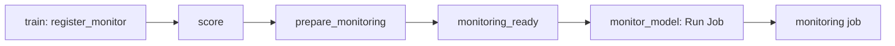

# Enroll models and run monitoring

## When you need it

Use this page after [store setup](databricks_monitoring_setup.md) to enroll activated or scored
batch models, prepare their references, and start observation. For endpoints, use
[serving monitoring](databricks_serving_monitoring.md).

Monitoring runs only for shared `mode: production` deployments (`test`, `syst`,
`prod`). Personal development targets do not enroll temporary models or create
monitoring tables. The `monitoring_allowed` condition excludes enrollment and the
post-scoring monitoring handoff in `mode: development`; training
and scoring still run normally, including automatic scoring after activation.
Development targets also set `monitoring_enabled: "false"`,
`monitoring_performance_policies: '{}'` and `on_drift: disabled`.
The deployment-mode guard remains effective even if shared monitoring destinations
or an enabled flag are inherited from common settings.



Activation enrolls the model in the train job. Each successful score then hands
its receipt to the separate monitoring job.

### If monitoring is not configured

Monitoring runs only when setup received a monitoring catalog and schema, which
sets `monitoring_enabled: "true"`. A blank catalog at setup sets it to `"false"`:
train and score run, `register_monitor` and `prepare_monitoring` report
`disabled`, and the score job skips `monitor_model`. Nothing is enrolled or
observed. Enable it later as described in
[store setup](databricks_monitoring_setup.md#if-no-destination-is-set). A
configured `"false"` flag with both names set publishes a pause instead.
Without a configured label table, drift and feature quality still run; actual
model performance remains unavailable.

Keep model/data `catalog`, `input_schema`, `output_schema` and `metadata_schema`
unchanged. After a successful activation, the train job's `register_monitor` task
registers the version from the verified lifecycle result before scoring. The training graph orders
`training_report -> register_monitor` before `scoring_requested` in every layout.
Initial activation, approval and rollback are supported; pending/rejected candidates do
not replace the active enrollment. Merely running `bundle deploy` does not
activate a model. A successful scoring or CDF-recovery task also registers its
actual model version and physical Delta prediction generation. It never resolves
an alias a second time. No-op scoring also repairs registration without writing
duplicate predictions. A registration error fails the task visibly; previously
committed predictions remain intact and their receipt makes scoring retries safe.
A pending recovery request does not register an output as successfully scored.

## What to edit

In the generated model Bundle's target variables, configure:

```yaml
monitoring_catalog: operations
monitoring_schema: model_monitoring
monitoring_expected_interval_hours: "24"
monitoring_revisit_windows: "3" # Includes the latest completed window
monitoring_drift_thresholds: '{"psi": 0.2, "ks_statistic": 0.1, "wasserstein": 0.1, "kl_divergence": 0.1}'
# Optional shared MLflow experiment for the post-scoring task:
monitoring_experiment_name: /Shared/skyulf/monitoring
monitoring_dashboard_url: "https://<workspace-host>/dashboardsv3/<dashboard-id>/published"
# Optional actual results:
monitoring_label_table: outcomes.production.labels
monitoring_result_available_at_column: available_at
monitoring_performance_policies: '{}'
```

Place this excerpt under `targets.<target>.variables` in the generated `deployment/targets.yml`.
Performance and [delayed labels](databricks_monitoring_labels.md) are optional; choose their policy
on the [performance-loss page](databricks_performance.md).

The inventory holds the latest enrollment for environment/project/fully qualified
model name. A newly scored model version updates that enrollment and keeps old
version observations in history. It appears never_observed until the central job
measures the new configuration. Removing deployment settings does not delete an
existing enrollment. To pause, retain the destination, set monitoring_enabled to
false and run scoring, or upsert a disabled MonitorConfig through enroll_monitor.
Do not edit only the duplicated config/digest fields by hand. Removing only the
destination while monitoring is enabled is invalid. External alias edits do not
trigger enrollment.

Automatic registration supports single models, competition winners and model-set
components. Model-set activation enrolls each component's concrete version before
scoring. Each component retains its parent set name/version/branch and reads its
own predictions from the shared physical output table. Use `all` or `separate_views`;
`combined_only` cannot supply individual model performance and is rejected before
scoring when monitoring storage is configured. No JSON model list is required.

## The command

Run from the generated project root after reviewing its target variables. These commands operate on
Databricks; replace `YOUR_PROFILE` and the target. Deploy updated model, score and monitoring jobs
together when changing their shared runtime contract.

```powershell
databricks bundle validate --strict -t test --profile YOUR_PROFILE
databricks bundle deploy -t test --profile YOUR_PROFILE
databricks bundle run monitoring -t test --profile YOUR_PROFILE
```

### Prepare references for a first pinned candidate

Activation prepares verified training references. A first manual candidate scored
by concrete version may be enrolled by scoring without having been activated.
In that case, the prediction commit can succeed while the monitoring child fails
with `Spark reference is not prepared; run prepare_spark_monitoring_reference first.`
Open the score receipt to confirm publication, then run the existing monitoring
job's preparation action for the enrolled identity:

```powershell
databricks bundle run monitoring -t test --profile YOUR_PROFILE --params monitoring_action=prepare_references
```

Use the same project, target and monitoring namespace. Preparation reads the saved
training evidence and creates/reuses the immutable references; it does not train,
promote or rescore. After it succeeds, repeat the original score request to finish
its monitoring handoff. An unchanged source/model replay is a prediction no-op;
inspect the original commit and the separate child result. Do not delete output
rows or invent a new watermark to repair monitoring. The preparation action needs
the [reference/table permissions](databricks_monitoring_setup.md) of the shared store.

After reference preparation succeeds, set `monitoring_pause_status: "UNPAUSED"` in the target
variables and redeploy to let the existing UTC schedule revisit observations. Keep the generated
schedule paused until references and permissions are verified.

## What you should see

Generated producer Bundles always use Spark monitoring; no engine selection is
required. Scoring validates its exact receipt, then a native Run Job task calls
the independent third `monitoring` job and waits for its result. Training can call
scoring through the same native job hierarchy. Monitoring uses its own serverless
environment, timeout and retry settings, and a UTC schedule that starts `PAUSED`. Prepare and
verify references before unpausing it. The scheduled run observes enrolled models
and delayed labels even if no new scoring batch arrives. Its tasks run
`monitor_model -> monitoring_report -> evaluate_retraining`; a guarded policy may submit
the producer's complete train job.

With monitoring configured and enabled, every successful scoring receipt reaches
the dedicated monitoring job. Failed scoring and missing saved batches do not
create a successful observation. Dashboard refresh reads saved results; it does
not run monitoring and an already open page is not a push stream. Use the
dashboard's refresh control to load new observations; reloading the browser can
still reuse cached query results. Scheduled monitoring covers late labels even
when scoring has not run again.

Open `monitoring_report` for saved drift, observed performance and policy evidence; **Open
monitoring dashboard** appears when the shared HTTPS URL is configured. `evaluate_retraining` then
applies only explicitly enabled [retraining policies](databricks_retraining.md).

The score job runs `prepare_monitoring -> monitoring_ready -> monitor_model`,
where the final node is the native child-job call. Calculation, saved drift reports
and guarded retraining belong to that child job. The monitoring job's own
`monitor_model` executes `src/jobs/monitor_project.py`; the scoring job's task
with that key invokes the child job. All projects can link to the same
`monitoring_dashboard_url`.

For custom inventory-wide SDK runs, select a suitable observation window.
The inventory limit bounds enrolled
models, not prediction rows. Refreshing the dashboard does not compute new
metrics. Each model failure is saved, other models are attempted, and the
notebook then fails if any model failed. Inspect reports before retrying.

Observation identity includes configuration, cutoff, window and snapshot evidence.
Exact retries do not overwrite history. Current health ranks the newest window,
then its latest measurement; historical backfills cannot replace newer windows.
Keep the Delta retention needed for source replay and audit history.

<span id="library-api-and-legacy-local-execution"></span>

### Library API and local execution

The library can read a bounded inventory snapshot, default maximum 10,000
entries. The SDK can enroll explicit records and run inventory-wide observations;
it does not require a configuration file or a second template.

The public local API observes with pandas or Polars in the Python process.
`MonitorConfig.max_rows=10000` is its default observation budget; `MAX_MONITOR_ROWS=1_000_000` is
the local safety ceiling. The local byte budget defaults to 64 MiB and is capped at 1 GiB. Neither
local row nor byte budget limits Spark observation rows. These are not two separate Spark limits.

The observation budget bounds local data, while the inventory budget bounds enrolled models.
Generated Spark observation rows have neither local row nor local byte caps;
[drift measurement limits](databricks_drift.md#common-errors-and-fixes) still apply.

### Library integration entrypoints

Import monitoring helpers from the domain modules below. Paths are relative to
`skyulf/integrations/databricks/`.

| File | Responsibility |
| --- | --- |
| `observability/monitoring/monitoring_config.py` | Validated model/table identity, version and bounded policy. |
| `observability/monitoring/monitoring_registration.py` | Activation/scoring enrollment and immutable scoring handoff. |
| `jobs/monitoring/monitoring_tasks.py` | Visible activation enrollment and per-commit scoring observation tasks. |
| `observability/monitoring/monitoring_output.py` | Saved-batch drift report and safe shared-dashboard navigation in task output. |
| `observability/monitoring/monitoring_reference.py` | Registered artifact and original training-reference replay. |
| `observability/monitoring/monitoring_sources.py` | Saved predictions, source snapshots, receipts and delayed labels. |
| `observability/monitoring/monitoring_metrics.py` | Core metric adapters and finite keyed reports for bounded frames. |
| `observability/monitoring/monitoring_performance.py` | Mature performance windows measured against a pinned model baseline. |
| `observability/monitoring/spark/` | Distributed monitoring measurements, references and source handling. |
| `observability/monitoring/monitoring_store.py` | Owned Delta objects, concurrent registration, inventory reads and report history. |
| `observability/monitoring/monitoring.py` | Inventory observations, engine dispatch, failure isolation and MLflow reports. |
| `jobs/shared/job_runtime.py`, `scoring/incremental/scoring_recovery.py` | Invoke enrollment after successful scoring/recovery. |
| `model_sets/model_set_project.py`, `model_sets/monitoring_model_set.py` | Enroll pinned components after activation and scoring. |

## Common errors and fixes

If train or score fails with `Set both monitoring_catalog and
monitoring_schema.`, monitoring is enabled or one name is set alone; fix the
destination as described in [store
setup](databricks_monitoring_setup.md#if-no-destination-is-set). If nothing is
monitored after successful scoring, check that `monitoring_enabled` is `"true"`
for that target.

A deployment alone does not activate or enroll a model. Run the normal lifecycle/scoring path, then
check the concrete version and configuration in inventory. A configured false flag publishes a pause
only when registration executes; removing configuration does not delete the previous enrollment.

Reference preparation is a separate, one-time activation or explicit migration step. It replays the
original training source under the existing bounded training row and byte budget, validates the
original split and writes pinned reference populations. Models without
`monitoring_source_evidence.json` need retraining or verified original source proof; the job never
silently reconstructs provenance. Spark freshness checks fail explicitly for unsupported fixed
normalizers, custom pre-split filters and custom weight generators. Supported source weight columns
still obey the training contract. Training remains local even when inference is distributed. Spark
monitoring does not change the training or scoring engine.

Activation enrollment is ordered by the original serialized lifecycle run start.
A delayed score cannot replace an activated different version, and repairing an
older activation cannot replace a newer activation. Enrollment-only repairs read
the verified original receipt without repeating training or alias changes.
The private activation-order metadata lives in inventory config_json; table
schemas and model configuration digests do not include it. Every job that reads
the shared inventory must run a Core release that understands it.

Current-health states and their freshness rules are described on
[Drift and data quality](databricks_drift.md#what-you-should-see). If the latest report failed,
inspect its saved error before retrying; the dashboard does not reuse an older success.
