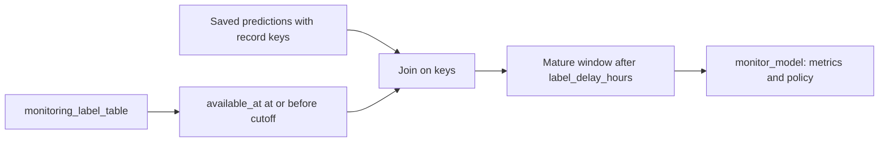
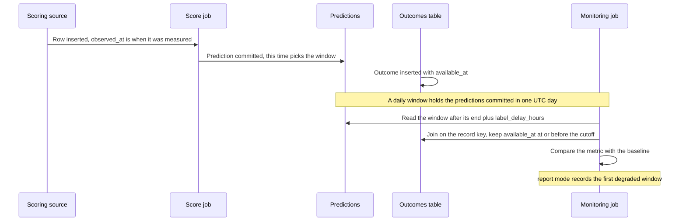

# Match delayed labels to saved predictions

## When you need it

Use delayed labels when actual outcomes arrive after prediction. [Drift](databricks_drift.md) can
run without outcomes; measured accuracy and [performance-loss policies](databricks_performance.md)
need usable true targets.

Performance explains the number of predictions with matched usable true target
values. No configured label source means no measured performance, not zero
accuracy. A target in an arbitrary source is not discovered automatically: use
monitoring_label_table with the saved record keys and target column, and declare
the result-availability timestamp. That table can be the scoring source when it
already satisfies this contract and its rows are never updated; when outcomes
arrive later, use a separate outcomes table (see
[Choose a table layout](databricks_training_data.md#choose-a-table-layout)).
Fewer than two eligible pairs cannot be scored.



## What to edit

During Bundle initialization, both setup modes accept `label_table_name` and
`label_available_at_column`. For example:

```json
{
  "label_table_name": "outcomes",
  "label_available_at_column": "available_at"
}
```

A short table name resolves through the active target's catalog and input schema.
A three-part name such as `labels.production.outcomes` stays explicit across
targets. Leave both fields empty to start without label-based measurements.
Setting only one fails initialization. These answers generate the two variables
below; override them per target if your environments use different sources.

Set these target variables in `deployment/targets.yml`; the names below are examples.

```yaml
monitoring_label_table: labels.production.outcomes
monitoring_result_available_at_column: available_at
monitoring_revisit_windows: "3"
```

The label table must expose the saved record keys, the model's target column
and the UTC timestamp when the actual outcome became available. `available_at`
is outcome availability, not the prediction time or the job execution time.

| Observation source | Required label identity |
| --- | --- |
| Batch predictions | The model's saved `record_key_columns`, including every component of a composite key. |
| Serving predictions | `databricks_request_id` plus zero-based `request_row_index`, distinguishing multiple rows in one request. |

Both need the saved target column and a valid UTC availability timestamp (or an aware ISO timestamp
string). Eligible label keys must be unique. Actuals must use the saved classification classes or
finite numeric regression targets.

For a model set, include the target columns required by each monitored component. Skyulf does not
discover an arbitrary target source, generate outcomes, or write labels back into the training
table. `source_layout: separate_outcomes` also configures a read-only training
join; in other layouts, monitoring's label binding alone does not enable that
join. See [training from separate outcomes](databricks_training_data.md#train-from-separate-outcomes)
before enabling [retraining](databricks_retraining.md).

`monitoring_revisit_windows` controls how many completed performance windows are
checked for late labels. It defaults to `3`, includes the latest window, and
accepts 1 to 100. Historical windows can update saved evidence, but do not
independently submit training. Spark joins saved predictions, pinned feature
snapshots and eligible actual outcomes, then writes durable Delta observations.
Ongoing Spark measurements do not use the local one-million-row monitoring cap.

### Which time counts

For batch predictions, three timestamps are involved, and only the prediction
commit time places a row in a performance window:



- `observed_at` is a source column for training windows; it does not decide the
  performance window. Loading two historical days today puts both into today's
  window.
- `available_at` decides whether an outcome may be used yet. An outcome that
  arrives later is picked up when monitoring revisits that window.
- `consecutive_windows` counts adjacent degraded windows. It decides whether
  `mode: retrain` may request training; it does not delay a report.

## The command

Deploy the updated producer settings and run successful activation/scoring registration so the
enrollment contains the label source. Run the existing monitoring job to read outcomes available at
its observation cutoff.

```powershell
databricks bundle validate --strict -t test --profile YOUR_PROFILE
databricks bundle deploy -t test --profile YOUR_PROFILE
databricks bundle run monitoring -t test --profile YOUR_PROFILE
```

Unpause the monitoring schedule after
[reference preparation](databricks_monitoring_enrollment.md#the-command). Revisited windows can
acquire late outcomes even without another scoring batch. A historical backfill updates evidence but
cannot independently submit training.

## What you should see

Only saved predictions are scored. Reference loading replays the original training
membership, and current features use the source snapshots recorded with predictions.
Local SDK enrollments materialize bounded pandas/Polars inputs under their
limits; generated Spark enrollments use distributed readers. Labels join by saved record
keys and only count when their UTC availability is at or before as_of.
Missing labels or fewer than two finite
pairs leave performance unavailable; an unavailable value is not zero accuracy.

Full monitoring reports include `excluded_rows`: the number of saved prediction
records explicitly marked `scoring_status="excluded"`. Missing prediction records
and missing labels do not increase this count. Spark, pandas and Polars reports
retain it in `report_json`. Existing saved observations are not rewritten; a
missing count in an older report means unavailable, not zero.

The saved report exposes `scored_rows`, `labeled_rows` and `label_coverage`. Coverage is eligible
usable labeled predictions divided by scored predictions; an empty prediction population leaves it
unavailable. The policy separately requires both `minimum_labeled_rows` and
`minimum_label_coverage`. Its fixed UTC windows wait `label_delay_hours` after their end before
assessment.

A 00:00–24:00 UTC window with a six-hour delay first becomes eligible at 06:00 UTC the following
day. Outcome availability is checked against the observation cutoff; an outcome recorded as
available later cannot be used early. Window end and calculation time remain separate.

See [performance chart interpretation](databricks_performance.md#what-you-should-see) for
per-identity coverage, gaps and classification matrices.

## Common errors and fixes

| Symptom or error | Fix |
| --- | --- |
| `Labels need target and availability columns.` | Supply the saved target and configured availability column. |
| `Invalid or naive label availability timestamp.` | Provide non-null valid timestamps; strings must include a timezone. Do not substitute prediction time or job execution time. |
| `labels has duplicate record keys.` | Resolve duplicates among eligible outcomes upstream, including every composite key field. The monitor does not pick an arbitrary label. |
| `Prediction and label classes must match saved classes.` | Correct label encoding to the classes saved with this concrete model version. |
| Insufficient labels or blank scores | Wait for true outcomes, check keys and cutoff, and meet both policy evidence minimums. Fewer than two finite pairs cannot produce performance. |
| Serving requests have incomplete payloads | Check [logging errors](databricks_serving_monitoring.md#common-errors-and-fixes); excluded payloads cannot contribute prediction/label pairs. |
| A label table changed but retraining remains blocked | Labels do not update the training table. Supply fresh eligible labeled training rows under the existing training contract. |
