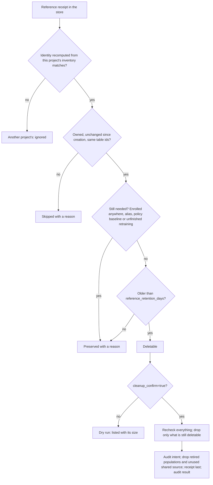

# Set up and upgrade the monitoring store

## When you need it

Set up one durable store before enabling production monitoring, or upgrade its owned views before
deploying a newer producer or dashboard. Follow [Enroll models](databricks_monitoring_enrollment.md)
next.

The end-to-end flow from scoring to dashboard is on the
[monitoring overview](databricks_monitoring.md#how-monitoring-runs).

Set per-model measurement controls through the existing
`monitoring_drift_thresholds` JSON variable. The [complete settings table](databricks_drift.md#configure-thresholds-and-measurement-limits)
covers category grouping, uniqueness, summary caps, PSI severity wording and
non-Spark row/byte budgets. Empty `{}` preserves existing enrollment defaults.
These settings do not resize Spark compute or change model admission probes.

The canonical dashboard definition is `src/monitoring/monitoring.lvdash.json`
inside the existing Databricks project template. This is not a separate Bundle
or another project template. Single, competition and model-set projects write to
one configured store and display their evidence in one shared dashboard.

| Operation | Trigger and effect |
| --- | --- |
| Measure drift and performance | Successful scoring calls the separate Spark monitoring job when monitoring is configured and enabled. A production-mode target is required; development targets bypass shared monitoring. |
| Revisit delayed outcomes | Unpause the monitoring job's schedule after setup. The generated schedule starts paused. |
| Clean old references | Projects initialized with monitoring include a separate weekly cleanup job, enabled on shared targets and paused in personal development. Review the retention and writer controls below before deployment. |
| Refresh dashboard results | The configured native Dashboard task reruns published datasets after monitoring completes. It does not calculate new monitoring metrics. |
| Request training | Drift or performance loss can qualify independently when its own policy enables retraining. Shared guards must also pass. |

Changing training/scoring compute to a cluster does not enable monitoring, change
its storage destination, or enable automatic retraining. The generated monitoring
job has its own serverless environment. Use Databricks to inspect job run
history, compute usage and billing.

Native AI/BI is the visualization product, distinct from Databricks Data Profiling. This Bundle does
not provision a separate native data profile. The older `quality_monitors` API is deprecated; new
integrations use `data_quality`. An InferenceLog profile can calculate model quality from prediction
and label columns, but it requires its own input table, refresh lifecycle and metric tables. It does
not replace this project's delayed-outcome matching, concrete training holdout references,
consecutive-window policy or guarded training requests. See
[the current Data Profiling API](https://docs.databricks.com/aws/en/data-governance/unity-catalog/data-quality-monitoring/data-profiling/create-monitor-api).

## What to edit

Setup asks `monitoring` (on or off) and, when on, `monitoring_schema` in both
quick and detailed mode. An omitted or blank schema defaults to
`skyulf_monitoring`; a different answer is preserved, and existing stores are
never moved or migrated. The catalog is not asked: `monitoring_catalog` defaults to
each target's own `catalog`. Setup writes both to `deployment/variables.yml`; see
[the setup questions](databricks_project_setup.md#monitoring-destination). To
use other names in one target, put this excerpt under
`targets.<target>.variables` in `deployment/monitoring.yml`. The values are
examples; use your existing catalog and a schema reserved for the shared store.

```yaml
monitoring_catalog: operations
monitoring_schema: model_monitoring
monitoring_enabled: "true"
```

### If no destination is set

`monitoring: "false"` at setup generates `monitoring_enabled: "false"`. Train
and score then run normally without enrollment, monitoring or a store. Nothing is
written to a monitoring schema, and both generated destination values are blank.
To enable monitoring later, set both names and
`monitoring_enabled: "true"`, then validate and redeploy.

| `monitoring_enabled` | Catalog and schema | Result at train/score |
| --- | --- | --- |
| `"false"` | Both blank | Runs without monitoring |
| `"false"` | Both set | Publishes a paused enrollment |
| `"true"` | Both set | Enrolls and monitors |
| `"true"`, or either value set alone | Not both set | Fails with `Set both monitoring_catalog and monitoring_schema.` |

Development targets skip this check unless they opt in to their own separate
store; see [development monitoring](databricks_monitoring_enrollment.md#development-monitoring-optional).

Every project uses the same independent
`monitoring_catalog` and `monitoring_schema` values. These control monitoring
storage only; they do not change model, training, source or prediction locations.
The catalog must exist. The first configured enrollment or enabled scheduled run creates the schema
and missing owned tables/views if its identity has the required permissions.
Later runs validate and reuse existing objects without replacing their data or
view definitions. Explicit `initialize_monitoring_store` remains the upgrade API
for deliberately refreshing view definitions.

When a release adds views, run that owner upgrade **before upgrading producer
jobs**. Bootstrap still needs CREATE permission for any missing object; a writer
with only SELECT/MODIFY fails with the platform's permission error until the owner
creates the missing views. There is no fallback to partially initialized storage.

| Object | First initialization | Later runs |
| --- | --- | --- |
| `model_inventory` (Delta) | Create if absent | Producer MERGE inserts/updates one environment/project/model identity. |
| `monitoring_results` (Delta) | Create if absent | Monitoring job inserts immutable observations; exact retries deduplicate. |
| `complete_observations` (view) | Create before dependent views | Exclude policy-only late-label reports from feature/serving selection; preserve failed and zero-row observations. |
| `current_health` (view) | Create if absent | Reuse; read inventory and latest applicable observation. |
| `monitoring_identities` (view) | Create after `current_health` | Include enrolled and historical model/version/context identities, including unresolved versions; latest measurement time counts full observations only. |
| `serving_windows` (view) | Create after `complete_observations` | Share enabled, current-configuration serving windows, error-class fallback and per-context/version ordering across charts. |
| `metric_history` (view) | Create if absent | Reuse; expand stored report metrics for dashboard queries. |
| `performance_actions` (Delta) | Create if absent | Append request and skip receipts without rewriting observations. |
| `retraining_requests` (Delta) | Create if absent with Serializable isolation | Retain request identities, submission receipts, a shared cooldown gate per training job and the store's reference-mutation control row. |
| `performance_history` (view) | Create if absent | Reuse; join performance evidence with the latest applicable action. |
| `monitoring_issues` (view) | Create if absent | Reuse; read current health and recorded quality, drift and active-policy issues. |
| `model_version_details` (view) | Create if absent | Reuse; read concrete version lineage and bounded metadata snapshots from existing reports. |

[Tables in your workspace](databricks_workspace_tables.md#the-shared-monitoring-store)
explains each of these objects and the reference tables in plain terms.
One store serves all enrolled models; inventory, observations and action history
are shared rather than recreated per model or score run. Spark reference
preparation writes a population and receipt per verified model/training identity,
plus an immutable `monitor_src_<identity>` table shared only by references with
identical source content and schema. The population has a recorded boolean
membership column so readers recover the original training and seen rows without
duplicating tables. Existing format-1 train/source/seen/receipt tables remain
readable and are not migrated. See the workspace-tables guide for examples.
References are prepared once for their identity and reused; a new
model/training identity can require new reference tables. Ordinary monitoring
observations append to the shared results table, not to new per-run tables.
Existing foreign objects or incompatible table schemas are rejected.
Store initialization sets inventory and retraining-request isolation to Serializable. Producer
registrations make at most three attempts (two retries) on optimistic Delta
conflicts; exhausted
conflicts and other errors remain visible. Each project monitoring job serializes
its own observations; independent projects share the same store. An inventory read
never writes its older snapshot back over another repository's configuration update.

## The command

For jobs without schema/table creation privileges, have the store owner run
`initialize_monitoring_store(spark, monitoring_catalog, monitoring_schema)` before
starting those jobs. This also prepares `retraining_requests`, so the first
automatic training request can use the existing table. Grant the runtime identity
the required catalog/schema access and table read/write privileges. Reusing a
compatible store requires no schema, table or view creation SQL. If any owned
table or view is missing, the next enrollment or monitoring run must create it,
so either rerun owner initialization first or give that run's identity CREATE
privileges. Normal runs refuse incompatible schemas or weak isolation.

Run this cloud-only Python example in a store-owner notebook after installing the Core requirement
that will serve the producers and dashboard. Define `monitoring_catalog` and `monitoring_schema`
with the destination selected above.

For an explicit schema/view upgrade, run `initialize_monitoring_store` after installing the updated
Core requirement and **before deploying or publishing the updated dashboard**. The dashboard reads
`complete_observations`, `monitoring_identities` and `serving_windows`; a dashboard refresh does not
create these views. In an owner-run notebook:

```python
from skyulf.integrations.databricks.observability.monitoring.monitoring_store import (
    initialize_monitoring_store,
)

namespace = initialize_monitoring_store(spark, monitoring_catalog, monitoring_schema)
for view in ("complete_observations", "monitoring_identities", "serving_windows"):
    spark.table(f"{namespace}.{view}").limit(0).collect()
```

Grant dashboard viewers SELECT on the new views, using the same access policy as
the existing monitoring views, then publish. The initializer checks ownership of
every object before changing any of them. Normal producer bootstrap creates only
missing views and never replaces existing definitions. The inventory and
observation table schemas and saved data stay compatible. Store bootstrap
creates `performance_actions` with the other tables. Any active performance
policy, in `report` or `retrain` mode, writes its actions there, so the
monitoring identity needs SELECT/MODIFY on `performance_actions`.

Projects on different Core versions share these views. Keep existing columns and
their meanings compatible across those versions; coordinate owner upgrades with
all consumers before changing a view contract. Owner-run monitoring can replace
view definitions using its installed Core version. Adding a result-table column
also requires reinitialization to refresh the views' stored column lists.
Chart labels and missing-value display text stay in the dashboard, so wording
changes do not require a store upgrade.

## What you should see

The initialization call returns the namespace, and all three `spark.table(...).limit(0).collect()`
checks finish without an error. Existing observations remain in place. Each later enrollment or
enabled observation reuses compatible objects. Monitoring metrics appear only after an observation
run; initialization does not calculate them.

The producer principal needs access to the central catalog/schema and
SELECT/MODIFY on `model_inventory` for enrollment. The score job's monitoring
task also needs SELECT/MODIFY on `monitoring_results`, read access to the saved
model/training/source/prediction/label data, and access to its optional MLflow
experiment. First bootstrap additionally requires permission to create the missing schema,
Delta tables and views. A complete existing store needs no recurring CREATE/ALTER
permission for bootstrap; normal observation/reference/action writes retain their
own grants. Foreign objects or incompatible schemas fail visibly.
The central monitoring principal needs inventory access, report writes, read access
to enrolled models/artifacts, original source snapshots, predictions and optional
labels, plus the monitoring MLflow experiment. These table grants assume trusted
producer repositories; they do not provide per-row tenant isolation.

Configure [the shared dashboard](databricks_monitoring_dashboard.md) after the store exists. Its
training tables also require `training_summary_json` in the owned `model_version_details` view.

## Retain or clean old Spark references

Prepared Spark monitoring references are stored snapshots of training and source
populations. They are separate from source tables and historical monitoring
reports. The optional cleanup action considers only references whose saved
receipt proves they belong to this project and environment in the configured
monitoring store. Nothing is cleaned during ordinary observation.

Projects initialized with a monitoring catalog include a separate
`monitoring_cleanup` job. It runs Sundays at 04:00 UTC with confirmation enabled
and a 90-day minimum reference age. This schedule is independent of monitoring
and retraining; personal development targets keep it paused. Override these
variables in `deployment/targets.yml`:

```yaml
monitoring_cleanup_cron: "0 0 4 ? * SUN"
monitoring_cleanup_confirm: "true" # false reports candidates without deleting
monitoring_cleanup_pause_status: UNPAUSED # PAUSED stops the cleanup schedule
monitoring_reference_retention_days: "90"
```

Setting `monitoring_enabled: "false"` does not pause cleanup in a configured
shared target. Use `monitoring_cleanup_pause_status: PAUSED` to stop its schedule,
or `monitoring_cleanup_confirm: "false"` to keep reporting candidates without
deletion.

The job uses the same monitoring identity, permissions, notifications and
serverless environment as observation. It only runs `cleanup_references`;
it does not measure drift or request training. Projects initialized with
monitoring off have no cleanup resource. Enable their monitoring destination
and use the manual action below, or regenerate with monitoring on to
obtain `resources/monitoring_cleanup.job.yml` and its target settings.

Before deploying an enabled cleanup schedule, meet the lifecycle-writer
requirements below. Existing corporate tables are not relocated or removed by
changing these defaults.



If the inventory, registry aliases or retraining state cannot be read, the run
stops before any change.

Start with a dry run from the deployed project:

```powershell
databricks bundle run monitoring -t test --profile YOUR_PROFILE --params monitoring_action=cleanup_references,reference_retention_days=90,cleanup_confirm=false
```

Inspect the `monitor_model` output for candidate tables, size and preservation
reasons. The default age is 90 days, measured from receipt creation; accepted
values are 1–3650. Change the default with
`monitoring_reference_retention_days` in the target variables. Active enrollment
in any project sharing the store, a registered alias, a policy baseline or
pending retraining can preserve an old reference. Unknown ownership or missing
dependency evidence is never permission to delete it.

Before enabling deletion, upgrade every producer sharing this store to the same
admission protocol. Updated generated jobs serialize model alias changes,
enrollment, reference publication and confirmed cleanup through one control row
in `retraining_requests`. The row uses Serializable Delta writes; it adds no new
store table. A competing mutation waits for the verified owner to release, for
up to ten minutes by default. Timeout reports the exact owner and job/task;
it never takes over an old lock. SDK callers can set `wait_timeout_s` from 0
to 3,600 seconds. An uncertain claim/write is not automatically retried.
During acquisition, a successful claim that loses to another owner, or a Delta
write explicitly rejected with a recognized data-conflict condition, can retry
within that same wait budget. Retries use bounded backoff and recheck the physical
table identity and ownership. Unknown errors, metadata/protocol changes and
contradictory ownership evidence stop the operation; an error message merely
containing the word "concurrent" is insufficient. This follows Databricks'
[documented write-conflict boundary](https://docs.databricks.com/aws/en/optimizations/isolation/row-level-concurrency#conflict-exceptions).
Some Delta Connect versions omit structured error fields. For those versions,
Skyulf accepts only a recognized Delta exception class with its matching,
allowlisted condition at the beginning of the message. Any supplied structured
condition remains authoritative; malformed or contradictory metadata stops retry.
Lifecycle evaluation and quality checks run before admission; the first alias
write acquires it and retains it through phase completion and failure cleanup.
Training computation and ordinary reference preparation run outside the publication
lock. First enrollment of a serving monitor retains its existing prepare-before-enroll
order and can hold admission longer while preparing that reference.

This is a cooperative protocol. Restrict alias and reference-table writes to the
participating job identities. Pause legacy jobs and external UI/MLflow writers
that bypass admission, and wait for them to finish before deleting. A separate
job with `max_concurrent_runs: 1` does not serialize other jobs.

After reviewing the dry run, use `cleanup_confirm=true`. The action rechecks
dependencies while holding admission, records intent and outcome in the owned
`reference_cleanup_audit` Delta table, drops reference populations and drops
their receipt last. Cross-service checks and table drops are not one atomic
transaction. A shared source is dropped only by its last retiring receipt, after
checking all projects' remaining receipts. Unknown receipt state prevents that
deletion. If dropping a population table
fails, the receipt remains for investigation and recovery. A failure writing the
final audit result can occur after every table, including the receipt, is gone;
completed deletions are not rolled back. Inspect the table state and recorded
intent before retrying or treating an absent final audit row as proof of no deletion.

The action does not delete source/prediction tables, model versions, monitoring
reports, jobs or dashboards. Disabled monitoring can still run cleanup when the
store destination is configured; personal development targets remain disabled.
The caller needs read access to the store, registry aliases and retraining job
state, permission to create/write the audit table, and ownership or equivalent
permission to drop the selected references. No new dashboard chart is created.

### Recover a failed reference mutation

A failed remote request can still finish after its response is lost. Admission
therefore remains held after a mutation fails or its driver crashes; there is
no expiry timer. Normal completion releases it, as does a validation failure
before any protected write started. A held owner temporarily blocks
other reference mutations in the same store, including model promotion and
enrollment, while ordinary observation reads remain available.

Inspect the row before taking action:

```sql
SELECT request_id AS owner, status, created_at_ms, evidence_json
FROM workspace.skyulf_monitoring.retraining_requests
WHERE row_id = 'control:reference_mutation';
```

Generated tasks record their workspace, job-run ID and task key. Stop the
original run, wait for it to terminate, and inspect its alias/table/audit state
to resolve uncertain writes. From a separate operator notebook, first preview:

```python
from databricks.sdk import WorkspaceClient
from skyulf.integrations.databricks.observability.monitoring.reference_admission import (
    recover_reference_mutation,
)

workspace = WorkspaceClient()  # The same workspace as the saved holder.
namespace = "workspace.skyulf_monitoring"
rows = spark.sql(
    f"SELECT request_id, status, evidence_json FROM {namespace}.retraining_requests "
    "WHERE row_id = 'control:reference_mutation'"
).collect()
if len(rows) != 1 or rows[0].status != "held":
    raise ValueError("No unique held owner to recover; inspect the store first.")
owner = rows[0].request_id
print(rows[0].evidence_json)

preview = recover_reference_mutation(
    spark, namespace, workspace=workspace, owner=owner
)
print(preview)
print(
    "After inspecting the interrupted operation, run:\n"
    "recover_reference_mutation(spark, namespace, workspace=workspace, "
    f"owner={owner!r}, confirm=True)"
)
```

The helper verifies the saved workspace, run and task. `TERMINATED` is accepted.
An `INTERNAL_ERROR` parent is accepted only with a positive end time and all
tasks either terminated with end times or skipped; the actual holder task must
have terminated. An internal-error label alone cannot prove that workers stopped.
Running, terminating, unknown or incomplete task state is rejected. These checks
use the [Jobs run response](https://docs.databricks.com/api/jobs/v2/run).
After verifying that the original writer cannot resume, explicitly call the
same function with `confirm=True`. It records a recovery intent, conditionally
clears only that exact owner, then records the result in
`reference_cleanup_audit`. Recovery does not retry the interrupted operation or
restore deleted tables. Review its partial work before starting a fresh job.
An audit failure can occur after release; re-read the control row before retrying.

Direct SDK callers must use `hold_reference_mutation(spark, namespace)` around
alias operations that could activate or retire these references. For recoverable
job provenance, also pass `job_run_id`, `task_key` and `workspace_host` together.
Custom table writers inside that scope must call
`require_reference_mutation(spark, namespace, owner)` immediately before writing;
the yielded owner token binds the write to its admission. Skyulf's registry alias
operations perform that check automatically.
Manual callers without those fields require verified process shutdown and
owner-controlled SQL recovery; the helper cannot prove that a local process
has stopped. Never clear an owner merely because its timestamp is old.

## Common errors and fixes

| Symptom | Fix |
| --- | --- |
| Missing view or CREATE permission error after an upgrade | Run owner initialization before upgrading producer jobs; grant viewers SELECT on the refreshed views. Dashboard refresh does not install schema changes. |
| Foreign object, incompatible schema or weak isolation rejected | Have the store owner inspect the destination and use the explicit upgrade API. Do not overwrite an unrelated object. |
| No monitoring in a development target | Use a shared `mode: production` target; development deliberately bypasses enrollment and monitoring. |
| `Set both monitoring_catalog and monitoring_schema.` | Monitoring is enabled, or one name is set alone. Set both names for the target and redeploy, or set `monitoring_enabled: "false"` and clear both. |
| Train and score succeed but nothing is monitored | Setup left the catalog blank, so `monitoring_enabled` is `"false"`. Set both names and `monitoring_enabled: "true"`, then redeploy. |
| New reports contain NULL counts | Unmeasured values are unavailable. Keep measured zero separate. |

New `monitoring_results` rows store unmeasured counts as SQL `NULL`: this applies
to reference, current, scored and labeled rows, and drifted columns. An explicit
zero remains `0`. Failed or performance-only observations can omit these counts.
Historical rows and retries keep their saved values; upgrading does not backfill
old zeros. For custom queries over older reports, check `report_json` to distinguish
an absent count from a measured zero rather than replacing every `NULL` with `0`.

Each project keeps its own Core pin in `deployment/requirements.txt`. Projects on
different pins can share one store, so coordinate view contracts across all of
them before an owner upgrade.
