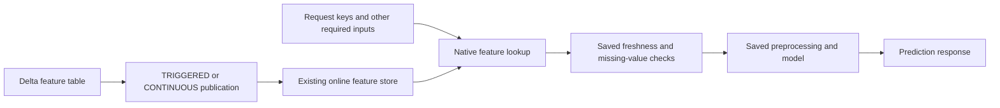

# Look up online features before prediction

## When you need it

An online feature model accepts entity keys, lets Databricks fetch current
feature values, and then runs the saved Skyulf preprocessing and predictor. An
explicit saved policy rejects missing or stale feature values before
preprocessing can impute them. This workflow uses the native Databricks Feature
Engineering envelope and Online Feature Store.

The saved guard supports raw pandas and Polars model execution. Endpoint
admission retains the existing certificate requirement: the fitted artifact
must use pandas and supported independent-row preprocessing. The initial online
request contract supports non-temporal scalar source inputs. It does not omit
required source fields to make an incompatible model appear to accept only keys.

### Follow the data through the system



Training binds the offline feature source to the model. Publication copies the
source's values into an online store. Endpoint setup verifies that the model's
saved source has an accessible matching publication. At request time Databricks
performs the lookup; Skyulf applies the saved validation and prediction logic.

| Bundle choice | What it adds | What you must supply |
| --- | --- | --- |
| `include_online_serving=true` | An unscheduled endpoint setup job and training lookup placeholders | Lookup fields, freshness policy, registered version and existing publication |
| `include_online_publication=true` | A feature synchronization job | Existing source table, source ID, destination and store name |
| `online_publication_mode=TRIGGERED` | Manual or scheduled synchronization; hourly schedule starts paused | Run a sync and observe completion before relying on the new values |
| `online_publication_mode=CONTINUOUS` | Start/status/stop/restart controls for native synchronization | Start once and inspect propagation and native pipeline health |
| `include_daily_rollout=true` | A separate gradual traffic controller | Two serving versions, saved comparison and initialized rollout state |

You can use online serving without this project's publication job when another
owner publishes the features. Conversely, publishing features does not create a
model endpoint. Continuous publication updates features; it is not a continuous
prediction job. Rollout is optional for either publication mode.

## What to edit

### Prepare identities and resources

Use the template's matching Core and Feature Engineering dependencies. On a new
workspace, arrange these before running the examples:

| Resource or identity | Required role in this flow |
| --- | --- |
| Source and destination UC schemas | Existing namespaces with access for the intended owners |
| Offline feature table | One row per key, declared non-null primary key, CDF and a feature timestamp |
| Online store | Explicitly provisioned and available; copy its exact name into the configuration |
| Training identity | Read observations/features and log/register the fitted native feature model |
| Publication identity | Read the source and manage its owned online publication |
| Endpoint identity | Read the published features and the registered package |
| Endpoint caller | Query permission and a request matching the saved input schema |

The online store is backed by Lakebase. Provisioning chooses its name and capacity in the
authenticated workspace; Bundle selection only references it. See
[Databricks Online Feature Stores](https://docs.databricks.com/aws/en/machine-learning/feature-store/online-feature-store)
for the current platform provisioning requirements. The examples below use the Skyulf adapter's
stricter latest-value, non-temporal contract.

### Generate, train and set up an online Bundle

From a Skyulf checkout, save these selections as `online-init.json`. This
answer-file command takes missing answers from their defaults; it does not ask
for missing table or target names. Replace the explicit example identities with
your own before generating:

```json
{
  "project_name": "customer_online",
  "catalog": "features",
  "schema": "customer",
  "source_table_name": "customer_observations",
  "target_column": "next_month_spend",
  "engine": "pandas",
  "training_layout": "single_model",
  "task": "regression",
  "input_columns": "total_spend, feature_updated_at",
  "record_key_columns": "customer_id",
  "include_online_serving": "true",
  "include_online_publication": "false",
  "include_daily_rollout": "false",
  "score_handoff": "disabled",
  "scoring_mode": "manual",
  "promotion_policy": "manual_approval"
}
```

```bash
databricks bundle init ./skyulf-core/templates/databricks --config-file online-init.json --output-dir ./generated
cd generated/customer_online
```

The three serving selections are independent and default to `"false"`. Only detailed setup asks
them; quick setup keeps `"false"`, so use detailed setup or an answer file like the one above.
`include_online_serving` adds an unscheduled `online_serving_setup` job and its notebook. It
installs the native Feature Engineering dependency for training even when another project owns
publication. Initialization creates files only. With `include_online_publication: "true"`, detailed
setup asks for `online_publication_mode`; an answer file can set it directly: `TRIGGERED` (default)
keeps the paused hourly job; `CONTINUOUS` generates explicit start/status/stop/restart controls
without a periodic schedule. The mode is independent of online serving and rollout.

Complete the generated placeholders under `defaults:` in `config/training.yml`,
retaining the source, label, split and model settings for your project. Both
mappings belong under `defaults:`; a top-level
`feature_lookup` is rejected. For example:

```yaml
defaults:
  # ... keep the generated source, keys, target and model settings ...
  feature_lookup:
    lookups:
      - table_name: "{catalog}.{input_schema}.customer_features"
        lookup_key: [customer_id]
        feature_names: [total_spend, feature_updated_at]
  online_features:
    required_features: [total_spend, feature_updated_at]
    freshness:
      - column: feature_updated_at
        max_age_seconds: 3600.0
```

All lookup features must be declared in `input_columns`; the required features
must cover them exactly. Choose a maximum age for each lookup's freshness field.
Empty generated placeholders fail validation. The policy is frozen into the
training specification and carried through prepare, fit, log and registration.
The original feature-table snapshot binding and fitted preprocessing remain
enforced. This generated flow supports pandas single-model and competition
training; multi-target policy transport and temporal feature lookups are rejected.
No Spark scoring job or batch prediction table needs to run or exist.

Keep the generated Core release pinned in `deployment/requirements.txt`
and complete your Bundle target and ordinary training
settings. Change only this requirement's version to upgrade Core and redeploy.
The optional online jobs inherit this pin through `serving-requirements.txt`,
which also installs the pinned feature-engineering SDK. Validate saved-model
runtime compatibility before upgrading production; see
[runtime packaging](databricks_deployment.md#runtime-packaging).
Provision and publish the feature source as described below, or use an existing
publication maintained externally. Then validate, deploy and train:

```bash
databricks bundle validate --strict -t test
databricks bundle deploy -t test
databricks bundle run train -t test
```

Continue with [online endpoint setup](databricks_serving.md#set-up-an-online-bundle-endpoint)
using the concrete version from training. The setup verifies publication binding
and first-sync evidence; it does not provision the store or publish features.

## The command

### Create a latest-value source and an online store

Use a Unity Catalog Delta feature table containing one current row per entity.
Declare its primary key columns `NOT NULL`, enable Change Data Feed, and include
a `DOUBLE` feature timestamp containing UTC Unix seconds. The timestamp records
when that entity's values were produced; a recent table synchronization is not a
substitute for a recent feature timestamp.

Provision an online store explicitly with the native Feature Engineering client
and wait until it is `AVAILABLE`. Store provisioning is never a side effect of
Skyulf prediction. Install `deployment/serving-requirements.txt` with `uv pip install`
in a compatible Databricks environment. Packaging and serving must use the same
Core release and source runtime.

Choose the store name and capacity when provisioning it in your selected
workspace. Databricks manages the underlying Lakebase infrastructure. Bundle
initialization does not create that infrastructure: `online_store` in
`config/serving.yml` refers to this existing store. `source_table` identifies
the Delta source, while `online_table` names the destination as
`catalog.schema.table`; prepare that destination catalog and schema first.

```python
from databricks.feature_engineering import FeatureEngineeringClient

features = FeatureEngineeringClient()
# Run provisioning once with a new name and an appropriate capacity.
features.create_online_store(name="customer-features", capacity="CU_1")
```

Prepare the destination catalog and schema before publication. Keep one online
publication per source when exact store selection matters: native lookup can
choose the oldest online copy if the same source has several publications. The
model's lookup contract identifies its source features, not a chosen online
table replica.

Inspect provisioning before publishing; creation is not a readiness signal:

```python
store = features.get_online_store(name="customer-features")
print(store.name, store.state, store.capacity)
```

Continue when the platform reports `AVAILABLE`. For the following publisher
example, use `features.customer.customer_features` with `customer_id BIGINT NOT
NULL`, `total_spend DOUBLE` and `feature_updated_at DOUBLE`, a primary key on
`customer_id`, and CDF enabled. Keep the training observation table separate:
it contains entity keys and labels, while the lookup supplies the selected
feature values. Source and online destination are different objects.

### Publish and inspect a sync

```python
from databricks.sdk import WorkspaceClient
from skyulf.integrations.databricks.data.admission import SingleWriterAdmission
from skyulf.integrations.databricks.feature_store import (
    OnlinePublicationSpec,
    online_publication_status,
    publish_online_features,
)

source = "features.customer.customer_features"
detail = spark.sql(f"DESCRIBE DETAIL {source}").first()
publication = OnlinePublicationSpec(
    source_table=source,
    online_table="features.online.customer_features",
    online_store="customer-features",
    source_table_id=detail["id"],
    publish_mode="TRIGGERED", # Default; choose CONTINUOUS to start a native stream.
)
receipt = publish_online_features(
    spark,
    publication,
    feature_client=features,
    admission=SingleWriterAdmission(),
)
print(receipt)
```

This validates the source table identity, CDF, key declarations and actual key
rows before requesting a `TRIGGERED` sync. Source and publication writers must
share the declared exclusive ownership; the adapter does not lock outside
writers or change the source schema for you. It publishes all source columns.
Temporal source tables remain unsupported. `CONTINUOUS` starts native feature
synchronization and releases the writer admission after submission, allowing
subsequent source writes. No caller process needs to keep running.

Inspect status later without submitting another sync:

```python
workspace = WorkspaceClient()
status = online_publication_status(workspace, receipt)
print(status["status"], status.get("update_id"))
```

`SUBMITTED` and `PENDING` are not completion. `SYNCED` requires a native pipeline
update that started after submission and completed; `FAILED` identifies a failed
or canceled update. Keep the receipt and update ID for inspection. The recorded
source version is the version checked during preflight, not a guarantee that
native latest-value publication copied precisely that snapshot. Verify an actual
endpoint lookup when testing propagation.

### Operate continuous feature publication

Select `online_publication_mode: "CONTINUOUS"` together with
`include_online_publication: "true"` in the Bundle initialization answers. Complete
the generated publisher configuration with the actual resources:

```yaml
online_publication:
  enabled: true
  exclusive_writer: true
  publish_mode: CONTINUOUS
  source_table: features.customer.customer_features
  source_table_id: "REPLACE_WITH_DESCRIBE_DETAIL_ID"
  online_table: features.online.customer_features
  online_store: customer-features
```

After configuring exclusive source/publication ownership and deploying the Bundle,
run one explicit operation at a time:

```bash
databricks bundle validate --strict -t test
databricks bundle deploy -t test
databricks bundle run online_publication -t test --params publication_action=start
databricks bundle run online_publication -t test --params publication_action=status
databricks bundle run online_publication -t test --params publication_action=stop
databricks bundle run online_publication -t test --params publication_action=status
# Wait until pipeline_state is IDLE or FAILED, then explicitly restart:
databricks bundle run online_publication -t test --params publication_action=restart
```

`RUNNING` describes pipeline activity, including resource provisioning; it is not
first-sync completion or entity freshness. Inspect `pipeline_state`, `update_id`,
`update_state`, `synchronization_state`, `first_sync_completed` and
`last_sync_end_timestamp` separately. A failed update or synchronization is
reported by the inspected `status` command as `FAILED` even if the pipeline still
reports running during recovery.
`STOP_REQUESTED` is a submitted stop; check again for `STOPPING` or `STOPPED`.
Restart requires native `pipeline_state` to be `IDLE` or `FAILED`. Overall
`status=FAILED` can coexist with a `RUNNING` or `STOPPING` pipeline; stop active
compute first and inspect its pipeline state. A restart receipt keeps its new
update ID and reports `PENDING` until that update appears in native metadata.
Earlier update/synchronization failures do not establish failure of that attempt.
Once its acknowledged update appears, that update/pipeline activity decides the
attempt status; synchronization failure labels remain separately visible because
they can lag an intentional cancellation or restart. An intentionally stopped
pipeline can therefore report native `pipeline_state=IDLE` alongside overall
`status=FAILED` and `update_state=CANCELED` from the last operation.
The model's saved missing/stale guard still validates every prediction request.

A repeated continuous `start` inspects and reuses the active pipeline without
submitting another update. Restart uses the same pipeline after a confirmed stop
or failure. Calls that time out or lose a response are not retried automatically;
inspect native status before another action. Changing `publish_mode` on an existing
publication is rejected. Stop and inspect the existing pipeline, then explicitly
plan the new publication and model-routing migration with its resource owner;
this adapter never drops or recreates an online table.

With `TRIGGERED`, the same `start` command requests one sync and the generated
hourly schedule remains `PAUSED` until you deliberately enable it. `status` inspects
the latest native update; `SYNCED` does not attest entity freshness. Continuous
stop/restart controls require a continuous publication. If online serving uses an
external publication, set its `online_serving.publications[].publish_mode` to that
publication's actual mode before setup.

The SDK exposes the same operations without a Bundle:

```python
from skyulf.integrations.databricks.feature_store import (
    publication_receipt,
    restart_online_publication,
    stop_online_publication,
)

# publication is an OnlinePublicationSpec with publish_mode="CONTINUOUS".
receipt = publication_receipt(workspace, publication)
print(online_publication_status(workspace, receipt))
print(stop_online_publication(workspace, receipt, admission=SingleWriterAdmission()))
# Inspect status in a later cell; restart only when pipeline_state is IDLE or FAILED.
receipt = restart_online_publication(
    spark, receipt, client=workspace, feature_client=features,
    admission=SingleWriterAdmission(),
)
```

If the source was dropped, replaced or became inaccessible, the guarded SDK
control fails closed during binding checks, even for stop. The resource owner
must inspect permissions, the saved receipt, online table source/store properties
and native pipeline identity before stopping through the native API. For example,
after that ownership review, verify the remaining publication metadata:

```python
saved = receipt["spec"]
online = workspace.tables.get(saved["online_table"])
synced = workspace.database.get_synced_database_table(name=saved["online_table"])
pipeline_id = receipt["pipeline_id"]
assert online.pipeline_id == synced.data_synchronization_status.pipeline_id == pipeline_id
assert (online.properties or {}).get("source_table") == saved["source_table"]
assert synced.spec.source_table_full_name == saved["source_table"]
assert synced.effective_database_instance_name == saved["online_store"]
print(workspace.pipelines.get(pipeline_id=pipeline_id))
# Resource owner only: after confirming this saved pipeline is the intended resource.
workspace.pipelines.stop(pipeline_id=pipeline_id)
```

This recovery stops pipeline compute and does not alter the source table or
publication. If metadata or ownership cannot be confirmed, resolve that with
the resource owner before any mutation. Inspect native pipeline state after the
stop request. Restart still requires restored, valid source identity/access and
all normal source preflight checks.

### Save the freshness policy with the model

The Bundle training path above saves this policy for you. The next snippet is
the equivalent SDK packaging stage, continuing an existing fitted model and
native training set; its named objects are prerequisites, not standalone inputs.

Build the native training set with explicit lookup fields and train from its
`load_df()` result, retaining that same native training-set object for packaging.
The freshness field must already be a fitted raw `float64`/`double` input and a
selected lookup feature. Each lookup table needs its own freshness field.

```python
from skyulf.integrations.databricks.feature_store import OnlineFeaturePolicy
from skyulf.integrations.mlflow.models.feature_model import log_feature_pipeline_model

online_policy = OnlineFeaturePolicy(
    required_features=("total_spend", "feature_updated_at"),
    freshness=(("feature_updated_at", 3600.0),),
)

# fitted_path, training_set, lookup_spec and lookup_binding come from training.
# run_id identifies the explicit MLflow run that owns this package.
model_uri = log_feature_pipeline_model(
    fitted_path,
    training_set=training_set,
    lookup_spec=lookup_spec,
    lookup_binding=lookup_binding,
    run_id=run_id,
    artifact_path="model",
    client=features,
    tracking_uri="databricks",
    online_policy=online_policy,
)
```

`lookup_binding` is the saved binding for that training set: its lookup spec and
`training_snapshot` evidence identify the feature table IDs and Delta versions
used during training. Retain that binding with the fitted artifact; do not
replace it with a new snapshot when packaging an already fitted model.

Choose the maximum age for your domain. The example's one-hour limit is not a
universal default. All fetched features are required and non-null. Every request
uses one real UTC clock reading; nonfinite, future or over-age timestamps fail
before fitted preprocessing. Callers cannot pass another clock to the saved
model. The policy is checked across saved model metadata, configuration and
serialized state when the package is loaded.

The timestamp is an actual fitted input: adding it only at packaging time is
rejected. If it should not affect the estimator, remove it through a supported
fitted preprocessing step and verify that step's serving certificate. Do not
drop or transform inputs outside the saved preprocessing and expect Databricks
lookup to repeat those transformations. `log_feature_model_set` also accepts
`online_policy`; its raw saved guard covers the model-set request before its
components run.

### Admit and query the registered package

Continue with
[endpoint admission and requests](databricks_serving.md#admit-and-query-the-registered-package).
That page owns endpoint creation, readiness and the inspected request schema; the publication and
saved freshness policy above are prerequisites.

## What you should see

### Schedule publication and test updates

Generate a Bundle project with `include_online_publication: "true"`. Fill
`online_publication` in `config/serving.yml` with the explicit source table ID,
source and online table names, and store name. Establish exclusive source/sync
writer ownership before setting `exclusive_writer: true` and `enabled: true`.
The hourly job starts `PAUSED`; deploy, inspect a manual run and its pipeline
status, then unpause it. Its result may be `PENDING` while the native pipeline
continues. A later run should not be used to blindly retry an ambiguous native
failure; inspect its pipeline and receipt first.

For acceptance, compare an endpoint prediction with the saved fitted artifact,
change a source feature and its timestamp, publish, and verify that the same
key-only request reflects the new value. Check that an absent entity and an
expired timestamp produce the intended feature error. A successful local model
load or native batch `score_batch` call does not establish online endpoint lookup.

#### Repeat the same request after a feature update

Continue the publication examples above and the
[endpoint SDK example](databricks_serving.md#admit-and-query-the-registered-package) with their
`workspace`, `features`, `publication`, `plan` and `receipt`. Use an isolated demonstration source,
with an existing `customer_id=42`, a one-hour saved freshness limit and a model whose output depends
on `total_spend`. This sequence uses `TRIGGERED` publication. Supply any additional fields required
by `plan.input_schema`; the illustrated model accepts only the entity key.

```python
assert tuple(plan.input_columns) == ("customer_id",)
assert spark.table(publication.source_table).where("customer_id = 42").count() == 1
records = [{"customer_id": 42}]
before = query_named_records(
    workspace, plan, records, client_request_id="feature-demo-before",
)
print("Before:", before.as_dict())

spark.sql(f"""
UPDATE {publication.source_table}
SET total_spend = total_spend + 100.0,
    feature_updated_at = CAST(unix_timestamp() AS DOUBLE)
WHERE customer_id = 42
""")
receipt = publish_online_features(
    spark, publication, feature_client=features,
    admission=SingleWriterAdmission(),
)
print(receipt)
```

Do not query immediately and treat an unchanged response as a failure. In a later
cell, inspect the submitted synchronization:

```python
status = online_publication_status(workspace, receipt)
print(status)
assert status["status"] == "SYNCED", "Wait for this submitted sync; inspect FAILED separately"
after = query_named_records(
    workspace, plan, records, client_request_id="feature-demo-after",
)
print("After:", after.as_dict())
```

The request and model version are unchanged. Compare the response with a local
prediction from the same fitted artifact using the **new** feature values. For a
simple model `prediction = 2 * total_spend`, a change from 50 to 150 should change
the prediction from 100 to 300. That arithmetic illustrates the acceptance check;
it is not an expected value for an arbitrary trained model. A classifier label
may remain unchanged even when its probabilities change.

For `CONTINUOUS`, update the source once, inspect the existing publication and
observe propagation; do not resubmit `publish_online_features` on every write.
An active pipeline alone does not prove that a particular row reached the store.

## Common errors and fixes

### Check missing and stale features

First use a key absent from the demonstration source. The following call should
raise a native model-evaluation error, not return an imputed prediction:

```python
assert spark.table(publication.source_table).where("customer_id = 999999").count() == 0
query_named_records(
    workspace, plan, [{"customer_id": 999999}],
    client_request_id="feature-demo-missing",
)
```

Then change the existing entity's freshness field to two hours ago:

```python
spark.sql(f"""
UPDATE {publication.source_table}
SET feature_updated_at = CAST(unix_timestamp() - 7200 AS DOUBLE)
WHERE customer_id = 42
""")
receipt = publish_online_features(
    spark, publication, feature_client=features,
    admission=SingleWriterAdmission(),
)
```

Wait for this receipt's `SYNCED` status as above, then repeat `records` with
`client_request_id="feature-demo-stale"`. A model saved with the one-hour limit
must reject it. Inspect the matched request's model log for the freshness error;
an unrelated network/authentication error does not pass this check. Afterwards
restore the entity's real feature values and a current production timestamp,
synchronize again and verify a successful request. Do not leave a shared entity
with intentionally stale test features.

The native Feature Engineering wrapper can return a generic model-evaluation
error to the REST caller. Inspect the served model's logs for the underlying
`Online required feature` or `Online freshness feature` exception. Check that
the traceback belongs to the rejected request; a generic HTTP error alone does
not establish that the freshness policy ran.

The latest-value policy does not replace historical evaluation evidence. New
feature-bound candidates save their enriched holdout in
`lifecycle/data/holdout.parquet`; later [champion promotion](databricks_serving_rollout.md)
verifies that saved artifact and the original source identities. Advancing a
feature table's version is allowed on this path; dropping/recreating a table or
altering the saved holdout blocks it. A candidate without a saved holdout uses
strict snapshot reconstruction, so a feature-source advance blocks it. Train a
new candidate with the matching runtime rather than replacing
historical values with today's online features.
