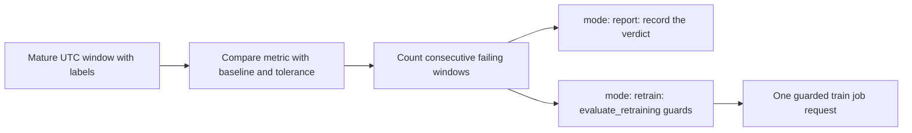

# Detect model performance loss

## When you need it

Use a performance policy when you need to decide whether measured prediction quality has worsened
enough to investigate or request training. [Drift](databricks_drift.md) measures input changes and
can exist without performance loss, or vice versa. Start with report mode and
[configure actual outcomes](databricks_monitoring_labels.md).

Performance policy is disabled by default. Each producer sets an independent
JSON mapping keyed by the exact fully qualified enrolled model name. The example
policy under [What to edit](#what-to-edit) reports a weighted F1 drop of at
least 0.05 across three distinct, completed windows for version 2.



## What to edit

Detailed setup offers a simple initial policy through these answers:

```json
{
  "monitoring_catalog": "workspace",
  "monitoring_schema": "skyulf_monitoring",
  "label_table_name": "outcomes",
  "label_available_at_column": "available_at",
  "performance_policy_mode": "report",
  "performance_regression_metric": "wape",
  "performance_classification_metric": "accuracy",
  "performance_tolerance_mode": "relative",
  "performance_tolerance": "0.2",
  "performance_baseline_version": "1"
}
```

The default is `off`. Enabling `report` or `retrain` requires both an outcome
binding and a monitoring store. Setup writes `monitoring_performance_policies`
in `deployment/variables.yml`: one entry for a single model or competition
winner, and one entry per component in a model set. Regression and classification
components use their respective metric answer and the correct loss direction.
The initial policy uses 24-hour windows, a six-hour label delay, at least 20
labeled rows, 80% coverage and two consecutive failing windows for retraining.
These are editable policy fields, not additional hidden runtime rules.

Verify the concrete baseline version before activation. Different model-set
components may need different versions: edit their JSON entries independently.
Changing the baseline is an explicit policy change; promoting a new champion
does not automatically advance the baseline. `report` can show a degraded
first window but never requests training.

For a more specific classification policy, set a target override:

```yaml
monitoring_label_table: labels.production.outcomes
monitoring_result_available_at_column: available_at
monitoring_performance_policies: >-
  {"models.risk.churn":{
    "mode":"report",
    "metric":"f1_weighted",
    "direction":"higher",
    "baseline":{"kind":"training_holdout","model_version":"2"},
    "tolerance":0.05,
    "tolerance_mode":"absolute",
    "window_hours":24,
    "label_delay_hours":6,
    "minimum_labeled_rows":20,
    "minimum_label_coverage":0.8,
    "consecutive_windows":3}}
```

These are example values, not production defaults. Put them under the producer
Bundle's `targets.<target>.variables` in `deployment/targets.yml`, alongside the
monitoring destination.
Replace the model and label table names with your own fully qualified names.

Labels match saved record keys and the saved target; their UTC `available_at` must say when the
actual outcome became available. For serving, match request ID and row index instead;
[label matching](databricks_monitoring_labels.md) has the full contract.

| Setting | Meaning in this example |
| --- | --- |
| `monitoring_label_table` | Actual outcomes joined to original predictions by stable record keys. Predictions are never used as actual outcomes. |
| `monitoring_result_available_at_column` | Outcome availability timestamp used to exclude labels unavailable at the observation cutoff. |
| `models.risk.churn` | Exact enrolled model name; a component model name for a model-set. |
| `mode: report` | Persist and display the performance decision without requesting training. |
| `metric: f1_weighted` | Class-support-weighted F1 over eligible prediction/label pairs; this does not enable training sample weights. |
| `direction: higher` | A decrease is worse. Regression MAE uses `lower`, where an increase is worse. |
| `baseline` | Saved training holdout for concrete model version `2`; production-window references are also supported. |
| `tolerance: 0.05`, `absolute` | A baseline of 0.84 is degraded at 0.79 or below: five percentage points, not a five-percent relative drop. |
| `window_hours: 24` | Measure each completed, fixed UTC day independently. |
| `label_delay_hours: 6` | Wait six hours after the window ends before assessing it. This is independent of the job schedule. |
| `minimum_labeled_rows: 20` | Require at least 20 eligible labeled predictions in that window. |
| `minimum_label_coverage: 0.8` | Require eligible labels for at least 80 percent of the window's prediction population; both minimums must pass. |
| `consecutive_windows: 3` | Require three adjacent eligible failing windows for trigger eligibility; replaying one window does not count again. |

An individual window can already be reported as degraded before the required
streak is reached. `report` never requests training, even after three failures.
With `retrain`, reaching the streak only makes the performance trigger eligible;
fresh training data, cooldown, active-run and duplicate-request guards still apply.

Policy reports retain the required window count even when labels, a baseline or
a source snapshot are unavailable. For example, a three-window policy reports
`0 / 3` after a failed observation; that failure does not count as measured
degradation. Older reports without a saved required count show `Unavailable` in
the notebook's failure-streak denominator instead of an invented zero.

| Project layout | Policy scope |
| --- | --- |
| Single | One policy for the active concrete model version. |
| Competition | Policy for the activated winner; losing candidates are not production monitors. |
| Model-set / multi-target | A separate mapping entry and matching baseline for each component model; each keeps its own target, metric and version. |

The producer's label table must contain the target columns needed by its enrolled
components. A retraining request runs the configured project train job; it does
not introduce selective retraining of just one model-set branch.

Use `mode: "retrain"` in the JSON policy to request guarded automatic training,
or `{"mode":"off"}` for an explicitly disabled model. An active policy needs
the label table and UTC availability column shown above. Select a
`training_holdout` baseline or pin an existing production observation with
`{"kind":"production_window","model_version":"2","report_id":"<64 hex characters>"}`.
The baseline version must match the observed version; a mismatch is unavailable
and cannot request training. No metric, direction, tolerance or baseline is
inferred. Fixed UTC windows wait `label_delay_hours` after their end, then count
only labels available at the cutoff. A 00:00–24:00 UTC window with a six-hour
delay can first be evaluated at 06:00 UTC the next day. Replays do not advance
the consecutive-window count; missing and immature labels remain unavailable.
Distribution drift remains controlled separately by `on_drift`. Its cooldown
and minimum new labeled training-row settings are shared request guards for
either retraining trigger. Model evaluation and approval rules still apply.

An active policy requires every policy field in the example; there are no
default metric, direction, baseline or tolerance values. `tolerance_mode` accepts
`absolute` or `relative`.

For `relative` tolerance, the permitted degradation is `tolerance * abs(baseline)`. A zero baseline
makes relative tolerance unavailable. Boundary equality counts as degradation (with the evaluator's
small floating-point comparison tolerance). Active tolerances and window lengths must be positive
finite numbers; label delay is nonnegative, minimum rows is an integer at least 2, coverage is from
0 to 1, and consecutive windows is an integer from 1 to 100.

Policy metrics with `lower` direction are `mae`, `mse`, `rmse`, `mape`, `wape`. Metrics with `higher`
direction are `r2`, `explained_variance`, `accuracy`, `balanced_accuracy`, `precision_weighted`,
`recall_weighted`, `f1_weighted`, `matthews_corrcoef`, `g_score`. Observed reports can contain
additional probability metrics; their presence does not make them supported policy metrics.

### WAPE when actual values can be zero

`wape` is `sum(abs(actual - prediction)) / sum(abs(actual))`. It is a ratio:
`0.10` means 10%, and lower is better. Like the other reported regression metrics,
it uses unweighted evaluation rows; training sample weights are not reused for
holdout or monitoring observations. It is calculated from saved predictions and
available labels, excluding rows the model did not score.

For actual values `[0, 10, 20]` and predictions `[5, 12, 18]`, total absolute error
is 9 and total absolute actual value is 30: **WAPE = 0.30**. MAPE instead divides
each row's error by that row's actual magnitude. Its near-zero denominator makes
the zero-actual row dominate. The taxi example's February labels include three
zero fares, so MAPE can be extremely large even while most errors are small.
Both metrics remain available; inspect WAPE alongside MAE, RMSE and label coverage.

When every actual value is zero, WAPE is undefined, including for perfect zero
predictions. Core evaluation omits `wape` from its finite metric dictionary;
monitoring records `value: null`, `status: unavailable`. A WAPE policy cannot
act on that window. No epsilon or invented zero score disguises the missing
denominator. A nonfinite result is also unavailable.

Use `metric: wape` with `direction: lower` in a performance policy, retaining
all the other required policy fields shown above. For registered-model holdout
comparison or an additional quality gate, use `heldout_wape`; its direction is
`minimize`. A missing holdout WAPE fails the gate. This does not add a WAPE scorer
to tuning or cross-validation model competitions.

For example, this regression policy reports a WAPE increase of at least 20%
relative to version 3's training holdout in each eligible completed daily window.
It counts adjacent failing windows; `consecutive_windows: 2` would gate trigger
eligibility in `retrain` mode, but does not delay reports in `report` mode:

```yaml
monitoring_performance_policies: >-
  {"models.sales.revenue":{
    "mode":"report",
    "metric":"wape",
    "direction":"lower",
    "baseline":{"kind":"training_holdout","model_version":"3"},
    "tolerance":0.2,
    "tolerance_mode":"relative",
    "window_hours":24,
    "label_delay_hours":6,
    "minimum_labeled_rows":20,
    "minimum_label_coverage":0.8,
    "consecutive_windows":2}}
```

Replace the model name and version with your enrolled identity and keep the label
table/availability settings from the complete example above. With baseline WAPE
0.05, the limit is 0.06: this is a 20% relative increase, not 20 percentage points.
WAPE suits this example when actual values can be zero because it uses the whole
population's absolute actual total; MAPE divides by each individual actual.
`report` never requests training. Spark monitoring reads cached holdout metrics
from its prepared reference; an older cache without WAPE produces unavailable
policy evidence until a compatible reference exists. The in-memory path measures
the verified holdout with the fitted model. Neither path rewrites historical
training-run metrics.

```python
import numpy as np
import pandas as pd
from skyulf.modeling._evaluation.metrics import calculate_regression_metrics

truth = np.array([0.0, 10.0, 20.0])
values = calculate_regression_metrics(
    None, pd.DataFrame(), truth,
    X_np=np.empty((3, 0)), y_np=truth,
    predictions=np.array([5.0, 12.0, 18.0]),
)
assert values["wape"] == 0.3
```

WAPE gives larger-magnitude actuals more influence and is undefined for all-zero
populations. It does not replace per-segment inspection or establish business
acceptability. A lower aggregate value can still conceal a poorly served segment.

## The command

To enable performance-driven retraining, change only the relevant model's policy from
`"mode":"report"` to `"mode":"retrain"` in the producer target variables, retain its metric,
matching baseline and evidence requirements, then validate and deploy that producer Bundle. Run
activation registration or successful scoring to update enrollment, then run monitoring to evaluate
the next eligible window. This is a job configuration change; there is no dashboard switch that
starts training. A policy change does not turn an old report into a new eligible request or bypass
consecutive-window requirements.

Run these cloud commands from the generated project after updating target variables. Between
deployment and observation, use normal activation or successful scoring to refresh enrollment.

```powershell
databricks bundle validate --strict -t test --profile YOUR_PROFILE
databricks bundle deploy -t test --profile YOUR_PROFILE
databricks bundle run monitoring -t test --profile YOUR_PROFILE
```

There is no literal `enforce` mode: `report` records a decision, `retrain` enables guarded request
eligibility, and `off` disables the policy. For online enrollments, both the inline policy and the
job-level gate must be configured as described in
[retraining](databricks_retraining.md#what-to-edit).

## What you should see

`monitoring_report` reads the saved observation instead of recalculating it. Its output includes
**Open monitoring dashboard** when the shared HTTPS `monitoring_dashboard_url` is configured. It
displays feature drift, observed prediction/outcome metrics and the separate performance-loss
policy. A measured RMSE or F1 value alone does not establish degradation: the policy also requires a
valid baseline, completed window, label coverage and configured tolerance. The policy population can
differ from the exact scoring batch shown under observed performance. `healthy` means the selected
metric has not degraded beyond its configured tolerance; it does not establish that the model meets
an absolute quality goal.

### Observed metrics and policy decisions

Local performance reuses skyulf.modeling._evaluation.metrics. Classification includes
G-score, accuracy, balanced accuracy, MCC and precision/recall/F1; probabilities
also enable log-loss, ROC-AUC and PR-AUC variants. Regression includes MAE, MSE,
RMSE, R2, MAPE, WAPE and explained variance. The job installs Core's optional G-score
dependency and compatibility pin. Local feature drift uses Core DriftCalculator;
Spark enrollments use distributed metric and drift aggregations.

Performance metrics appear as dynamic pivot columns, so selecting a regression
model shows its regression metrics, while classification shows its available
metrics, including G-score and AUC. Same-time reports get deterministic observation
suffixes so the pivot cannot merge distinct reports/monitors. Blank cells remain
unavailable, never zero. **Latest prediction coverage by model** replaces the
three shared counters with one row per model/version/context. Each row shows
predictions, matched outcomes and label coverage from that identity's latest
full observation. A failed latest measurement clears its counts rather than
reviving an older success. Counts and coverage are never aggregated across
models, contexts or observation windows.

The performance page starts with matching identities, then policy results and
policy history. Prediction coverage and observed metrics follow below.
**Latest policy result for every model** gives
each identity its own row with metric, baseline, current score, allowed limit,
improvement direction, result, explanation and training action. Accuracy, F1 and
RMSE policies can coexist, with separate model/metric chart panels and independent
scales. The policy charts use each identity's latest saved policy metric;
selecting MAE in **Chart metric** does not hide an RMSE policy. Current is the
observed metric, Baseline is its reference value, and Tolerance boundary is the
permitted limit.
An accuracy baseline of 0.96 with an absolute tolerance of 0.10 gives a lower
limit of 0.86. For an error metric, exceeding the upper limit indicates loss.
Missing scores are unavailable and must not be interpreted as zero.
The latest policy summary ranks by
window end before measurement time for each identity: a late historical degradation
cannot replace a newer unavailable window. Disabled policies are explicitly
labeled disabled, and identities without a saved check show No policy evidence.
The Performance checks table is the history of those per-window comparisons.
Performance result means Within tolerance, Performance loss, Insufficient evidence
or Policy disabled. Training action is separate: loss can be report-only, awaiting
further checks, skipped or actually requested. Eligible is not already submitted.
Full reasons, source references and request IDs remain in `performance_history`
and the job's saved reports. Classification
matrix availability appears below the confusion matrix; the full metric matrix
follows below.

Performance pairs a latest-observation metric table with time series in separate
model/version/context and metric panels. Each panel keeps its own units and
scale; legends identify whether higher or lower is better. The table identifies
each metric, value, target and window even when only one observation exists.
A latest unavailable measurement stays blank,
rather than falling back to an older measured value.
The metric selector defaults to an available MAE, weighted F1, accuracy or other
saved metric independently for each matching context. Selecting a metric narrows
the observed table and time chart to identities with that metric. A single observation does not
establish a trend. The charts never combine different monitor identities or windows.
Metric selection does not remove columns from the full metric-history table.

Filters never select an older observation; see [latest observations and page
filters](databricks_monitoring_dashboard.md#latest-observations-and-page-filters).
Metric selection does not change the configured policy metric.

Each saved performance value is a point. Missing values have no point and are not joined by a line.
The time axis and date filters use Data window end (UTC), while Calculated at records the separate
execution time.

The scoring-volume chart uses one stacked bar per full observation: labeled
rows and rows not labeled at measurement add up to scored rows. Gray identifies
observations without measured label coverage. The tooltip shows coverage as a
percentage. Counts absent from the original report stay blank even if an older
store row defaulted them to zero. Failed and policy-only reports never invent
scoring counts; bars from different or overlapping windows must not be added.

The policy-margin comparison uses each identity's latest saved policy window,
independently of the chart metric and history date filters. Remaining tolerance is
the direction-aware distance from the saved limit divided by the absolute
baseline-to-limit distance: 1 is at baseline, 0 is at the limit and negative values
are beyond it. Bar color follows the saved policy verdict, including boundary
equality rules. Unavailable, disabled or zero-tolerance policies stay in the
policy table without a bar. Accuracy and error metrics can therefore share this
normalized comparison without mixing their original units.
The **Policy status** legend distinguishes blue **Within tolerance** from red
**Performance loss**. Rows without a calculable margin remain in the policy
table and are excluded from this chart and its legend.

The confusion-matrix pivot separates model/version/context first, then shows
actual classes on rows and predictions on columns from each identity's latest
report. Counts from different identities are never combined. Numeric class indices
preserve identity when display labels collide. Measured zeros are real counts; unavailable
classification, regression and historical reports without a stored matrix show an
explicit status. The matrix is independent of history date and target filters.

## Common errors and fixes

| Symptom | Fix |
| --- | --- |
| `active policy has missing or unknown fields.` | Keep every field from the complete example, with no invented fields; `off` accepts only its mode. |
| Baseline unavailable or wrong version | Pin the observed concrete version and its saved training holdout or a compatible production report ID. Do not substitute another version. |
| A raw RMSE or F1 exists but the policy is unavailable | Check its own window, matching baseline, minimum labeled rows, label coverage and maturity. Observed batch and policy populations may differ. |
| The same failing window was retried but the streak did not grow | Distinct adjacent eligible windows are required; retries and backfills do not create extra windows. |
| A performance loss did not start training | `report` never submits; `request_eligible` still needs the [shared retraining guards](databricks_retraining.md). Dashboard refresh is not a training command. |
| Logging errors coexist with a policy verdict | Usable records can still provide evidence; inspect the [partial-population warning](databricks_serving_monitoring.md#common-errors-and-fixes). Missing usable labels leave the policy unavailable. |

An unavailable newest window remains newest; historical success or degradation does not replace it.
Policy reports retain the required streak denominator even after failed observations. Delayed and
insufficient labels are evidence limits, not zero accuracy.
