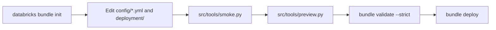

# Create and preview a Databricks project

## When you need it

Create an editable project before its first deployment. For a complete example with source rows,
follow the [end-to-end guide](databricks_bundle_walkthrough.md). Initialization is offline and does
not inspect your tables.

### Start from the closest example

Copying a finished project is usually faster than answering the setup wizard.
Four NYC taxi projects on `samples.nyctaxi.trips` cover the main shapes:

| Your project | Copy | Notes |
| --- | --- | --- |
| One model, scored on Spark workers | `taxi_fare` | Promotes automatically and scores after promotion |
| One model behind an online endpoint | `taxi_fare_online` | Needs a billable Lakebase online store; no batch scoring |
| One target, several candidate algorithms | `taxi_high_fare` | Competition with custom steps and manual approval |
| Several targets approved together | `taxi_trips` | Model set with a combined scoring rule |

1. Copy the project folder out of
   [`examples/nyctaxi`](https://github.com/flyingriverhorse/Skyulf/tree/master/skyulf-core/templates/databricks/examples/nyctaxi).
2. Run `load_nyctaxi.sql` in the Databricks SQL editor with `catalog` set to
   `workspace` (or yours) and `schema` set to the project name. It creates the
   source tables and never overwrites one.
3. In `deployment/targets.yml`, replace `https://replace-test.example.invalid`
   with your workspace URL. If your catalog is not `workspace`, change
   `test_catalog` and `monitoring_catalog` in `deployment/variables.yml`.
4. Run `databricks bundle deploy -t test --profile <profile>`, then
   `databricks bundle run train -t test --profile <profile>`.

Then swap the taxi tables, columns and recipes for your own. The examples README
owns the complete steps, approval and serving. Not sure which shape fits? See
[choose a project shape](databricks_choose.md).

### Generate a project with the wizard

When no example is close, generate the project:



Smoke and preview run locally. Validate and deploy use the workspace; see
[deployment](databricks_deployment.md).

### Choose a layout and setup mode

| Choice | Use it when | Result |
| --- | --- | --- |
| `single_model` | One target and one chosen model | One fitted pipeline and registered candidate |
| `model_competition` | One target, several candidate algorithms | Comparable candidate runs and one selected winner |
| `multi_target` | Several independently defined targets | One fitted component per target and a versioned model set |
| `setup_mode=quick` (default) | You want a working starting configuration | Ask for source, keys, targets and input columns; accept editable defaults |
| `setup_mode=detailed` | You want to choose model, search, schedules and compute before generation | Ask applicable settings, including competition candidates and each active branch |

Quick mode still supports all three layouts. Its defaults include bounded pandas training,
whole-frame inference, manual schedules, a random split, manual promotion and pinned-version
scoring. Inspect the generated values before the first run; accepting a default does not inspect the
table or infer suitable columns. Detailed mode also has hidden advanced defaults;
[offline preview](#guided-setup-and-offline-preview) shows the effective configuration.

The manual quick default leaves `quality_threshold` unset. Pinned scoring can
use a registered version, but first-champion initialization requires an absolute
quality bound chosen before training. Set that field in training defaults or the
model entry if you intend to approve the first candidate; see the worked run.

## What to edit

### Files you edit

| File | Owns | Example change |
| --- | --- | --- |
| `config/training.yml` | Shared defaults and each model's fit/evaluation policy | Inputs, target, row/byte limits, model, search, CV, recipes |
| `config/pre_split.yml` | Fixed cleanup and eligibility recipes | Convert a declared sentinel, filter missing labels |
| `config/preprocessing.yml` | Learned or fixed feature steps | Fit an imputer and encoder on training folds |
| `config/inference.yml` | Saved-model selection and prediction publication | Pinned version/champion, source, output, model-change policy |
| `config/features.yml` | Optional upstream feature domains | Transform and merge Delta inputs |
| `config/serving.yml` (optional) | Publication, endpoint setup and rollout | Existing store/table identity, concrete version, health policy |
| `deployment/targets.yml`, `variables.yml` | Workspace, UC namespaces, identities, compute and schedules | Bind `test` to an authorized workspace and schema |
| `deployment/*requirements.txt` | Core and optional runtime dependencies | Change a published Core pin; add the selected estimator's package |
| `src/features/` | Trusted custom Python factories | Register a custom step referenced from YAML |

Built-in steps and their full parameter cards are in the
[Preprocessing YAML catalog](preprocessing_recipes.md). For every accepted
training field, its default and complete examples of all three layouts, use the
[training configuration reference](databricks_training_config.md). Generated
`START_HERE.md`, `PREPROCESSING.md`, `SERVING.md` and deployment/monitoring
READMEs travel with the project and document its template revision.

### What a configuration change requires

| Change | Preview/redeploy | Fit a new model |
| --- | --- | --- |
| Feature steps, training columns, estimator, search or split | Yes | Yes; scoring keeps the old fitted state until you select the new version |
| Pinned scoring version, output destination or change policy | Yes | No, but check artifact/output compatibility |
| Cron, pause status, identity or compute binding | Validate and redeploy | No; verify access and runtime compatibility |
| Published feature values | Run/observe publication | No for latest-value requests; historical evaluation retains its saved evidence |
| Core/dependency upgrade | Follow release migration steps, validate and redeploy | When saved-artifact runtime checks require it |

Targets are `test`, `syst` and `prod`, with optional paired
`test_development`, `syst_development` and `prod_development` targets. There is no
standalone `dev` target. Personal schedules start paused. Input catalogs/schemas
and tables must exist; template generation and deployment do not provision them.

Quick setup asks only for the layout, project name, task, source table, record
keys (including composite keys), target and input columns, and the
[monitoring destination](#monitoring-destination). Detailed setup also
asks for split strategy, applicable date parsing, model, CV, scoring/promotion
policies, compute and deployment choices. Serverless is the default. Answer-file
examples are in `skyulf-core/templates/databricks/examples/`. The generated
project has its own `databricks.yml`; Skyulf's root has no Bundle config.

New projects use YAML as the authoritative configuration. Edit shared settings
under `defaults` and named model settings under `models` in `config/training.yml`:

| Layout | Training configuration |
| --- | --- |
| `single_model` | One model entry, normally `models.main` |
| `model_competition` | One entry per candidate, sharing target/split/quality defaults |
| `multi_target` | One entry per independent target, with its own inputs, model and policy |

For multiple targets, `config/inference.yml` has a `model_set` mapping for the
registered set, activation policy and scoring destinations. Put business output
functions in `src/features/scoring.py`. For example, revenue and cost model
entries can activate together and expose a saved profit rule. See
[model sets](databricks_model_sets.md).

```yaml
version: 1
defaults:
  training_layout: single_model
  engine: pandas
  preprocessing_probe: false
models:
  main:
    model:
      type: linear_regression
      params: {}
```

This is a configuration excerpt; keep the generated source, keys, target, limits
and quality settings. Model entries inherit complete values from defaults;
nested mappings replace rather than deep-merge. Use YAML `true`, `false`, `null`.
Do not add competing Python model files or `workflow.json` beside these files;
each setting has one owner. Place shared training values in YAML `defaults`,
model/tuning values in the named `models` entry, and scoring values in
`config/inference.yml`.

Regression starts with Core `linear_regression` and `heldout_rmse`;
classification starts with `logistic_regression` and `heldout_accuracy`.
The pipeline remains editable: add registered Core preprocessing nodes and
choose a task-compatible model. Model parameters are editable too:

```yaml
models:
  main:
    model:
      type: random_forest_regressor
      params: {n_estimators: 100, max_depth: 8, random_state: 42}
```

A default model ID or an empty parameter object uses Core defaults.

In a JSON answer file, `max_rows` and `max_input_mb` are positive integer
**strings**; the generated `config/training.yml` stores them as numbers. Enter
`record_key_columns` as `customer_id, observation_id` and `input_columns` as
`income, age`, with no brackets or quotes; the generated YAML stores ordered
lists. Answer files use task-specific `regression_model`/`classification_model`
and `regression_metric`/`classification_metric`.

## The command

Initialize a project from a Skyulf checkout:

```powershell
databricks bundle init skyulf-core/templates/databricks --output-dir ./generated
```

### Guided setup and offline preview

Setup follows your answers; it does not inspect source tables or sample rows.
Random full-snapshot training hides observation-date questions. Result-availability
questions appear only when you enable that separate filter. Schedule and
policy-cluster details likewise appear only when selected.

`setup_mode` chooses how much to answer now. The default, `quick`, asks for the
layout, project name, task, source table, record keys and target/input columns,
and for the monitoring destination. A model set asks for the task and columns of
each active branch. It accepts documented defaults for the remaining settings.
Choose `detailed` to inspect model choices, competition candidates, branch
recipes, search and deployment settings as they become relevant. Every list
starts with its default, so Enter accepts it. Both modes produce the same files
for the same answers. Explicit answer-file values are honored even for prompts
hidden in quick mode; edit the generated `config/*.yml` and `deployment/` files
to change them afterwards.

#### Monitoring destination

Both setup modes ask two monitoring questions, after the deployment questions:

| Question | Answer | Result in `deployment/variables.yml` |
| --- | --- | --- |
| `monitoring_catalog` | Existing catalog for the shared monitoring store, or blank | Default of `monitoring_catalog` |
| `monitoring_schema` | Schema in that catalog; required when a catalog is given, blank otherwise | Default of `monitoring_schema` |

Give every project the same catalog and schema, reserved for monitoring (for
example `skyulf_monitoring`), not the project's own schema: all models then
appear in one store and one dashboard. Only one project creates the dashboard;
the others connect to it with `--dashboard-url`, see
[the shared dashboard](databricks_monitoring_dashboard.md).

A catalog answer sets `monitoring_enabled` to `"true"`: train and score enroll
models and run monitoring. A blank catalog sets `monitoring_enabled` to
`"false"`: train and score run without monitoring. A catalog without a schema
stops `databricks bundle init` with a template error. Each answer is blank or
one identifier. The schema is created on first use if the run-as identity may
create schemas. Personal development targets always set `monitoring_enabled`
to `"false"`.

To turn monitoring on later, set `monitoring_catalog`, `monitoring_schema` and
`monitoring_enabled: "true"` in `deployment/variables.yml`, or per target under
`targets.<name>.variables`, then redeploy. See
[monitoring store setup](databricks_monitoring_setup.md).

Before raising a project's Core pin, follow the **Upgrade steps for generated
Databricks projects** listed under each release in the changelog.

Some settings are never asked, in either mode. Set them with `--config-file`
using an existing example, or edit the generated `config/training.yml` before
running preview:

| Never asked | Default |
| --- | --- |
| `test_size`, `random_state`, `stratify` | `0.2`, `42`, `false` |
| `training_sample_rows`, `training_sample_seed` | `null` (all eligible rows within limits), `42` |
| `min_improvement` | `0.0` |
| `risk_category` | Empty: the key is omitted from `config/training.yml` |
| `catalog`, `schema` | `REPLACE_TEST_CATALOG`, `REPLACE_TEST_SCHEMA`; prefill the `test` bindings in `deployment/variables.yml` and the preview/smoke defaults |

Quick setup also skips the settings below. Detailed setup asks them when they
apply to the chosen layout and earlier answers:

| Asked only in detailed setup | Quick default |
| --- | --- |
| `training_version` (not asked for `single_model`) | `null`: pin the latest snapshot at run start |
| `training_window_mode` | `auto`: full snapshot for random, rolling calendar for temporal |
| `cv_enabled`, then `cv_folds`, `cv_type`, `cv_shuffle`, `cv_random_state` | CV off; `5`, `k_fold`, `true`, `42` |
| `max_rows`, `max_input_mb` | `10000`, `64` |

Most answer-file values are strings, including `"true"`, `"42"` and `"null"`;
`min_improvement` is a JSON number. The generated `config/training.yml` uses
native YAML booleans and numbers, and omits keys whose value is null.
For fixed dates, start from
`random-window-init.example.json` or `temporal-delayed-results-init.example.json`.
For stratified CV and sampling, use `guided-classification-init.example.json`.
From the Skyulf checkout, for example:

```powershell
databricks bundle init skyulf-core/templates/databricks --config-file skyulf-core/templates/databricks/examples/guided-classification-init.example.json --output-dir ./generated
```

Review table and feature names in the example first. If you edit the generated
`config/training.yml`, use `full_snapshot`, `fixed_window`, `rolling_calendar`
or `rolling_days` for `training_window_mode`; `auto` is resolved during
initialization. Run `python src/tools/preview.py --action train` from the
generated project to validate the resulting combination.

For each date column you actually use, declare how it is stored:

| Your answer | Follow-up questions |
| --- | --- |
| `timestamp`: database timestamp representing an instant | No text format, source timezone or date-only question |
| `local_timestamp`: database clock time without a timezone | Which timezone this clock belongs to |
| `date`: day with no clock time | Source timezone, then whether to treat the day as midnight or reject it |
| `text`: dates stored as strings | Whether the text contains a date only, local date/time, or date/time with an offset; then its format and only the applicable timezone/date-only questions |

For example, date-only text `2026-08-10` asks for its format, timezone and permission to use 00:00.
Text `2026-08-10T14:30:00+02:00` asks for its format but not another timezone or midnight rule.
Initialization fields `event_time_kind`/`result_time_kind` and `event_text_kind`/`result_text_kind`
control these questions only; the generated `config/training.yml` stores only the resulting
`event_time_parsing`/`result_time_parsing` rules. Runtime still validates actual values against your
declared rules.

The project has two **input** table references. `source_table_name` contains the
training examples and known answers. `score_source_table_name` contains records
to predict; blank reuses the training input. Neither is the output. Choose the
result name through `prediction_table_name`, for example `customer_predictions`.
It becomes `prediction_table` in the configured output schema, with any target
resource suffix. Blank uses `<project_name>_predictions`.

Quick setup asks for neither `score_source_table_name` nor
`prediction_table_name` and keeps the blank defaults. Detailed setup asks both
for `single_model` and `model_competition`. A `multi_target` project sets its
scoring outputs in `config/inference.yml`.

| Setting | Meaning and example |
| --- | --- |
| Training version | A saved Delta table snapshot from the table's History, such as version 12. This pins input data, not model v12. `null` or missing resolves latest once at run start; an explicit nonnegative integer pins that snapshot for manual and scheduled runs. |
| Source selection | `full_snapshot`: use all eligible rows from that snapshot. `fixed_window`: use observation dates between your boundaries. `rolling_calendar`: derive recent complete months at every invocation. `rolling_days`: read the last `lookback_days` elapsed UTC days before every invocation. `auto`: full snapshot for random splitting, rolling calendar for temporal splitting. |
| Result availability column | A column such as `claim_confirmed_at`, recording when that row's answer became known. Only needed if availability filtering is enabled. |
| Result cutoff | Keep answers known **by** this instant, including equality. For a cutoff of September 15, an answer confirmed September 20 is excluded even if the observation occurred in August. An explicit cutoff is honored in every run; null derives invocation time minus `result_availability_lag_hours`. |
| Date format | For a text value `10/08/2026 14:30`, use `%d/%m/%Y %H:%M` (day/month/year hour:minute). For `2026-08-10`, use `%Y-%m-%d`. Database timestamp/date columns do not need a text format. |
| Source timezone | For values such as `2026-08-10 14:30` with no offset, specify where that clock time belongs, e.g. `Europe/Copenhagen`. Offset-bearing values such as `2026-08-10T14:30:00+02:00` identify their offset already. |
| Date-only policy | `reject` stops on values without clock time. `midnight` interprets `2026-08-10` as 00:00 in the explicitly selected source timezone. |
| Training sample | `10000` selects up to 10,000 eligible rows before splitting; with a 20% test split this usually means 8,000 train and 2,000 test. `null` uses all eligible rows within read limits. Prediction never samples. |
| CV | With five folds, score each search candidate using five training folds. Learned preprocessing is fitted within each fold. The final test set remains separate. |
| Cron timezone | The timezone of the job clock. A 03:00 schedule with `Europe/Copenhagen` uses Copenhagen time, including daylight saving. This does not interpret source dates or change the selected data window. |

For training every six months on January 1 and July 1 at 03:00, choose
`scheduled` and enter `0 0 3 1 1,7 ?`. The cron is the schedule; nothing
overrides it with a second monthly timer. Manual and scheduled runs use the same
`train` action with identical snapshot/window selection rules.
`monthly_lookback_months` separately controls how many complete months a
`rolling_calendar` window reads; `lookback_days` does the same for `rolling_days`.
Scoring has its own independent job schedule.

Detailed setup groups its questions into these sections. Quick setup asks only
the task, source table, keys and columns from the first one.

| Section | What you choose |
| --- | --- |
| Basics/data | Engine/task, source and output tables, keys/features/target, split strategy, snapshot and window, availability/date parsing and input limits; sampling uses config |
| Model | A menu containing only models for the selected regression/classification task; defaults remain editable in the generated file |
| Evaluation CV | Enable evaluation with fold-local preprocessing; select folds, method, shuffle and seed |
| Lifecycle | Metric/gates, manual/automatic promotion, score selector/handoff and enabled retraining cron |
| Compute | Serverless or approved policy cluster and cost tags |

Edit the ordered recipe in `config/preprocessing.yml`. Put fixed eligibility
rules in `config/pre_split.yml`. Custom Python factories stay in the corresponding
`src/features/` modules. For example:

```yaml
version: 1
recipes:
  default:
    - name: impute
      transformer: SimpleImputer
      params: {columns: [income, age], strategy: mean}
    - name: scale
      transformer: StandardScaler
      params: {columns: [income, age]}
```

Select `preprocessing_recipe: default` in the model's training configuration.

## What you should see

### Smoke result

`smoke.py` validates YAML, model configuration and Python syntax without executing
editable hooks. Present `src/features/` and `src/composition/` packages also pass
training's snapshot checks: package boundaries, declared assets, exact pins and
saved-source size limits. Success JSON lists `project_packages`; a failure exits
with code 1 and names its file/package and reason. Syntax errors include file,
line and column. Dependencies are neither imported nor installed by this check.

Smoke does not prove data access, runtime dependency compatibility, model fit or
deployment permission. Preview executes trusted builders; keep I/O out of imports
and factories. A training sample is a real training input, not a no-write smoke mode.

### Generated files and preview output

| Directory | Responsibility |
| --- | --- |
| `src/jobs/` | Databricks notebook entrypoints referenced by generated job resources |
| `src/features/` | Custom Python factories, helpers and scoring rules referenced from YAML |
| `config/` | Authoritative YAML, including the recipes in `pre_split.yml` and `preprocessing.yml` |
| `src/tools/` | Preview, smoke checks and local graph/dashboard setup; see its `README.md` |

To move an existing project to this layout, follow
[project upgrades](databricks_project_upgrade.md).

### Local tools and preview

The generated `src/tools/README.md` is the short reference beside the scripts.
Run commands from the project root with the matching Core package installed:

```powershell
python src/tools/preview.py
python src/tools/preview.py --list-models
python src/tools/preview.py --list-preprocessors
python src/tools/preview.py --action train
python src/tools/preview.py --action score
```

| Option | Effect and default |
| --- | --- |
| `--action train\|score` | Inspect training or scoring; default: `score`. Training checks job preflight, including configured source/window selection. |
| `--list-models` | List installed Core model metadata for the configured task. A `multi_target` project lists both regression and classification models. |
| `--list-preprocessors` | List installed Core preprocessing metadata and configuration defaults. |
| `--catalog` | Override the local catalog binding; default is the initialization `catalog` value. |
| `--input-schema` | Override the input schema; default is the initialization `schema` value. |
| `--output-schema` | Override the output schema; default is the initialization `schema` value. |
| `--metadata-schema` | Override the registry/metadata schema; default is the initialization `schema` value. |
| `--resource-suffix` | Override the resource suffix; default is empty. |
| `--help` | Show the available command-line options. |

Preview executes the trusted Python recipe to resolve its steps. Keep data access
and training out of module-level code and `build_preprocessing()`. The preview
shows the actual pipeline, input selection, final holdout, CV and
score/promotion policies. Competition prints a `Candidate:` section for each
candidate; model sets print a `Branch:` section for each branch. The same training
rules apply to manual and scheduled runs. Preview starts no cloud job, reads no
Delta rows, fits no model and does not execute `preprocessing_probe`. A
preview-resolution `ValueError` prints `Configuration error:` and exits with
code 2; fix the reported setting before deployment. File/parsing failures that
happen before resolution may raise directly.

This check does not test data values, parameter combinations, permissions or
worker dependencies. Model/node metadata comes from the installed Core registry;
availability depends on local packages and the selected options.

Preview uses its local default bindings. To inspect a deployment target, pass
`--catalog`, `--input-schema`, `--output-schema`, `--metadata-schema` and
`--resource-suffix` matching that target's resolved Bundle variables. Preview does
not resolve target YAML or workspace `${...}` substitutions. Run the real Bundle's
`validate --strict` as well before deployment.

If initialization did not supply `catalog`/`schema`, these defaults remain the
generated `REPLACE_TEST_*` placeholders. Editing Bundle target YAML does not
update the preview script's defaults.

| Other tool | When to use it and command |
| --- | --- |
| `smoke.py` | Check YAML, Python syntax and package snapshots without running editable hooks: `python src/tools/smoke.py`. It accepts preview's five binding flags; see [smoke result](#smoke-result) for status and exit codes. |
| `refresh_feature_graph.py` | After editing feature groups or merges: `python src/tools/refresh_feature_graph.py`. |
| `refresh_training_graph.py` | After editing competition candidates or model-set branch names/count: `python src/tools/refresh_training_graph.py`. Single-model projects remain unchanged. |
| `configure_monitoring_dashboard.py` | Configure an existing dashboard's target refresh: `python src/tools/configure_monitoring_dashboard.py --dashboard-id YOUR_DASHBOARD_ID --target test`. See [dashboard configuration](databricks_monitoring_dashboard.md) for ownership, warehouse and disable options. |

Graph/dashboard tools change local resource YAML. Validate and redeploy before
running the updated job. They do not start a cloud job by themselves.

The answer-file examples include `guided-classification-init.example.json`
(Polars, random forest, stratified CV and explicit sample) and
`random-window-init.example.json` (random holdout inside an observation window,
separate Copenhagen event and Vilnius result parsing). Replace example
table/column names and snapshot pins with real values.

## Common errors and fixes

| Symptom | Fix |
| --- | --- |
| Preview resolves the wrong schema | Pass the target's `--catalog`, `--input-schema`, `--output-schema`, `--metadata-schema` and `--resource-suffix`. Preview does not read target YAML. |
| An init example names columns absent from your table | Edit its source, keys, inputs and targets; initialization never validates source rows. |
| A quick setup did not ask about a model or search | Edit `config/training.yml`, or choose detailed setup. Quick mode retains editable defaults. |
| A newly enabled task has no notebook | Generate a separate comparison project and transfer the required notebook, dependencies and graph together. |
| Init stops with `ERROR_monitoring_schema_is_required_with_monitoring_catalog` | Answer `monitoring_schema` as well, or leave `monitoring_catalog` blank to start without monitoring. |
| Train or score fails with `Set both monitoring_catalog and monitoring_schema.` | `monitoring_enabled` is `"true"`, or only one destination value is set. Set both values for that target and redeploy, or set `monitoring_enabled: "false"` and clear both. |

Continue with [deployment and access](databricks_deployment.md), or
[upgrade an existing project](databricks_project_upgrade.md).
