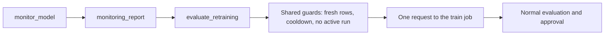
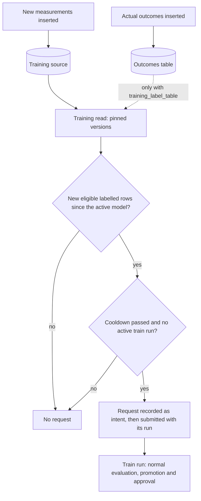

# Request guarded automatic retraining

## When you need it

Enable automatic training only after [drift](databricks_drift.md) or
[performance-loss](databricks_performance.md) reporting is understood and the project training
source is maintained with real targets. The new candidate still follows normal evaluation, promotion
and approval.

| Eligible signal | Retraining decision |
| --- | --- |
| Neither drift nor performance loss | No training request. |
| Drift only, with `on_drift: retrain` | One request, subject to shared guards. |
| Performance loss only, with policy `mode: retrain` | One request, subject to shared guards. |
| Both signals eligible | One combined request, not two training jobs. |
| Missing labels, unavailable metrics or policy `mode: report` | No performance-driven training request; drift remains independently eligible. |

The two retraining opt-ins form an OR decision, not an AND requirement:
`on_drift: retrain` enables drift; a model's performance policy `mode: retrain`
enables performance loss. Setting only one leaves the other disabled. For
performance, eligible labels, a matching baseline, tolerance and the configured
consecutive-window count must pass first. Missing labels, an unavailable metric,
`mode: report`, or a historical backfill cannot independently start training.
Both eligible signals are combined into one idempotent project training request.
The resulting candidate still goes through the existing evaluation, promotion
and approval rules; detecting a change does not itself approve a new model.



## What to edit

Set these variables under `targets.<target>.variables` in
`deployment/targets.yml` to request this project's existing train job:

```yaml
on_drift: "retrain" # Default: disabled
on_drift_cooldown_hours: "24"
on_drift_min_new_training_rows: "20"
```

These cooldown and fresh labeled training-row controls are shared by drift and
performance retraining requests. Set a model's performance policy to
`mode: "retrain"` inside the JSON mapping to enable its performance trigger;
`on_drift` remains an independent setting. Either trigger uses the same guarded
train job request. Neither trigger bypasses model evaluation or approval.

Set `training_table_version: null`. Maintain the configured training features upstream.
Targets may be embedded in that table or read through an explicit
[`training_label_table` join](databricks_training_data.md#train-from-separate-outcomes).
With the join, use `training_label_table_version: null` for fresh runs: new eligible
outcomes can count as changed training data even when feature rows are unchanged.
Monitoring's optional label binding alone does not enable the training join or
write outcomes back to a source table.
Freshness means eligible training values changed relative to the active model;
it does not require their arrival time to be after the drift report. The request
records the assessed Delta version and content digest. The train run independently
pins its input snapshot at initialization; inspect its saved training specification
and membership evidence to establish what was actually used if data changed again.
Predictions are never substituted for real targets. Random splitting includes
some new eligible rows in training; merely reshuffling old rows does not qualify.
Temporal rows qualify once they enter the training side of the time boundary.
Changing the table, column roles, split strategy or engine needs an explicit
training run before automatic retraining can assess the new contract.

A scheduled training job with `training_window_mode: fixed_window` repeats the
same date interval. The project preview warns but permits this intentional
combination. Use `rolling_days` or `rolling_calendar` to advance the interval.
This warning does not alter automatic retraining's freshness and cooldown checks.

New data has to reach the training read before any trigger can pass the
fresh-rows guard:



If new outcomes exist only in the monitoring label table, they do not reach
training without `training_label_table`, so they cannot satisfy the fresh-rows
guard. Training rows that already contain actual targets still work without a
join. Predictions are never used as targets on either path.

For a daily rolling window, configure `defaults` or a model entry in `config/training.yml`:

```yaml
training_window_mode: rolling_days
split_strategy: temporal
event_column: transaction_time
lookback_days: 90
holdout_days: 14
```

`transaction_time` must be a real selected source column, using the existing date
parsing settings. Each run selects the preceding 90 elapsed UTC days; temporal
holds out the latest 14 days. For random use `holdout_days: null` and `test_size`.
Random with `full_snapshot` needs no event column. Advancing a window does not
guarantee new training data or better performance.

### Serving performance needs both gates

Set the online enrollment's inline `performance_policy.mode` to `retrain`, and add a `mode: retrain`
policy for that same fully qualified model in the job deployment variable
`monitoring_performance_policies`, then redeploy the monitoring job. The inline policy determines
the measured online verdict; the job-level mapping enables evaluation of guarded training requests.
Only changing the inline policy leaves automatic requests disabled when `on_drift` is disabled and
the job mapping remains `{}`. Existing ownership, freshness, cooldown and promotion checks still
apply; retraining does not update an endpoint.

Requests are stored in the owned `retraining_requests` Delta table of the
monitoring store, with job claims, request evidence and run IDs. Store bootstrap
creates that table with the other store objects. The monitoring identity needs
SELECT/MODIFY on it and CAN MANAGE RUN on the train job, in addition to
monitoring's read permissions. Keep train `max_concurrent_runs: 1`. Ambiguous
API failures retain the pending claim; repair the monitoring job's
`evaluate_retraining` task to retry the same idempotency token. An unresolved request
blocks other automatic requests instead of guessing that submission failed.
The independent monitoring job revisits delayed labels and can submit guarded
training requests. All project layouts use the same store and shared dashboard.

## The command

Validate and redeploy after changing target variables. Update enrollment through activation/scoring,
or resubmit the online enrollment after changing its inline policy. Then observe:

```powershell
databricks bundle validate --strict -t test --profile YOUR_PROFILE
databricks bundle deploy -t test --profile YOUR_PROFILE
databricks bundle run monitoring -t test --profile YOUR_PROFILE
```

The `evaluate_retraining` task reads saved evidence after `monitoring_report`. To use the recurring
path, unpause the verified monitoring schedule. No dashboard switch enables training.

## What you should see

The independent Spark monitoring job runs
`monitor_model -> monitoring_report -> evaluate_retraining` after a score request or on
its unpaused schedule. The scoring job's native Run Job task provides the exact
validated receipt and exposes the child run directly in the graph.
The check reads the saved observation, checks the current enrolled version,
and compares actual eligible training rows with the saved model's training data.
Feature quality/schema problems, incomplete drift checks, stale observations,
unchanged training data, active training and cooldown prevent a new request.
The checks do not claim a request until submission; the request path repeats
them before claiming, so a concurrent run or data change cannot bypass guards.
One request starts the complete single, competition or model-set train job.
Spark monitoring and scoring do not wait for that train run or alter its
quality/approval policy.
The trigger resolves the unique deployed `${bundle.name}_train` job name at run
time, preserving the actual scoring job's development prefix and avoiding a
Bundle dependency cycle with training's scoring handoff.

Shared guards still require usable input, fresh training data, cooldown and no
active or duplicate request. Earlier run graphs keep the task names they ran
with; open the current job or a new run to see `monitoring_report` and
`evaluate_retraining`.

A submission records the request identity and training run ID; a skip records why its guard did not
pass. Performance action receipts are kept in `performance_actions` and presented through
`performance_history`. Read the training action separately from the performance verdict:
`request_eligible` does not mean a run was submitted.

An active performance policy that is report-only never requests training. Missing labels or an
unavailable performance baseline do not disable an independently eligible drift trigger. Both
eligible triggers share a single idempotent project request.

## Common errors and fixes

| Why no new train run appeared | Fix or interpretation |
| --- | --- |
| Neither trigger opted in | `on_drift` and per-model `mode: retrain` are independent switches. Enable only the intended policy. |
| Feature quality/schema problems or incomplete checks | Resolve the data problem; a detected drift flag alone does not bypass quality guards. |
| Stale evidence or changed enrolled version | Observe the current concrete enrollment again. |
| Unchanged or insufficient new labeled training rows | Maintain the configured training source with eligible true targets; a label table alone or reshuffling old rows does not qualify. |
| Changed table, roles, split or engine | Run an explicit training job to establish the new contract first. |
| Cooldown, active train run or duplicate/pending request | Inspect request receipts and run history; keep `max_concurrent_runs: 1`. |
| Ambiguous submission response | Repair the same `evaluate_retraining` task and idempotency token; an unresolved claim intentionally blocks another automatic request. |
| Loss recorded only in a historical backfill | Backfilled evidence remains visible but cannot independently submit training. |
| A new trained candidate did not move endpoint traffic | Retraining preserves lifecycle approval and does not reconfigure serving; use the [serving workflow](databricks_serving.md). |
