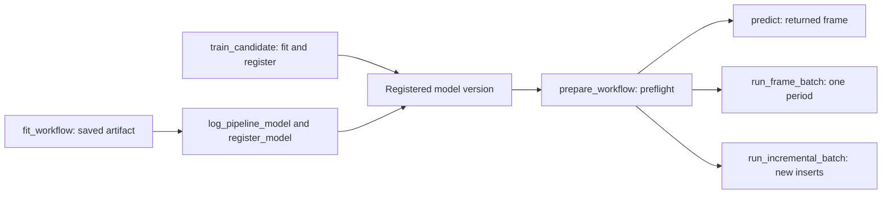

# Databricks Python SDK: fit, inspect and score

Start here to fit a bounded pandas pipeline, save it and score two new rows in
Python. Then choose only the cloud scenario you need from the index below.
A Bundle is optional; the Python SDK does not submit Databricks jobs for you.

## Fit and score a small batch

Use Python 3.12+ and a writable working directory:

```bash
uv pip install skyulf-core
# Add tracking/registry support only when needed:
uv pip install "skyulf-core[mlflow]"
```

Pin a published Skyulf release and resolved dependencies for repeatable training
and scoring. Newer integration features require their matching release/build;
unpublished development validation uses the exact build on every participating
runtime. Do not assume an editable install's version identifies its source revision.

This complete local example needs no account, Spark or MLflow:

<!-- skyulf-example: native sdk-local -->
```python
import pandas as pd

from skyulf.data.dataset import SplitDataset
from skyulf.integrations.databricks import (
    InputSource, WorkflowConfig, ModelSelection, OutputSink,
    fit_workflow, prepare_workflow,
)

frame = pd.DataFrame({
    "x": [1., 2., 3., 4., 5., 6., 7., 8.],
    "target": [2., 4., 6., 8., 10., 12., 14., 16.],
})
training, heldout = frame.iloc[:6].copy(), frame.iloc[6:].copy()
pipeline_config = {"preprocessing": [], "modeling": {"type": "linear_regression"}}
artifact_path = "artifacts/customer-model"
artifact = fit_workflow(
    pipeline_config, SplitDataset(train=training, test=heldout),
    target_column="target", artifact_path=artifact_path,
    max_rows=100, max_bytes=1_000_000,
)
config = WorkflowConfig(
    runtime="standalone", engine="pandas",
    source=InputSource(kind="caller_frame", max_rows=100, max_bytes=1_000_000),
    model=ModelSelection(kind="local_pipeline", path=artifact_path),
    sink=OutputSink(kind="return_frame"),
)
prepared = prepare_workflow(config)
query = pd.DataFrame({"x": [9., 10.]})
predictions = prepared.predict(query)
assert prepared.preflight.ready
assert prepared.preflight.feature_order == ("x",)
assert (predictions["prediction"] - [18., 20.]).abs().max() < 1e-10
print(predictions)
```

Expect a `prediction` column containing approximately `18.0` and `20.0`.
`artifacts/customer-model` contains the saved fitted artifact, not a source
project directory you must invent. Preflight verifies the recorded schema,
engine, outputs and dependency versions before prediction. All rows remain in
this Python process. The training/test split is explicit and test labels are not
used to fit the model. Add normal Core steps to `preprocessing`; the
[recipe catalogue](preprocessing_recipes.md) explains built-in nodes and parameters.

The same saved artifact can be logged/registered for separate jobs using
[MLflow model packaging](mlflow_models.md) and the [registry walkthrough](mlflow_registry.md).
A temporary driver path alone is not a cross-job model store.

## Choose your next scenario



Fit, register and score are separate calls. The local example above skips
registration and loads the saved artifact path. Only `run_frame_batch` and
`run_incremental_batch` write a Delta table.

| Goal | Continue here | Result |
| --- | --- | --- |
| Inspect configuration or a representative prediction | [Preflight](#preflight-and-custom-pipelines) | Issues, recorded schema and optional sample prediction. |
| Track model quality | [Holdout evaluation](#evaluate-the-held-out-split-in-the-model-run) | Real metrics and one model URI in an MLflow run. |
| Train from labeled Delta rows | [Candidate training](#train-a-candidate-when-labels-are-ready) | Concrete registered version and comparison; no implicit alias move. |
| Read one fixed UC snapshot | [Pinned UC scoring](#fit-and-score-a-pinned-uc-source) | Keyed returned predictions and diagnostics. |
| Publish one month safely | [Period publication](databricks_batch.md) | Delta receipt, replay and second-month readback. |
| Consume new inserts | [Incremental scoring](#score-newly-inserted-rows-automatically) | Prediction commit and CDF watermark. |
| Continue lag/rolling context | [History](#lag-and-rolling-history-across-batches) | Predictions plus explicit saved continuation state. |
| Save business rules and lookup files | [Policies and assets](#saved-scoring-policies-and-project-assets) | Versioned eligibility, output rules, assets and exact dependency pins. |
| Train several targets | [Multi-target workflows](#train-independent-target-models-in-one-job) | Per-target candidates and optional coherent model-set activation. |
| Build/deploy generated jobs | [Bundle guide](databricks_bundle.md) | Project YAML, job tasks and operator commands. |

| Setting | What it chooses |
| --- | --- |
| `runtime="standalone"` / `"databricks"` | General Python integration or Databricks integration policy. UC publication requires `databricks`; it does not select a DataFrame engine. |
| `engine="pandas"` / `"polars"` | Bounded fit/scoring engine; must match the saved pipeline. |
| `inference_mode="local"` / `"spark"` | Whole-frame scoring or separately admitted distributed worker scoring. Default `local`; Spark has additional source/registry/recipe requirements. |
| Input budgets | `InputSource` defaults to 100,000 rows and 128 MiB. Set explicit smaller job limits; they reject overflow rather than silently sample. |

UC examples below run in a compatible Databricks notebook/task with authenticated
`spark`, Delta support, model dependencies and access to the named resources.
Replace example catalog/schema/table/version identities with your provisioned
resources. A workstation needs separately configured compatible Databricks
Connect; installing Skyulf alone does not create a session. Source reads require
catalog/schema use and `SELECT`; model loading needs its own model permissions;
publication needs target/control read-write permissions. Keep tokens outside
configuration and authenticate through the runtime's credential provider.

## Preflight and custom pipelines

`WorkflowConfig` is frozen, serializable and has no implicit source
snapshot, period or promotion decision. `preflight(config, artifact=...)`
performs offline checks without a registry call, package load or job submission.
It returns issues with a code, category and suggested fix. For a registry
selection, offline preflight reports `model_unresolved`; call
`prepare_workflow` when read-only registry access is allowed. That step
loads the pinned package and performs full preflight before returning a
predictor. `local_issues`, `remote_issues` and `remote_checked` keep the two
stages visible. It may deserialize trusted pickle, but creates no cloud resource.
If representative rows are available before submitting a job, pass
`probe_frame=sample` to `preflight` or `prepare_workflow`. The probe
runs the actual fitted FE and model and reports a `prediction_probe_failed`
issue for an incompatible sample. A passing sample is evidence for that sample,
not a guarantee about every later batch.

<!-- skyulf-example: native sdk-local -->
```python
from skyulf.inference.fitted_pipeline import load_pipeline
from skyulf.integrations.databricks import preflight

artifact = load_pipeline("artifacts/customer-model")
report = preflight(config.model_copy(update={
    "model": ModelSelection(kind="local_pipeline", path="artifacts/customer-model")
}), artifact=artifact)
for issue in report.issues:
    print(issue.category, issue.code, issue.fix)
```

For custom feature engineering, edit the normal `SkyulfPipeline` preprocessing
configuration, fit it on training data, save it, and compare predictions before
and after loading. The SDK has **no separate node or model allowlist**: it
restores the fitted `SkyulfPipeline` and calls its existing prediction path.
Integration examples cover imputation, scaling, encoding, binning, linear and
logistic regression, and a MinMaxScaler/random-forest combination on both DataFrame
engines. Other library combinations remain governed by their own fitted
inference behavior and should receive replay tests before production use.
Saving a pipeline does not itself admit it to independent worker batches or
single-row requests. Inspected pandas artifacts can use the separately certified
[Spark pyfunc route](databricks_spark_scoring.md) when
their exact fitted recipe and model are supported. A portable `InferenceBundle`
uses a different state format and its own `predict_local`/`predict_spark` paths;
selecting the wrong package kind fails preflight. See
[preprocessing context](preprocessing_context.md) for groups and history.

For example, an advanced pipeline may fit explicit binning followed by encoding
before it is packaged; its saved edges and category positions are then replayed
by the fitted artifact:

<!-- skyulf-example: illustrative binning-recipe -->
```python
from skyulf.pipeline import SkyulfPipeline

pipeline = SkyulfPipeline({
    "preprocessing": [
        {"name": "bands", "transformer": "CustomBinning", "params": {
            "columns": ["x"], "bins": [0.0, 2.0, 4.0, 6.0],
            "output_suffix": "_band",
        }},
        {"name": "encode_bands", "transformer": "OneHotEncoder", "params": {
            "columns": ["x_band"], "drop_original": True,
            "handle_unknown": "ignore",
        }},
    ],
    "modeling": {"type": "linear_regression"},
})
# Pass this recipe and an explicit SplitDataset to fit_workflow, which saves it.
```

`InputSource` defaults to 100,000 rows and 128 MiB. Set tighter limits for each
job. `PreparedWorkflow.predict` checks both before running FE and the model.
It preserves the caller's input column order and rejects schema mismatches; it
does not silently collect a Spark DataFrame. On Databricks, supply either a
bounded caller-owned frame or the explicit pinned UC source adapter below.

## Evaluate the held-out split in the model run

Keep labeled test rows outside the fit split. After fitting and loading the
artifact, `evaluate_holdout` calls the saved pipeline's normal prediction
path on those raw test features. It returns `heldout_mae`, `heldout_rmse` and
`heldout_r2` for regression; classification returns `heldout_accuracy` and
`heldout_f1_weighted`, plus `heldout_f1` for binary models (the model's second
class is positive). A negative R2 is a valid poor-generalization result, not a
logging failure. The caller chooses the split and logs metrics to the same
MLflow run ID that contains the model artifact:

<!-- skyulf-example: native sdk-tracking -->
```python
# Continue the first local example: artifact, heldout and artifact_path.
from pathlib import Path
from skyulf.integrations.databricks import evaluate_holdout
from skyulf.integrations.mlflow import TrackingConfig, track_run
from skyulf.integrations.mlflow.models.pipeline_model import log_pipeline_model

tracking_uri = "sqlite:///" + (Path.cwd() / "sdk-demo.db").as_posix()
tracking = TrackingConfig(
    enabled=True, tracking_uri=tracking_uri, experiment_name="sdk-demo",
)
metrics = evaluate_holdout(artifact, heldout, target_column="target")
with track_run(tracking, run_name="customer-model") as run:
    run.log_params({"heldout_rows": len(heldout)})
    run.log_metrics(metrics)
    model_uri = log_pipeline_model(
        artifact_path, run_id=run.run_id,
        artifact_path="model", tracking_uri=tracking_uri,
    )
assert metrics["heldout_rmse"] < 1e-10
print(model_uri, metrics)
```

The held-out labels are used only for evaluation. Monthly scoring reads raw
features without labels and applies the already fitted FE and model.

## Preprocessing diagnostics

Set `TrainingSpec(..., preprocessing_probe=True)` to inspect the saved and
reloaded preprocessing on at most the first 256 holdout rows. The option defaults
to `False`. The 8 MiB input/output budget keeps the sample bounded; the report
is saved as `preprocessing_probe.json` on the candidate's MLflow training run.

This checks saved state, schema, repeated application, chunk/order consistency
and mutation where the step's context allows those comparisons. It does not
refit or measure model quality and does not change promotion policy. A step
requiring groups or history reports `requires_context`, with later steps
`not_run`; that is a request for the right execution context, not proof of a
broken pipeline. See [the runnable example and report guide](preprocessing_context.md)
for all statuses and direct `probe_fitted_preprocessing(artifact, sample)` use.
The preflight prediction sample described above is a separate check that also
calls the model.

## Train a candidate when labels are ready

Continue with `pipeline_config` from the first local example and the
runtime-provided `spark` session. This scenario requires an existing Delta
`catalog.schema.labeled_events` version `12` with unique `event_id`, numeric
`feature_a` and `feature_b`, numeric `target`, and native Spark timestamp
`event_time`/`label_available_at`. It also assumes an existing registered
baseline version `7` with the same target/schema and experiment access.
Omit `champion_version` when creating your first candidate. Replace these sample
resource identities before running; the local first example does not create them.


`train_candidate` reads a **specific Delta table version**, filters a
bounded event window in Spark when temporal splitting is selected. Random
splitting uses Core `DataSplitter` on stable record-key order and needs no dates.
Optional availability filtering excludes unknown results and those after the
independent `result_cutoff` from both fit and holdout.
For temporal splitting, the feature/model pipeline fits only on events before
`holdout_start`; later eligible events are reserved for evaluation. The fit engine can be pandas or
Polars. The run logs the Skyulf config, source and code identities, fitted model,
held-out metrics and `candidate_comparison.json`. It registers a new concrete
model version. By default it assigns neither `@challenger` nor `@champion`;
an explicitly supplied `on_registered` callback can hand nomination to a
separate lifecycle owner.

The model-producing run also exposes native MLflow **Inputs** for the actual
`training` and `holdout` frames. These preserve the pinned source version and
bounded split profiles; `dataset_inputs.json` links the source, sampling, split
and optional feature lookup evidence. See
[training datasets in Inputs](mlflow_tracking.md#training-datasets-in-inputs)
for the fields and the distinction between lineage metadata and saved data rows.

<!-- skyulf-example: cloud candidate-training -->
```python
from datetime import UTC, datetime
from skyulf.integrations.databricks import TrainingSpec, train_candidate

spec = TrainingSpec(
    table="catalog.schema.labeled_events", version=12,
    split_strategy="temporal", filter_unavailable_results=True,
    result_cutoff=datetime(2026, 3, 15, tzinfo=UTC),
    start=datetime(2026, 1, 1, tzinfo=UTC),
    holdout_start=datetime(2026, 2, 1, tzinfo=UTC),
    cutoff=datetime(2026, 3, 1, tzinfo=UTC),
    event_column="event_time", result_available_at_column="label_available_at",
    record_key_columns=("event_id",), input_columns=("feature_a", "feature_b"),
    target_column="target", max_rows=10_000, max_bytes=32_000_000,
)
result = train_candidate(
    spark, spec, pipeline_config,
    model_name="catalog.schema.customer_model",
    tracking_uri="databricks", registry_uri="databricks-uc",
    experiment_name="/Shared/customer-model", run_name="candidate-2026-03",
    artifact_path="artifacts/customer-model", metric="heldout_rmse",
    min_improvement=0.05, engine="pandas",
    champion_version="7",  # Pin this concrete version before the job starts.
)
print(result.model_version, result.comparison.eligible)
```

The example uses native Spark timestamp instants; their stored instants are
retained independently of the Spark session timezone. A
missing or later label is not a training label, even if its target value is
already present in the pinned table. The source must have unique nonnull row
keys and distinct feature, target and timestamp columns. A nonempty training
set and holdout of at least two rows each are required. The row and byte limits
bound decoded rows and the local frame, not Spark's wire transfer size. The
caller supplies a concrete `champion_version`; omit it for the first candidate.
Review the comparison report, then use the separate guarded staging/promotion
operations if a human approves a change. If fit, packaging, registration or
comparison fails, no alias moves; a registered but unapproved candidate may
remain for inspection. A scheduling policy is separate from this service.

For string, local-clock or date-only source columns, supply independent rules:

<!-- skyulf-example: cloud candidate-probe -->
```python
from dataclasses import replace
from skyulf.integrations.databricks import TrainingDateSpec

spec = replace(
    spec,
    event_time_parsing=TrainingDateSpec(
        format="%d/%m/%Y %H:%M:%S", timezone="Europe/Copenhagen"
    ),
    result_time_parsing=TrainingDateSpec(format="%Y-%m-%dT%H:%M:%S%z"),
)
```

Leave the format unset for native timestamp columns. Naive local timestamps
need an explicit source timezone; dates additionally require
`date_only="midnight"`. The default rejects date-only inputs. Ambiguous and
nonexistent local times are rejected, and strings are never guessed.
See the [source-date contract](databricks_bundle.md#source-date-formats-and-timezones)
for examples, boundaries, supported directives and distributed validation cost.
`candidate_training_spec.json` retains both parsing rules for approval replay.

For a table without dates, create the same specification with no time fields:

<!-- skyulf-example: cloud cv-spec -->
```python
spec = TrainingSpec(
    table="catalog.schema.labeled_customers", version=12,
    record_key_columns=("customer_id",), input_columns=("income", "age"),
    target_column="target", max_rows=10_000, max_bytes=32_000_000,
    split_strategy="random", test_size=0.2, random_state=42, stratify=False,
)
```

Pass this spec to the same `train_candidate` call above with either fit engine. All targets must be
known. Enable `filter_unavailable_results` and set `result_available_at_column` plus `result_cutoff`
if outcomes arrive later; random splitting still needs no observation timestamp. The returned
candidate and saved spec record holdout membership evidence for approval replay. See the
[split/availability matrix](databricks_bundle.md#choose-the-evaluation-split-and-result-availability)
for the four supported combinations.

## Candidate CV and sampling

Candidate training also accepts `cv=CVSpec(enabled=True, folds=3)` from
`skyulf.integrations.databricks.training.tuning.cv`. It reuses Core CV on training rows,
refits preprocessing per fold and logs a separate report to the candidate's
MLflow run. Use `method="stratified_k_fold"` for classification; time-series CV
requires an explicit event window and `shuffle=False`. The saved final pipeline
and its protected holdout are independent of the fold fits.

`TrainingSpec(training_sample_rows=10_000, training_sample_seed=42, ...)`
opts into seeded Spark-side selection before local transfer. The limit includes
training and final holdout rows and cannot exceed `max_rows`. Sample membership
is pinned for approval replay. Leaving it null preserves overflow-fail behavior.
See [Bundle CV, sampling and selection](databricks_bundle.md#optional-basic-model-cross-validation)
for full contracts and the Bundle's `train` calendar settings. The Bundle uses
the same action for manual and scheduled runs: null source version resolves
latest once, explicit version pins the snapshot, and rolling windows derive at
invocation. The direct `train_candidate` API still takes a concrete
`TrainingSpec` with its source version and any active date boundaries.

## Fit and score a pinned UC source

This is an independent Databricks scenario, run in a Python notebook/task with
its authenticated `spark` session. Replace the example three-part names and
versions with existing resources: version `12` of `new_entities` must contain
`entity_id` keys, `event_time` as Spark timestamp, and `amount`/`city` with the
exact raw schema of the pre-existing version `7` customer model. That model must
have been fitted with Polars. These resources are not created by `prepare_workflow`.
For a complete provision/train/register/monthly example, use the
[batch walkthrough](databricks_batch.md).


`fit_workflow` requires an explicit `SplitDataset`; it bounds the total
rows and in-memory bytes before fitting and saves the same trusted artifact as
`save_pipeline`. Tracking and registration remain opt-in calls through
`track_run`, `log_pipeline_model` and `register_model`. They do not move an alias.

<!-- skyulf-example: cloud pinned-uc-source -->
```python
from datetime import UTC, datetime

from skyulf.integrations.databricks import (
    InputSource, SourceSpec, WorkflowConfig, ModelSelection,
    OutputSink, prepare_workflow, score_source,
)

table = "catalog.schema.new_entities"
config = WorkflowConfig(
    runtime="databricks",
    engine="polars",  # must match the registered artifact's fit engine
    source=InputSource(kind="uc_table", table=table, version=12,
                       max_rows=10_000, max_bytes=32_000_000),
    model=ModelSelection(kind="local_pipeline",
                         name="catalog.schema.customer_model", version="7",
                         tracking_uri="databricks", registry_uri="databricks-uc"),
    sink=OutputSink(kind="return_frame"),
)
prepared = prepare_workflow(config)  # resolves a concrete model version
period = SourceSpec(
    table=table, version=12, record_key_columns=("entity_id",),
    input_columns=("amount", "city"),  # exact saved raw input order
    period_start=datetime(2026, 1, 1, tzinfo=UTC),
    period_end=datetime(2026, 2, 1, tzinfo=UTC),
    max_rows=10_000, max_bytes=32_000_000,
)
result = score_source(spark, period, prepared)
print(result.predictions, result.diagnostics)
```

The reader applies the pinned Delta version, half-open UTC period filter,
column projection, deterministic row-key order and `max_rows + 1` limit before
iterating on the driver. It stops when decoded serialized rows or the resulting
local frame exceed `max_bytes`, and rejects duplicate row keys. This byte guard
measures decoded payload and local memory, not Spark's private wire framing;
very wide individual rows should therefore be excluded or handled by a
separately proven paged transport. The selected source and its limits must match
the prepared workflow. The result keeps row keys outside the model input and
records the source version, period, model digest and concrete model version.
No prediction table is created here. Whole-frame FE retains local pandas or
Polars behavior even though Spark performs the bounded UC read.

## Publish one scored month to a UC Delta table

This Databricks fragment assumes a pre-existing `scoring_source` version `12`
with the same `entity_id`, `event_time`, `amount` and `city` contract as the previous
scenario, a registered Polars model version `7`, and provisioned output/admission
tables. Use the [complete batch walkthrough](databricks_batch.md) for table DDL,
version discovery, unchanged retry, a second month and readback assertions.


`run_frame_batch` keeps feature engineering and model prediction in the saved
pandas or Polars engine. Spark reads the pinned UC source and converts only the
bounded final prediction rows to a DataFrame with the target's explicit schema.
The guarded Delta writer then replaces exactly the requested half-open period.
A second month therefore leaves the first month's predictions and run metadata
unchanged; a backfill must explicitly name the earlier period.

Provision the source, prediction target and admission control table before the
job. The source and target must be different Delta tables. The target must have
the row-key columns with the same Spark types as the source (`long` or
`string`), a `timestamp` period column, the saved model's output columns at
their declared types, and three string columns:
`run_id`, `model_name` and `model_version`.
Here `run_id` identifies the prediction publication, not the MLflow training run;
the incremental writer derives it from the source/model snapshot. Existing test
targets with `__skyulf_*` columns retain their historical schema; create a
new target with these names for the updated writer.

The control table has exactly one row, `target_id STRING` equal to the target
Delta table ID and nullable `owner STRING` initially null. Every publisher
of this target must use that same control table. The job identity needs read
access to the source/model and write access to the target/control tables.

<!-- skyulf-example: cloud monthly-publication -->
```python
from datetime import UTC, datetime
from importlib.metadata import version

from skyulf.integrations.databricks import (
    BatchSpec, InputSource, SourceSpec, WorkflowConfig,
    ModelSelection, OutputSink, prepare_workflow, run_frame_batch,
)
from skyulf.integrations.databricks.data.delta_io.delta_admission import DeltaTableAdmission

source_table = "catalog.schema.scoring_source"
target_table = "catalog.schema.predictions"
control_table = "catalog.schema.prediction_admission"
source_version = 12
source = SourceSpec(
    table=source_table,
    version=source_version,
    period_start=datetime(2026, 1, 1, tzinfo=UTC),
    period_end=datetime(2026, 2, 1, tzinfo=UTC),
    record_key_columns=("entity_id",),
    input_columns=("amount", "city"),
    max_rows=10_000,
    max_bytes=32_000_000,
)
config = WorkflowConfig(
    runtime="databricks",
    engine="polars",
    source=InputSource(
        kind="uc_table", table=source_table, version=source_version,
        max_rows=source.max_rows, max_bytes=source.max_bytes,
    ),
    model=ModelSelection(
        kind="local_pipeline", name="catalog.schema.customer_model", version="7",
        tracking_uri="databricks", registry_uri="databricks-uc",
    ),
    sink=OutputSink(kind="uc_delta", table=target_table),
)
prepared = prepare_workflow(config)
spec = BatchSpec(
    period_start=source.period_start,
    period_end=source.period_end,
    as_of=datetime.now(UTC),  # capture after the selected source commit exists
    record_key_columns=source.record_key_columns,
    output_table=target_table,
    model_name=config.model.name,
    model_version=prepared.preflight.model_version,
    model_digest=prepared.preflight.model_digest,
    source_version=source_version,
    code_version=version("skyulf-core"),
    run_id="january-2026-v1",
    expected_target_version=0,  # read and pin before submission
    mode="local_pipeline",
)
result = run_frame_batch(
    spark, source, prepared, spec,
    admission=DeltaTableAdmission(spark, control_table),
)
print(result.commit_version, result.replayed, result.manifest)
```

Use a new logical run ID and the current target version for the next month's
job. Retry an uncertain job with the *identical* spec, including its original
run ID and expected target version; a successful replay returns the existing
receipt. A new run with a stale expected version fails instead of overwriting
newer results. An empty period fails unless `allow_empty=True` is explicit.
The source snapshot must have been committed by `as_of`. The reader and
result both enforce the configured local row and memory budgets; this does not
measure Spark's private wire bytes. The control-row admission protocol protects
participating writers only; do not let other jobs bypass it or manually clear
an owner while a writer may still be active.


## Score newly inserted rows automatically

This independent Databricks scenario uses the runtime-provided `spark` session,
a registered Polars model version `7`, and an existing CDF-enabled `new_records`
table whose raw feature columns match that model. `event_id` is the globally
unique source key. The initially empty `predictions` target and
`prediction_admission` control row must already be provisioned as described below.
Choose a different target from a period-replacement job; incremental and period
receipts are different contracts.


`run_incremental_batch` selects records by **Delta source commits**, not
by calendar date. On the first run it scores the existing bounded snapshot. On
later runs it reads only inserts after the source version recorded in the last
prediction-table commit. It appends predictions without replacing an older
period. A source `event_time` column is optional; if you want to carry it into
the target, set `period_column="event_time"` in the stable job configuration.
It never filters rows by that column, including late arrivals.

Provision a distinct, initially empty Delta prediction table with the
globally unique key, saved model output columns and
`run_id`, `model_name`, `model_version` string
columns. If carrying an event timestamp, add a matching Spark `timestamp`
column to both tables. Enable Delta Change Data Feed on the source **before**
any changes that the job must consume. Provision the same shared admission
control table used by the explicit-period writer; all target writers must use
that admission authority. The job identity needs source, model, target and
control-table permissions.

<!-- skyulf-example: cloud incremental-scoring -->
```python
from skyulf.integrations.databricks import (
    InputSource, WorkflowConfig, ModelSelection, OutputSink,
    prepare_workflow, run_incremental_batch,
)
from skyulf.integrations.databricks.data.delta_io.delta_admission import DeltaTableAdmission

config = WorkflowConfig(
    runtime="databricks",
    engine="polars",
    source=InputSource(
        kind="uc_table", table="catalog.schema.new_records",
        read_mode="incremental", max_rows=10_000, max_bytes=32_000_000,
    ),
    model=ModelSelection(
        kind="local_pipeline", name="catalog.schema.customer_model", version="7",
        tracking_uri="databricks", registry_uri="databricks-uc",
    ),
    sink=OutputSink(kind="uc_delta", table="catalog.schema.predictions"),
)
prepared = prepare_workflow(config)
result = run_incremental_batch(
    spark, prepared, record_key_columns=("event_id",),
    admission=DeltaTableAdmission(spark, "catalog.schema.prediction_admission"),
)
print(result.input_count, result.commit_version, result.noop)
```

Keep this configuration for scheduled runs; do not supply a period or source
version on each invocation. A repeat at the already committed source version
makes no target write (`noop=True`). If the source version advances without new
inserts, scoring commits a zero-row receipt (`noop=False`, both row counts zero)
to advance the CDF watermark without changing saved predictions or carry history.
An initially empty source also gets this checkpoint. Monitoring treats it as no
new prediction batch; configured delayed-label checks still run.
If an append succeeds but its acknowledgement is lost, the next
run reads its committed receipt and continues after that source version.
Source updates and deletes, duplicate keys, a missing or expired change feed,
and an unrecognized target commit fail without advancing the watermark.
Key uniqueness must hold across all runs, not only within one batch. Oversized
increments fail under the same local row/decoded-memory limits; increase the
budget deliberately or handle such a source with a separate distributed path.
The target receipt is in the same Delta commit as the predictions. This
protects participating writers only; changes outside the admission protocol
must be handled explicitly.

## Lag and rolling history across batches

`LagFeatures` and `RollingAggregate` default to `history_mode="batch"`: only
the supplied frame participates. Set `history_mode="carry"` in a preprocessing
step to save a bounded training tail per entity. Put this step **after splitting**.
The following is one preprocessing-step dictionary inside a pipeline configuration:

<!-- skyulf-example: illustrative rolling-recipe -->
```python
{"name": "recent_value", "transformer": "RollingAggregate",
 "params": {"columns": ["value"], "window": 5,
            "sort_by": "observation_time", "group_by": ["entity"],
            "history_mode": "carry",
            "history_max_rows": 1000, "history_max_bytes": 48000}}
```

Declare the observed value, clock and entity in `input_columns`. For the
Databricks source contract, this clock must be distinct from the job's
`event_column` and record keys. Drop or encode non-model columns after the
temporal step. Inputs must be available at prediction time; target-history
forecasting is not supported.
The clock must be numeric or a typed datetime; parse JSON/string timestamps in
an earlier preprocessing step before using them as temporal ordering keys.

- The artifact seed stays fixed. Lag 3 retains three prior rows per entity;
  rolling window 5 retains four. Window 1 retains one ordering marker.
- Training never reads its own saved tail. Temporal holdout and each CV fold
  use only their own training history. Carry mode requires Time Series CV
  (or nested Time Series); skipped gap rows do not enter history.
- Missing or tied entity/time keys and observations at or before the saved
  entity time are rejected. New entities start with empty history. Returned
  rows keep request order. `drop_na` is disallowed; use an imputer instead.
- Each chained temporal step stores its own input context. Context rows do
  not enter subsequent imputer/scaler/model fitting or returned predictions.
- Limits apply across all entities per step: by default 10,000 rows and 1 MiB.
  Exceeding a limit fails explicitly; inactive entities are not silently evicted.

**Incremental Databricks scoring:** the initial complete source snapshot
reconstructs history from that snapshot, without prepending the training seed.
Later increments read `temporal_history` from the last prediction receipt.
The new context, source watermark and predictions share one Delta commit.
A failed write leaves the prior committed context; a retry reads the actual
receipt, and replaying the same source version makes no write. Empty increments
at newer source versions retain the committed history in their zero-row receipt.
Receipts have a 64 KiB history budget.
A changed model or a prior receipt without history requires a fresh target;
contexts are never silently mixed across models. This is bounded local batch
execution, not Spark worker or streaming state.

**Period scoring:** `run_frame_batch(..., history_state=...)` accepts an explicit
earlier context. A successful result's manifest contains the next context.
Period replacement does not automatically choose another period's history.
Retry identity includes the supplied context, so conflicting retries fail.

**Core continuation:** use `score_pipeline_with_history` to receive a `PipelinePrediction` with
`frame` and detached `history`. Pass that history to the next call. The
[complete history example](preprocessing_context.md#runnable-history-continuation) shows model
reload, JSON transport and equivalence with one complete request. Persist predictions and history
atomically, and serialize writers or compare and swap the prior state. Ordinary prediction reuses
the immutable training seed; it does not remember earlier calls.

The backend `/deployment/predict` accepts `continue_history=true` for the first
request and `history_state` thereafter; its response returns the next state.
The caller owns durable storage and request serialization. An HTTP error returns
no next state. Custom group/window callbacks still need complete caller-supplied
context; built-in carry mode does not create history for arbitrary callbacks.

## Saved scoring policies and project assets

The rest of this section configures a generated Bundle project, not arguments
to `WorkflowConfig`. Generate it with the [Bundle guide](databricks_bundle.md),
then edit the named project files before training. Saved model versions capture
these choices; scoring a prior version does not reload today's files.


Generated projects separate `src/features/pre_split.py`, `preprocessing.py`
and `scoring.py`. Preprocessing fits transformations inside each training fold.
Scoring has a three-way mode and an independent target-filter switch:

<!-- skyulf-example: illustrative scoring-flags -->
```python
SCORING_MODE = "pre_split"           # "pre_split", "custom", or "combined"
SKIP_TARGET_PRE_SPLIT_STEPS = False # fail if reuse requires the actual target
```

In `pre_split` or `combined`, set the second switch to `True` to skip target-reading filters while
keeping other pre-split steps. This never changes the predicted target. For example, "price is
present" is a training-label check; "floor_area is present" can also be useful when predicting an
unknown price. A mixed target/feature filter is skipped whole, because deleting one field would
change its meaning. Fixed edits are projected onto feature columns. Preview records skipped names
and reused steps.

Reused rules use existing Core implementations and survivor guards on a copy.
Accepted original rows go to the model, so its saved normalization runs once.
Filter dependencies must exist in scoring `input_columns`; include a field there
and remove it from model features in preprocessing if necessary. Deduplication
checks the current batch only. Empty recipes in pre_split mode preserve ordinary output.
These choices are saved per model version; changing a local switch does not
change the behavior of an already registered model.

Use `SCORING_MODE="custom"` for custom rules alone, or `"combined"` to run
pre-split first and custom eligibility only on its survivors. First pre-split
exclusion reasons are retained. Custom callbacks receive original accepted inputs;
fixed model transformations still run once. All-excluded batches skip custom
callbacks and the model; combined mode with no pre-split steps still uses custom
rules. Both modes expose the same separate custom sections:

- `eligibility`: checks **before prediction**. A null reason accepts a row;
  a text reason excludes it. The template shows both required-field and finite
  inclusive numeric-range checks, using `feature_value` as an editable example.
- `outputs`: rules **after prediction**. Add fields such as a prediction band.
  They do not change model predictions or select training data.

`build_eligibility_rules()` and `build_output_rules()` configure the callable
paths and parameters; the functions they name are defined at the end of
`scoring.py`. Both lists start empty; the sample dictionaries in
`scoring.py` are commented out. Uncomment and adapt a desired example explicitly.
Selecting custom or combined mode alone does not activate sample rules.
The complete dictionary form
below is also supported (returning `None` explicitly disables all scoring rules):

<!-- skyulf-example: illustrative scoring-function -->
```python
# src/features/scoring.py

def build_scoring():
    return {
        "eligibility": [{
            "name": "observed_fields", "version": "1",
            "function": "scoring.require_observed_values",
            "params": {"columns": ["feature_value"]},
        }],
        "outputs": [{
            "name": "risk_band", "version": "1",
            "function": "scoring.prediction_band",
            "params": {"column": "prediction", "thresholds": [10.0, 50.0],
                       "labels": ["low", "medium", "high"], "output": "band"},
            "columns": [{"name": "band", "dtype": "string"}],
        }],
    }
```

For classification, the band rule can use `probability_0`, `probability_1`, etc.;
class order comes from the saved artifact manifest. Callbacks are ordinary trusted
project functions saved with the model. Eligibility receives `(frame, params)`
and returns a Series of nullable reason strings: null means eligible. The first
non-null reason wins in configured order. Output callbacks receive
`(frame, predictions, params)` and return exactly their declared columns, types,
rows and index. Supported output types: `float64`, `int64`, `string`, `bool`.
Callbacks receive defensive pandas frames with a RangeIndex for both engines;
Core preprocessing and model prediction retain the recorded engine. Rules cannot
overwrite raw inputs, estimates, keys or publication metadata. Keep callbacks
deterministic; use saved assets instead of mutable files, clocks or network data.

Every source key has an output row. With a scoring policy enabled, that row has
`scoring_status` (`predicted`/`excluded`) and nullable `exclusion_reason`.
Excluded rows have null predictions and business outputs. Receipts include
`predicted_count` and `excluded_count`; `output_count` counts all outcome rows.
An all-excluded increment is a successful atomic publication that advances the
source watermark. Failed callbacks/writes advance nothing. Replays cannot publish
duplicate keys. Existing targets require the exact output schema, so introduce a
new scoring schema using a fresh target. Training, CV and holdout comparison still
use the raw predictor and their independently defined population.

Eligibility precedes lag/rolling processing. Excluded observations never enter
continuation history. All-excluded batches retain the previous history unchanged.
The saved input schema still applies to excluded rows; normalize input types before
scoring rather than relying on eligibility to reinterpret an incompatible schema.

### Deliver lookup files and external Python dependencies

`src/features/assets.json` includes detailed `_help` instructions and a `files`
list, initially empty. Create your data file and add its feature-root-relative
path, for example `"files": ["assets/bands.json"]`. The original plain-list format
`["assets/bands.json"]` also works. Help text is never embedded as model data.
Assets can support pre-split, preprocessing or scoring; they do not automatically
add a pipeline step. Inside saved code, read a declared file as bytes:

<!-- skyulf-example: illustrative asset-reader -->
```python
from skyulf.inference.project_package import read_project_asset

payload = read_project_asset(__package__, "assets/bands.json")
```

Code, encoded file contents and pins share the bounded 64 KiB source snapshot.
Paths must remain inside the feature package and asset symlinks are rejected.
Undeclared assets, large external model downloads and files outside the package
are not embedded. Replacing a local lookup file cannot change an existing model.

Declare exact `distribution==version` pins in `src/features/requirements.txt`.
Training/load verifies installed versions before executing package code or
unpickling the model. The artifact manifest records the pins; MLflow includes them
in its saved environment. Provision the same dependencies in the training and
scoring job environments; prediction never installs packages. Ranges, URLs,
recursive requirement files, options, extras and environment markers are rejected.

## Train independent target models in one job

<span id="activate-and-score-a-coherent-model-set"></span>
<span id="choose-output-storage-and-consumer-views"></span>
<span id="per-component-quality-gates-and-automatic-set-activation"></span>
<span id="select-preprocessing-and-pre-split-recipes-independently"></span>

`TrainingBranch` and `train_branches` train several targets from one pinned
Delta snapshot and register one candidate per branch. They do not move aliases.
A generated `multi_target` project packages those candidates into one model set
that is approved, rolled back and scored as a whole. The
[model set guide](databricks_model_sets.md) owns the SDK example, the
`model_set` settings, output modes, the replacement rule and set scoring.

## Diagnose a workflow failure

| Symptom | Action |
| --- | --- |
| Preflight `model_unresolved` | Offline preflight cannot read the registry; use `prepare_workflow` when read access is allowed. |
| Engine/schema mismatch | Match the artifact's fit engine and exact raw column order/dtypes; keep keys outside model features. |
| Row/byte budget exceeded | Reduce the requested source population or deliberately review a higher limit. Do not silently truncate. |
| Missing recorded dependency | Install the saved exact dependency/build before loading; prediction does not install packages. |
| UC permissions failure | Verify source, model, target and admission permissions independently for the job identity. |
| Source update/delete during incremental scoring | Standalone single-model incremental scoring rejects it; choose a new/rebuilt destination deliberately. Model sets have an explicit [rebuild policy](databricks_model_sets.md#score-the-set). |
| Stale publication or alias expectation | Review the intervening commit/role change; do not refresh the expected version automatically. |
| Context required | Supply complete group/history context or use the saved carry contract; see [context diagnostics](preprocessing_context.md). |

For REST serving continue to [online feature lookup](databricks_online_features.md)
and [gradual serving rollout](databricks_serving_rollout.md). These are separate
endpoint/publication workflows; registering a model or publishing batch rows does
not create an endpoint.

<span id="upgrading-integration-code"></span>

Renamed modules, the replaced `runtime="local"` value and model packages saved
with older import paths are covered in
[project upgrades](databricks_project_upgrade.md#upgrade-integration-code).
