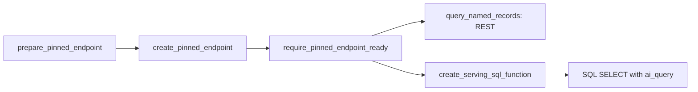

# Set up a model serving endpoint and SQL function

## When you need it

This optional workflow deploys a **concrete registered model version**, then
creates a Unity Catalog SQL function calling its endpoint through `ai_query`.
The endpoint runs the saved preprocessing and prediction code. Callers supply
the model's input features, including any features produced by upstream joins
or aggregations. The function returns predictions; your application or SQL job
owns source selection and destination writes.

Choose `prediction_delivery: endpoint` or `both` in detailed Bundle setup to
generate the `serving_endpoint` job. It maintains one endpoint per project and
target, then checks real REST and SQL predictions against the saved model.
Quick setup defaults to `batch`. REST serving works independently of the SQL function.
The [notebook API](#the-command) remains available for explicit, create-only setup.

For a complete endpoint-only project, copy
[taxi_fare_endpoint](https://github.com/flyingriverhorse/Skyulf/tree/master/skyulf-core/templates/databricks/examples/nyctaxi/taxi_fare_endpoint).
It uses the built-in NYC taxi data, automatically updates serving after champion
promotion, and demonstrates SQL requests plus telemetry monitoring. Its
[serving walkthrough](https://github.com/flyingriverhorse/Skyulf/blob/master/skyulf-core/templates/databricks/examples/nyctaxi/taxi_fare_endpoint/SERVING.md)
ends at the **Online serving** dashboard; no batch prediction table is created.

### Choose how predictions are produced

| Setup choice | Generated prediction jobs | Monitoring |
| --- | --- | --- |
| `batch` (default) | `score` | Batch observations through the monitoring job |
| `endpoint` | `serving_endpoint`; no batch schedule, prediction table or score handoff | The monitoring job reads logged requests after enrollment |
| `both` | `score` and `serving_endpoint`, independently | Both sources in the same monitoring store |

The monitoring job is retained in every mode. Changing delivery mode changes
the generated job graph: regenerate and review the project before deployment.
Endpoint-only projects retain `config/inference.yml` for the smoke source and,
for model sets, the registered parent identity and composition settings.

| Path | Runs where | Use it for | Cost model |
| --- | --- | --- | --- |
| Batch `score` job, `batch_compute: single_node` | One Python process on job compute | Scheduled or handoff scoring of a bounded table | Job compute while it runs |
| Batch `score` job, `batch_compute: spark` | Spark workers via `mlflow.pyfunc.spark_udf`; no endpoint | Large scheduled scoring into Delta | Job compute while it runs |
| REST endpoint (this page) | Databricks Model Serving | Applications needing one request at a time | Endpoint compute while provisioned; scale to zero is enabled by default |
| SQL function with `ai_query` (this page) | Model Serving, called from SQL | Analysts, SQL jobs and dashboards querying the endpoint | Endpoint plus the SQL warehouse or cluster |

The batch job never calls an endpoint, and the endpoint never writes the
prediction table: an `ai_query` caller decides where results go, for example
`CREATE TABLE ... AS SELECT score_fn(...)`. Spark workers and endpoints both run
the saved pandas pipeline on independent batches, so both admit only the steps
and models listed in [Spark scoring support](databricks_spark_scoring.md#what-spark-scoring-supports).

Additional built-in models, voting/stacking and eligible preprocessing recipes
need the training evidence described in
[built-in recipes and model evidence](databricks_spark_scoring.md#built-in-recipes-and-model-evidence).
Selecting the endpoint job enables `defaults.allow_tested_custom_steps: true`
in `config/training.yml`. For an existing endpoint-only project, enable it before
training. Spark and online-feature projects already enable it.
`prepare_pinned_endpoint` recomputes the certificate from
the exact registered package; changing a serving setting cannot admit an old
model without evidence. Missing or changed evidence requires retraining and
registering a new version. Inspect `partition_probe.json` in that training run:
the model and built-in step records explain what was checked. Serving uses the
same `model_probed` and `apply_probed_builtin` certificate actions as Spark.



For entity-key requests, first prepare and publish the model's
[online features](databricks_online_features.md), then use the online setup
commands on this page. Change traffic gradually through the separate
[daily rollout](databricks_serving_rollout.md) workflow.

### Raw-input models and optional prediction tables

The model's saved input schema determines what callers send. If the complete
pipeline was fitted on raw columns, its admitted feature generation and fitted
preprocessing run inside the model. Callers do not repeat those transformations
or create a merged feature table. Spark joins and historical feature-table
calculations performed before that pipeline are not automatically included.

Training does not require a prediction sink. Choose `prediction_delivery: endpoint`
to omit the batch job and its output configuration. REST calls and SQL functions
return results. A separate caller decides whether to publish them with a
DataFrame write or `CREATE TABLE ... AS SELECT`.

## What to edit

| File or input | Set before running |
| --- | --- |
| `config/serving.yml` → `serving_endpoint` | Enablement, automatic handoff, logging, compute, SQL function, caller grants and sample size |
| `config/inference.yml` → `score_source_table` | Existing table containing every raw input in the saved model signature |
| `deployment/requirements.txt` | Runtime matching the registered model's producer |
| `deployment/variables.yml` / target overrides | Serving job timeout, compute policy, cost attribution and job permissions |
| `config/serving.yml` → `online_feature_lookup` | Separate online-lookup setup, only when selected |

Use
[deployment identities and access](databricks_deployment.md#deployment-identity-and-run-identity)
for the Bundle and the [permissions below](#errors-and-privileges) for REST/SQL.

## Run the Bundle serving job

Detailed setup → `prediction_delivery: endpoint` or `both` supports certified pandas single
models, competition winners and model sets. Quick setup creates batch scoring; Polars
training is not admitted. Online lookup and rollout are separate options.

After training and champion approval, run from the generated project. Substitute
your target and authenticated profile:

```bash
databricks bundle validate --strict -t test --profile YOUR_PROFILE
databricks bundle deploy -t test --profile YOUR_PROFILE
databricks bundle run serving_endpoint -t test --profile YOUR_PROFILE
# Explicit version instead of resolving champion:
databricks bundle run serving_endpoint -t test --profile YOUR_PROFILE --params model_version=7
```

- **Automatic:** completed champion initialization, promotion or rollback,
  including daily-rollout promotion, submits a separate serving run in production
  Bundle mode. Pending/rejected/unchanged candidates do not. The receipt pins the
  numeric version; submission retries are idempotent.
- **Manual:** personal development targets, `follow_champion: false`, or champion changes
  made outside the template. Batch `follow_champion` in `config/inference.yml` is independent when `both` is selected.
- **Check the child run:** training waits only for submission and retains its
  timeout. Open the returned serving run ID and inspect `serving_result`.

The dispatch tasks exist whenever the endpoint job is generated. Toggle
`serving_endpoint.follow_champion` in YAML and deploy that file; the toggle does not
require regenerating the graph and does not compare against a frozen job value.

### Automatic monitoring enrollment

To enroll automatically, set the target's `monitoring_enabled: "true"` and use
`logging_mode: telemetry` or `ai_gateway`. Configure `monitoring_catalog` and
`monitoring_schema` before running the job; these are validated before endpoint
changes when enrollment is enabled. After reference, REST and optional SQL parity passes,
it enrolls the served concrete version in that existing monitoring store. A
model set gets one registration per branch, with parent name/version/branch
attribution. Reruns reuse the same identities; prior registrations for this
endpoint and project/target are disabled after the new enrollment succeeds.
Their history, unrelated endpoints and batch registrations are preserved.

The result reports enrollment status. With `monitoring_enabled: "false"` or an
absent flag, it reports `monitoring_disabled` and skips all monitoring work,
preserving existing registrations. Endpoint logging and verification still run.
When monitoring is enabled, `logging_mode: disabled` reports `logging_disabled`.
The target's paused monitoring schedule still remains paused.
Enrollment alone does not create observations: send requests, wait for payload
delivery, then run the monitoring job. The Online serving dashboard reads those
saved observations. Performance needs matching outcome labels. See
[serving monitoring](databricks_serving_monitoring.md) for access and label contracts.

### Three caller recipes

Merge **one** recipe into the generated `serving_endpoint` section; retain its
names and target bindings. Examples assume one `amount` input. For your model,
copy the job's generated examples with every required field.

#### SQL with ai_query

```yaml
serving_endpoint:
  # SQL access without request logging tables.
  sql_function:
    enabled: true
  logging_mode: disabled
  permissions:
    - group_name: risk_readers
      level: CAN_QUERY
```

The job adds endpoint `CAN_QUERY` and function `EXECUTE`. Callers also need
`USE CATALOG` and `USE SCHEMA`, which the job does not grant.

```sql
SELECT main.ml.risk_score(`amount` => s.`amount`) AS result
FROM main.source.customers AS s;
```

#### REST for applications

```yaml
serving_endpoint:
  # Replace the application ID with your service principal's ID.
  sql_function:
    enabled: false
  logging_mode: disabled
  permissions:
    - service_principal_name: APPLICATION_ID
      level: CAN_QUERY
```

To capture requests, choose `telemetry` and fill the three logging destination
keys below before creating the endpoint. Credentials stay in the environment:

```bash
curl --fail-with-body --request POST \
  "${DATABRICKS_HOST}/serving-endpoints/risk-test-endpoint/invocations" \
  --header "Authorization: Bearer ${DATABRICKS_TOKEN}" \
  --header "Content-Type: application/json" \
  --data '{"dataframe_records": [{"amount": 12.5}]}'
```

#### Python SDK for notebooks and jobs

```yaml
serving_endpoint:
  # Use the notebook/job caller's group.
  sql_function:
    enabled: false
  logging_mode: disabled
  permissions:
    - group_name: risk_readers
      level: CAN_QUERY
```

```python
from databricks.sdk import WorkspaceClient

result = WorkspaceClient().serving_endpoints.query(
    name="risk-test-endpoint", dataframe_records=[{"amount": 12.5}]
)
print(result.predictions)
```

### Configuration reference

All keys below belong to `config/serving.yml` → `serving_endpoint`.

| Key | Generated default | Meaning |
| --- | --- | --- |
| `enabled` | `true` when selected | Enable the job's work |
| `follow_champion` | `true` | Automatically update after a completed champion change in production; `false` means manual runs only |
| `endpoint_name` | Project + target + suffix | Stable endpoint; personal suffixes use hyphens |
| `model_name` | Target's model or model-set name | Concrete UC registered model identity |
| `tracking_uri` / `registry_uri` | `databricks` / `databricks-uc` | Package lookup |
| `workload_type` / `workload_size` | `CPU` / `Small` | Endpoint compute, independent of job compute |
| `scale_to_zero_enabled` | `true` | Reduce idle compute; cold starts remain possible |
| `ready_timeout_s` | `3600` | Endpoint readiness deadline |
| `logging_mode` | `disabled` | No inference tables or captured-request monitoring; alternatives: `telemetry`, `ai_gateway` |
| `logging_catalog` / `logging_schema` / `logging_table_prefix` | Empty when disabled | Separate payload sink, required for logged modes |
| `sql_function.enabled` / `sql_function.name` | `true` / target's score function | Create and smoke-test SQL; `false` leaves REST/SDK only |
| `permissions` | `[]` | Additive caller grants; one user, group or service principal per entry |
| `verification.sample_rows` | `20` | Collected sample size, from 1 to 1000 |

Use `verification: {sample_rows: 20}` to set how many source rows the job checks.
Older `smoke.rows` and `selection` keys are rejected. The job uses the current
champion unless you pass `--params model_version=<version>` for that run.

To change automatic updates, edit `serving_endpoint.follow_champion` in YAML and deploy the updated
file. The endpoint job's existing dispatch tasks remain in place in either mode.

### Operational rules

- **Input and proof:** `config/inference.yml` → `score_source_table` must already
  contain the saved raw inputs after any upstream joins. Hash ordering spreads
  the bounded sample but still scans the source. Empty samples and infinite
  reference predictions fail before endpoint changes. The same records run
  through the saved pyfunc, REST and enabled SQL path. Counts, fields and discrete
  values match exactly; floats allow `rtol=1e-10`, `atol=1e-12` for rounding.
  Null transport follows the saved package. No batch scoring or Delta write occurs.
- **Result:** action, concrete model URI, logging destination, SQL action,
  comparison counts under `verification` and runnable examples. Output includes one sampled input
  record. This smoke check does not replace holdout evaluation or monitoring.
- **Ownership:** one entity at 100% traffic; foreign names, pending updates,
  conflicting logging/runtime settings and rollout/online endpoints are refused.
  Reserve tags `project`, `target`, `suffix`, `managed_by`; use one deployment
  writer. SQL ownership comes from its managed comment. Only schema/transport
  changes replace its definition; caller arguments may then need updating.
- **Identity and grants:** the job needs model/table read access, endpoint
  management and function create/update rights. Shared targets use the shared SP
  or, with separate identities, scoring SP. Preserve training's `CAN_MANAGE_RUN`
  in `serving_permissions`. Removing a caller from YAML does not revoke access;
  change endpoint permissions and explicitly `REVOKE EXECUTE` when needed.
- **Compute and cost:** job compute follows serverless/`policy_cluster` settings.
  Set `cost_tag_value` before serving, including serverless targets; its placeholder
  is rejected. Do not use an ownership key as `cost_tag_key`. Set Bundle
  `serving_timeout_seconds` (default 7200) to at least `ready_timeout_s + 300` and
  redeploy. Endpoint, maintenance and SQL-call costs are separate from logging.
- **Logging and retirement:** existing notebook/online APIs retain telemetry
  defaults. This job refuses changing an existing endpoint's logging mode; use a
  separately named endpoint. Before retirement, set `follow_champion: false`, deliberately
  delete the endpoint and drop its function. Bundle job removal does not delete
  these resources; retain logs according to your policy.
- **Recovery:** a failed smoke can leave the new version serving. Rerun with
  `--params model_version=<previous_version>` from the deployment result or
  endpoint configuration history (failed runs may have no final summary).
  Recovery is explicit and leaves champion unchanged.


## The command

This advanced path creates a new endpoint and SQL function explicitly. It keeps
the create-only behavior; use the Bundle job above for managed version updates.

### 1. Inspect the model and prepare the endpoint

Install `deployment/requirements.txt` with `uv pip install -r` in your
notebook environment. Use the **same Skyulf source runtime that packaged
the registered model**: admission checks source provenance, fitted artifact
digest, partition safety, named input/output signature and nullable transport.
Updating the local library does not silently upgrade an old model package.
Repackage and register a new version with the intended runtime when necessary.

Supported packages are certified local pipelines (including a selected
competition winner) and model sets. Admission is stricter than “any MLflow model”.
Spark-native models, stateful/batch-dependent preprocessing and native feature
lookup envelopes are not automatically admitted by this bridge.

Edit the explicit identifiers below. Use a separate endpoint and function name
for each release so existing callers continue to use their selected version.

```python
from databricks.sdk import WorkspaceClient
from skyulf.integrations.databricks.serving import (
    PinnedEndpointSpec,
    build_serving_sql_function,
    create_pinned_endpoint,
    create_serving_sql_function,
    prepare_pinned_endpoint,
    query_named_records,
    require_pinned_endpoint_ready,
)

client = WorkspaceClient()  # Notebook workspace identity, never embed a token.
spec = PinnedEndpointSpec(
    endpoint_name="risk-v7",
    model_name="models.risk.customer_risk",
    model_version="7",  # Concrete numeric version, not @champion or latest.
    logging_catalog="ops",
    logging_schema="serving",
    logging_table_prefix="risk_v7",
)
endpoint = prepare_pinned_endpoint(spec, tracking_uri="databricks", registry_uri="databricks-uc")
print("Inputs:", endpoint.input_schema)
print("Outputs:", endpoint.output_schema)
print("Endpoint configuration:", endpoint.config)

function = build_serving_sql_function(endpoint, "models.api.score_risk_v7")
print(function.create_sql)  # Inspect complete DDL before creating anything.
```

Preparation reads the registry but creates no endpoint or function. The generated
SQL uses the inspected schema, not an independently maintained feature list.
Fields must have simple names (letters, digits, underscores; no leading digit)
and must be unique ignoring case. Reserved words are quoted. Supported primitive
types are boolean, int32/int64, float32/float64 and string, including supported
pandas/Polars aliases. Unsupported types fail before SQL execution.

For CPU custom models, the helper configures `telemetry_config` with `sampling_fraction: 1.0`.
Databricks creates the `<prefix>_payload` inference **view** over its managed `<prefix>_otel_logs`
Delta table. A workspace may reject the `ai_gateway.inference_table_config` path; set
`logging_mode="ai_gateway"` only for a workspace that supports it. The helper never falls back
automatically. Retain the endpoint, concrete model version and payload view name together: registry
aliases can move independently of logged requests. See
[serving observation setup](databricks_serving_monitoring.md),
[Databricks custom-model telemetry](https://docs.databricks.com/aws/en/machine-learning/model-serving/custom-model-serving-uc-logs)
and
[fast inference tables](https://docs.databricks.com/aws/en/ai-gateway/inference-tables-serving-endpoints).

#### Payload logging and the inference table

Logging belongs to the endpoint, not to the caller: every request that reaches it
is logged the same way, whether it comes from REST or from an `ai_query` SQL call.
Choose it with `logging_mode` on `PinnedEndpointSpec`, or with
`online_feature_lookup.endpoint.logging_mode` in `config/serving.yml`; setup does not ask.

| `logging_mode` | What Databricks creates in `<logging_catalog>.<logging_schema>` | When to choose it | Rollout and serving monitoring |
| --- | --- | --- | --- |
| `telemetry` (default) | Raw `<prefix>_otel_logs`, `_otel_spans` and `_otel_metrics` tables, plus a `<prefix>_payload` **view** over the logs. Every request is logged (`sampling_fraction: 1.0`). | New projects; the custom-model telemetry path Databricks recommends | Available |
| `ai_gateway` | A `<prefix>_payload` Delta **table** written by AI Gateway, plus usage tracking | Your organization already standardizes on AI Gateway inference tables, or telemetry is unavailable | Available; some workspaces reject this path for custom models |
| `disabled` | Nothing | Callers store predictions themselves, for example with `ai_query` | Rejected with an explicit error |

Both logged modes expose the requests as `<prefix>_payload`, which is what Skyulf
reads. A rejected mode fails endpoint creation; Skyulf never switches to the other
mode automatically, so the log location stays explicit.

The payload view holds raw request/response records and arrives with a delay of
minutes. The batch `score` job is separate: it never calls the endpoint and always
writes its configured `prediction_table`.

#### Serve without an inference table

Set `logging_mode="disabled"` when callers own prediction storage, for example an
`ai_query` job that writes its own table with `CREATE TABLE ... AS SELECT score_fn(...)`.
The endpoint is created with no telemetry or AI Gateway inference table, and the
`logging_*` fields may be empty. Readiness checks then reject an endpoint that does
log payloads. Daily rollout and serving monitoring read those payload logs, so they
reject a `disabled` endpoint with an explicit error.

#### Write your own prediction table with `ai_query`

The SQL function from step 3 already wraps `ai_query` with the model's typed
inputs: it sends numeric NULLs as `NaN` and nullable integers/booleans as text, so
the saved imputation still applies (a bare `ai_query` would send a NULL number as
`0`). Every input row returns exactly one result; the endpoint never drops rows.
A model with a fitted outlier step or `PowerTransformer` can return a result
with an empty `prediction`, `scoring_status` = `excluded` and an
`exclusion_reason` such as `outlier:<step name>` or `invalid:<step name>` (see
[rows that are not scored](databricks_spark_scoring.md#rows-that-are-not-scored)).
Handle that case explicitly in the caller; do not treat the empty prediction
as zero. Keep keys outside the call so results join back. `call_sql()` renders the call
for a table alias:

```sql
-- Full refresh
CREATE OR REPLACE TABLE gold.trip_scores AS
SELECT s.trip_id, s.pickup_month,
       models.api.score_fare_v7(`pickup_hour` => s.`pickup_hour`,
                                `trip_distance` => s.`trip_distance`) AS result,
       current_timestamp() AS scored_at
FROM bronze.trips s;

-- Monthly incremental: rerunning the same month replaces it instead of duplicating it
DELETE FROM gold.trip_scores WHERE pickup_month = 2;
INSERT INTO gold.trip_scores (trip_id, pickup_month, result, scored_at)
SELECT s.trip_id, s.pickup_month, models.api.score_fare_v7(...), current_timestamp()
FROM bronze.trips s WHERE s.pickup_month = 2;
```

For one row per key, `MERGE INTO gold.latest USING (<the SELECT above>) AS s ON
t.trip_id = s.trip_id WHEN MATCHED THEN UPDATE ... WHEN NOT MATCHED THEN INSERT ...`.
Replace the argument list with your function's real `call_sql()` output. These
tables are yours: Skyulf monitoring reads its own prediction tables or the
endpoint payload logs, not caller-written tables.

### 2. Create the REST endpoint and check readiness

```python
ready = create_pinned_endpoint(client, endpoint)  # Create once and wait for readiness.
```

Databricks builds the endpoint asynchronously. This helper polls for readiness
using `endpoint.spec.ready_timeout_s` (3600 seconds by default), then returns
the ready endpoint. It requires `READY` and `NOT_UPDATING` and checks the exact
model version, workload and logging configuration. A failed native update or
an API error remaining after the SDK's own retries propagates.
The polling timeout does not interrupt an HTTP request already in progress:
the injected SDK client's HTTP timeout and retry budget are separate. A ready
response received from that in-flight request can complete the wait after the
polling deadline. Configure the client's transport limits when elapsed request
time also needs a tighter bound.

If the wait expires, `TimeoutError` leaves the endpoint intact. Inspect the
endpoint page and its build logs. Resume waiting for the same admitted plan:

```python
from skyulf.integrations.databricks.serving import wait_for_pinned_endpoint_ready

ready = wait_for_pinned_endpoint_ready(client, endpoint)
```

For one immediate check without waiting:

```python
require_pinned_endpoint_ready(client, endpoint)
```

Prediction and SQL enrollment use this immediate check. Do not repeatedly call
creation: an existing endpoint name is rejected. The helper does not overwrite
endpoints or change model aliases.

The default is CPU/Small with scale-to-zero enabled. Idle endpoints can stop serving compute
after the platform's inactivity interval, and the next request can incur a cold start. This is
separate from SQL warehouse compute and billing. See
[Databricks custom model serving](https://docs.databricks.com/aws/en/machine-learning/model-serving/custom-models).

For an inspected model whose only input is `x: float64`, a REST probe is:

```python
response = query_named_records(client, endpoint, [{"x": 1.5}])
print(response.predictions)
```

Replace that example with **all and only** your model's input fields. REST records
use native JSON scalars except fitted nullable `Int32`, `Int64`, `boolean` and
`Boolean` columns: those use canonical strings (e.g. `"42"`, `"true"`) or `None`,
matching the saved package. The SQL wrapper handles this encoding for you.

### 3. Create the SQL function

Use a Databricks Spark session and SDK client from the **same workspace**:

```python
create_serving_sql_function(spark, client, function)
```

The helper checks endpoint readiness/version before submitting `CREATE FUNCTION`.
It never uses `OR REPLACE` or `IF NOT EXISTS`: an existing function is an error,
so a stale implementation cannot be silently reused. SQL creation errors are
propagated without retries. After successful creation, rerun the SELECT below
as often as needed; creation is not part of every prediction query.

For a SQL warehouse, run `require_pinned_endpoint_ready` first and execute the printed
`function.create_sql` in the SQL editor. This path requires a Pro or Serverless SQL warehouse;
`ai_query` is unavailable on SQL Classic. Supported Databricks Runtime compute requires 15.4 LTS or
later. Verify workspace/region availability in the
[ai_query reference](https://docs.databricks.com/aws/en/sql/language-manual/functions/ai_query).

The SQL wrapper calls the endpoint name, not a UC model URI. The model version is
checked at deployment, but an endpoint administrator can change it afterwards.
Restrict endpoint management rights and retain one endpoint per model release.
The SQL function cannot atomically enforce the version on each call. Run
`require_pinned_endpoint_ready` before a controlled batch as an additional check.

### 4. Call it from a table

```python
# These names stand for your existing table with the model's input feature columns.
expression = function.call_sql(table_alias="source")
print(expression)
scored = spark.sql(
    f"SELECT source.customer_id, {expression} AS result "
    "FROM analytics.features.customer_inputs AS source LIMIT 10"
)
display(scored)
```

Copy the printed expression into your own SQL job. It uses **named arguments**,
so source-table column order does not control feature order. The wrapper builds
`named_struct` in saved model order and declares `returnType` explicitly. SQL
arguments use the fitted types; nullable integer/boolean values are cast directly
to canonical strings without a floating-point conversion. Their nulls stay null.
For floating-point inputs, the wrapper represents SQL nulls as a same-width
`NaN` before calling `ai_query`, so the saved preprocessing handles missing
values. This prevents the numeric-null-to-zero behavior reproduced in native
testing. It does not fill values with a new SQL-side mean or constant.
Use matching source types: SQL's argument coercion is not a data validation layer.

`result` is the named per-row prediction struct, not the REST `predictions` array.
Its fields match `endpoint.output_schema`: e.g. `result.prediction`, probability
fields, model-set outputs and saved project-scoring status fields when present.
A single model, a registered competition winner and an admitted model set use
the same SQL API; the saved output schema determines the returned fields.

### Set up an online Bundle endpoint

First complete
[online Bundle training](databricks_online_features.md#generate-train-and-set-up-an-online-bundle)
and publication. This endpoint setup job exists only when initialization selected
`include_online_feature_lookup: "true"`. It is unscheduled and never creates a publication.

Take the **concrete registered version** from the training result and complete
`online_feature_lookup` in `config/serving.yml`:

```yaml
online_feature_lookup:
  enabled: true
  exclusive_writer: true
  tracking_uri: databricks
  registry_uri: databricks-uc
  endpoint:
    endpoint_name: customer-online-v3
    model_name: models.risk.customer_online
    model_version: "3"
    workload_type: CPU
    workload_size: Small
    scale_to_zero_enabled: true
    ready_timeout_s: 3600
    logging_catalog: ops
    logging_schema: serving
    logging_table_prefix: customer_online_v3
    logging_mode: telemetry
  publications:
    - source_table: features.customer.customer_features
      source_table_id: "REPLACE_WITH_DESCRIBE_DETAIL_ID"
      online_table: features.online.customer_features
      online_store: customer-features
      publish_mode: TRIGGERED # Match the existing publication; use CONTINUOUS for a stream.
```

Use actual resolved UC names here; the source table must be the model's saved
lookup source with the same Delta identity. Configure exclusive endpoint writer
permissions before setting `exclusive_writer: true`. The setup identity must be
able to inspect the source, publication and store; the serving identity also
needs access to the online features. Grant visibility of all publications for
these sources and prevent concurrent publication changes during setup. UC
enumeration covers the setup identity's visible inventory, not hidden resources.
Setup rejects missing, mismatched or ambiguous accessible publications and requires
evidence of a completed first sync before admitting creation. It reports a
validation error while the first sync is incomplete; it does not poll or republish.

```bash
databricks bundle deploy -t test
databricks bundle run online_feature_lookup_setup -t test
```

The setup result reports `READY`, `model_uri`, `input_schema` and a typed
`request_example` derived from the actual native signature. Replace its example
values with a real entity and all other required request values, then send that request body to
`POST /serving-endpoints/customer-online-v3/invocations` or use
`query_named_records` in the SDK example below. Endpoint readiness does not
establish that every requested entity has current features; the saved lookup
policy checks that at prediction time. Rerunning setup never overwrites an
existing endpoint. On timeout, inspect the existing endpoint and resume an
explicit wait; do not rerun creation with the same name.

Save the returned `request_example` object as `request.json`, replace its sample
values, and query after the endpoint reports readiness:

```bash
databricks serving-endpoints get customer-online-v3
databricks serving-endpoints query customer-online-v3 --json @request.json
```

Required source metadata can survive in the native signature, even when excluded
from estimator inputs. Inspect `input_schema`; do not assume every model accepts
keys alone. Direct REST callers can override fetched values. Freshness validation
checks the received values and does not attest their source.

#### Endpoint compute and setup timeout

These settings belong to `online_feature_lookup.endpoint`. They are also keyword
arguments of `PinnedEndpointSpec` for a regular endpoint without online lookup.

| Setting | Default | Supported values and effect |
| --- | --- | --- |
| `workload_type` | `CPU` | `CPU`, `CPU_MEDIUM`, `CPU_LARGE`: CPU memory tiers. Availability depends on your Databricks workspace. GPU model packages are outside this setup. |
| `workload_size` | `Small` | `Small`, `Medium`, `Large`: serving capacity. Larger sizes can cost more; choose using your measured traffic. |
| `scale_to_zero_enabled` | `true` | A YAML boolean. Set `false` to keep serving compute provisioned while idle; `true` permits cold starts. Some workspaces require `true`; platform restrictions are returned as errors. |
| `ready_timeout_s` | `3600` | A positive integer in seconds. Controls the setup wait only; it does not change request timeout or get sent as an endpoint setting. |

For example, to keep a Medium endpoint warm and allow 30 minutes for startup:

```yaml
workload_type: CPU
workload_size: Medium
scale_to_zero_enabled: false
ready_timeout_s: 1800
```

Place those four lines under `online_feature_lookup.endpoint`. A changed YAML file
does not update an existing endpoint. Setup is create-only: use a new endpoint
name and explicitly move your callers after verifying it. A daily rollout must
use the same workload type, size and scale-to-zero setting for champion and
challenger; each plan can have its own client-side wait timeout.

To seed these values during Bundle initialization, the answer-file keys are
`serving_workload_type`, `serving_workload_size`,
`serving_scale_to_zero_enabled` and `serving_ready_timeout_s`. All four are
hidden from interactive questions but accepted in an answer JSON file. As with
other initialization answers, use strings there (for example `"false"` and
`"1800"`); the generated `serving.yml` contains typed booleans and integers.
The generated setup job and task also have a total runtime cap, controlled by
the existing Bundle variable `monitoring_timeout_seconds` (7200 by default).
Keep that cap above `ready_timeout_s` plus model/publication inspection time.
Increasing the wait in YAML alone cannot extend the Databricks job deadline.
See [Databricks endpoint configuration](https://docs.databricks.com/aws/en/machine-learning/model-serving/create-manage-serving-endpoints)
for the platform's compute and readiness behavior.

### Admit and query the registered package

The following SDK route is an alternative to the Bundle's `online_feature_lookup_setup`
job. Register the native outer package, then inspect a concrete version:

```python
from databricks.sdk import WorkspaceClient
from skyulf.integrations.databricks.serving import (
    PinnedEndpointSpec,
    create_pinned_endpoint,
    prepare_online_endpoint,
    query_named_records,
    require_pinned_endpoint_ready,
)

workspace = WorkspaceClient()
spec = PinnedEndpointSpec(
    endpoint_name="customer-risk-online",
    model_name="models.risk.customer_risk_online",
    model_version="3",
    logging_catalog="ops",
    logging_schema="serving",
    logging_table_prefix="customer_risk_online",
)
plan = prepare_online_endpoint(
    spec, tracking_uri="databricks", registry_uri="databricks-uc"
)
print(plan.input_schema)
create_pinned_endpoint(workspace, plan)  # Once, using a new endpoint name.
```

After deployment is ready:

```python
require_pinned_endpoint_ready(workspace, plan)
response = query_named_records(workspace, plan, [{"customer_id": 42}])
print(response)
```

The example request is valid only if the inspected input schema requires exactly
`customer_id`. Native Feature Engineering can retain excluded training-source
columns in its outer signature. Supply every field reported by
`plan.input_schema`, or train from a narrower source. Temporal/date and binary
source inputs are rejected by this bridge. The endpoint identity must have
permission to read the required online features.

The helper's exact schema excludes feature overrides. Direct native REST calls
can still provide feature values, including a freshness value. The saved guard
checks the values it receives; it cannot prove that those values came from the
online store after enrichment. Restrict direct endpoint access or use an
application boundary if your application must prohibit caller overrides.

## What you should see

### Validate your endpoint

The serving smoke reader converts Spark DECIMAL model values using the same
float64 rule as training and batch prediction. The saved signature determines
JSON numbers and SQL `DOUBLE` arguments. See
[conversion evidence and precision](databricks_training_data.md#spark-decimal-model-values).
`deployment/serving-requirements.txt` pins the tested Databricks SDK; install this
job environment rather than relying on the SDK preinstalled in a compute runtime.

Compare direct saved-model, REST and SQL predictions using the same representative
inputs. Include nulls, reordered named columns, integer limits and keys, and all
component/composition outputs used by your application. Check strict and captured
error behavior without treating an error result as a valid prediction.

Use the actual caller identity to verify access rules. For classification, inspect
labels and every probability column; for production capacity, measure cold starts,
scale-to-zero behavior and sustained load. Recipe admission does not establish
these endpoint-specific properties. Keep the concrete model version and request
schema fixed during the comparison.

Automatic enrollment for the Bundle job and manual enrollment for other endpoints are documented in
[serving observations and enrollment](databricks_serving_monitoring.md).

## Common errors and fixes

### Errors and privileges

Default `fail_on_error=True` stops the query on an endpoint error. To inspect
row-level endpoint failures, create a **different function** with capture enabled:

```python
capture = build_serving_sql_function(
    endpoint, "models.api.score_risk_v7_checked", fail_on_error=False
)
print(capture.create_sql)
create_serving_sql_function(spark, client, capture)
```

This function returns `{response: <prediction struct>, errorMessage: STRING}`. On endpoint success,
`errorMessage` is null. On an endpoint error, `response` is null. Authorization, SQL and other
non-endpoint failures can still fail the whole query. Preserve and inspect errors before writing
accepted predictions. See
[Databricks error behavior](https://docs.databricks.com/aws/en/sql/language-manual/functions/ai_query).

- The deployer needs appropriate model/endpoint creation and logging destination
  permissions. Existing endpoint preparation also needs registry/artifact access.
- The function creator needs `USE CATALOG`, `USE SCHEMA`, `CREATE FUNCTION` in
  the function's schema, and endpoint `CAN QUERY`; the SDK readiness check also
  requires endpoint visibility. The endpoint must be in the SQL workspace.
- Function callers need `USE CATALOG`, `USE SCHEMA` and `EXECUTE` on the function,
  plus permissions for their own source reads, destination writes and compute.
  Databricks documents the `ai_query` definer's endpoint permission; verify the
  intended caller identity in your workspace before sharing the function.
- Skyulf does not grant permissions or create catalogs/schemas here. An owner
  can grant `EXECUTE ON FUNCTION models.api.score_risk_v7 TO ...` explicitly.

See [Unity Catalog UDF permissions](https://docs.databricks.com/aws/en/udf/unity-catalog) and
[SQL function creation](https://docs.databricks.com/aws/en/sql/language-manual/sql-ref-syntax-ddl-create-sql-function).

| Symptom | What to check |
| --- | --- |
| Preparation rejects source/digest/signature | Correct concrete model package and matching Skyulf runtime; do not bypass admission. |
| Endpoint not ready/config mismatch | Endpoint deployment state, build logs and exact version/configuration. |
| Function already exists | Use a new release name or deliberately manage the old function yourself. |
| SQL permission/unsupported feature error | Caller/definer privileges, warehouse/runtime and workspace preview availability. |
| Missing field or type error | Compare source fields with `endpoint.input_schema`; inspect SQL coercions. |
| Row returns errorMessage | Endpoint response/build logs; preserve the failed row for diagnosis. |
| First invocation is slow | Cold start and endpoint capacity; retry only under your workload's policy. |

For missing or stale online features, use the
[feature guard checks](databricks_online_features.md#check-missing-and-stale-features). For traffic
decisions, inspect the [daily rollout evidence](databricks_serving_rollout.md#decisions-and-timing).
