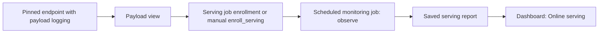

# Monitor serving requests and logged predictions

## When you need it

For REST deployment and typed SQL function/`ai_query` calls, follow
[Deploy and call a model](databricks_serving.md). The optional helper uses one concrete registered
model version and derives SQL input/output types from its inspected package.

The generated `serving_endpoint` job automatically enrolls its concrete version
after successful verification when payload logging is enabled and the target's
`monitoring_enabled` variable is `"true"`. Configure the shared monitoring
catalog/schema first. For a model set it enrolls every branch;
updating the endpoint disables its prior registrations while retaining history.
No separate `enroll_serving` run is needed for this job. Send requests and run
the monitoring job to create observations; enrollment itself does not populate
traffic charts. `prediction_delivery: endpoint` keeps monitoring without a batch
score job.

Set `monitoring_enabled: "false"` in the target variables to skip automatic
enrollment while keeping endpoint logging and REST/SQL verification enabled.
An absent flag also disables enrollment. The serving result reports
`monitoring_disabled`; no monitoring namespace, reference or inventory work
runs, and existing registrations remain unchanged. Only exact `"true"` and
`"false"` values are accepted. When monitoring is enabled but payload logging
is disabled, the result instead reports `logging_disabled`.

For an endpoint created outside that job, first
[prepare and create a pinned endpoint](databricks_serving.md#the-command)
with full payload capture. Keep its concrete model version, endpoint name and
payload view together; a registry alias can move independently of requests
already logged. Endpoint creation, runtime admission and logging-mode selection
are described on that serving page.

Every **inventory reader** sharing that monitoring namespace must run a Core
release with serving support before the first serving enrollment. This includes
other projects' monitoring jobs and any custom inventory readers. A reader
without serving support rejects the serving fields, even in another project's
entry. The score job's `prepare_monitoring` task does not load the shared
inventory, so it is not affected. A dashboard update does not change reader
runtimes. Keep training/scoring runtime changes separate when their saved
artifact certificates require the original packaged source.



This page covers enrollment and observations. [Daily serving rollout](databricks_serving_rollout.md)
is the single policy guide for traffic increases, holds, rollback and restart.

## What to edit

Match `environment` and `project` to this job's target and bundle name. The
job compares them with the deployed target and project and rejects a mismatch,
so an entry with `"environment": "prod"` works only with `-t prod`. Set
`reference_namespace` to its configured monitoring catalog and schema. The
source and prediction names are the **same inference payload view**.
For CPU custom models that object is the Databricks-managed `risk_payload` view;
its backing `risk_otel_logs` is a managed Delta table. Grant the monitoring job
read access to both the view and its backing Delta table, plus
`system.serving.served_entities` for actual model-version attribution. The job
also needs the usual catalog/schema usage privileges and read access to the
configured labels and saved training references. Do not rename, replace, alter or
delete either Databricks-owned object, including its schema or internal
checkpoints. Monitoring verifies the pinned view and backing Delta identity
before reading; enrollment does not copy or modify the serving logs.
Enrollment validates the entire list (1-100 distinct models), prepares verified
training references, and saves the enrollments to the shared inventory. It does
not observe, publish an observation reference, or request training in that run.
Later scheduled `monitoring_action=observe` runs select active batch and online
enrollments together and use the existing report, policy and dashboard.

For manually enrolled endpoints with two served versions, add a separate entry
for each concrete version and endpoint. A model-set branch needs its own entry with `model_set_name`,
`model_set_version` and `model_set_branch` identifying the parent release and
output. Labels are provided independently in a Delta table keyed by
`databricks_request_id` and zero-based `request_row_index`, with the actual target
column and UTC `available_at`. Skyulf does not generate outcomes or write them
back to the training table. Missing or late labels remain unavailable until an
eligible observation; choose `mode: report` first and make any retraining policy
an explicit later decision.

Keep performance in `report` mode initially. The inline online policy determines its measured
verdict; automatic requests also require the deployment gate described in
[guarded retraining](databricks_retraining.md#what-to-edit). Retraining alone does
not update an endpoint. After a completed champion change, the independently
configured serving handoff can submit its update job in production mode.

To retire or pause one online enrollment, resubmit its complete JSON entry with
`enabled: false` using `monitoring_action=enroll_serving`. Keep the endpoint,
model/version and parent branch identity unchanged. Disabling does not require
loading its model or preparing references, so an unavailable model or reference
cannot prevent the pause. Other batch and online enrollments remain active.

This optional bridge covers pinned serving and
monitoring; it does not imply that every serving or feature lookup flow is
automatically deployed.

## The command

In Databricks Jobs, open the generated monitoring job and use **Run now with different parameters**
for this enrollment action. Supply the job parameter names and complete JSON below; replace the
example identities. This is a cloud operation.

Run this project's existing **monitoring** job once with job parameter
`monitoring_action=enroll_serving` and
`monitoring_serving_enrollments` set to a JSON list. One entry, for an endpoint
whose telemetry prefix is `risk`, can be the following. It targets `test`,
matching the run command below:

```json
[
  {
    "environment": "test",
    "project": "risk",
    "model_name": "models.risk.churn",
    "model_version": "2",
    "serving_endpoint": "risk-v2",
    "source_table": "logs.serving.risk_payload",
    "prediction_table": "logs.serving.risk_payload",
    "execution_engine": "spark",
    "reference_namespace": "ops.monitoring",
    "label_table": "labels.production.serving_outcomes",
    "result_available_at_column": "available_at",
    "performance_policy": {
      "mode": "report",
      "metric": "f1_weighted",
      "direction": "higher",
      "baseline": {
        "kind": "training_holdout",
        "model_version": "2"
      },
      "tolerance": 0.05,
      "tolerance_mode": "absolute",
      "window_hours": 24,
      "label_delay_hours": 6,
      "minimum_labeled_rows": 20,
      "minimum_label_coverage": 0.8,
      "consecutive_windows": 3
    }
  }
]
```

After enrollment, run an observation from the generated project root:

```powershell
databricks bundle run monitoring -t test --profile YOUR_PROFILE
```

Unpause the dedicated Spark monitoring schedule after enrollment. Individual HTTP
requests do not launch monitoring jobs; observation reads asynchronously delivered
logs on that schedule. Completed performance windows are revisited according to
`monitoring_revisit_windows` so late logs and outcomes can update their evidence.
If the target has a dashboard in `deployment/monitoring.yml`, its native
Dashboard task refreshes the published dashboard after the monitoring flow
completes with monitoring enabled; development targets never refresh. Without it, new Delta rows alone do not
invalidate the dashboard's cached view.
`sampling_fraction: 1.0` requests full payload capture, but it does not make
recorded counts a complete HTTP request count: custom-model 4xx or 5xx errors
may produce no inference-log row. The dashboard reports **captured** successes,
failures and latency. Empty or late windows can reflect asynchronous delivery;
check serving endpoint telemetry separately before interpreting them.

## What you should see

### Online serving dashboard

All matching contexts are visible initially; choose **Model** to narrow them.
**Monitored version** filters the
component model's concrete version; **Context** narrows its monitoring registration.
The identity table separately shows Endpoint, Served model, Served version and
Branch. A model-set parent can have a different name/version from the monitored
component. Explicit mismatched selections stay empty. Only enabled serving
enrollments are included.

| Table | Scope |
| --- | --- |
| Selected model and serving scope | Selection guidance and number of matching current contexts. |
| Endpoint and model identity | Monitored model/version versus served model/version and branch. |
| Latest observation per context | Latest full observation per matching enrollment and current configuration, ordered by window end, measurement time and report ID. |
| Observation history | All matching saved full observations, with native pagination and an optional history window-end filter; there is no global 100-row cutoff. |

Five charts above the detailed tables show captured requests, HTTP error classes, captured error
rate, mean/p95 execution latency, and the latency distribution. Each model/version/context has a
separate panel; **Model (choose one for details)**, **Monitored version** and **Context** apply to
all five. The history window-end control also filters the latency matrix, while the latest snapshot
stays unchanged. The latency bar chart and matrix retain only the latest 12 observations per
identity before the date selection; use the history table to inspect older windows.

| Chart | Reading the result |
| --- | --- |
| Captured requests per window | Number of logged requests, including failed responses. One request may contain several prediction rows. |
| How many errors of each kind? | Grouped bars with an **HTTP error class** legend: **4xx client** (blue), **5xx server** (red), and **Other / class not recorded** (gray). Value labels show captured counts. Zero means none captured; a missing class count stays blank. If an older report lacks complete class counts, its entire error total appears in gray. A date plus observation number keeps repeated windows separate. |
| Captured error rate per window | Captured errors divided by captured requests in that same observation. Missing counts, failed observations and zero requests leave it unmeasured. |
| How long does the model take to answer? | Two grouped bars per observation: blue is the average execution time and orange is approximate p95, in milliseconds per request (lower is faster). The last 12 observations per identity are shown separately, including repeated windows. Hover for p50, p99, maximum, timed sample count and exact window timestamps. Small samples can make p95 and p99 equal to the maximum; this is not a separate anomaly. |
| Where do captured execution times fall? | Nine duration ranges across the latest 12 observations per identity. Each valid column totals 100% of non-null timings. A shared 0-100% blue scale allows comparisons; hover for exact counts and window times. Old, failed, empty or invalid summaries produce no cells. |

For example, a report with ten captured requests, two 4xx responses and one 5xx
response has a 30% captured error rate. If only eight requests have a recorded
execution duration, latency percentiles and distribution shares use those eight,
including any failed responses with durations. A p95 of 250 ms estimates the
95th percentile of those captured execution durations; it is not the slowest
request or an end-to-end service guarantee.

Timings use Spark `percentile_approx` with accuracy 10,000. The fixed distribution
boundaries are 5, 10, 25, 50, 100, 250, 500 and 1,000 ms: the first range is below
5 ms, each middle range includes its lower bound and excludes its upper bound,
and the final range is at least 1,000 ms. Null timings are excluded from both the
percentiles and distribution. No request payloads are read by dashboard queries;
these fields come from saved aggregate reports.

Latest/history tables also show class counts, p50/p95/p99 and timed sample count.
Older reports retain the fields originally recorded; missing percentiles are
blank in numeric tables and produce no bar. The latency chart's detail tooltip
shows **Not recorded** for missing p50/p95/p99 and timed sample counts; a recorded
zero remains zero. Only a new monitoring observation records these fields;
refreshing or redeploying the dashboard does not backfill saved reports. The
monitoring environment must match the runtime recorded in the registered model
artifact. Updating the Core requirement alone can fail that runtime check;
prepare a compatible model artifact before upgrading its monitoring jobs.

Recomputing an old window with added serving fields can create a new report identity, so history can
contain both calculations. Dashboard charts display saved measurements; traffic and promotion policy
are defined on [Daily serving rollout](databricks_serving_rollout.md).

Observation history also shows prediction rows per captured request when saved.
Its denominator includes failed captured requests. Request counts and latency
stay per observation: windows may overlap, and model-set branches may describe
the same parent requests. Do not sum these rows as unique traffic or average their
latency means into an endpoint SLA. **Observation status** describes the saved
monitoring result, not live endpoint availability.

Logging is asynchronous and custom-model HTTP 4xx/5xx errors may be absent, so
captured counts do not measure all endpoint traffic. Latency describes model
execution durations recorded by the platform, not client/network round-trip time.

Window end describes the request-time observation window; `measured_at` in the
saved dataset is when monitoring calculated the report. Shared health freshness
uses the latest captured request time for online serving and the scoring commit
time for batch predictions. Neither proves that the feature values themselves
are recent: a new request or scoring run can use old source data. Refreshing the
dashboard rereads saved results and does not obtain new measurements.

For accuracy, open Model performance and select the matching model, version and
monitoring context. Missing or immature actual outcomes remain insufficient
evidence; successful HTTP requests alone do not establish prediction quality.

The **Online serving** dashboard page shows **Requests with logging errors**
beside **Captured errors** in **Latest observation per context** and
**Observation history - windows may overlap**. Hover over a point in
**Captured requests per window** to see the same count for that observation.
`0` means the saved observation recorded no logging errors; **Not recorded**
means the saved report has no count for it.
For example, an observation can have 10 captured requests, no HTTP errors and
2 requests with logging errors: those two requests remain in the request count,
but their payloads are excluded from drift and performance. Logging errors are
not added to the HTTP error-class chart. Model, version and context selections
continue to scope these values; overlapping windows must not be added together.

## Common errors and fixes

| What you see | Next check |
| --- | --- |
| `awaiting_logs` | No applicable saved report exists. Check enrollment, the monitoring job and asynchronous log arrival; this is not a healthy measurement. |
| `failed` | Inspect the saved report and monitoring task error. A failed latest observation clears earlier counts instead of showing an older success. |
| Blank counts or latency | Check the report status and log coverage. Unavailable measurements are not zero requests or zero latency. |
| `no_data` | Inspect the selected request window and captured logs. An empty window does not prove endpoint health or absence of HTTP traffic. |
| Captured failures or unexpected latency | Inspect endpoint telemetry and serving logs for that endpoint/version. A healthy input-drift status does not certify request success or latency. |

### Incomplete serving payload logs

`logging_error_count` counts captured requests whose payload log has one or more
`logging_error_codes`. It counts requests, not individual codes or prediction
rows. A logging error can occur even when the endpoint returned a successful
HTTP response; it is separate from the captured 4xx/5xx error counts.

Monitoring keeps those requests in captured-request, HTTP-status and available
latency summaries. It excludes their unusable payloads from feature and
performance calculations and reports the missing-log count. A window that would
otherwise be healthy becomes `degraded`; usable remaining records can still
show drift or performance loss. The request charts describe captured telemetry,
not a guarantee that every production request was logged.

For traffic rollout, read the incomplete-evidence rule on
[Daily serving rollout](databricks_serving_rollout.md#what-you-should-see). A logging failure alone
is not a retraining trigger; inspect native logging codes and payload-size behavior before changing
model settings.

Serving monitoring keeps captured requests with `logging_error_codes` in the
HTTP request and status counts, but excludes their input/output payloads from
drift and model-performance calculations. Exact duplicate deliveries count once;
conflicting copies of the same request still fail validation. A logging error
does not turn a successful HTTP response into an HTTP failure.

An otherwise healthy observation becomes `degraded`; measured `drift` and
`no_data` retain their existing status. Capture completeness is reported separately:
the saved report's
`serving.logging_error_count` counts affected requests, not individual error codes
or prediction rows. The notebook's **Observation notes** shows the excluded count.
For example, two usable predictions and one request with a truncated log retain
the two predictions' metrics, with an explicit warning about the missing payload.
If every payload is excluded, drift and performance remain unavailable.

Metrics on the retained subset may not represent the missing requests. Logging
errors alone do not block retraining: statistically supported drift or a measured
performance-policy breach can still request training, subject to the existing
minimum data, label coverage, consecutive-window and cooldown checks. Candidate
comparison still decides whether a newly trained model qualifies for promotion.
The notebook's **Performance policy evidence** shows the affected request count
for that policy's own window and warns when it uses a partial population. With no
usable predictions or sufficient labels, the policy remains `unavailable`.

Missing identity, timestamps or HTTP status, and capture sampling other than 100%, still reject the
observation. Old reports are not rewritten; recomputing a window with new summary fields can produce
a new report identity. Captured counts describe saved logs rather than every endpoint request.
