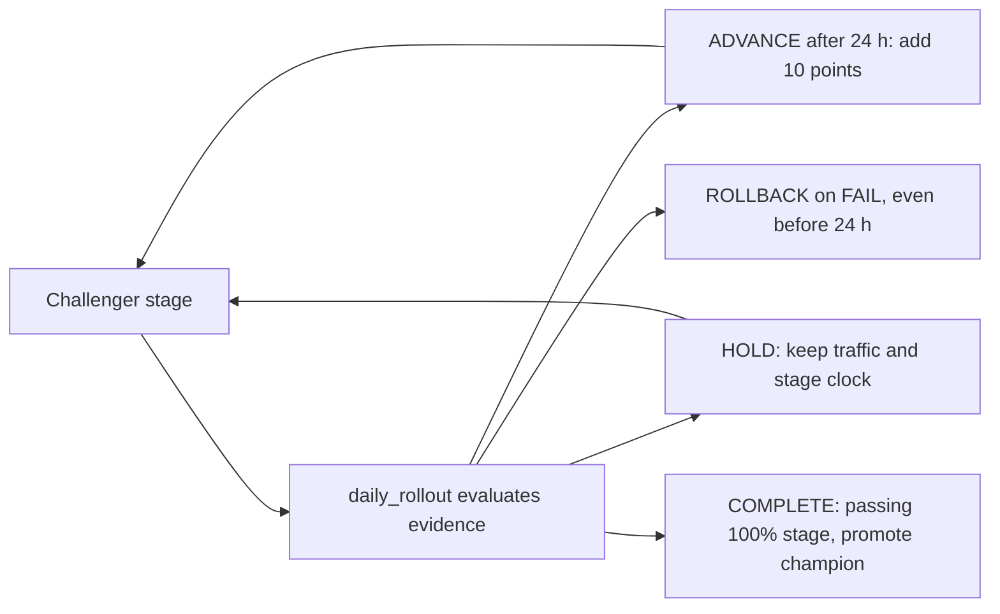

# Increase serving traffic and promote a challenger

## When you need it

Use a daily rollout to introduce a registered pipeline version gradually. The
default policy increases challenger traffic by **10 percentage points after at
least 24 hours at each stage**. After a passing observation at 100% traffic, the
scheduled job automatically promotes that version to the `champion` alias.



The diagram uses default step/timing settings. `ADVANCE` and `COMPLETE` need
the full stage time; `ROLLBACK` happens as soon as fresh evidence fails. A
rollback ends that rollout; a hold is evaluated again with better evidence.

This workflow requires an existing champion, a staged challenger with a saved
passing comparison, and two compatible serving packages. Train the challenger
with `promotion_policy: manual_approval` so training leaves the current champion
in place. The rollout owns the later automatic promotion. Both packages must
use the serving-compatible Skyulf runtime used by the controller.

Automatic promotion supports one fitted pipeline per version. It
rejects model sets before initialization. Spark-native models and preprocessing
that needs other request rows are outside the existing endpoint certificate.
Model-set traffic composition is available at the lower-level endpoint API, but
the generated daily job requires the single-pipeline approval workflow.

### Choose the right release mechanism

| Workload | Does this daily rollout control it? | What selects the version? |
| --- | --- | --- |
| Requests routed through the configured serving endpoint | Yes | Endpoint traffic percentages, then guarded champion promotion |
| Requests explicitly targeted at a served entity | No percentage routing | Caller chooses the entity; the controller uses this for smoke checks |
| Batch or incremental Delta scoring | No | The score job's pinned version/champion selection and publication policy |
| Spark worker inference | No | The registered version resolved for that score invocation |
| Online feature publication | No | Its separate TRIGGERED/CONTINUOUS publication job |

If a batch scorer resolves `champion`, it can pick up the promoted version on a
later run. That is separate from serving traffic and does not rewrite prior
prediction rows by itself. An online store is needed only when the saved model
requires online feature lookup; raw-input serving can use rollout without one.

The sequence is: train and stage a challenger, create the two-version endpoint,
initialize durable rollout state, configure the generated controller job, test
one invocation, then unpause its schedule. The snippets below form that sequence
and require existing model versions and permissions; they do not train models.

## What to edit

| File or input | Required settings |
| --- | --- |
| Challenger training | `promotion_policy: manual_approval` and a saved passing comparison |
| Endpoint and rollout initialization | Two concrete compatible versions, durable MLflow run, saved `DailyRolloutPolicy` |
| `config/serving.yml` | `rollout` identities, approval, smoke records, health and monitoring settings |
| `resources/daily_rollout.job.yml` | Keep the single-writer queue; unpause only after inspecting a manual run |

Use [serving observations](databricks_serving_monitoring.md) for telemetry
and label collection. Their evidence feeds this controller; their schedules
do not replace the rollout stage clock.

## The command

### Prepare an isolated endpoint

Use a new A/B endpoint name. Keep an existing SQL function's pinned endpoint
separate; changing A/B traffic would change that function's prediction contract.

```python
from dataclasses import replace
from databricks.sdk import WorkspaceClient
from skyulf.integrations.databricks.serving import (
    PinnedEndpointSpec,
    build_rollout_endpoint,
    prepare_pinned_endpoint,
    rollout_endpoint_ready,
)

workspace = WorkspaceClient()
registry_options = {"tracking_uri": "databricks", "registry_uri": "databricks-uc"}
champion_spec = PinnedEndpointSpec(
    endpoint_name="risk-gradual-release",
    model_name="models.risk.customer_risk",
    model_version="7",
    logging_catalog="ops",
    logging_schema="serving",
    logging_table_prefix="risk_gradual_release",
)
challenger_spec = replace(champion_spec, model_version="8")
plan = build_rollout_endpoint(
    prepare_pinned_endpoint(champion_spec, **registry_options),
    prepare_pinned_endpoint(challenger_spec, **registry_options),
)
print(plan.config)

# Run creation once. The native create operation rejects an existing name.
created = workspace.api_client.do(
    "POST", "/api/2.0/serving-endpoints", body=plan.config
)
```

Creation is asynchronous. In a later cell, inspect the same endpoint:

```python
endpoint = workspace.api_client.do(
    "GET", f"/api/2.0/serving-endpoints/{champion_spec.endpoint_name}"
)
ready = rollout_endpoint_ready(endpoint, plan, challenger_percentage=0)
print(ready)
```

Continue only when `ready` is true. Both model versions must be loaded, routing
must be exactly 100/0, and the configured inference logging must be intact. Do
not repeat creation after a timeout without inspecting the endpoint first.

### Initialize durable rollout state

Create an explicit MLflow run for this rollout. Use the comparison digest and
quality settings from the challenger's saved training result. The approval
settings below are examples; their metric, threshold and improvement must match
that saved comparison.

```python
from mlflow.tracking import MlflowClient
from skyulf.integrations.databricks.data.admission import SingleWriterAdmission
from skyulf.integrations.databricks.serving import (
    DailyRolloutPolicy,
    MLflowRolloutStore,
    build_rollout_promotion,
    initialize_rollout,
)

registry = MlflowClient(**registry_options)
approval = {
    "model_name": champion_spec.model_name,
    "metric": "heldout_rmse",
    "min_improvement": 0.0,
    "quality_threshold": 5.0,
    "quality_gates": None,
    "max_rows": 10000,
    "max_input_mb": 64,
    **registry_options,
}
comparison_sha256 = "REPLACE_WITH_SAVED_COMPARISON_SHA256"
promotion = build_rollout_promotion(
    plan, approval, auto_promote=True, comparison_sha256=comparison_sha256
)
experiment_id = "REPLACE_WITH_EXISTING_EXPERIMENT_ID"
run = registry.create_run(experiment_id)
store = MLflowRolloutStore(registry, run.info.run_id)
result = initialize_rollout(
    workspace,
    plan,
    store=store,
    policy=DailyRolloutPolicy(
        increment_percentage=10,
        minimum_stage_hours=24.0,
        evidence_max_age_hours=24.0,
    ),
    admission=SingleWriterAdmission(),
    rollout_id=run.info.run_id,
    promotion=promotion,
)
print(result)
print("rollout run_id:", run.info.run_id)
```

`SingleWriterAdmission` is an explicit ownership contract, not a distributed
lock. Restrict endpoint and alias mutation permissions to the controller's
identity, serialize all its writers, and keep `max_concurrent_runs: 1`. Another
job or UI writer must not modify those resources concurrently. Applications with
multiple writers must supply a shared admission provider to the SDK operations.
There is no native atomic compare-and-swap for an endpoint configuration.

### Enable the daily Bundle job

Generate the project with `include_daily_rollout: "true"` in the template init
configuration. This adds `resources/daily_rollout.job.yml`, its notebook,
`config/serving.yml`, and serving dependencies. To add it to an existing
project, follow [project upgrades](databricks_project_upgrade.md). The job is
initially `PAUSED`; its configuration is initially disabled.

Fill `rollout` in `config/serving.yml`:

- Set `run_id` to the initialized rollout run and copy the comparison digest and
  exact `approval` settings used above.
- Supply representative `smoke_records` matching the admitted request schema.
  The job calls both named served versions directly, including the version with
  zero routed traffic.
- Configure minimum request and label counts, label coverage, maximum error
  rate and the latency limit (p99) in `health`.
- Configure `monitoring` for the concrete challenger version and endpoint.
  `source_table` and `prediction_table` select its inference payload table.
  Use `execution_engine: spark`, an existing `reference_namespace`, and a label
  table with a result-availability timestamp.
- `monitoring.environment` labels the saved observation only. The generated
  `daily_rollout` job passes `bundle_target: ${bundle.target}`, so evidence records
  the target that ran it; the YAML value (`syst`) is used only when that parameter
  is absent. It does not select tables or change rollout decisions.
- Set `enabled: true` and `exclusive_writer: true` only after establishing the
  ownership contract. Deploy, test one run, and then unpause the schedule.

These fields are an excerpt of that generated block, not a replacement for the
required approval, endpoint and monitoring identities:

```yaml
rollout:
  enabled: true
  exclusive_writer: true
  run_id: "COPY_THE_INITIALIZED_ROLLOUT_RUN_ID"
  comparison_sha256: "COPY_THE_SAVED_COMPARISON_DIGEST"
  smoke_records:
    - income: 42000.0
      age: 38.0
  health:
    minimum_requests: 100
    maximum_error_rate: 0.01
    maximum_latency_ms: 1000.0
    minimum_labeled_rows: 30
    minimum_label_coverage: 0.8
```

Replace the smoke fields with the actual request schema; an online feature
model may require keys and additional source fields instead. Stage size and
duration belong to the saved `DailyRolloutPolicy` initialized above, while these
health thresholds configure the job's observation. Preserve both deliberately.

From the configured generated project:

```powershell
databricks bundle validate --strict -t test --profile YOUR_PROFILE
databricks bundle deploy -t test --profile YOUR_PROFILE
databricks bundle run daily_rollout -t test --profile YOUR_PROFILE
```

Open the resulting job task's Output, then compare the reported percentage and
endpoint revision with the native endpoint configuration. Inspect the saved
observation and reason before unpausing the daily schedule. Missing observations,
missing latency, incomplete logs and immature labels are holds, not healthy passes.

Serving labels join on `databricks_request_id` and `request_row_index`; retain
these identifiers when collecting outcomes. The adapter uses the actual served
model identity from telemetry and evaluates the current stage's time interval.
It does not recompute historical predictions. Late or missing outcomes hold the
rollout until enough mature labels are available. Quality thresholds come from
the saved comparison; the job does not accept a configurable PASS flag.

The job records the complete observation and verifies its MLflow artifact before
changing traffic. Its output includes `status`, `state.challenger_percentage`,
the decision and an observation digest. A successful final transition also
includes the guarded `promotion` receipt.

## What you should see

### Decisions and timing

| Observation | Action |
| --- | --- |
| Zero traffic, saved comparison and targeted requests pass | Advance when the initial minimum stage has elapsed |
| Enough fresh requests and mature labels; health and quality pass | Increase by one configured step |
| Too few requests or labels, stale evidence, or an incomplete stage | Hold the current allocation |
| Confirmed error-rate, latency, or quality regression | Return traffic to the retained champion and stop the rollout |
| 100% traffic completes its final passing stage | Recheck the saved heldout evidence and automatically promote |

A missed scheduled run does not cause several increases at once. Stage time
starts when the new routing configuration is verified as ready. Endpoint traffic
and registry aliases are separate: reaching 100% does not itself change an alias.
The final approval also checks that the original champion, challenger, comparison
digest and quality policy still match.

`health.maximum_latency_ms` bounds **p99 model execution time**, the duration at or below which
approximately 99% of timed captured requests fall. A single unusually slow request can exceed the
threshold without failing the stage. For example, p99 of 80 ms passes a 100 ms limit even if the
maximum is 900 ms; p99 of 120 ms fails the same limit and requests rollback. This measures model
execution, not total client/network response time.

If a saved summary has no `latency_p99_ms`, or it is null, the check uses
`latency_max_ms`. Recorded zero is valid. An invalid non-null p99, or no usable
latency in either field, holds the stage. Error-rate, minimum request and label
counts, quality, stage duration and incomplete-log checks also apply.

For example, a verified 10% stage with insufficient mature labels stays at 10%.
A confirmed health regression returns traffic to 0% challenger / 100% retained
champion and ends that rollout. This traffic rollback does not promote the
challenger or restore a registry alias from an unrelated promotion. At 100%,
the challenger still needs its final complete passing stage before becoming
champion. A day passing on the calendar is not sufficient evidence.

The evidence verdict and controller action are different fields:

| Fresh, matching evidence | Controller action | Traffic and next invocation |
| --- | --- | --- |
| `PASS`, full stage elapsed, below 100% | `ADVANCE` | Add one configured step; start a new stage only after the endpoint is verified |
| `HOLD`, missing evidence, or incomplete stage | `HOLD` | Keep the current share and original stage start; the next day evaluates that same stage with fresh evidence |
| `FAIL` | `ROLLBACK` | Request 0% challenger / 100% retained champion immediately, even before 24 hours; verified rollback becomes terminal |
| `PASS` at 100%, full stage elapsed | `COMPLETE` | Keep 100% and perform guarded final promotion |

A label shortfall today does not reset the clock. The next invocation can
advance once the complete stage has enough fresh, mature evidence; it
never catches up by applying several missed daily increases. A terminal
`ROLLED_BACK` run stays at 0% on subsequent invocations and cannot resume.

Too few requests, unavailable or inconsistent request counts, missing or
invalid latency, stale/future observations, logging errors, too few mature
labels and insufficient label coverage all hold. Logging errors mean
capture is incomplete, not a measured prediction regression. Once usable
evidence exists, an excessive error rate, excessive latency or failed
quality gate yields `FAIL`. The controller first verifies evidence identity
and freshness; stale or mismatched failure evidence cannot trigger rollback.

### Feature updates during a rollout

New feature-bound candidates save their enriched training-time holdout at
`lifecycle/data/holdout.parquet` in the candidate's MLflow run. The saved comparison
binds its hash, owner run, schema, row and memory limits, split membership and
model identity. Lifecycle training reuses its prepared holdout; SDK training
records the same bounded artifact when needed.

Final approval reloads those verified inputs and evaluates the fitted pipeline.
Feature table versions may advance while the rollout runs: current feature
values do not replace historical holdout values. The original source and feature
table identities must still match. Missing or altered artifacts, changed split
metadata, insufficient read budgets or a dropped and recreated table block approval.
Retain the candidate run and its artifacts throughout the rollout and approval.

A candidate without this saved holdout uses strict snapshot reconstruction.
If a feature table has advanced, approval explains that no frozen holdout is
available and remains blocked. Train a new candidate with the updated runtime;
do not edit comparison artifacts to bypass that check.

Online requests still use current published features and enforce their missing
value and freshness policy. Historical holdout success does not replace fresh
serving health, quality or final-stage observations. A shared feature failure can
affect both versions; returning traffic to the champion does not repair that data.
See [online features](databricks_online_features.md) for the serving freshness
contract and supported request shape.

## Common errors and fixes

### Retry, stop and recovery

Before an endpoint update, the controller persists the exact intended request.
After a timeout or interruption, rerun the job to reconcile that request. A
reconciliation run does not immediately apply another traffic increase. The
stage clock advances only after the expected endpoint revision and routes are
verified.

If the request remains `PREPARED` while the endpoint still shows its old
configuration, the controller holds. It cannot tell whether an uncertain request
will still apply. Inspect the recorded intent and native endpoint operation
before resolving the rollout; do not edit receipt tags or blindly resend the
request. An unexpected endpoint ID, revision, model or routing setting stops
automation rather than overwriting another writer's change.

Pause the scheduled job to stop further decisions. A verified regression rollback
is terminal for that rollout; starting again requires a new explicit rollout.
After a successful promotion, both concrete served entities remain available.
Retiring the previous model or changing SQL pins is a separate operator action.

To restart after rollback, investigate the saved failure, correct its cause,
and follow the explicit endpoint/initialization sequence with a new rollout
run and an admitted model pair. Recheck the current champion, comparison and
ownership; do not reuse or edit the terminal receipt to reset its state.
Pausing a schedule only prevents new controller runs; it does not itself
roll traffic back. A shared feature outage still needs its own repair.
