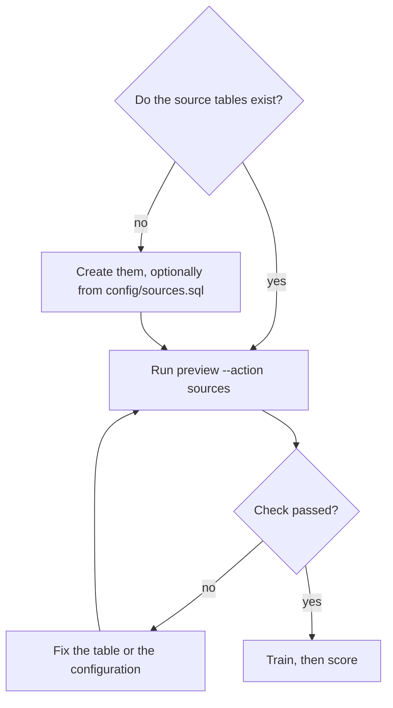

# Check or create your source tables

## When you need it

Read this page before the first training run, once you know which tables the
project will read. Skyulf never creates or changes your data tables. It expects
them to follow a small contract, and it gives you a read-only command to check
that they do. You do **not** need to create anything when your tables already
exist.



A project reads data in up to three roles: training data, scoring input and
actual outcomes. [Choose a table layout](databricks_training_data.md#choose-a-table-layout)
explains the roles and the `single_table`, `separate_outcomes` and
`separate_all` layouts. **Source data** in the generated `GUIDE.md` repeats the bindings for your
project.

## What to edit

The check reads the table names from your configuration. Nothing else needs to
change:

| Role | Setting |
| --- | --- |
| Training data | `training_table` in `config/training.yml` |
| Training outcomes, when joined | `training_label_table` in `config/training.yml` |
| Scoring input | `score_source_table` in `config/inference.yml` |
| Actual outcomes for monitoring | `monitoring_label_table` and `monitoring_result_available_at_column` in `deployment/targets.yml` |

Every table must satisfy this contract:

- **Delta tables.** Views and other formats are not accepted as sources.
- **Record keys.** The `record_key_columns` exist in every table, are never null
  or non-finite, are unique within each table, and have exactly the same type in
  every table that is joined.
- **Inputs.** The training data and the scoring input both contain every input
  column, with the same types.
- **Inserts only.** The scoring input has Delta change data feed enabled, and
  rows are only appended. An `UPDATE` or `DELETE` stops incremental scoring; an
  outcome that arrives later goes into the outcomes table, not into an existing
  row.
- **Outcomes.** An outcomes table holds the record keys, the target and the time
  the outcome became known. For monitoring this is a `TIMESTAMP`, or a string
  with an ISO timestamp and an explicit offset or `Z`. For training it must match
  `result_time_parsing`: a `TIMESTAMP` with the default parsing, a string with a
  `format`, a `DATE` with `date_only: midnight` and a timezone, or a
  `TIMESTAMP_NTZ` with a timezone only.

### If the tables do not exist yet

Choose `include_source_sql: "true"` during quick or detailed setup (or add
`"include_source_sql": "true"` to the JSON answer file) to generate the starter.
The default is `"false"`; the `GUIDE.md` source section and source checks remain available in
either case. If you already generated a project, render a separate folder with
the option enabled and copy only the starter; do not overwrite your configuration.

`config/sources.sql` is an optional starter for that case. It contains one
`CREATE TABLE` statement per input table that your layout needs: the training
or feature table, a separate scoring input for `separate_all`, and the outcomes
table when you named one. Columns come from your setup answers; every type is a
`TYPE_FOR_<column>` placeholder except the availability column, which is
`TIMESTAMP`. Change data feed is enabled on each table.

Replace `{catalog}`, `{input_schema}` and every placeholder with your real types,
then run the statements yourself in Databricks SQL. Nothing in the Bundle runs
this file. It does not copy data, and it uses `CREATE TABLE` without
`IF NOT EXISTS`, so an existing table makes it fail instead of being changed.
Skip the file entirely when your tables exist.

The jobs create the other tables themselves: the prediction table on the first
score run, the monitoring store on the first enrollment, and the registered
model on the first training run. See [Tables in your workspace](databricks_workspace_tables.md).

## The command

From the project root, with an existing SQL warehouse:

```powershell
python src/tools/preview.py --action sources --profile YOUR_PROFILE --warehouse-id YOUR_WAREHOUSE_ID --catalog my_catalog --input-schema my_schema --output-schema my_schema --metadata-schema my_schema
```

Add `--label-table` and `--label-available-at-column` when the monitoring
outcomes table differs from your setup answers. A short label table name resolves
through the catalog and input schema you pass.

The command reads Delta metadata and runs bounded queries: `DESCRIBE DETAIL`,
`DESCRIBE TABLE`, a probe for null keys and a probe for duplicate keys. The
duplicate probe can scan the whole table. It never writes data, changes table
properties or starts a job.

## What you should see

A JSON report per training configuration (`main`, or one entry per model-set
branch):

```json
{
  "main": {
    "status": "passed",
    "tables": {
      "workspace.air.observations": {"columns": {"record_id": "bigint", "...": "..."}, "change_data_feed": true}
    },
    "warnings": []
  }
}
```

Warnings do not fail the check. They name things that only the runtime can
verify:

| Warning | Meaning |
| --- | --- |
| `Delta change data feed is off on <table>; ...` | Fine for a table that is never the scoring input. |
| `Initial scoring includes training history; ...` | Training and scoring share a table and use the default `full_snapshot`. Choose `initial_scoring: from_now` before the first score to skip existing rows. See [Choose a table layout](databricks_training_data.md#choose-a-table-layout). |
| `Training availability values in ... are checked against result_time_parsing during training; ...` | The column type fits your parsing settings; individual values are validated when training reads them. |
| `Monitoring availability values in ... must be ISO timestamps with an explicit UTC offset or Z; ...` | A string availability column is accepted; monitoring rejects values without an offset. |
| `Feature lookup tables, point-in-time joins and fetched feature types are checked by training, ...` | Feature Store lookups are outside this raw-table check. |

A passed check describes the tables as they are now, read with your identity. It
cannot prove that future inserts keep the contract, that another run-as identity
has the same access, or that the model's preprocessing accepts every value.

## Common errors and fixes

Errors are printed as `Configuration error: <message>` and the command exits with
status 2.

| Message | Fix |
| --- | --- |
| `--action sources requires --profile and --warehouse-id.` | Pass both; the check needs a workspace and a running SQL warehouse. |
| `Source must be an existing Delta table: <table>.` | Create the table, check its name and schema, or convert it to Delta. |
| `Source is missing record key columns: <table>.` | Add the key columns, or correct `record_key_columns`. |
| `Source has null or nonfinite record keys: <table>.` | Remove or repair those rows upstream; keys identify one observation each. |
| `Source has duplicate record keys: <table>.` | Make the key unique, for example by adding a timestamp or observation id to `record_key_columns`. |
| `Source <table> is missing columns: [...]` | Add the columns, or remove them from `input_columns` and the other settings. |
| `Source column types differ: [...]` | Cast the columns so training, scoring and outcomes use exactly the same types. |
| `Enable Delta change data feed before incremental scoring: <table>.` | `ALTER TABLE <table> SET TBLPROPERTIES ('delta.enableChangeDataFeed' = 'true')`, before the first score run. |
| `An outcomes table requires an availability timestamp column.` | Set `monitoring_result_available_at_column` or `result_available_at_column`. |
| `Training outcome availability ... is incompatible with result_time_parsing; ...` | Change `result_time_parsing` to match the column type listed under [What to edit](#what-to-edit), or change the column type. |
| `Monitoring outcome availability must use TIMESTAMP or offset ISO STRING: ...` | Use a `TIMESTAMP` column, or a string with an explicit offset. |
| `Source validation query did not complete: ...` | Start the warehouse, check your permissions on the tables and retry. |
