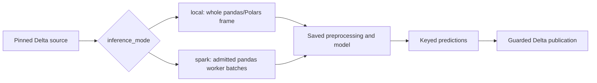

# Score on Spark workers

This page covers distributed scoring for a generated Databricks Bundle:
`inference_mode: spark` worker configuration and admission, the table of what
Spark scoring supports, worker capacity and environment settings, and how to
read results and model-set composition. Read it when a saved model should score
a Delta source in pandas batches on Spark workers instead of as one whole frame.
Source selection, eligibility, watermarks and publication stay in the parent
scoring guide.

[Back to Score saved models and publish Delta predictions](databricks_scoring.md)

Training fits one bounded pandas or Polars model in a Python process. Scoring
can apply that fitted model to a whole frame or distribute admitted pandas
prediction batches across Spark workers. Distributed inference does not turn
the estimator's fit or tuning trials into distributed training.



Here `inference_mode: local` means whole-frame scoring, including on Databricks
compute. It is separate from SDK `runtime="standalone"` versus
`runtime="databricks"`, which chooses the integration environment.
UC Delta publication requires `runtime="databricks"`. SDK `runtime` accepts
`standalone`, `databricks` or `spark`; preflight rejects `spark` with
`runtime_unsupported` because Spark scoring uses its separate batch runner.
Monitoring already uses Spark and has no separate engine choice.

## Worker configuration and admission

Merge these fragments into the named files, keeping the remaining settings:

```yaml
# config/training.yml
defaults:
  engine: pandas
```

```yaml
# config/inference.yml
inference_mode: spark
spark_udf_env_manager: local
spark_udf_prediction_batch_rows: 10000
```

The Bundle uses `mlflow.pyfunc.spark_udf`; workers receive pandas batches and
apply saved preprocessing without refitting. Explicit Spark with Polars is
rejected. The library's `predict_spark`/`mapInPandas` API is a separate route.
Without `inference_mode`, scoring is whole-frame (`local`).

### What Spark scoring supports

Admission checks the exact fitted artifact, not just its model-family name.
The setup menus also serve whole-frame projects and therefore offer more
choices than distributed scoring admits.

| Part | Admitted scope and important boundaries |
| --- | --- |
| Linear models | Exact `LinearRegression` and `LogisticRegression`. |
| Tree models | Exact `DecisionTreeRegressor/Classifier`, `RandomForestRegressor/Classifier` and `ExtraTreesRegressor/Classifier`; single-output fitted trees only. Custom subclasses or replaced inference methods are rejected. |
| XGBoost | Exact `XGBRegressor` with reviewed gbtree state and `reg:squarederror` or `reg:logistic` objective; no custom callbacks/objectives or DART. `XGBClassifier` instead needs sealed model probe evidence. |
| Additional models | AdaBoost, gradient boosting, histogram gradient boosting, nearest neighbours and LightGBM classifiers/regressors; Bernoulli/Gaussian/Multinomial Naive Bayes; calibrated classifier; ElasticNet, Lasso and Ridge regression; SGD classifier, SVC and SVR. Exact built-in classes and their saved configurations need sealed model probe evidence. |
| Voting and stacking | Classifiers and regressors need ensemble-level probe evidence. Every fitted member, calibration estimator and stacking final estimator must have an accepted exact identity. Replacing a member invalidates admission. |
| Reviewed preprocessing | `SimpleImputer`, `StandardScaler`, `MinMaxScaler`, `ClipValues`, `GroupImputer`, `OneHotEncoder` and `FeatureInteraction`. Each must pass its configuration/state checks and preserve rows. `SimpleImputer` supports `mean`, `constant`, `most_frequent` and `median`; `GroupImputer` supports `mean`, `most_frequent` and `median`. `OneHotEncoder` requires `max_categories: null` and `include_missing: false`; fixed string `categories` and `column_names: slug` retain these requirements and strict fitted-state inspection. Median uses saved training values through the pandas worker path; this does not add a native Spark median codec. |
| Other built-in preprocessing | Eligible row-preserving steps need sealed evidence for their actual saved state and recipe; see the table below. A successful probe cannot override a declared group/window/global context or row filtering. |
| Skipped fitted row steps | `Deduplicate`, `DropMissingRows` and `RowFilterFunction` (`filter_step`) are skipped by the prediction chain to preserve request rows. They do not filter each worker batch. |
| Tuning and thresholds | Reviewed fitted tuning wrappers are supported. Arbitrary tuned feature exclusions are rejected; recorded CV time/group metadata removal retains its existing contract. Tuned thresholds need a valid class-to-threshold mapping and a reviewed classifier or matching probed model evidence. SGD with hinge loss and SVC without probability support retain label-only outputs. |
| Model sets | Every component must pass admission, including its saved scoring rules and reused pre-split recipe. Independent outputs, declared numeric `weighted_sum`/`weighted_mean` composition and combined function rules from `build_combined_rules()` are supported; function rules need sealed training probe evidence (see below). |
| Saved project scoring rules | Eligibility and output rules are admitted when training linted and probed them (see below); Spark and online-feature projects do this automatically. The result columns (`scoring_status`, `exclusion_reason` and the declared outputs) travel through the Spark UDF and endpoints. Reused pre-split eligibility (`SCORING_MODE` `pre_split` or `combined`) is admitted when its steps are row-local and probed: fixed built-in edits, `DropMissingRows`, `ManualBounds` and `filter_step` functions. `Deduplicate` and custom filter classes in the reuse are rejected; `validate_model` rejects them before registration. `preview.py --action score` prints `Project scoring rules: disabled` when none are saved. |
| Custom/context-dependent code | `column_step`/`fitted_step` steps are admitted when training linted and probed them (see below). An `inference_context="row"` declaration is optional. `group`, `window` and `global` declarations, custom classes from `custom_step`, unreviewed fitted states and temporal carry history are rejected. A passing `preprocessing_probe` report alone grants no admission. |

Models packaged with [feature lookup](databricks_features.md) require
`inference_mode: spark`; whole-frame mode rejects them, including feature-backed
model-set components. They score through the Feature Engineering `score_batch`
route. Lookup does not relax the model/preprocessing checks.

### Built-in recipes and model evidence

The following additional steps can be admitted when the saved recipe preserves
rows, declares row context and passes every probe check. Admission is per fitted
recipe: a name in this table does not promise support for every parameter choice.

| Purpose | Candidate steps |
| --- | --- |
| Cleaning and types | `AliasReplacement`, `Casting`, `InvalidValueReplacement`, `TextCleaning`, `ValueReplacement` |
| Missing data | `DropMissingColumns`, `MissingIndicator`, `KNNImputer`, `IterativeImputer` |
| Encoding | `DummyEncoder`, `HashEncoder`, `LabelEncoder`, `OrdinalEncoder`, `TargetEncoder`, `WOEEncoder` |
| Scaling and transformations | `MaxAbsScaler`, `RobustScaler`, `Winsorize`, `SimpleTransformation`, `GeneralTransformation`, `PowerTransformer` |
| Outlier exclusion | `IQR`, `ZScore`, `EllipticEnvelope`, `ManualBounds` (see [rows that are not scored](#rows-that-are-not-scored)) |
| Binning | `CustomBinning`, `GeneralBinning`, `KBinsDiscretizer` |
| Feature generation | `FeatureGeneration`, `FeatureGenerationNode`, `FeatureMath`, `PolynomialFeatures`, `PolynomialFeaturesNode` |
| Feature selection | `CorrelationThreshold`, `ModelBasedSelection`, `UnivariateSelection`, `VarianceThreshold`, `feature_selection` |
| Dates and geography | `DateFeatures`, `GeoDistance`, `H3Index` (requires its optional package) |
| Text | `count_vectorizer`, `hashing_vectorizer`, `tfidf_vectorizer`, `tokenizer` |

Six of these steps needed a change before Spark and endpoints could use them,
because their earlier behaviour let one row affect the others in its batch:

| Step | Earlier problem | Behaviour now |
| --- | --- | --- |
| `IQR`, `ZScore`, `EllipticEnvelope`, `ManualBounds` | They dropped the rows they flagged, so a request of 10 rows could return 8 predictions. | The flagged row stays in the output without a prediction, marked `excluded` with reason `outlier:<step name>`. The bounds are learned at training, so each row is judged on its own values. |
| `PowerTransformer` | One value it could not transform, for example zero or a negative value with Box-Cox, left the whole batch untransformed. | Each value is transformed on its own. A row with a value that cannot be transformed (zero or negative with Box-Cox, infinity, or a result too large to represent) is marked `excluded` with reason `invalid:<step name>`; the other rows are unaffected. A missing value is not invalid: it stays missing, so a later imputer can fill it. With Box-Cox, every row that has a zero or negative value is excluded, so use Yeo-Johnson for columns that contain zeros, such as counts. If more than 10% of the step's training rows would be excluded as invalid (missing values do not count), training stops with an error that names the share and suggests Yeo-Johnson or repairing those rows first. |
| `IterativeImputer` | When every value in a batch was missing, it skipped its learned rounds and returned only the initial fill. | The learned rounds always run, so a row is filled the same way in any batch. Posterior sampling (`sample_posterior: true`) and unsupported estimators stay rejected. |

Window steps, resampling, inspection nodes and `sentence_embedder` are not
added by this admission path.

#### Rows that are not scored

When an outlier step or `PowerTransformer` excludes a row, the output still
has one row per input row. The excluded row has:

- an empty (null) `prediction` and empty probability columns;
- `scoring_status` = `excluded` (scored rows have `predicted`);
- `exclusion_reason` naming the first step that excluded it, for example
  `outlier:trip_distance_iqr` or `invalid:fare_power`. A later step never
  overwrites it. The `outlier:` and `invalid:` prefixes separate a deliberate
  filter from a value the fitted step cannot handle, usually a data error.

The same rule applies to whole-frame scoring, Spark scoring and serving
endpoints. During training the excluded rows are left out of model fitting;
each step's `rows_in` and `rows_out` in the training result show how many were
left out. Monitoring adds `exclusion_rate` (all excluded rows) and
`invalid_exclusion_rate` (rows excluded by `invalid:` reasons) to the quality
table, as shares of all stored prediction outcomes; a rising
`invalid_exclusion_rate` usually means a data-quality problem upstream rather
than model drift. Performance monitoring uses only the scored rows. Whatever
reads the predictions must handle
an empty prediction: decide in the consuming application whether to use a
default value, send the row for review or show "not scored"; do not read an
empty prediction as zero or as the negative class.

Adding one of these steps adds the `scoring_status` and `exclusion_reason`
columns to the model's output, so a scoring table written by an earlier
version has a different schema. Write the new version to a new table or
migrate the existing one before switching. How training measures a model that
excludes rows is described in
[models that exclude rows](databricks_lifecycle.md#models-that-exclude-rows).

Admission is decided for your saved settings, not for the step name. The tests
fit every listed step with one typical recipe; a different setting of the same
step can behave differently, and training then stops with the failing check
instead of registering a model that would score inconsistently. Typical cases:

- **Output type depends on the data.** `Casting` to `int64` turns a column
  into floats when a batch contains text it cannot parse, so a single bad row
  changes the dtype of its whole batch. Cast to the nullable `Int64` instead;
  its dtype stays the same in every batch.
- **State saved in an older format.** Some encoders (`DummyEncoder`,
  `HashEncoder`, `LabelEncoder`, `OrdinalEncoder`, `WOEEncoder`) saved by
  earlier versions render categories from the whole batch. Retrain to save the
  current per-row state.
- **Settings that read other rows.** A few steps use other rows only for
  particular options. The error names the step and the check; see
  [When a built-in step or model is rejected](#when-a-built-in-step-or-model-is-rejected).

Spark and online-feature projects run the checks automatically. Endpoint-only
projects enable the same training check with
`defaults.admit_probed_custom_steps: true` in `config/training.yml`; despite its
historical name, this setting also seals built-in and model evidence. Train and
register a new version after enabling it. Editing an old artifact's flag does
not create evidence.

Built-in code uses an exact calculator/applier identity check instead of project
source lint. Its saved state and resolved recipe are fingerprinted; the replay
check creates a fresh stateless applier over detached state. Model probes check
predictions, supported probabilities and configured thresholds on transformed
holdout rows. Nested estimator identities are checked too. Model `fresh_module`
replays separately serialized state; it does not reload a third-party package.
The model's empty check calls the saved prediction API and verifies its declared
empty output schema without invoking the estimator. Nonempty comparisons follow
the comparison rule described under
[floating-point rounding](#when-a-built-in-step-or-model-is-rejected).

Each step and the model is checked on its own, and the complete prediction
chain is checked once more end to end: the raw holdout rows are scored as a
whole, again, and in batches of 1 and 7 rows, through every preprocessing step,
the model and any saved scoring rules. This catches a rounding difference that
a step's own check allows but that changes a label after the model, for
example a value close to a tree's split point. At least 16 holdout rows must
reach each step and at least 16 must receive a prediction at the end; rows
excluded on the way do not count. A recipe that leaves fewer rows fails
training with a message naming where the rows were lost.

Look at `partition_probe.json` in the training run: `builtins` contains the
preprocessing evidence and `model` contains model evidence. The recomputed
Spark/endpoint certificate records `apply_probed_builtin` and `model_probed`.
No project source directory is required for a pipeline using only built-ins.
Custom functions still require their captured source and lint checks. These
bounded observations are evidence for the trained recipe, not proof for every
future input or every library version. Workers need the same supported runtime
and optional packages as the saved model.

XGBoost and LightGBM fingerprints now include their native learned trees.
Artifacts with earlier fingerprints or probe evidence need fresh evidence and
repackaging with the corrected runtime. Copying the old certificate into a new
package is not supported.

### Admit your own row steps (opt-in)

Skyulf cannot prove that your `apply` function or scoring rule uses only its
saved training state. A function that computes something from the batch, such
as `df["x"].mean()`, would give different answers on each Spark worker batch.
Training therefore checks your own code before it can run on Spark workers or
endpoints:

- In a project with `inference_mode: spark` or `online_features`, the check runs
  automatically whenever the model has a `column_step`, a `fitted_step` or
  saved scoring rules. No setting is needed.
- Other projects, for example one that only serves an endpoint from
  `config/serving.yml`, or SDK training, opt in:

```yaml
# config/training.yml
defaults:
  admit_probed_custom_steps: true
```

```python
# src/features/preprocessing.py; inference_context="row" is optional
fitted_step("clip_duration", learn, apply, output="duration")
```

The check has two parts, and every step and rule must pass both:

1. **Lint.** Training reads the saved source of `apply()` (or the rule) and the
   helpers it calls in the same file. It rejects whole-batch calls on the input
   frame, such as `.mean()`, `.sum()` or `.max()` without `axis=1`, `.rank()`,
   `.shift()`, `.groupby()`, `.sort_values()`, `.value_counts()`, `.any()`,
   `len(df)` and `df.shape[0]`. It also rejects writes to shared process state
   anywhere in the step's functions: module globals, class or function
   attributes, `os.environ`, mutated default arguments and `globals()`.
   `learn()` may use batch statistics: learning on the training rows is its job.
   Row-wise forms are fine: `.str`/`.dt` methods, `axis=1` (or a positional
   `1`), the column count `df.shape[1]`, and `any()`/`all()`/`len(df) == 0`
   used only in an `if` that raises or returns early for empty input. The lint
   is a heuristic: it does not see other modules or dynamic calls, so the probe
   still runs.
2. **Probe.** On the first 256 holdout rows (at least 16 are required), each
   step or rule must give the same results (floating-point values within the
   [rounding tolerance](#when-a-built-in-step-or-model-is-rejected)) on the
   whole sample, when scored
   again, in chunks of 1, 2 and 7 rows, in reverse order, with the row index
   renumbered, on an empty batch, and when one row's inputs change (other rows
   must not move). Spark gives each batch a fresh `0, 1, 2, ...` index and can
   send an empty batch, so code that reads `df.index`, fails on empty input or
   returns a different dtype for it is rejected. A step must not change values
   in its module's globals while it is probed. Finally, the step runs from a
   freshly loaded copy of the project code (`fresh_module`) and must give the
   same results, as a new worker process would.

   `perturb` moves numbers by half their size, staying inside small integer
   types such as `uint8`, flips booleans and replaces text with a value the
   sample does not contain. If the step raises on that text (for example a
   date or number stored as text), the row is retried with the text unchanged;
   a step that still raises is reported as `raised on a changed input value`.

Steps without a declaration that pass both are treated as row-local. Steps
declared `group`, `window` or `global` stay rejected, as do custom classes from
`custom_step`. Scoring rules run on the rows they really receive: eligibility on
the raw request, output rules on up to 256 eligible holdout rows plus
predictions. A reused pre-split recipe is probed as one eligibility rule bound to
its saved steps; target-reading steps stay skipped with
`SKIP_TARGET_PRE_SPLIT_STEPS`. Model-set
combined rules from `build_combined_rules()` read the same row's component
predictions; they are probed on up to 256 rows of the set's training source
(`perturb` changes one row's inputs and component predictions) and their
evidence is sealed in the set.

Passing results are saved inside the model as evidence, tied to each step's
saved state, each rule's version, function and parameters, and the project
source. Spark scoring and endpoints admit the code only when that evidence
matches; the certificate records steps as `apply_probed` and rules as
`rules_probed`. The training report lists every probed step and rule with its
passed checks (**Spark and endpoint admission probe**). The evidence is bound to
the sealed model by its checksum. It does not authenticate who produced the
model: a trusted SDK or job producer is trusted.

Spark output carries null rule results as SQL nulls. To do so it reserves the
text value `␀null␀`: a string output equal to it is rejected, as are nullable
`int64` outputs beyond 2**53, which float64 transport cannot hold exactly.

The probe is evidence, not proof. It checks at most 256 holdout rows, so it can
miss:

- logic that depends on the batch size, such as code that only runs above 300
  rows;
- batch statistics used only for rare values that the holdout does not contain;
- module-level caches and globals that the lint cannot see. These are not
  allowed. The probe only detects plain JSON values that change while it runs.

Keep `apply` functions and rules to row-by-row arithmetic on the saved state.

#### When the probe fails

Every failure names the step or rule, the check and one fix, and ends with a
link to this section. A lint failure also gives the file, line and call:

```text
Custom step 'fill_values' reads a batch statistic (preprocessing.py line 41:
df['x'].mean()). Compute it in learn() and read it from state in apply() ...
```

Pick one of three fixes:

1. **Make the function row-local.** Move the batch statistic from `apply()` into
   `learn()` and read it from the saved state:

   ```python
   # Before: every Spark batch fills with its own mean.
   def apply(df, state):
       return df["x"].fillna(df["x"].mean())

   # After: learn() saves the training mean once; apply() only reads it.
   def learn(df, y):
       return {"mean": float(df["x"].mean())}

   def apply(df, state):
       return df["x"].fillna(state["mean"])
   ```

2. **The calculation really needs other rows.** Move it upstream into a
   `groups/` Spark producer that writes a feature column, or into a pre-split
   step if it only concerns training rows. Otherwise declare
   `inference_context="group"` or `"window"` and keep the project on
   `inference_mode: local`.
3. **Lint false alarm on a per-row call.** Write the row axis explicitly, for
   example `df[["a", "b"]].sum(axis=1)`. There is no switch to turn the lint
   off, by design.

Find failures on your laptop before a training job:

```bash
# Lint the selected recipes and rules (Spark and online-feature projects).
python src/tools/preview.py --action train
# Fit on a local labeled sample (CSV or Parquet, 16+ rows) and run lint and probe.
python src/tools/smoke.py --probe sample.csv
```

Get a real sample by exporting `SELECT * FROM <training_table> LIMIT 256`; its
columns and dtypes must match `input_columns` plus the target. The local probe
uses the sample as both training rows and holdout, so it shows how the code
behaves on those rows only. Training on the real holdout makes the final
decision.

#### When a built-in step or model is rejected

Built-in steps and models run the same probe checks as your own code, without
the lint. A rejection stops training before the model is registered and names
the part and the check, for example:

```text
Model partition probe failed chunks:1: output_mismatch. Partition parity
requires exact labels and the fixed floating tolerance; retrain with a
compatible configuration.
```

The check name tells you what differed:

| Check | What it compares | Usual cause | What to do |
| --- | --- | --- | --- |
| `repeat` | The same rows scored twice; must match exactly, with no rounding tolerance | Randomness at prediction time | Fix `random_state`; avoid estimators that sample when predicting. |
| `chunks:1`, `chunks:2`, `chunks:7` | Batches of 1, 2 and 7 rows against the whole sample | Output depends on the batch size beyond the rounding tolerance (below): a whole-batch fallback, or a dtype that follows the data | Choose a setting from the step's table above, use stable dtypes, or replace the step. |
| `reverse`, `index_shift` | Reversed row order; renumbered index | The step reads row order or the pandas index | Use a step that only reads column values. |
| `empty` | A batch with no rows | The step fails or changes dtypes on empty input | Report it: built-in steps are expected to handle empty batches. |
| `perturb` | Change one row's inputs; the other rows must not move | The step reads other rows' values, such as a whole-batch fallback, or fails on a value training never saw | Use a setting that handles unseen values row by row, for example `handle_unknown: ignore` on `OneHotEncoder`. |
| `fresh_module` | Reload the saved state in a new process | State that does not survive saving | Retrain; report it if it persists. |

**Floating-point rounding.** Floating-point results can differ in the last
digits between batch sizes, because the numeric library chooses a different
calculation path for each batch size. For example, a stacking model whose
default `logistic_regression` final learner combines member outputs differs by
about `2e-16` between a batch of one row and a larger batch. The probe therefore
compares floating-point columns, such as probabilities, regression predictions
and transformed numeric features, with a fixed tolerance: two values match when
`|a - b| <= 1e-12 + 1e-9 * |b|`, and missing values must be in the same places.
Everything else stays exact: predicted labels, integer, text and boolean
values, column names, order and dtypes, the row index and the row count. A
difference larger than the tolerance, or a single changed label, still rejects
the model. Evidence saved before this rule (evidence version 1) is not accepted;
retrain to create new evidence.

Change the rejected step's or model's settings, or remove it, and retrain.

## Capacity and worker environment

`max_rows` and `max_input_mb` bound local training, not the distributed scoring
population. `spark_udf_prediction_batch_rows` accepts 1 through 100000
(default 10000) and slices each worker input into model calls. It does not limit
every incoming Arrow allocation: the worker still needs memory for that frame,
the fitted model and prediction slices. Databricks controls Arrow transport;
serverless does not permit setting `spark.sql.execution.arrow.maxRecordsPerBatch`.
There is no universal row threshold for choosing Spark and no fallback to
collecting the source if distributed execution fails.

The template uses `spark_udf_env_manager: local` on serverless, reusing the
declared task environment with the required wheel/dependencies. Here "local"
describes environment reuse on the worker, not driver-side inference.
Policy-cluster projects use `virtualenv` to install the packaged wheel and saved
pins in an isolated worker environment; Core's direct API default is also
virtualenv. Validate that environment on the chosen runtime: the tested
serverless runtime rejects MLflow 3.16.1 virtualenv archives containing absolute
interpreter symlinks. There is no automatic environment fallback.

Certified MLflow packages carry a safety certificate, exact source hash and
Skyulf wheel. A package logged without a certificate cannot use Spark; log a new
certified version. A pickle alone provides no Spark capability. Workers recheck loaded
state and runtime versions. Nullable integer and Boolean transport is handled
before Arrow conversion.

When a fitted artifact retains an XGBoost or LightGBM estimator, saving it
automatically records that library's exact installed version. This includes
members inside voting, stacking and calibrated models. MLflow packaging adds
these pins to its requirements, and loading checks them before unpickling the
model. A plain sklearn model does not require either native library merely
because it was installed during training. Python must have the same major and
minor version; a different patch version is accepted. The other recorded
runtime dependencies must match exactly.

Re-export and repackage older native artifacts that lack these dependency pins.
Native-model fingerprints and partition probe evidence created before the
corrected native-state hashing must also be regenerated; changing only a
manifest does not update or validate the saved model.

For a repeatable native/worker/Bundle comparison, see
[Measuring inference capacity](spark_benchmark.md#measuring-inference-capacity).
Its timings include a correctness aggregate and exclude Delta publication;
they are not complete score-job latency. Benchmark resources are separate from
project jobs and the shared dashboard. Measure executor memory and packaging
on your actual target compute.

<span id="certified-estimators-and-model-set-composition"></span>

## Results and model-set composition

In **Workflows > score job > score task**, inspect the concrete version, row
counts, source watermark and receipt. Spark receipts include inference mode,
environment manager and prediction batch size. Snapshots, insert-only CDF,
no-op replay, model-change policies and optional `recover_predictions` use the
same guarded Delta publication lifecycle. Model-set outputs commit together;
successful scoring retains the monitoring and dashboard-refresh handoff.

Spark admits model-set composition as declarative `weighted_sum` or
`weighted_mean` rules in `model_set.composition_config`, and as function rules
from `build_combined_rules()` when training sealed their probe evidence in the
set. The
[model set guide](databricks_model_sets.md#declarative-composition) shows the
rule format.
