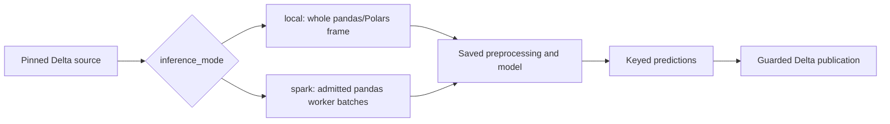

# Score on Spark workers

This page covers distributed scoring for a generated Databricks Bundle:
`inference_mode: spark` worker configuration and admission, the table of what
Spark scoring supports, worker capacity and environment settings, and how to
read results and model-set composition. Read it when a saved model should score
a Delta source in pandas batches on Spark workers instead of as one whole frame.
Source selection, eligibility, watermarks and publication stay in the parent
scoring guide.

[Back to Score saved models and publish Delta predictions](databricks_scoring.md)

Training fits one bounded pandas or Polars model in a Python process. Scoring
can apply that fitted model to a whole frame or distribute admitted pandas
prediction batches across Spark workers. Distributed inference does not turn
the estimator's fit or tuning trials into distributed training.



Here `inference_mode: local` means whole-frame scoring, including on Databricks
compute. It is separate from SDK `runtime="standalone"` versus
`runtime="databricks"`, which chooses the integration environment.
UC Delta publication requires `runtime="databricks"`. SDK `runtime` accepts
`standalone`, `databricks` or `spark`; preflight rejects `spark` with
`runtime_unsupported` because Spark scoring uses its separate batch runner.
Monitoring already uses Spark and has no separate engine choice.

## Worker configuration and admission

Merge these fragments into the named files, keeping the remaining settings:

```yaml
# config/training.yml
defaults:
  engine: pandas
```

```yaml
# config/inference.yml
inference_mode: spark
spark_udf_env_manager: local
spark_udf_prediction_batch_rows: 10000
```

The Bundle uses `mlflow.pyfunc.spark_udf`; workers receive pandas batches and
apply saved preprocessing without refitting. Explicit Spark with Polars is
rejected. The library's `predict_spark`/`mapInPandas` API is a separate route.
Without `inference_mode`, scoring is whole-frame (`local`).

### What Spark scoring supports

Admission checks the exact fitted artifact, not just its model-family name.
The setup menus also serve whole-frame projects and therefore offer more
choices than distributed scoring admits.

| Part | Admitted scope and important boundaries |
| --- | --- |
| Linear models | Exact `LinearRegression` and `LogisticRegression`. |
| Tree models | Exact `DecisionTreeRegressor/Classifier`, `RandomForestRegressor/Classifier` and `ExtraTreesRegressor/Classifier`; single-output fitted trees only. Custom subclasses or replaced inference methods are rejected. |
| XGBoost | Exact `XGBRegressor` with reviewed gbtree state and `reg:squarederror` or `reg:logistic` objective; no custom callbacks/objectives or DART. This does not admit XGBClassifier. |
| Fitted preprocessing | Reviewed `SimpleImputer`, `StandardScaler`, `MinMaxScaler`, `ClipValues`, `GroupImputer`, `OneHotEncoder` and `FeatureInteraction` states. Each must pass its configuration/state checks and preserve rows. Settings: `SimpleImputer` strategy `mean`, `constant` or `most_frequent` (not `median`); `GroupImputer` `mean` or `most_frequent`; `OneHotEncoder` `max_categories: null` with `include_missing: false`; the others in any validated configuration. A Spark project rejects other settings in `validate_model` (`select_best_model` for competitions) before registration. |
| Skipped fitted row steps | `Deduplicate`, `DropMissingRows` and `RowFilterFunction` (`filter_step`) are skipped by the prediction chain to preserve request rows. They do not filter each worker batch. |
| Tuning and thresholds | Reviewed fitted tuning wrappers are supported. Tuned feature exclusions are rejected; tuned thresholds require LogisticRegression or an admitted tree classifier and a valid class-to-threshold mapping. |
| Model sets | Every component must pass admission. Independent outputs and declared numeric `weighted_sum`/`weighted_mean` composition are supported; arbitrary Python composition is not. |
| Saved project scoring rules | Rejected. `SCORING_MODE` `custom` or `combined`, even with empty rule lists, or `pre_split` with a non-empty pre-split recipe saves rules with the model. Only `pre_split` with an empty recipe is admitted. Training does not check this; a single model fails in the score job and a model set fails at activation. `preview.py --action score` prints `Project scoring rules: disabled` when none are saved. |
| Custom/context-dependent code | Other callbacks, unreviewed fitted states and temporal carry history are rejected. A `row` declaration or passing preprocessing probe alone grants no admission. |

Models packaged with [feature lookup](databricks_features.md) require
`inference_mode: spark`; whole-frame mode rejects them, including feature-backed
model-set components. They score through the Feature Engineering `score_batch`
route. Lookup does not relax the model/preprocessing checks.

## Capacity and worker environment

`max_rows` and `max_input_mb` bound local training, not the distributed scoring
population. `spark_udf_prediction_batch_rows` accepts 1 through 100000
(default 10000) and slices each worker input into model calls. It does not limit
every incoming Arrow allocation: the worker still needs memory for that frame,
the fitted model and prediction slices. Databricks controls Arrow transport;
serverless does not permit setting `spark.sql.execution.arrow.maxRecordsPerBatch`.
There is no universal row threshold for choosing Spark and no fallback to
collecting the source if distributed execution fails.

The template uses `spark_udf_env_manager: local` on serverless, reusing the
declared task environment with the required wheel/dependencies. Here "local"
describes environment reuse on the worker, not driver-side inference.
Policy-cluster projects use `virtualenv` to install the packaged wheel and saved
pins in an isolated worker environment; Core's direct API default is also
virtualenv. Validate that environment on the chosen runtime: the tested
serverless runtime rejects MLflow 3.16.1 virtualenv archives containing absolute
interpreter symlinks. There is no automatic environment fallback.

Certified MLflow packages carry a safety certificate, exact source hash and
Skyulf wheel. A package logged without a certificate cannot use Spark; log a new
certified version. A pickle alone provides no Spark capability. Workers recheck loaded
state and runtime versions. Nullable integer and Boolean transport is handled
before Arrow conversion.

For a repeatable native/worker/Bundle comparison, see
[Measuring inference capacity](spark_benchmark.md#measuring-inference-capacity).
Its timings include a correctness aggregate and exclude Delta publication;
they are not complete score-job latency. Benchmark resources are separate from
project jobs and the shared dashboard. Measure executor memory and packaging
on your actual target compute.

<span id="certified-estimators-and-model-set-composition"></span>

## Results and model-set composition

In **Workflows > score job > score task**, inspect the concrete version, row
counts, source watermark and receipt. Spark receipts include inference mode,
environment manager and prediction batch size. Snapshots, insert-only CDF,
no-op replay, model-change policies and optional `recover_predictions` use the
same guarded Delta publication lifecycle. Model-set outputs commit together;
successful scoring retains the monitoring and dashboard-refresh handoff.

Spark admits model-set composition only as declarative `weighted_sum` or
`weighted_mean` rules in `model_set.composition_config`. Function rules from
`build_combined_rules()` are rejected. The
[model set guide](databricks_model_sets.md#declarative-composition) shows the
rule format.
