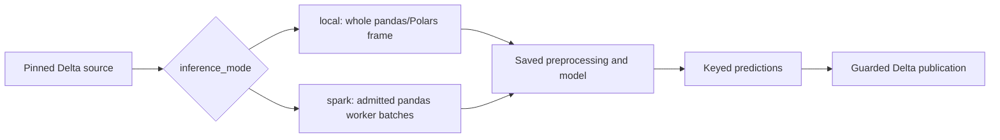

# Score on Spark workers

This page covers distributed scoring for a generated Databricks Bundle:
`inference_mode: spark` worker configuration and admission, the table of what
Spark scoring supports, worker capacity and environment settings, and how to
read results and model-set composition. Read it when a saved model should score
a Delta source in pandas batches on Spark workers instead of as one whole frame.
Source selection, eligibility, watermarks and publication stay in the parent
scoring guide.

[Back to Score saved models and publish Delta predictions](databricks_scoring.md)

Training fits one bounded pandas or Polars model in a Python process. Scoring
can apply that fitted model to a whole frame or distribute admitted pandas
prediction batches across Spark workers. Distributed inference does not turn
the estimator's fit or tuning trials into distributed training.



Here `inference_mode: local` means whole-frame scoring, including on Databricks
compute. It is separate from SDK `runtime="standalone"` versus
`runtime="databricks"`, which chooses the integration environment.
UC Delta publication requires `runtime="databricks"`. SDK `runtime` accepts
`standalone`, `databricks` or `spark`; preflight rejects `spark` with
`runtime_unsupported` because Spark scoring uses its separate batch runner.
Monitoring already uses Spark and has no separate engine choice.

## Worker configuration and admission

Merge these fragments into the named files, keeping the remaining settings:

```yaml
# config/training.yml
defaults:
  engine: pandas
```

```yaml
# config/inference.yml
inference_mode: spark
spark_udf_env_manager: local
spark_udf_prediction_batch_rows: 10000
```

The Bundle uses `mlflow.pyfunc.spark_udf`; workers receive pandas batches and
apply saved preprocessing without refitting. Explicit Spark with Polars is
rejected. The library's `predict_spark`/`mapInPandas` API is a separate route.
Without `inference_mode`, scoring is whole-frame (`local`).

### What Spark scoring supports

Admission checks the exact fitted artifact, not just its model-family name.
The setup menus also serve whole-frame projects and therefore offer more
choices than distributed scoring admits.

| Part | Admitted scope and important boundaries |
| --- | --- |
| Linear models | Exact `LinearRegression` and `LogisticRegression`. |
| Tree models | Exact `DecisionTreeRegressor/Classifier`, `RandomForestRegressor/Classifier` and `ExtraTreesRegressor/Classifier`; single-output fitted trees only. Custom subclasses or replaced inference methods are rejected. |
| XGBoost | Exact `XGBRegressor` with reviewed gbtree state and `reg:squarederror` or `reg:logistic` objective; no custom callbacks/objectives or DART. This does not admit XGBClassifier. |
| Fitted preprocessing | Reviewed `SimpleImputer`, `StandardScaler`, `MinMaxScaler`, `ClipValues`, `GroupImputer`, `OneHotEncoder` and `FeatureInteraction` states. Each must pass its configuration/state checks and preserve rows. Settings: `SimpleImputer` strategy `mean`, `constant` or `most_frequent` (not `median`); `GroupImputer` `mean` or `most_frequent`; `OneHotEncoder` `max_categories: null` with `include_missing: false`; the others in any validated configuration. A Spark project rejects other settings in `validate_model` (`select_best_model` for competitions) before registration. |
| Skipped fitted row steps | `Deduplicate`, `DropMissingRows` and `RowFilterFunction` (`filter_step`) are skipped by the prediction chain to preserve request rows. They do not filter each worker batch. |
| Tuning and thresholds | Reviewed fitted tuning wrappers are supported. Tuned feature exclusions are rejected; tuned thresholds require LogisticRegression or an admitted tree classifier and a valid class-to-threshold mapping. |
| Model sets | Every component must pass admission, including its saved scoring rules and reused pre-split recipe. Independent outputs, declared numeric `weighted_sum`/`weighted_mean` composition and combined function rules from `build_combined_rules()` are supported; function rules need sealed training probe evidence (see below). |
| Saved project scoring rules | Eligibility and output rules are admitted when training linted and probed them (see below); Spark and online-feature projects do this automatically. The result columns (`scoring_status`, `exclusion_reason` and the declared outputs) travel through the Spark UDF and endpoints. Reused pre-split eligibility (`SCORING_MODE` `pre_split` or `combined`) is admitted when its steps are row-local and probed: fixed built-in edits, `DropMissingRows`, `ManualBounds` and `filter_step` functions. `Deduplicate` and custom filter classes in the reuse are rejected; `validate_model` rejects them before registration. `preview.py --action score` prints `Project scoring rules: disabled` when none are saved. |
| Custom/context-dependent code | `column_step`/`fitted_step` steps are admitted when training linted and probed them (see below). An `inference_context="row"` declaration is optional. `group`, `window` and `global` declarations, custom classes from `custom_step`, unreviewed fitted states and temporal carry history are rejected. A passing `preprocessing_probe` report alone grants no admission. |

Models packaged with [feature lookup](databricks_features.md) require
`inference_mode: spark`; whole-frame mode rejects them, including feature-backed
model-set components. They score through the Feature Engineering `score_batch`
route. Lookup does not relax the model/preprocessing checks.

### Admit your own row steps (opt-in)

Skyulf cannot prove that your `apply` function or scoring rule uses only its
saved training state. A function that computes something from the batch, such
as `df["x"].mean()`, would give different answers on each Spark worker batch.
Training therefore checks your own code before it can run on Spark workers or
endpoints:

- In a project with `inference_mode: spark` or `online_features`, the check runs
  automatically whenever the model has a `column_step`, a `fitted_step` or
  saved scoring rules. No setting is needed.
- Other projects, for example one that only serves an endpoint from
  `config/serving.yml`, or SDK training, opt in:

```yaml
# config/training.yml
defaults:
  admit_probed_custom_steps: true
```

```python
# src/features/preprocessing.py; inference_context="row" is optional
fitted_step("clip_duration", learn, apply, output="duration")
```

The check has two parts, and every step and rule must pass both:

1. **Lint.** Training reads the saved source of `apply()` (or the rule) and the
   helpers it calls in the same file. It rejects whole-batch calls on the input
   frame, such as `.mean()`, `.sum()` or `.max()` without `axis=1`, `.rank()`,
   `.shift()`, `.groupby()`, `.sort_values()`, `.value_counts()`, `.any()`,
   `len(df)` and `df.shape[0]`. It also rejects writes to shared process state
   anywhere in the step's functions: module globals, class or function
   attributes, `os.environ`, mutated default arguments and `globals()`.
   `learn()` may use batch statistics: learning on the training rows is its job.
   Row-wise forms are fine: `.str`/`.dt` methods, `axis=1` (or a positional
   `1`), the column count `df.shape[1]`, and `any()`/`all()`/`len(df) == 0`
   used only in an `if` that raises or returns early for empty input. The lint
   is a heuristic: it does not see other modules or dynamic calls, so the probe
   still runs.
2. **Probe.** On the first 256 holdout rows (at least 16 are required), each
   step or rule must give identical results on the whole sample, when scored
   again, in chunks of 1, 2 and 7 rows, in reverse order, with the row index
   renumbered, on an empty batch, and when one row's inputs change (other rows
   must not move). Spark gives each batch a fresh `0, 1, 2, ...` index and can
   send an empty batch, so code that reads `df.index`, fails on empty input or
   returns a different dtype for it is rejected. A step must not change values
   in its module's globals while it is probed. Finally, the step runs from a
   freshly loaded copy of the project code (`fresh_module`) and must give the
   same results, as a new worker process would.

   `perturb` moves numbers by half their size, staying inside small integer
   types such as `uint8`, flips booleans and replaces text with a value the
   sample does not contain. If the step raises on that text (for example a
   date or number stored as text), the row is retried with the text unchanged;
   a step that still raises is reported as `raised on a changed input value`.

Steps without a declaration that pass both are treated as row-local. Steps
declared `group`, `window` or `global` stay rejected, as do custom classes from
`custom_step`. Scoring rules run on the rows they really receive: eligibility on
the raw request, output rules on up to 256 eligible holdout rows plus
predictions. A reused pre-split recipe is probed as one eligibility rule bound to
its saved steps; target-reading steps stay skipped with
`SKIP_TARGET_PRE_SPLIT_STEPS`. Model-set
combined rules from `build_combined_rules()` read the same row's component
predictions; they are probed on up to 256 rows of the set's training source
(`perturb` changes one row's inputs and component predictions) and their
evidence is sealed in the set.

Passing results are saved inside the model as evidence, tied to each step's
saved state, each rule's version, function and parameters, and the project
source. Spark scoring and endpoints admit the code only when that evidence
matches; the certificate records steps as `apply_probed` and rules as
`rules_probed`. The training report lists every probed step and rule with its
passed checks (**Spark and endpoint admission probe**). The evidence is bound to
the sealed model by its checksum. It does not authenticate who produced the
model: a trusted SDK or job producer is trusted.

Spark output carries null rule results as SQL nulls. To do so it reserves the
text value `␀null␀`: a string output equal to it is rejected, as are nullable
`int64` outputs beyond 2**53, which float64 transport cannot hold exactly.

The probe is evidence, not proof. It checks at most 256 holdout rows, so it can
miss:

- logic that depends on the batch size, such as code that only runs above 300
  rows;
- batch statistics used only for rare values that the holdout does not contain;
- module-level caches and globals that the lint cannot see. These are not
  allowed. The probe only detects plain JSON values that change while it runs.

Keep `apply` functions and rules to row-by-row arithmetic on the saved state.

#### When the probe fails

Every failure names the step or rule, the check and one fix, and ends with a
link to this section. A lint failure also gives the file, line and call:

```text
Custom step 'fill_values' reads a batch statistic (preprocessing.py line 41:
df['x'].mean()). Compute it in learn() and read it from state in apply() ...
```

Pick one of three fixes:

1. **Make the function row-local.** Move the batch statistic from `apply()` into
   `learn()` and read it from the saved state:

   ```python
   # Before: every Spark batch fills with its own mean.
   def apply(df, state):
       return df["x"].fillna(df["x"].mean())

   # After: learn() saves the training mean once; apply() only reads it.
   def learn(df, y):
       return {"mean": float(df["x"].mean())}

   def apply(df, state):
       return df["x"].fillna(state["mean"])
   ```

2. **The calculation really needs other rows.** Move it upstream into a
   `groups/` Spark producer that writes a feature column, or into a pre-split
   step if it only concerns training rows. Otherwise declare
   `inference_context="group"` or `"window"` and keep the project on
   `inference_mode: local`.
3. **Lint false alarm on a per-row call.** Write the row axis explicitly, for
   example `df[["a", "b"]].sum(axis=1)`. There is no switch to turn the lint
   off, by design.

Find failures on your laptop before a training job:

```bash
# Lint the selected recipes and rules (Spark and online-feature projects).
python src/tools/preview.py --action train
# Fit on a local labeled sample (CSV or Parquet, 16+ rows) and run lint and probe.
python src/tools/smoke.py --probe sample.csv
```

Get a real sample by exporting `SELECT * FROM <training_table> LIMIT 256`; its
columns and dtypes must match `input_columns` plus the target. The local probe
uses the sample as both training rows and holdout, so it shows how the code
behaves on those rows only. Training on the real holdout makes the final
decision.

## Capacity and worker environment

`max_rows` and `max_input_mb` bound local training, not the distributed scoring
population. `spark_udf_prediction_batch_rows` accepts 1 through 100000
(default 10000) and slices each worker input into model calls. It does not limit
every incoming Arrow allocation: the worker still needs memory for that frame,
the fitted model and prediction slices. Databricks controls Arrow transport;
serverless does not permit setting `spark.sql.execution.arrow.maxRecordsPerBatch`.
There is no universal row threshold for choosing Spark and no fallback to
collecting the source if distributed execution fails.

The template uses `spark_udf_env_manager: local` on serverless, reusing the
declared task environment with the required wheel/dependencies. Here "local"
describes environment reuse on the worker, not driver-side inference.
Policy-cluster projects use `virtualenv` to install the packaged wheel and saved
pins in an isolated worker environment; Core's direct API default is also
virtualenv. Validate that environment on the chosen runtime: the tested
serverless runtime rejects MLflow 3.16.1 virtualenv archives containing absolute
interpreter symlinks. There is no automatic environment fallback.

Certified MLflow packages carry a safety certificate, exact source hash and
Skyulf wheel. A package logged without a certificate cannot use Spark; log a new
certified version. A pickle alone provides no Spark capability. Workers recheck loaded
state and runtime versions. Nullable integer and Boolean transport is handled
before Arrow conversion.

For a repeatable native/worker/Bundle comparison, see
[Measuring inference capacity](spark_benchmark.md#measuring-inference-capacity).
Its timings include a correctness aggregate and exclude Delta publication;
they are not complete score-job latency. Benchmark resources are separate from
project jobs and the shared dashboard. Measure executor memory and packaging
on your actual target compute.

<span id="certified-estimators-and-model-set-composition"></span>

## Results and model-set composition

In **Workflows > score job > score task**, inspect the concrete version, row
counts, source watermark and receipt. Spark receipts include inference mode,
environment manager and prediction batch size. Snapshots, insert-only CDF,
no-op replay, model-change policies and optional `recover_predictions` use the
same guarded Delta publication lifecycle. Model-set outputs commit together;
successful scoring retains the monitoring and dashboard-refresh handoff.

Spark admits model-set composition as declarative `weighted_sum` or
`weighted_mean` rules in `model_set.composition_config`, and as function rules
from `build_combined_rules()` when training sealed their probe evidence in the
set. The
[model set guide](databricks_model_sets.md#declarative-composition) shows the
rule format.
