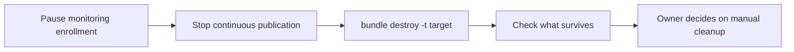

# Remove a deployed project

## When you need it

Use this page to remove one target of a generated project, for example a
finished `test` trial or a personal development target. `databricks bundle
destroy` removes what the Bundle deployed. Data, models and monitoring evidence
are Unity Catalog or workspace objects that the Bundle never managed, so they
stay.



## What to edit

Do these steps first, while the jobs still exist. After `destroy` you can no
longer run them.

| Step | How |
| --- | --- |
| Pause batch monitoring enrollments | Set `monitoring_enabled: "false"` for the target, redeploy and run the score job once. The inventory then records a paused enrollment instead of a model that stops reporting. |
| Pause serving enrollments | Run the monitoring job with `monitoring_action=enroll_serving` and each entry resubmitted with `enabled: false`; see [serving monitoring](databricks_serving_monitoring.md#what-to-edit). |
| Stop a continuous feature publication | Run `online_publication` with `publication_action=stop`, then `status`; see [online features](databricks_online_features.md#operate-continuous-feature-publication). A native pipeline keeps running after the job is gone. |
| Pause a traffic rollout | Pause the `daily_rollout` schedule. Destroying the job does not change endpoint traffic. |
| Keep training evidence you still need | Approval, rollback and monitoring reference preparation read saved candidate runs. Export or keep them before removing the folder that holds the experiment (see below). |

If this target owns the shared monitoring dashboard (created with
`--create-dashboard`), other projects use its URL. Either keep the owner target
deployed, or first create a new owner in another project with `--create-dashboard`
and rerun the helper with the new `--dashboard-url` in every project that uses
it. See [the dashboard page](databricks_monitoring_dashboard.md).

## The command

From the generated project root, with the same target and profile used to
deploy:

```powershell
databricks bundle destroy -t test --profile YOUR_PROFILE
```

The CLI lists the jobs and the workspace folder it will delete and asks for
confirmation. Read the list before you confirm. Repeat per target; destroying
`test` does not touch `syst` or `prod`.

## What you should see

`bundle destroy` removes the resources in the Bundle state of that target:

| Removed | Source |
| --- | --- |
| Jobs `train`, `score`, `monitoring` | `resources/*.job.yml` |
| Optional jobs `online_feature_lookup_setup`, `online_publication`, `daily_rollout` | Present when selected at setup |
| The `features` job | `resources/features.job.yml`, when created by `refresh_feature_graph.py` |
| The dashboard refresh task | A target's block in `deployment/dashboards.yml`, part of the monitoring job |
| The shared monitoring dashboard | Only in a target whose `deployment/dashboards.yml` block uses `create` |
| Job permissions managed by the Bundle | `permissions` and `manage_job_permissions` settings |
| Deployed files and Bundle state | The target's `root_path` workspace folder |

The training jobs log to the MLflow experiment `<root_path>/experiment`, inside
that folder. Treat it as deleted with the folder unless you move or export it
first. Registered model versions stay in Unity Catalog, but their links to
those runs no longer open.

These stay, because the Bundle never created them as resources:

| Survives | Notes |
| --- | --- |
| Training and scoring source tables | Never created by the project |
| Prediction tables, generation tables and model-set views | Created by the score job at run time |
| Feature group outputs and the merged feature table | Created by the `features` job at run time |
| Monitoring store tables and views | `model_inventory`, `monitoring_results`, `performance_actions`, `retraining_requests`, the views, `reference_cleanup_audit`, `monitor_ref_*` references and shared `monitor_src_*` populations; shared with other projects |
| Monitoring enrollment rows | Stay in `model_inventory`; paused if you followed the steps above |
| Registered models, versions, aliases and tags | Unity Catalog objects |
| Monitoring experiment named by `monitoring_experiment_name` | Outside the project folder when set to a path such as `/Shared/...` |
| Serving endpoints and UC SQL functions | Created by the SDK or the `online_feature_lookup_setup` job, not by the Bundle |
| Online stores, online tables and publication pipelines | Created through Feature Engineering, not by the Bundle |
| A dashboard reused by URL | Owned by another project or created outside the Bundle |

[Tables in your workspace](databricks_workspace_tables.md) explains what each of
these objects holds and which ones grow over time.

## Common errors and fixes

Check ownership before deleting anything by hand. The monitoring store, the
dashboard, feature tables and online stores are often shared with other
projects. Registered models and prediction tables can feed other consumers.
Only the owner of an object should remove it, with that team's normal process.

| Symptom | Fix |
| --- | --- |
| `destroy` wants to delete resources you did not expect | Stop and check `-t` and `--profile`. Destroy works on the Bundle state of the selected target only. |
| Other projects lost their dashboard | The destroyed target owned it. Redeploying creates a new dashboard with a new ID, so create a new owner with `--create-dashboard` and rerun the helper with its `--dashboard-url` in every project that uses it. |
| The dashboard still lists the removed model | Its enrollment row stays in the shared inventory. Pause it before destroying, as shown above. |
| An endpoint still serves the model | Endpoints are not Bundle resources. Its owner removes it in Databricks Serving. |
