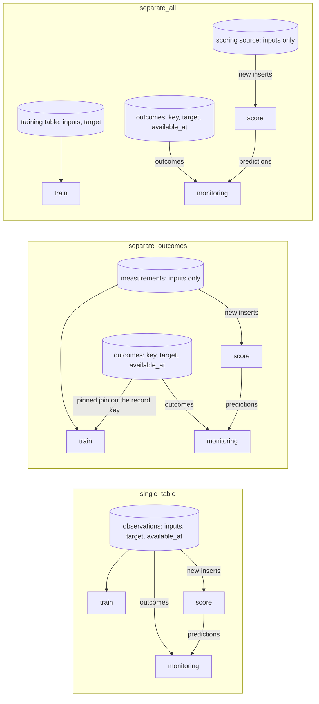
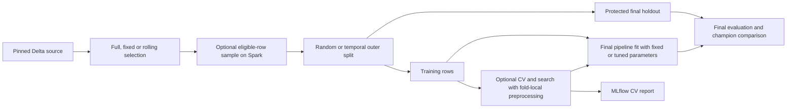

# Select training rows, time windows and holdout

## When you need it

Choose the population and evaluation split before training. Snapshot version, observation window,
label availability, sample, split and job schedule are separate choices. These rules apply to
single-model, competition and model-set projects.

## What to edit

### Prepare the source table

Skyulf reads existing tables; it never creates or repairs them. Before the first
training run, make sure the training and scoring sources meet these rules:

| Requirement | Why |
| --- | --- |
| Unity Catalog Delta table | Training pins a Delta snapshot version; scoring reads Delta changes. |
| Change Data Feed on the scoring source, before new rows arrive | Incremental scoring reads new rows from the change feed. The default first score processes existing rows; `initial_scoring: from_now` checkpoints without predictions. [Scoring](databricks_scoring.md) explains the starting choice, updates and deletes. |
| Record key columns of type `STRING` or `BIGINT`, nonnull and unique | Keys identify each prediction. Date or timestamp keys are not supported; store a date key as `date_format(observed_on, 'yyyy-MM-dd')` (STRING) or `yyyyMMdd` (BIGINT). |
| Keys kept out of `input_columns` | Keys are copied to the output, not learned from. |
| A nonnull target for every eligible training row | Skyulf does not create labels. Use [result availability](#record-identity-and-result-availability) for delayed outcomes. |
| The same key and input columns, with the same types, in training and scoring sources | The saved pipeline expects the training input schema. The scoring source needs no target. |
| Date columns stored consistently | Declare their type and parsing as described in [source date formats](#source-date-formats-and-timezones). |

To enable Change Data Feed on an existing table you own:

```sql
ALTER TABLE my_catalog.my_schema.customer_observations
SET TBLPROPERTIES (delta.enableChangeDataFeed = true);
```

For a worked example table, see the
[end-to-end guide](databricks_bundle_walkthrough.md).

### Spark DECIMAL model values

At the Spark-to-model boundary, Skyulf converts selected `DECIMAL(p,s)` model inputs,
numeric targets and weights to `DOUBLE` / `float64`. Bounded training, batch prediction,
Spark worker inputs and the serving job's smoke sample use the same rule. Nulls remain
missing values for the fitted preprocessing. Record keys, grouping identities and
time controls retain their declared types.
Use supported `STRING` or `BIGINT` record keys. Serving refuses a DECIMAL key that
cannot be represented by its saved JSON contract; it does not round the key to float.

For example, an `amount DECIMAL(17,6)` input becomes `float64` in the fitted pipeline,
`double` in its MLflow signature and `DOUBLE` in the generated SQL scoring function.
REST callers send JSON numbers or null, rather than Python `decimal.Decimal` objects.
Converting DECIMAL to float64 may lose precision beyond roughly 15–17 significant digits.

The completed training report and `training_data.json` list the observed conversions:

```json
{
  "source_column_conversions": [
    {"column": "amount", "source_dtype": "decimal(17,6)", "target_dtype": "float64"}
  ]
}
```

The saved model's `manifest.json` records conversions for its fitted inputs; a model
set retains these in each component manifest. The default offline preview cannot
inspect a table's physical types. Use its source-validation action for planned casts
on the current schema, and the training report for casts actually performed on the
pinned snapshot. Older artifacts without this field have no recorded conversion evidence.

Native Feature Engineering lookup reads its own source/feature tables after Skyulf's
projection. Its model-value columns must already use `DOUBLE`; persist the converted
column and retrain before logging or serving that native lookup model. Its existing
admission check rejects DECIMAL storage with an actionable message.

If an older champion learned a DECIMAL input as `object` or string, the new float64
candidate has a different input contract. Follow the
[schema migration steps](databricks_model_sets.md#upgrading-core-with-model-sets)
before switching consumers; a runtime-recovery flag does not override schema validation.

### Choose a table layout

A project reads data in three roles. A layout only decides how many physical
tables hold them:

| Role | What it holds | Who reads it |
| --- | --- | --- |
| Training data | Inputs and the known answer (target) for past rows | The train job, to fit the model |
| Scoring input | Rows to predict, without a target | The score job, which writes the `predictions` table |
| Actual outcomes (labels) | The real answer for a predicted row, learned later: record key, target and the time it became known (`available_at`) | Monitoring, to compare predictions with reality; training too, when `training_label_table` is set |

A label is the actual answer. A prediction is made before the answer is known,
so the scoring input has no target; the answer is inserted into the outcomes
table when it arrives.

The score job never writes to its input table. It reads only the record keys and
input columns, so a target column in the scoring input is ignored, and it writes
each prediction as a row of the separate prediction table
(see [Tables in your workspace](databricks_workspace_tables.md#predictions-output_schema)).
Even with one input table, a project therefore has at least two tables: the
input and its predictions.

Quick and detailed setup both ask for `source_layout`. `single_table` is the
default and uses embedded training targets. `separate_outcomes` connects one
feature source to a separate actual-outcome table for both training and
monitoring. `separate_all` asks for a distinct scoring source and keeps targets
in the training table. The separate layouts require an outcome table and its
availability column. Existing answer files with an explicit scoring-table
override retain that override even when no layout answer was supplied.

[Check or create your source tables](databricks_source_tables.md) walks through
the check, the table contract and its error messages.

Each generated project includes `SOURCES.md` and a read-only validation command.
The optional `config/sources.sql` starter is generated only when setup selects
`include_source_sql: "true"` (default `"false"`). Existing tables need no SQL starter:

```powershell
python src/tools/preview.py --action sources --profile YOUR_PROFILE --warehouse-id YOUR_WAREHOUSE_ID --catalog my_catalog --input-schema my_schema --output-schema my_schema --metadata-schema my_schema
```

The check reads Delta metadata, CDF settings, required columns, compatible input
types, unique/non-null keys and the declared outcomes. Key probes may scan the
full table; no data or settings are changed. It validates the calling identity's
access to current tables. It cannot prove future inserts or another run-as
identity will satisfy the same contract. Supply `--label-table` and
`--label-available-at-column` when target overrides differ from setup answers.
Fetched Feature Store outputs are not required in raw tables. The report warns
that lookup-table permissions, point-in-time joins and fetched feature types
still require the training checks.
The SQL starter deliberately leaves unknown types as `TYPE_FOR_column`:
replace these and namespace placeholders with your real schema before running.

Training, scoring and monitoring each read a table you name: `training_table`
in `config/training.yml`, the scoring source in `config/inference.yml`, and
`monitoring_label_table` in `deployment/targets.yml`. They may be the same table
or different ones. Choose by how your actual outcomes arrive:

| Layout | Use it when | Configure |
| --- | --- | --- |
| **One append-only table** | Each row is complete when it is inserted (inputs, target and the time the outcome became known) and is never updated afterwards. | Point all three settings at the same table. Training selects its window with `start`/`cutoff` and keeps rows whose outcome is available; scoring reads newly inserted rows. |
| **Measurements plus a separate outcomes table** | The outcome is known only later. New measurements are inserted without a target; outcomes are inserted into a second table keyed by the same record key. | `separate_outcomes` sets both `training_label_table` and `monitoring_label_table`; training joins a pinned outcome snapshot. Training and scoring share the measurement source. |
| **A raw table plus derived tables or views** | Your raw source receives updates or deletes, such as late corrections or outcomes written into existing rows. | Keep the raw table for your own processes, and give Skyulf insert-only derived tables: one for training, one for scoring inputs, one for outcomes. |

| `source_layout` | Tables | Use it when |
| --- | --- | --- |
| `single_table` | One: inputs, target and `available_at` | Each row arrives complete with its answer and is never updated afterwards |
| `separate_outcomes` | Two: measurements without a target, and actual outcomes | The answer arrives later; the most common case |
| `separate_all` | Three: training with targets, scoring input, actual outcomes | Training and scoring data come from different places, as in the `real_data` examples |

In every layout the score job works in batches: each run predicts the rows
inserted since the previous run, found through Delta change data feed. It does
not predict a row the moment it arrives; use a [serving endpoint](databricks_serving.md)
for that.

The generated `source_layout` choices map to these tables and jobs:



In `separate_all`, training keeps the targets embedded in its own table: new
labelled rows must reach that table upstream, unless you also configure
`training_label_table`. Only `separate_outcomes` joins the outcomes into training
by default.

Three behaviours decide which layout works:

- **Incremental scoring accepts inserts only.** For a single model or a
  competition, an UPDATE or DELETE in the scoring source fails the score job
  with *Source updates and deletes require an explicit rescore policy*. Model
  sets alone can opt into `on_source_change: rescore_all`; see
  [source changes](databricks_scoring.md#source-changes-are-separate-from-model-changes).
  Writing an outcome into an existing scoring row is an update, so use a
  separate outcomes table instead.
- **Choose whether to score existing rows.** The default
  `initial_scoring: full_snapshot` includes historical training rows when the
  source is shared; that first population is an in-sample observation.
  Set `initial_scoring: from_now` in `config/inference.yml` before the first
  score to record a zero-row checkpoint and score only later inserts. The choice
  is fixed for that prediction target. Rebuilds preserve the starting boundary
  using saved prediction keys and recent CDF. Only CDF-expiry recovery needs
  the original starting snapshot to remain readable. See
  [start with new records only](databricks_scoring.md#start-with-new-records-only).
  If you keep `full_snapshot`, run the first score on its own UTC day and ignore
  that day's performance window; the policy cannot filter out training rows.
- **Monitoring needs to know when an outcome became available.** The outcomes
  table must contain the saved record keys, the target and a UTC timestamp for
  when the actual value was known (`monitoring_result_available_at_column`); see
  [delayed labels](databricks_monitoring_labels.md).

The [single-table air-quality walkthrough](https://github.com/flyingriverhorse/Skyulf/blob/master/skyulf-core/templates/databricks/examples/real_data/air_quality_single_table.md)
trains on summer rows, then appends individual winter days to the same input
table and scores them with Spark. Outcomes stay in a separate table, so retrying
a partial load never updates the scoring source. It also explains why loading
two historical days today does not create two daily performance-policy windows.

[Tables in your workspace](databricks_workspace_tables.md) shows these tables next
to the ones the jobs create. The prepared examples use the second layout: `observations_train`,
`observations_score` and `labels`, with no column ever updated. When new data
arrives, insert it: new measurements into the scoring source, measured outcomes
into the outcomes table. These prepared examples keep embedded training targets,
so they also need newly labelled rows in the training source before retraining.
With `training_label_table`, insert new feature rows into the training source and
actual targets into the outcome table instead; the join supplies the labels.

### Train from separate outcomes

Use a read-only join when new feature rows arrive before their actual target.
The `separate_outcomes` layout generates this configuration; you can also add
it explicitly to `defaults` or a model entry in `config/training.yml`:

```yaml
training_table: "{catalog}.{input_schema}.measurements"
training_table_version: null
training_label_table: "{catalog}.{input_schema}.outcomes"
training_label_table_version: null
record_key_columns: [record_id]
input_columns: [temperature, humidity]
target_column: demand
filter_unavailable_results: true
result_available_at_column: available_at
result_availability_lag_hours: 0
# result_cutoff is resolved at invocation when omitted.
```

The outcomes table supplies `record_id`, `demand` and the UTC `available_at`.
Its target and availability values are authoritative; same-named columns in
the feature table are ignored. Both sources need unique, non-null keys with
exactly matching types. A duplicate outcome fails instead of choosing an
arbitrary latest row. Missing joins and outcomes after the availability cutoff
are excluded by the existing availability policy. An available row with a null
target still needs an explicit target-missing policy; joining does not invent
labels or silently relax target validation.

At invocation, both Delta versions and the outcome table's immutable identity
are pinned. Saved training specifications, dataset identity and MLflow input
provenance include that binding. Replaying the saved model uses those versions,
even if outcomes have since arrived. A replaced same-name outcome table fails
the identity check. `training_label_table_version: 12` explicitly selects version 12;
leave it null for new training runs to see later outcomes. No source rows are
written or merged back into Delta.

The same join is used for pandas/Polars training and Spark retraining freshness
checks. It can recognize new eligible labels when the feature table has not
changed. In `separate_all`, rows arriving only in the scoring source still need
to reach the configured training feature source upstream. Model-set branches
may share one outcome table with multiple targets; each branch keeps its own
target and availability policy.

### Local input limits

`max_rows` bounds the rows read into the local process before train/test splitting.
Without sampling it applies after any observation-window selection and after
rows without a usable label are dropped on Spark, so they do not count toward
it: rows outside `filter_unavailable_results`, and in `multi_target` rows whose
branch target is missing. Single-model sources still need a label on every
eligible row. Those
rows still appear in the reported unavailable-label count. An overflow fails;
the reader never silently truncates data. Explicit sampling is available as described below.

Quick setup uses `max_rows: 10000` and `max_input_mb: 64`. Detailed setup also
asks for `training_sample_rows`; null means no sampling. Overflow errors show
the configured limit and the setting to edit. A bounded read reports **at least**
the observed number of rows, not a fabricated count of the entire table.

`max_input_mb` is required; setup writes `64`. One unit is 1 MiB (1,048,576
bytes). It bounds
measured decoded input/serialized row sizes and local frames; it does not cap
Spark's scan, total process RAM, preprocessing expansion or model training RAM.
The existing scoring services also check bounded prediction frames. Row count
alone cannot predict size: wide numeric tables and long strings cost more.

```yaml
max_rows: 100000
max_input_mb: 256
```

These are illustrative limits, not a claim that every 100,000-row dataset fits
256 MiB. Training, scoring and approval convert this value to bytes internally.
Approval may tighten but never relax the saved training budget. The lower-level
Python SDK accepts `max_bytes`; Bundle settings use only `max_input_mb`. In
an answer file use `"max_input_mb": "64"`; the generated `config/training.yml`
stores the number `64`.

### Record identity and result availability

Keys must be non-null `STRING` or `BIGINT` values and uniquely identify records
across the initial data and later inserts. Initialization accepts
`customer_id, observation_id` and emits an ordered array. For repeat observations
of a customer, choose a composite key before deployment. Keep keys out of
`input_columns`; the Bundle does not create IDs or turn them into model features.

| Reference | Role |
| --- | --- |
| `training_table` | Existing labeled source, pinned to a Delta snapshot for training |
| `score_source_table` | Existing CDF-enabled source for predictions |
| `prediction_table` | Output table, or active view in full-rebuild mode |
| `model_name` | Unity Catalog registered model, not a table |

Training and scoring default to the same existing source. Separate them when
labeled examples and new prediction requests have different lifecycles. The
initial score processes existing source rows, including historical labeled rows
if you retain that default. A prediction keeps its keys, so it can be queried:

```sql
SELECT customer_id, prediction, model_version
FROM catalog.schema.predictions
WHERE customer_id = 'C123';
```

`config/training.yml` uses the following names:

```yaml
record_key_columns: [customer_id, observation_id]
event_column: observation_date
target_column: claim_amount
result_available_at_column: result_confirmed_at
```

The key columns identify a source record and are copied to prediction output.
They do not create an ID, become features, or implicitly define CV groups.
`event_column` names the source observation timestamp; `start`, `holdout_start`
and `cutoff` are boundaries applied to that column. `result_available_at_column`
names each row's actual result-availability timestamp. Different rows can have
different availability dates. With `filter_unavailable_results: true`, exclude
unknown results and results later than the independent `result_cutoff`. Skyulf does not invent
those timestamps or fill them with the job's execution time.

Use `record_key_columns` and `result_available_at_column` in answer files.
The default example identity column is `entity_id`. Date columns you do not
answer are omitted from the generated YAML, which means null. Initialization
does not create columns or generate timestamps. The same names are used
throughout the library and saved training settings.

### Choose the evaluation split and result availability

The default `split_strategy: "random"` needs only existing keys, features and a
nonnull target. `training_table_version` pins the source Delta snapshot; it is unrelated
to dates. Leave it null to resolve latest once at run start, or set a nonnegative
integer to pin that version. This example shows the training-related
part of the generated `config/training.yml` defaults. Generation omits keys
whose value is null, such as `event_column`, `start` or `result_cutoff`:

```yaml
defaults:
  training_table_version: 12
  record_key_columns: [customer_id]
  input_columns: [income, age]
  target_column: claim_amount
  split_strategy: random
  training_window_mode: full_snapshot
  test_size: 0.2
  random_state: 42
  stratify: false
  filter_unavailable_results: false
```

| Split | Availability filter | Required date settings |
| --- | --- | --- |
| Random | Disabled | None; all supplied targets must be known. |
| Random | Enabled | `result_available_at_column`; explicit `result_cutoff` or invocation time minus lag; source parsing rules when needed. |
| Temporal | Disabled | `event_column`; `start`, `holdout_start`, `cutoff` for `fixed_window`, or `rolling_calendar` or `rolling_days` settings; source parsing rules when needed. |
| Temporal | Enabled | Both sets above; observation and result cutoffs are independent. |

For random splitting with delayed outcomes, keep the event fields null and set
`filter_unavailable_results: true`, `result_available_at_column: "confirmed_at"`
and an aware `result_cutoff`, for example `2026-09-15T00:00:00+00:00`, or leave
it null to derive invocation time minus `result_availability_lag_hours`. Each row
is eligible only if its own result date is known and no later than that instant.
A future snapshot/cutoff can admit results that became available later. Null
availability is excluded; a known, eligible result with a null target fails.
With filtering disabled, any null target fails: Skyulf does not manufacture labels.

Core `DataSplitter` selects the random holdout after sorting by the complete
record key. The same snapshot, keys, seed and split settings retain membership
when input row order changes. `stratify: true` is for classification; insufficient
class counts or an impossible partition fail instead of silently disabling it.
A different snapshot may produce different membership even with the same seed.
The final holdout never fits preprocessing or the model.

Saved training settings include the split policy and a holdout-key digest.
`holdout_membership.json` records the key-column names, count and digest without
labels. Approval replays the saved snapshot and verifies that membership before
comparison; changing today's workflow cannot silently replace the evaluation set.
See [training CV](databricks_tuning.md#cv-nested-cv-and-total-work)
and the independent source-window controls below.

Inactive fields must stay null/default: full-snapshot selection rejects event
fields; random splitting rejects `holdout_start`. A random split can use an
explicit event window without becoming a temporal split. A result column with
availability filtering disabled is rejected. Missing temporal dates never switch
training to random.
Initialization hides irrelevant prompts but preserves explicitly supplied values
so validation can identify conflicts. The examples folder contains
`date-free-init.example.json`, `random-delayed-results-init.example.json` and
`temporal-delayed-results-init.example.json`. Replace their table/feature names
and snapshot before using them. Their date examples assume native timestamp
instants; edit parsing rules for other source types. In answer-file JSON,
`test_size`, `random_state`, `stratify` and `filter_unavailable_results` are
strings; the generated YAML stores numbers and booleans.

<a id="optional-basic-model-cross-validation"></a>

### Explicit training sampling

```yaml
training_sample_rows: 10000
training_sample_seed: 42
max_rows: 10000
max_input_mb: 64
```

`training_sample_rows: null` keeps the full selected input and fails on budget
overflow. When enabled, Spark selects up to the requested number of eligible
records using a seeded SHA-256 ordering of complete record keys. Selection occurs
before local transfer, after window and result-availability filtering. Changing
partition layout does not change the sample. A different seed or source snapshot
may change it. The requested count must be 4 through `max_rows`.

The count includes the final holdout: a 10,000-row sample with `test_size: 0.2`
produces 8,000 training and 2,000 test rows. Sampling is without replacement and
is not class-balanced; split/CV class-count guards still apply. For temporal
splits it samples within the chosen window; both partitions must remain usable.
It never samples inference rows. Record keys must be nonnull and unique across
the selected source, and eligible targets must be nonnull before sampling.

`training_selection.json` records source/eligible/selected counts, seed, algorithm
and membership digest. Saved training evidence pins both sample and holdout
membership; approval replays those choices. Row/memory budgets remain enforced.
Sampling bounds transfer, not Spark scans: validation, counts and hash ordering
can scan the selected source several times.

### Source windows are independent of splitting and scheduling

| `training_window_mode` | Source selection | Settings |
| --- | --- | --- |
| `full_snapshot` | All eligible rows from the pinned snapshot | Random split; event fields, lookback and window timezone null. |
| `fixed_window` | Explicit `[start, cutoff)` observations | Event column and boundaries; random or temporal split; lookback and window timezone null. |
| `rolling_calendar` | Completed calendar months, derived at every `train` invocation | Event column, explicit `window_timezone` and `monthly_lookback_months`; random or temporal split. |
| `rolling_days` | Preceding elapsed UTC days, ending at invocation time | Event column, `lookback_days`; temporal uses `holdout_days`, random uses `test_size`. Calendar-only fields stay null. |

With `training_window_mode: auto`, setup writes `full_snapshot` for random
projects and an editable `rolling_calendar` with four months and
`window_timezone: "UTC"` for temporal projects. Every `train`
invocation resolves latest once when `training_table_version` is null or missing;
an explicit version is honored regardless of trigger. `rolling_calendar` and
`rolling_days` derive new observation boundaries, including for manual runs. Fixed
windows stay fixed even if a job runs again a month later.

Sampling fields participate in the saved dataset identity even when sampling
is disabled.

For example, `window_timezone: "Europe/Vilnius"` uses Vilnius month boundaries,
including the correct seasonal UTC offsets. Four months includes the temporal
holdout month: three months for fit, the last completed month for final test.
Random splitting instead divides the selected four-month data by `test_size`
and leaves `holdout_start` null. Temporal lookback is 2-120 months; random is
1-120. Source parsing timezone, window timezone and cron timezone serve different
purposes. Neither the cron day nor the source timestamp format determines the
calendar implicitly. When availability filtering is enabled, an explicit
`result_cutoff` is honored; null derives invocation time minus
`result_availability_lag_hours`, equally for manual and scheduled runs.



### Source date formats and timezones

Column names and time boundaries serve different purposes. `event_column`
selects the source column; `event_time_parsing` explains its values. The
`start`, `holdout_start` and `cutoff` boundaries are timezone-aware instants.
They do not need to use the same UTC offset as source values.

Edit these settings in the generated `config/training.yml` defaults. Calendar
and day-window fields are omitted because `fixed_window` does not use them:

```yaml
defaults:
  split_strategy: temporal
  training_window_mode: fixed_window
  filter_unavailable_results: true
  event_column: observation_date
  event_time_parsing: {format: "%d/%m/%Y %H:%M:%S", timezone: Europe/Copenhagen, date_only: reject}
  result_available_at_column: result_confirmed_at
  result_time_parsing: {format: "%Y-%m-%dT%H:%M:%S%z", timezone: null, date_only: reject}
  start: "2026-06-01T00:00:00+00:00"
  holdout_start: "2026-08-01T00:00:00+00:00"
  cutoff: "2026-09-01T00:00:00+00:00"
  result_cutoff: "2026-09-15T00:00:00+00:00"
```

In this example `01/08/2026 02:00:00` in Copenhagen and
`2026-08-01T03:00:00+03:00` represent the same instant: August 1 at 00:00 UTC.
An event at that instant belongs to the holdout. The window includes `start`
and excludes `cutoff`; the holdout includes `holdout_start`.

| Source values | Parsing settings |
| --- | --- |
| Native Spark `TIMESTAMP` instants | Keep defaults: `format: null`, `timezone: null`, `date_only: "reject"`; the stored instant is retained. |
| Native `TIMESTAMP_NTZ` or naive local datetimes | Set the source IANA `timezone`; leave `format: null`. |
| Strings containing UTC offsets | Set an explicit `format` with `%z`; leave `timezone: null`. |
| Strings containing local clock times | Set an explicit `format` and source `timezone`. |
| Native `DATE` or date-only strings | Set `date_only: "midnight"` and source `timezone`; strings also need a date `format`. |

Formats use Python numeric directives: `%Y`, `%m`, `%d`, `%H`, `%M`, `%S`,
`%f` and `%z`, with literal separators. A complete four-digit year, month and
day are required. They are not Spark/Java patterns such as `yyyy-MM-dd`.
The same parser handles formatted source values and local validation, so
pandas and Polars training receive the same instants. Precision is limited to
microseconds; submicrosecond pandas timestamps are rejected. Local month names,
missing years and guessed day/month order are not supported. An explicit
`%d/%m/%Y` resolves day/month order; a string without a format does not.

Date-only values are not automatically interpreted as UTC. For example,
`2026-08-01` with `date_only: "midnight"` and `Europe/Copenhagen` means
July 31 at 22:00 UTC, before the holdout boundary above. Ambiguous or nonexistent
local times at daylight-saving transitions fail; supply an offset-bearing
source timestamp to make the intended instant explicit.

Source dates are normalized in Spark before filtering. Invalid/null event
values fail validation even if a window filter would otherwise hide them.
A null result-availability value remains unavailable, while a malformed value
fails. Normalized instants cross the Spark/Python boundary as integer
microseconds; session and process timezone settings do not reinterpret them.
The local row/byte limits still apply after filtering. Date validation may scan
the pinned source snapshot in Spark; these limits bound driver materialization,
not the amount of distributed source validation.

Keep driver, worker and replay environments' timezone data aligned. Saved rules
record zone identifiers, not a copy of the IANA timezone database.

Parsing rules are saved with the candidate's training specification and dataset identity. Approval
replays those saved rules. The job's cron timezone only controls when it runs; it does not define
the source timestamps' timezone. For Python APIs, use `TrainingDateSpec` in the
[Python SDK training guide](databricks_sdk.md#train-a-candidate-when-labels-are-ready). The
supported format vocabulary is a subset of Python's
[strptime directives](https://docs.python.org/3/library/datetime.html#strftime-and-strptime-format-codes);
source timezone rules use [IANA zoneinfo](https://docs.python.org/3/library/zoneinfo.html).

`training_table_version` defaults to `null`, resolving latest once at the start of
each `train` invocation. Set an explicit version for a repeatable snapshot.
Date boundaries default to null and are required only for `fixed_window`;
`rolling_calendar` and `rolling_days` derive them at invocation. Scoring and saved-evidence actions
do not require a new training window.

## The command

Edit `config/training.yml` defaults or the selected model entry, then inspect the resolved request:

```powershell
python src/tools/preview.py --action train
databricks bundle validate --strict -t test --profile YOUR_PROFILE
```

Preview validates configuration, not real source values. After
[deployment](databricks_deployment.md), run `train`; it pins the source and checks actual keys,
dates, labels and budgets before fitting.

## What you should see

Inspect `training_data.json`, `training_selection.json` when sampling is configured, and
`holdout_membership.json` in the model-producing MLflow run. They identify the source and saved
selection; [training reports](databricks_training_reports.md) explain the run graph and Inputs view.

Saved-artifact holdout evaluation uses sequential joblib prediction so parallel
Random Forest tree summation does not introduce last-bit metric differences into
exact approval evidence. This affects evaluation only: model hyperparameters and
normal training/batch inference parallelism are retained. Arbitrary numerical
runtimes may still be nondeterministic and must pass replay checks.

## Common errors and fixes

| Symptom | Fix |
| --- | --- |
| Row/byte budget exceeded | Choose an explicit sample or a smaller source window; there is no silent truncation. |
| Temporal boundaries are missing | Supply a fixed window or valid `rolling_calendar` or `rolling_days` settings; training does not switch to random. |
| Null labels remain | Enable a valid availability filter if labels are delayed; eligible rows still need a real target. |
| A date parses in the wrong timezone | Declare its source format and zone; cron timezone only schedules the job. |
| Approval cannot replay a candidate | Restore access to its saved source version and evidence; today's configuration cannot replace its holdout. |

For CV and search on the selected training rows, see [tuning](databricks_tuning.md). For delayed
labels arriving after predictions, see [monitoring outcomes](databricks_monitoring_labels.md).
