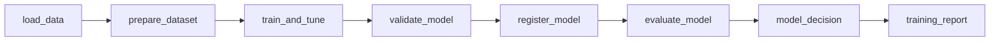
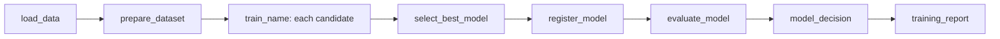
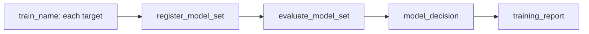

# Read training reports, evaluation charts and explanations

## When you need it

Use this page to inspect a completed or failed training invocation, locate its
MLflow evidence, and enable bounded evaluation charts or SHAP explanations.
Start with the [training walkthrough](databricks_bundle_walkthrough.md) to run a
project. [Lifecycle decisions](databricks_lifecycle.md) explain approval,
rejection and rollback; this page explains the reports that support them.

## What to edit

Set `evaluation_charts`, `explainability` and `save_preprocessing_diagnostics` under
`defaults` or the supported named-model override in `config/training.yml`.
The [field reference](databricks_training_config.md) lists allowed values.
Generated optional report tasks and their pinned dependencies must be present:
changing a setting cannot create an omitted notebook or update a deployed graph.
Use [project upgrades](databricks_project_upgrade.md) when adding those resources.

Keep `workflow_contract: "3"` in generated notebook parameters. It is distinct
from workflow JSON `config_version: 1` and companion YAML `version: 1`.

## The command

From the generated project, using its pinned training requirements:

```powershell
uv pip install -r deployment/train-requirements.txt
python src/tools/smoke.py
python src/tools/preview.py --action train
databricks bundle validate --strict -t test --profile YOUR_PROFILE
databricks bundle deploy -t test --profile YOUR_PROFILE
databricks bundle run train -t test --profile YOUR_PROFILE
```

Substitute your target and profile. Smoke and preview do not read source data or
fit models. Preview bindings can be passed explicitly with `--catalog`,
`--input-schema`, `--output-schema`, `--metadata-schema` and `--resource-suffix`.
Do not execute `explanations.py` directly: the normal fit saves its report.

## What you should see

Open **Jobs > your run > the task > Output**. Generated notebooks print
`STARTED`, then either `COMPLETED` with elapsed time or `FAILED` with the task
name, exception type, message, source file and line. Available job/run/model
identifiers appear beside the start message. Failure diagnostics preserve the
original exception and traceback; they do not convert a failed task to success.
Inspect the failing task's inputs and saved effects before retrying.

After a successful training run (`lifecycle_action=train`), the final
`training_report` starts with **Where to look**, one row per fitted model.
Approve, reject and rollback runs show only the action result. The index links
to existing evidence rather than recomputing reports:

| Column | What to inspect |
| --- | --- |
| Model / run | The exact MLflow fitting run; a registered UC version where one exists. Competition losers have runs but no registered winner version. |
| Training data | Saved table and Delta version, available source/train/holdout counts and pre-split removals; links to the underlying JSON evidence. |
| Preprocessing probe | Saved diagnostic status and artifact, or off when confirmed by the saved config. |
| SHAP | Saved explanation status and JSON/HTML link, or an enablement link. |
| Evaluation charts | The saved Charts run if ready. **Off** when saved settings disable charts. **Winner only; see the selected model** for a competition candidate that was not selected. Otherwise check `generate_charts > Output`. |
| Decision threshold | Saved threshold mode/values and evidence; absence is reported explicitly. |

The decision, quality comparison and receipts follow this index. Single models,
competition winners and model sets show the same operator blocks:
**Available action: approve**, **Available action: reject** and
**If rollback is needed**. Copy parameter values from those blocks; the
[operator steps](databricks_lifecycle.md#operator-actions-through-run-now)
explain each one. A model set ends with **Decision details (JSON)**.
Missing/unreadable evidence is **unavailable**, not
proof that a check passed. Off is shown only when saved settings establish it.
The summary uses the fitting run's saved configuration, not today's edited YAML.

Artifact links open that run's **Artifacts** tab; select the filename shown in
the link. Threshold previews show at most ten entries and shorten long labels
or values. Open `decision_threshold.json` for the complete saved mapping.

For `lifecycle/`, `model/` and the individual training JSON files, use the
[experiment artifact reference](databricks_artifacts.md). It explains their
contents, when to open each file and how similarly named evidence differs.

Chart leaves run independently and can still be running when this final report
renders. Their eventual task state is in the job graph. A requested child score
run starts **after** `training_report`, so it cannot have a child-run link in
that report yet; open the later `run_batch_scoring` task. If lifecycle
finalization fails, its existing exception remains authoritative and the final
summary may not render. Inspect the failed task and fitting runs directly.

Other task outputs retain their labeled text or specialized reports. Notebook
JSON and task values remain available for automation.

The final-report notebook (`training_report.py` or `models_report.py`) passes
Databricks `displayHTML` to the renderer. Without it, the task prints a plain
text summary and no **Where to look** table. The `training_report` task also
needs the base parameter `workspace_host: ${workspace.host}` in
`resources/train.job.yml`. Without it, the table renders but every link is plain
text. [Project upgrades](databricks_project_upgrade.md#final-report-links)
show how to add both to an existing project.

Project generation writes the selected model entries in `config/training.yml`
and optional set settings in `config/inference.yml`. It includes only the job
notebooks of the selected graph, including optional SHAP/charts/recovery.
Reinitialize a separate project when changing layout or enabling a feature whose
notebook was omitted, then review and merge the required resources and files.
Do not only toggle a resource flag and reference a missing notebook.

### Optional evaluation charts

Detailed Bundle initialization asks `evaluation_charts_enabled` (default: `false`). Choosing
`true` adds a separate `generate_charts` task after model evaluation, plus
`matplotlib==3.10.0` in the training environment. Charts do not retrain models.

| Layout | Images and destination |
| --- | --- |
| Single | Saved model diagnostics in a `Charts` child of its training run |
| Competition | CV leaderboard and selected model diagnostics share a `Charts` child of the parent training run; final holdout is never used to rank candidates |
| Model set | Each component has its own `Charts` child; a separate `Charts` child of the set parent contains the overview |

Regression includes actual versus predicted, residuals and error distribution.
Classification includes raw/normalized confusion matrices and per-class metrics;
ROC/PR and calibration require model probabilities. Tree models expose native
feature importance; linear models expose signed coefficients when available.
Saved CV folds, tuning trials and training loss are plotted only when present.
Full-holdout metric summaries use existing scalar values and separate metric scales.

Open the **Charts** tab using the links printed by `generate_charts`. Images
are indexed in dedicated `Charts` child runs with no training parameters, so
MLflow's image-grid header does not repeat the long parameter list. The original
training run retains all parameters, metrics and model artifacts. Its
`skyulf.charts.run_id` tag links to the latest successful chart run.

MLflow can automatically create image cards from logged image keys. If a card
is missing from your saved layout, choose **Add chart -> Image grid** and select
a key such as `single_actual_vs_predicted` or `competition_leaderboard`.
The task output is plain text: created image keys grouped under their MLflow
Charts links. Sample counts, skipped diagnostics and `charts_run_id` remain in
`evaluation_charts/report.json` on the parent training run. Component reports
keep the source `run_id` and the separate chart `destination_run_id`.

`config/training.yml` > `defaults` controls the saved sample and display budgets:

```yaml
evaluation_charts:
  enabled: true
  max_rows: 2000
  max_features: 20
  max_classes: 20
```

Enabling charts saves a deterministic bounded sample of actual heldout predictions,
probabilities and labels in the evaluated model's MLflow artifacts, subject to
the experiment's access and retention policies. Raw features and record keys are
excluded. Sampling happens after full-holdout evaluation, preserving temporal
feature context. Maximums are
10,000 rows, 50 displayed features and 50 classes; each sample has a 16 MiB budget.
Pairwise coefficient outputs are capped at 20 boundaries. Sample diagnostics are
labelled with their row count; full-holdout scalar metrics are never overwritten.
Missing classes or unavailable model capabilities are reported explicitly.

If the saved output includes `scoring_status`, prediction diagnostics plot only
rows marked `predicted`. Excluded rows remain in the original uniform sample;
their null predictions are not turned into zeros. Each component report records
`sample_scored_rows`, `sample_excluded_rows` and `sample_excluded_by_reason`.
Chart captions and task output show how many sampled rows were accepted or excluded.
These are sample counts, not the full holdout's exclusion counts. Fewer than two
predicted sample rows skip prediction diagnostics; available model and training
evidence charts can still be shown. Sampling, saved labels and evaluation metrics
are unchanged, and malformed predictions still raise an error.

The task is an independent leaf with no retries. A chart failure can mark the
overall job failed but does not undo model decisions or repeat training. Inspect
the chart task and `skyulf.charts.status`; do not repair an old lifecycle invocation.
Setting `enabled` to `false` disables an already deployed chart task. Adding charts
to a project generated without them also requires adding the generated task and
Matplotlib dependency, then redeploying; the flag alone cannot change a job graph.

### Optional SHAP explanations

Quick setup leaves SHAP off and skips its questions. Detailed setup can add the
config, pinned dependencies and separate `shap_model`/`shap_<name>` leaves.
The [SHAP explanation guide](databricks_explanations.md) shows how to add those
files to an existing project, where reports are saved and how to read them.
Computation uses bounded training inputs during fit; the leaf displays the saved
report without retraining. Unavailable or disabled SHAP does not replace the
model's evaluation metrics.

### Training graph and notebook files

Each `train_<name>` performs a real fit and retains its split, preprocessing,
model, CV and tuning information. Its `shap_<name>` task is a separate leaf:
it displays that exact run's saved report and has no outgoing dependencies.
SHAP computation still happens during the fit; the leaf does not retrain the
model. Unavailable explanations show their saved reason. A report-task failure
is visible in the job but does not prevent model selection or set assembly.

SHAP tasks display saved explanation charts. Training, scoring and monitoring
report tasks also render readable summaries where available. Structured JSON
and saved artifacts retain the machine-readable results; task values and
downstream job handoffs use those results, not the HTML presentation.

Each diagram starts after `initialize_run` and `choose_action` select training.
The **single-model** main path is:



The **competition** shares the prepared dataset and fans out into named fits.
Selection uses training-side CV, adopts the fitted winner without retraining
and retains loser runs without registering them:



The **multi-target model set** has separate source/split/fit work inside each
branch. It packages every pinned component, checks the saved quality policies
and applies one set-level decision. The
[model set guide](databricks_model_sets.md) explains the set:



`train_name` represents each concrete `train_<name>` key in the generated
graph. These diagrams show the training paths, not every condition or optional
leaf. Manual approve/reject/rollback skip fitting and use `model_decision`.
`training_report` uses `ALL_DONE` to attempt finalization even after a failure;
that does not make the failed invocation successful. Optional SHAP leaves depend
only on their own fitting task; chart generation is another independent branch.
After a successful final report, the verified scoring handoff can start the
separate score job. Model-set aliases belong to the set, while components remain
pinned.

The graph uses meaningful model names; notebook implementation is shared:

| File in `src/jobs` | Responsibility |
| --- | --- |
| `initialize_run.py` | Pin single/competition source, recipes and champion |
| `initialize_models.py` | Pin every multi-model recipe, source version and set baseline |
| `load_data.py`, `prepare_dataset.py` | Load and split the shared single/competition dataset |
| `train_and_tune.py` | Fit a single model |
| `train_model.py` | Fit the named competition candidate or multi-model branch |
| `shap_report.py` | Display one training task's saved SHAP report |
| `select_best_model.py` | Select the complete competition's winner from training-side CV |
| `validate_model.py` | Verify the single fitted candidate before registration |
| `register_model.py`, `evaluate_model.py`, `model_decision.py` | Existing single-model registration and alias controls |
| `register_model_set.py` | Package the complete set and nominate its challenger |
| `evaluate_model_set.py` | Evaluate every component against its quality policy and pinned champion |
| `model_set_decision.py` | Apply set promotion policy or an explicit approve/reject/rollback action |
| `training_report.py`, `models_report.py` | Final single/competition or multi-model status |
| `score.py`, `score_models.py` | Saved single-model or model-set scoring |

Changing parameters or a recipe keeps the graph unchanged. After adding,
removing or renaming entries in `config/training.yml` > `models`, run:

```bash
python src/tools/refresh_training_graph.py
databricks bundle validate --strict --target test
databricks bundle deploy --target test
```

The refresh script preserves schedules, compute and operator settings. A changed
model list with an old deployed graph is rejected before any model is trained.
Tasks can run concurrently when compute permits; each task's row/byte/search
limits still apply separately. Existing serialized job admission, frozen
receipts and no-repair/no-retry rules remain in effect.

### Training parameters in MLflow

After training, open the model's MLflow experiment run and select **Parameters**.
Competition candidates and multi-target branches each record their own settings:

| Parameter | Meaning |
|---|---|
| `tuning_strategy`, `tuning_model_type` | Search strategy and selected model family |
| `tuning_requested_metric`, `tuning_metric` | Requested objective and resolved scorer |
| `tuning_requested_trials`, `tuning_trials` | Configured trial budget and actual Core trial count |
| `tuning_random_state`, `tuning_timeout`, `tuning_n_jobs` | Search seed, timeout and workers |
| `tuning_strategy_params`, `tuning_search_space` | Strategy controls and effective search space |
| `tuning_best_params.<name>` | Each parameter selected by the final search |

Large parameter previews point to the complete `tuning.json` artifact. Existing
`cv_*` parameters remain alongside these fields; `tuning_best_score` is a metric.
With nested CV, Parameters shows the final search on all training rows; individual
outer-fold selections remain in `tuning.json`.

Fixed and tuned models also expose their fitted configuration in Parameters:

| Parameter | Meaning |
|---|---|
| `model_type`, `model_params.<name>` | Model family and actual constructor settings, including defaults and tuned values |
| `ensemble.base_models`, `ensemble.strategy` | Ordered member names and voting/stacking strategy |
| `ensemble.voting`, `ensemble.weights` | Applicable voting type and weights in member order |
| `ensemble.final_estimator`, `ensemble.cv` | Stacking meta-model and its internal folds, separate from workflow CV |
| `split_strategy`, `split_test_size`, `split_random_state`, `split_stratify` | Active random holdout controls, separate from CV and tuning seeds |
| `split_start`, `split_holdout_start`, `split_cutoff`, `split_event_column` | Temporal holdout boundaries and clock column; inactive random controls are omitted |
| `preprocessing_recipe`, `pre_split_recipe` | Selected recipe or declared builder default; `inline` means no project recipe metadata |
| `preprocessing_steps`, `pre_split_steps` | Ordered step names for each phase |

`training_parameters.json` retains complete summaries when a preview exceeds the
display limit. Non-JSON constructor objects are described by type; their nested
constructor settings are separate entries, and the fitted artifact retains the
actual objects. `builder_default` means the builder has no named recipe default;
`none` means that optional builder is absent. Previously saved artifacts without
recipe metadata still work.

### Task outputs and saved input evidence

The `train` job has one active run, with queued training and operator actions:

| Task | Purpose |
| --- | --- |
| `initialize_run` | Validate settings and pin source version, recipe and expected champion |
| `choose_action` | Select training or an explicit approve/reject/rollback action |
| `load_data` | Read the bounded pinned source and save its verified dataset |
| `prepare_dataset` | Apply fixed cleanup and eligibility rules, then save training/holdout partitions |
| `train_and_tune` | Fit preprocessing inside training folds, run configured CV/tuning, and save the fitted pipeline |
| `validate_model` | Verify the single fitted candidate |
| `select_best_model` | Show the competition leaderboard and selected winner |
| `register_model` | Check heldout evaluation before registering and nominating the candidate |
| `evaluate_model` | Compare the registered candidate with the pinned champion on the same holdout |
| `model_decision` | Apply promotion policy or execute an explicit approve/reject/rollback action |
| `training_report` | Finalize the run and publish verified results and next actions |
| `register_monitor` | Enroll the activated model, competition winner or model-set components before scoring |
| `scoring_requested` | Check whether scoring was requested |
| `run_batch_scoring` | Invoke the existing score job |

The separate score job has the `score` task. With CDF expiry recovery enabled,
`recovery_needed` routes recognized expiry to `recover_predictions`, and
`scoring_report` shows the actual scoring or recovery result. Open **`training_report`** for
metrics, the decision and ready-to-copy `next_actions`. Search details are in
`train_and_tune`; champion comparison is in `evaluate_model`. Score results are
in the child or independent score run. Manual actions skip data and training
and use `model_decision` directly. Finalization can run after failure; that
does not imply a successful result.

The score job's `monitor_model` task invokes the separate monitoring job after
its preparation checks succeed. In that monitoring job, `monitor_model`
measures enrolled models, `monitoring_report` displays saved drift and performance
evidence, and `evaluate_retraining` applies the configured retraining guards.
These are monitoring operations, not fitting tasks in the train graph.

`prepare_dataset` applies only fixed transformations and filters. Learned
preprocessing and feature engineering stay inside `train_and_tune` so each CV
fold learns from its own training rows. With tuning disabled, that task fits
the configured model directly. With `training_layout=model_competition`, each
named candidate is fitted and `select_best_model` verifies the complete shared-CV
leaderboard before the winner reaches registration. Other candidates remain
inspectable MLflow runs without registered versions.

Bounded source and split datasets are saved as Parquet artifacts under the
MLflow run's `lifecycle/data/`. Downstream training verifies their saved digests
and preserves split membership without rereading the source. These artifacts
contain training data: apply the experiment's access and retention policy.
Registration and approval retain their source/evidence replay checks.

### Preprocessing diagnostics

With `defaults.save_preprocessing_diagnostics: true`, each fitting run saves
`preprocessing_probe.json`; the fitting task's Output (`train_and_tune` or
`train_<name>`) shows the result. The
[preprocessing diagnostics guide](preprocessing_context.md) explains the check
and every status.

## Common errors and fixes

| Symptom | Check and fix |
| --- | --- |
| A report task/notebook is missing | Regenerate the selected optional capability separately, review its notebooks/dependencies/resources, and redeploy the matching graph. |
| SHAP says unavailable | Read the saved reason; check transformed feature width, supported model and installed pinned dependencies. `max_features` does not select columns. |
| An evaluation chart is absent | Inspect `evaluation_charts/report.json`; unavailable probabilities, missing classes or absent CV/tuning history can legitimately skip a chart. |
| A chart task failed after a model decision | Inspect `skyulf.charts.status`; the independent leaf does not undo decisions. Do not repair an old lifecycle invocation to recreate charts. |
| Training report ran after another task failed | Finalization reports the failure; a completed report does not establish a successful training run. |
| Large MLflow parameter value is truncated | Read `training_parameters.json` or `tuning.json` for the complete saved value. |
| Preprocessing reports requires_context | Supply the actual groups/history through the supported inference contract; the sample probe cannot certify worker or endpoint execution. |

Reports describe the exact saved run and installed Core version. A local preview
or the examples on this page do not establish cloud execution or model quality.
