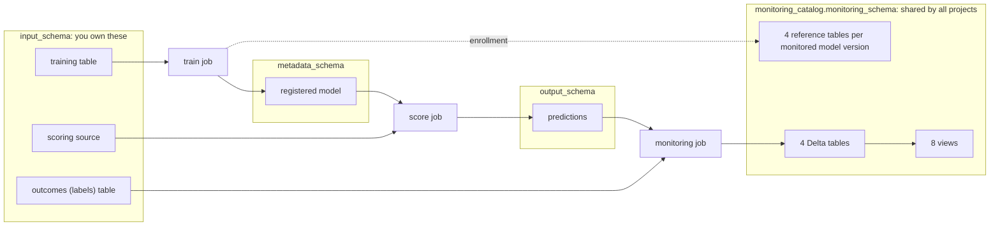

# Tables and objects in your workspace

## When you need it

Read this page when you open a project's schema after the first runs and want to
know what each table is, who created it, whether you need it, and what grows over
time. A Bundle project touches four kinds of objects: your data, its predictions,
its registered models and the shared monitoring store. Skyulf never creates your
data tables; the jobs create everything else when they first need it.

The four locations come from `deployment/variables.yml`: `input_schema`,
`output_schema` and `metadata_schema` for the project, and `monitoring_catalog`
plus `monitoring_schema` for the monitoring store. They may all be the same
schema, but separating them keeps each schema readable (see
[recommended layout](#recommended-layout)).

## Your data: `input_schema`

| Table | Created by | Purpose |
| --- | --- | --- |
| Training table (`training_table` in `config/training.yml`) | You | Rows the model learns from. Training pins a Delta version of it. |
| Scoring source (`config/inference.yml`) | You | Rows to predict. It needs no target; Change Data Feed lets the score job read only new inserts. |
| Outcomes table (`monitoring_label_table` in `deployment/targets.yml`) | You | Actual values that arrive later, keyed by the same record key, with the time each value became known. Optional: without it, monitoring measures drift but not performance. |

These may be one table or several; see
[Choose a table layout](databricks_training_data.md#choose-a-table-layout).
The prepared examples create them with their own loaders (`load_nyctaxi.sql`,
`real_data/load_data.py`); a normal project uses tables you already have.

## Predictions: `output_schema`

| Table | Created by | Purpose |
| --- | --- | --- |
| Prediction table (`prediction_table` in `config/inference.yml`) | Score job, on its first run | One row per scored source row: record key, `prediction`, probabilities for classifiers, model name, version and run, and, when the model can exclude rows, `scoring_status` and `exclusion_reason`. Extra output columns from scoring rules (for example `no2_band`) are added here. |
| `<prediction_table>_v<version>` plus a view under the logical name | Score job with `model_change_mode: full_rebuild` | One physical table per model version; the view always points at the current generation. Older generations remain until you remove them. |

The default `incremental_append` mode keeps one table and appends new
predictions. See [Scoring](databricks_scoring.md).

## Feature tables (optional)

Projects that use `config/features.yml` and `src/features/groups/` also run a
`features` job. It writes one output table per feature group and the merged
feature table that training and lookup read. Online serving can add an online
copy of a feature table. See [Feature tables](databricks_features.md) and
[online features](databricks_online_features.md). Projects without feature
groups, such as the `real_data` examples, have none of these.

## Models: `metadata_schema`

The train job registers the model as a Unity Catalog **registered model**
(`model_name` in `config/training.yml`), for example
`air_quality_no2_model`. It appears in the schema's model list, not as a table.
Each training run adds a version; the `champion` alias marks the version that
scoring uses. The MLflow experiment, with runs, metrics, SHAP and chart artifacts,
lives in the workspace path from `experiment_name`, not in a schema.

## The shared monitoring store

The first monitoring enrollment creates the store in
`monitoring_catalog.monitoring_schema`. **One store serves every project and
model** that uses the same catalog and schema; later projects reuse it instead of
creating their own. See [Store setup](databricks_monitoring_setup.md) for
permissions and upgrades.

### Four Delta tables (they hold data)

| Table | What it holds |
| --- | --- |
| `model_inventory` | One row per monitored model in each environment and project: which model and version, which tables, and its monitoring settings. Enrollment writes it. |
| `monitoring_results` | One immutable row per monitoring observation: the full report with drift, quality and performance evidence. The monitoring job only appends. |
| `performance_actions` | For each performance-policy result, whether a retraining request was made or skipped and why, recorded without rewriting the observation. |
| `retraining_requests` | Every retraining request and its submission receipt, and the shared cooldown gate per train job, so two triggers cannot start training twice. |

### Eight views (no data of their own)

They read the Delta tables above and exist for the dashboard and your own
queries.

| View | Answers |
| --- | --- |
| `current_health` | What is the latest state of each monitored model? |
| `monitoring_issues` | Which quality, drift or performance-policy issues are open now? |
| `metric_history` | Every recorded metric as one row (column, metric, value, threshold, issue). The easiest place to query drift and performance values. |
| `performance_history` | Performance results together with the action taken for each. |
| `complete_observations` | Full observations, excluding the small late-label-only reports a policy writes. |
| `monitoring_identities` | Every model, version and context ever monitored, including earlier ones. |
| `model_version_details` | Lineage and saved metadata of each concrete model version, including its training summary. |
| `serving_windows` | Serving-endpoint observation windows used by the dashboard's serving charts. |

### Four reference tables per monitored model version

Drift and retraining checks compare new data with what the model was trained on.
Rereading the training table on every run would be slow and could see changed
data, so enrollment copies the needed populations once into four immutable
tables named `monitor_ref_<identity>_<part>`. The identity is a hash of the
monitored model, its version and its verified training evidence.

| Part | What it holds | Used for |
| --- | --- | --- |
| `_train` | The training split's inputs and target. | The reference distribution for drift. |
| `_seen` | The rows the model already learned from (the training split for a temporal split; training plus holdout otherwise). | Counting genuinely new labelled rows before automatic retraining. |
| `_source` | The training source snapshot at the pinned Delta version. | Reconstructing the historical population when retraining compares weights. |
| `_receipt` | One JSON record: the evidence these tables belong to, their table identities, the source table identity and the holdout metric values. | Verifying the tables before use, and the `training_holdout` baseline of performance policies. |

A model version keeps its four tables for as long as it is monitored. **A new
model version gets four new tables**; nothing removes the previous ones
automatically. They hold copies of training rows, so their size follows your
training data (bounded by `max_rows`).

## Recommended layout

Give every project the same monitoring schema reserved for the store (for
example `workspace.skyulf_monitoring`), and keep each project's data, predictions
and models in the project's own schemas. A project schema then holds only its own
tables, and all monitoring objects sit in one place:

| Schema | Typical contents |
| --- | --- |
| Project schema(s) | Training table, scoring source, outcomes table, prediction table, registered model |
| `skyulf_monitoring` | The 4 Delta tables, the 8 views and 4 reference tables per monitored version, for all projects |

The `air_quality_no2` example uses this shared layout. A fresh installation has
four project tables: `observations_train`, `observations_score`, `labels` and
`predictions`. The store's four tables, eight views and per-version references
are in `workspace.skyulf_monitoring`. The other two `real_data` examples keep
their independent stores in their project schemas.

The [single-table air-quality walkthrough](https://github.com/flyingriverhorse/Skyulf/blob/master/skyulf-core/templates/databricks/examples/real_data/air_quality_single_table.md)
uses three project tables: `observations` for both training and scoring,
`labels` for outcomes, and `predictions`. Daily input inserts do not update old
rows. It uses the same shared monitoring schema.

Changing `monitoring_schema` redirects future enrollment and observations; it
does not move or delete an existing store. Redeploy, enroll the existing concrete
model in the destination, and prepare its Spark references before observing.
Verify the destination report before retiring old objects. For example, an
older air-quality installation may still contain its original 20 objects until
its 16 monitoring objects are separately reviewed and removed. Historical reports
stay in that old store; they are not automatically copied to the new one.

## What grows, and how to clean up

| Object | Grows with | Clean up |
| --- | --- | --- |
| Prediction table | New source inserts | Your retention policy; Skyulf does not delete predictions. |
| `monitoring_results`, `performance_actions`, `retraining_requests` | Monitoring runs and decisions | Keep for audit; they are append-only by design. |
| Reference tables | New monitored model versions (4 each) | Remove the tables of versions you no longer monitor, as described in [Remove a project](databricks_teardown.md). |
| `_v<version>` prediction generations | New versions in `full_rebuild` mode | Drop old generations once consumers use the new view. |

Views never need cleanup. Do not drop or recreate the store's tables while any
project still monitors into them; other projects share them.
