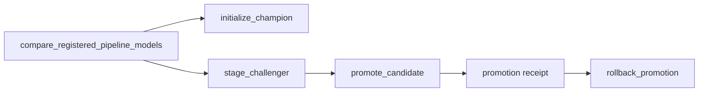

# Register, compare and select model versions

This walkthrough registers two real fitted models, evaluates both on the same
holdout, initializes a first champion, stages a challenger, promotes it and
rolls back using the verified promotion receipt. It uses a local SQLite registry;
[Unity Catalog admission](#stage-promote-and-roll-back-a-local-pipeline) needs
a shared authority and platform permissions.

Registration creates a version. It does not deploy an endpoint, score a table
or move an alias. Resolve an alias once at the start of a scoring job so a later
alias change cannot change that job's selected version.

## Prerequisites

Use Python 3.12+, `uv pip install "skyulf-core[mlflow]"`, and a fresh writable
working directory. Pin the published release and resolved dependencies used by
your jobs. The full guarded lifecycle and recovery contracts in this guide
require their matching release/build; when validating unreleased changes,
install the matching checkout or exact development wheel in every participating
job. A development package version does not prove publication of those changes.

Only load trusted model artifacts. Their pickle payload can execute code;
checksums prove content identity, not producer trust.

## Create two versions and compare them

Run these blocks in order in one Python session. The first block supplies all
model, run, source and holdout variables. The baseline is deliberately weak; the
candidate learns `target = 2*x`. The four held-out rows never participate in fitting.

<!-- skyulf-example: native registry -->
```python
from dataclasses import asdict
from pathlib import Path
import json

import pandas as pd
from mlflow import MlflowClient

from skyulf.data.dataset import SplitDataset
from skyulf.inference.fitted_pipeline import save_pipeline
from skyulf.integrations.mlflow import TrackingConfig, track_run
from skyulf.integrations.mlflow.models.pipeline_model import log_pipeline_model
from skyulf.integrations.mlflow.registration.registry import (
    register_model, resolve_model, load_registered_pipeline,
)
from skyulf.integrations.mlflow.lifecycle.validation import compare_registered_pipeline_models
from skyulf.integrations.mlflow.lifecycle.promotion import (
    AliasConflictError, LocalAliasAdmission, initialize_champion, stage_challenger,
    promote_candidate, rollback_promotion,
)
from skyulf.pipeline import SkyulfPipeline

tracking_uri = "sqlite:///" + (Path.cwd() / "registry-demo.db").as_posix()
registry_uri = tracking_uri
model_name = "revenue_demo"  # choose a new name if repeating the walkthrough
endpoints = {"tracking_uri": tracking_uri, "registry_uri": registry_uri}
config = TrackingConfig(
    enabled=True, tracking_uri=tracking_uri, experiment_name="registry-demo",
)
frame = pd.DataFrame({
    "x": [1., 2., 3., 4., 5., 6., 7., 8., 9., 10.],
    "target": [2., 4., 6., 8., 10., 12., 14., 16., 18., 20.],
})
training, heldout = frame.iloc[:6].copy(), frame.iloc[6:].copy()
references = []
for label, estimator in [
    ("baseline", {"type": "decision_tree_regressor",
                  "params": {"max_depth": 1, "random_state": 42}}),
    ("candidate", {"type": "linear_regression"}),
]:
    pipeline = SkyulfPipeline({"preprocessing": [], "modeling": estimator})
    pipeline.fit(SplitDataset(train=training, test=heldout), target_column="target")
    path = Path("artifacts") / label
    save_pipeline(pipeline, path)
    with track_run(config, run_name=label) as run:
        uri = log_pipeline_model(
            path, run_id=run.run_id, artifact_path="model", tracking_uri=tracking_uri,
        )
    created = register_model(uri, model_name, **endpoints)
    references.append(resolve_model(model_name, version=created.version, **endpoints))
baseline, candidate = references
assert baseline.version != candidate.version
print(baseline.model_uri, candidate.model_uri)

policy = dict(
    target_column="target", dataset_id="synthetic-v1/holdout-rows-7-10",
    metric="heldout_rmse", min_improvement=0.1, quality_threshold=20.0,
    max_rows=100, max_bytes=1_000_000, **endpoints,
)
bootstrap = compare_registered_pipeline_models(baseline, None, heldout, **policy)
report = compare_registered_pipeline_models(candidate, baseline, heldout, **policy)
assert report.eligible
failed_gate = compare_registered_pipeline_models(
    baseline, candidate, heldout, **{**policy, "quality_threshold": 1.0},
)
assert not failed_gate.eligible and failed_gate.reason == "quality_gate_failed"
print(report.reason, report.candidate_metrics, report.champion_metrics)
Path("comparison.json").write_text(json.dumps(asdict(report), indent=2), encoding="utf-8")
```

Expect versions `1` and `2` for a new registered name. The candidate RMSE is
close to zero and the baseline RMSE is larger. Actual versions come from the
returned references; never assume numeric literals in a production job.
`dataset_id` describes caller-pinned rows; it does not independently verify a
Delta snapshot or reconstruct the split.

## Initialize, stage, promote and roll back

No champion exists in a fresh model. Initialization requires a fresh evaluation
and an absolute `quality_threshold`; a comparison without a champion is not
eligible for ordinary promotion. All alias changes use one admission authority.



`initialize_champion` applies only when no champion exists. Staging, promotion
and rollback each re-check the registry state they expect.

<!-- skyulf-example: native registry -->
```python
admission = LocalAliasAdmission(Path("alias-locks"))
mutation = dict(
    target_column="target", admission=admission,
    max_rows=100, max_bytes=1_000_000, **endpoints,
)
initial = initialize_champion(bootstrap, heldout, **mutation)
staging = stage_challenger(
    report, heldout, expected_champion_version=baseline.version, **mutation,
)
receipt = promote_candidate(
    report, heldout, expected_champion_version=baseline.version, **mutation,
)
Path("promotion-receipt.json").write_text(
    json.dumps(asdict(receipt), indent=2), encoding="utf-8",
)
assert resolve_model(model_name, alias="champion", **endpoints).version == candidate.version
# The original comparison's expected champion is now stale.
try:
    promote_candidate(
        report, heldout, expected_champion_version=baseline.version, **mutation,
    )
except AliasConflictError:
    pass
else:
    raise AssertionError("A stale champion must block promotion")
reversal = rollback_promotion(
    receipt, expected_current_version=candidate.version,
    admission=admission, **endpoints,
)
assert resolve_model(model_name, alias="champion", **endpoints).version == baseline.version
print(asdict(receipt), asdict(reversal))
```

For a new name, alias assignments change as follows:

| After operation | champion | challenger | previous_champion |
| --- | --- | --- | --- |
| Registration/comparison | absent | absent | absent |
| Initialize baseline | baseline (`1`) | absent | absent |
| Stage candidate | baseline (`1`) | candidate (`2`) | absent |
| Promote candidate | candidate (`2`) | absent | baseline (`1`) |
| Roll back this receipt | baseline (`1`) | absent | absent |

`previous_challenger` is separate contender history. In this walkthrough there
is no displaced contender, so it stays absent. Keep the returned receipts and
comparison evidence; a prepared event alone is not proof of a completed move.
Rollback restores the matching prior champion and rollback pointer, not endpoint
traffic or prediction tables.

Start `mlflow ui --backend-store-uri sqlite:///registry-demo.db`. Open
**Models > revenue_demo** to inspect both versions and aliases. Follow each
version's source run to **Artifacts > model**. Inspect version tags for validation
status, event IDs and committed lifecycle evidence. `comparison.json` and
`promotion-receipt.json` above are caller-owned local files, not automatically
uploaded run artifacts.

## Pin and load the selected model

Continue the session to pin the rolled-back champion and load its exact fitted
artifact. For a portable package logged with `log_model`, use
`load_registered_bundle` instead.

<!-- skyulf-example: native registry -->
```python
from skyulf.inference.fitted_pipeline import predict_pipeline

selected = resolve_model(model_name, alias="champion", **endpoints)
artifact = load_registered_pipeline(selected, **endpoints)
predictions = predict_pipeline(pd.DataFrame({"x": [11., 12.]}), artifact)
assert selected.model_uri == f"models:/{model_name}/{selected.version}"
print(selected.version, selected.digest, predictions)
```

Select exactly one of `alias` and `version`. Resolution reads the package metadata;
the loader verifies the selected artifact's kind, scope, engine and digest. A later
alias move does not redirect `selected`. Resolution/loading does not predict or
move aliases; the explicit prediction call above does.

## Choose gates and handle failures

| Option or failure | Meaning and action |
| --- | --- |
| `min_improvement` | Required absolute difference on the chosen metric. A tie never passes, even at zero. |
| `quality_threshold` | Maximum for error/loss, minimum for score metrics. Required for first-champion initialization. |
| `quality_gates` | Optional additional absolute metric bounds; every gate must pass, including for the first champion. |
| `report.eligible=False` | Inspect `reason` and measured metrics. A rejected comparison may be staged for inspection; promotion refuses it. |
| Stale champion/challenger | Re-resolve roles, review the competing change, recompare the same intended holdout and submit an explicitly reviewed expectation. |
| Holdout/config changed | Build fresh evidence; lifecycle functions recompute and reject a changed comparison. |
| `RegistryModelNotFoundError` | Check the exact name/version and retention. Do not silently fall back to another model. |
| `RegistryAccessError` | Configure the job identity's operation-specific permissions. |
| `AliasOutcomeUnknownError` | Stop alias writers and use the reconciliation procedure below; an alias call may already have succeeded. |

Regression includes MAE, MSE, RMSE, R2, MAPE and explained variance.
Classification includes hard-label scores and probability metrics when defined
for the labels and saved class order. Some optional metrics can be absent.
Error metrics minimize; other supported scores maximize. Missing/nonfinite
required gate metrics fail the gate. Evaluation uses saved preprocessing and
threshold decisions, is unweighted, and needs true labels. Unlabeled production
predictions cannot establish supervised quality.

For Unity Catalog use `catalog.schema.model`, `tracking_uri="databricks"` and
`registry_uri="databricks-uc"`. The job needs catalog/schema use privileges and
operation-specific model privileges, including `EXECUTE` to load a model;
publication and alias mutation also need their corresponding write authority.
Registry access does not grant source/target table permissions. Use the shared
admission and recovery contracts below before production lifecycle automation.

## Stage, promote, and roll back a local pipeline

After a comparison, stage_challenger re-evaluates the same pinned
holdout and assigns the concrete candidate version to `@challenger`, even
when it fails the promotion gate. It records validation status and reason and does
not move `@champion`. A replacement challenger requires an explicit
`expected_challenger_version`; staging cannot silently overwrite another
candidate. Merely registering or comparing a model never assigns an alias.

An orchestrator can explicitly create `ChallengerLifecycle` from
`skyulf.integrations.mlflow.lifecycle.challenger` and pass its `registered` method as
`train_candidate(..., on_registered=...)`. This nominates a registered
contender before comparison, with `validation_status=pending`. After evaluation,
`stage_challenger` records `passed` or `rejected`; `lifecycle.failed()` records
`error` for a still-pending comparison without overwriting a completed result.
The caller must use the same serialized alias writer for all these operations.
An uncertain registry write keeps its pending receipt and requires reconciliation.

The promote_candidate function re-resolves both concrete model versions and
re-evaluates the same bounded labeled holdout. It rejects a changed comparison
report, an ineligible candidate, a missing champion alias, a stale expected
champion version, or a challenger alias without a matching committed staging
event. The caller must pin the holdout's source snapshot externally;
dataset_id alone is not proof of the underlying data. There is no implicit
first-champion initialization.

Alias writes have no expected-prior-version parameter. Every alias writer
must use the same non-expiring admission authority, and registry write
permissions must be restricted to that controlled path. A local development
store can use LocalAliasAdmission with a shared lock directory:

The complete local example above uses this provider. All local writers must
share its lock directory.


For Unity Catalog, use DeltaAliasAdmission(spark, control_table) with a
separate, preprovisioned Delta control table containing exactly one row:
target_id = alias_resource_id(model_name, "champion") and nullable owner = NULL.
Provision it once with a plain CREATE TABLE statement so an existing authority
cannot be overwritten:

~~~python
from skyulf.integrations.mlflow.lifecycle.promotion import DeltaAliasAdmission, alias_resource_id

key = alias_resource_id("catalog.schema.customer_risk", "champion")
spark.sql(
    "CREATE TABLE catalog.schema.customer_risk_alias_admission USING DELTA AS "
    f"SELECT '{key}' AS target_id, CAST(NULL AS STRING) AS owner"
)
admission = DeltaAliasAdmission(
    spark, "catalog.schema.customer_risk_alias_admission"
)
~~~

All participating staging, promotion and rollback jobs must point to that same table.
Do not use the predictions-table admission row for aliases. Local file locks
are rejected when the registry URI is databricks-uc.

Staging writes a prepared model-version tag, assigns `@challenger`, verifies
the alias, and commits a staging event. Promotion assigns
`@previous_champion` to the old champion, moves `@champion` to the
challenger, then removes `@challenger`. The returned receipt records the
concrete model versions, event ID, and the previous value of
`@previous_champion`. Rollback verifies the committed promotion event,
restores `@champion` and the previous rollback pointer, and does not
reinstate the rolled-back model as challenger. A prior release's single-alias
promotion receipt remains reversible. A separate challenger with a verified
committed lifecycle event survives rollback unchanged. An unverified alias,
or one pointing at the champion or rollback destination, still blocks rollback.

If the older version recorded as `previous_champion_version` was deleted,
rollback still restores the prior champion and clears `@previous_champion`;
the reversal receipt and committed event record a null previous pointer.
Permission errors, other registry failures, unreadable metadata on an existing
version, or a missing prior champion still prevent the change. A repeat accepts
the cleared pointer only while its committed event and absent alias still agree.

MLflow performs these alias changes as separate calls, not one atomic
transaction. If a later call fails after an earlier alias moved, the operation
reports an unknown outcome; inspect all three aliases and the prepared event
before retrying. `@previous_champion` identifies only the latest rollback
pointer, not the full history. Concrete versions and promotion/rollback event
tags retain that history; predictions should record the resolved model version.
Rollback refuses a later promotion, even if it selects the same version.
An unchanged repeat of a completed rollback returns its original reversal
receipt without another alias mutation. The active receipt, previous-champion
pointer and any retained challenger must still be consistent.
AliasOutcomeUnknownError includes the event ID for inspection. A prepared tag
is not proof that promotion completed. Registry tags are audit records for
controlled writers, not tamper-proof authorization tokens.
The event tag key uses underscores, and its compact value stays within Unity
Catalog's 256-byte tag-value limit.

New `promotion_<event_id>` tags include `at`, a UTC timestamp such as
`20261012T182556Z` (12 October 2026, 18:25:56 UTC). It records the writer's clock
immediately before saving the tag's current `state`: `prepared`, `committed` or
`aborted`. A final state replaces the preparation time; an unchanged replay keeps
the saved time. This is not a server commit timestamp or a separate history of
every phase. Space for the final state is checked before alias changes begin.

Read `at` from the raw model-version tag; `read_event` validates it and returns
only the control fields used to verify receipts. A tag without `at` is also
valid. The returned `AliasChangeReceipt` has no timestamp field.
Actor identity is not inferred from the machine or notebook user; use the platform
audit log to establish who performed a change.

Every job that reads or writes lifecycle tags for one registered model must use the same Skyulf Core
version. See [project upgrades](databricks_project_upgrade.md#lifecycle-tags-and-alias-recovery)
before changing that version.

`skyulf.integrations.mlflow.lifecycle.rejection.reject_candidate(report, reason=...,
expected_champion_version=..., admission=..., tracking_uri=..., registry_uri=...)`
records an explicit operator decision against the exact staged comparison.
It leaves aliases and evaluation metrics/status unchanged, adding
`approval_status=rejected` and `approval_reason` to the candidate version.
It requires no training rows and accepts a failed quality comparison too.
The same unchanged request reuses its committed receipt; a changed reason,
proof, champion, challenger or pending event is refused. Promotion, initialization,
staging and nomination do not implicitly override rejection. A partial metadata
write reports an unknown outcome and keeps the pending event for inspection.
The local workflow wrapper additionally verifies controlled champion state and
requires an explicit manual policy; the low-level registry API retains its
existing legacy-champion compatibility.

`previous_challenger` retains the last contender displaced by nomination or
direct staging. Repeating a nomination does not rotate it. Promotion and
rollback preserve a separate historical contender; if that version becomes
champion or challenger, the conflicting history alias is cleared. Neither
clearing nor replacing the pointer deletes model versions or event records.
This is recent contender history, not an automatic model selection rule.

History intent is stored in a separate `challenger_history_<event_id>`
model-version tag with readable `from_version`, `to_version` and `state`
fields, each value bounded to 256 UTF-8 bytes. These versions describe the
history pointer's change. The registered-model marker
`previous_challenger_current_event` identifies the event's owning version,
which may differ from the historical version. Existing promotion receipt
formats remain unchanged. A cleared pointer retains its event marker, so
an incompatible manual alias addition is detected. Pending writes, malformed
history evidence and alias disagreement fail rather than silently replacing
that history. All mutations use the same lifecycle admission.

The lock protects only participating jobs. A principal with direct registry
write permission can bypass it. A crashed Delta admission owner does not
expire; clear it only after proving the original job cannot publish.

### Recover an interrupted alias operation

An `AliasOutcomeUnknownError` means a registry call may have succeeded before
its response was lost. Do not rerun training or delete `pending_alias_event`
to bypass it. First stop all jobs and manual actions that can write this
model's aliases. Confirm the original run has terminated and cannot retry.

New lifecycle operations save their full recovery intent before publishing
the pending marker. Use the pending event ID and its destination model
version from the failed operation's logs and `promotion_<event_id>` tag:

<!-- skyulf-example: illustrative receipt-reconciliation -->
```python
from skyulf.integrations.mlflow.lifecycle.promotion import (
    reconcile_alias_change,
)

outcome = reconcile_alias_change(
    "catalog.schema.customer_risk",
    version="7",                     # destination of the interrupted operation
    event_id="event_id_from_pending_alias_event",
    admission=admission,              # the same authority used by all writers
    tracking_uri="databricks",
    registry_uri="databricks-uc",
)
print(outcome)  # "committed" or "aborted"
```

The function acquires shared admission and reads all four roles: `champion`,
`challenger`, `previous_champion` and `previous_challenger`. It never sets or
deletes an alias.

| Observed state | Result |
| --- | --- |
| All changed roles match their saved targets; metadata is unchanged or partly completed as planned | Complete and verify the metadata, then clear this operation's pending marker. Return `committed`. |
| All roles and operation-owned metadata still match their saved starting values | Mark the event `aborted`, verify it, then clear its pending marker. No model is promoted. Retry the original business operation with fresh checks if still wanted. |
| Some roles changed, a guarded role changed unexpectedly, or metadata contradicts the plan | Raise `AliasConflictError` with observed roles and expected before/after values. Keep the pending marker. |
| The same repair already completed and its terminal state is still current | Return the same outcome without writing tags or changing the event timestamp. |

Rejection, evaluation-error recording and same-version restaging may change
only metadata. Unchanged aliases alone cannot prove these operations finished.
They abort if their metadata is untouched; an already committed event can
finish its remaining markers. Partly applied metadata without a committed
event requires manual inspection.

Recovery storage uses `alias_intent` and numbered `alias_intent_0000` slots on the destination
version. A manifest verifies the complete snapshot's digest; each ASCII chunk is at most 256 bytes.
The next operation on that version reuses these slots only after the pending guard is clear. Compact
event tags remain available, but a superseded recovery snapshot cannot repair an older event. The
writer reserves room for intent, final status and event tags before preparation and rejects
operations exceeding the 50-tag model or model-version budget. This follows the
[Unity Catalog tag limits](https://docs.databricks.com/aws/en/machine-learning/manage-model-lifecycle/migrate-to-uc#tags).
Existing receipts can eventually exhaust that budget; archive reviewed audit evidence before
deliberately retiring obsolete tags. Never remove current control receipts or pending recovery
evidence to make room.

Each chunk is framed as `|...|` and the manifest records `"encoding":"json-framed-v1"`. Run
`reconcile_alias_change` with a Core release that reads framed intents, such as the writers'
release. An older Core reader raises `Alias intent digest differs from its stored chunks` for a
framed manifest. That error means a version mismatch, not corrupted evidence; install the matching
Core and retry before considering manual recovery.

For a partial or historical operation without complete recovery intent:

1. Keep writers stopped. Export the registered-model tags, the destination
   version's tags, all four alias assignments and the original operation's
   inputs/logs. A comparison hash does not reconstruct a rejection reason or
   missing quality-gate metadata.
2. If Delta admission has a crashed owner, confirm that exact owner belongs
   to the terminated run. Under exclusive operator control, release only its
   row, using both `target_id = alias_resource_id(model_name)` and the observed
   owner in the update condition. Read the row back. Do not clear another
   owner's claim or introduce a time-based expiry.
3. Compare every role and marker with the saved intent. Decide explicitly
   whether to complete the intended operation or restore the starting state.
   Make any necessary alias corrections under the same admission. Do not
   invoke reconciliation while holding a second, non-reentrant claim.
4. For a complete saved intent, release the manual claim with writers still
   stopped and call `reconcile_alias_change`. It verifies the whole resulting
   state. A failed call leaves recovery unresolved; do not bypass its guard.
5. For an older event without a snapshot, automatic recovery is unavailable.
   Restore aliases **and** status/history/active markers from verified original
   evidence. Verify a consistent terminal event and control markers before
   clearing only the matching pending event. If the evidence cannot establish
   those values, keep the model blocked and recover from an audited registry
   snapshot with the platform owner.
6. Read the controlled champion again, then resume the appropriate failed
   job. Alias repair does not roll back predictions, serving traffic or tables.

Only load trusted registry artifacts: bundle loading deserializes pickle, and
digest matching is an identity check, not authentication of an unknown producer.
Missing bundle metadata/artifacts or mismatched digests fail explicitly. A later
alias move does not redirect the pinned reference.

Registry resolution/loading does not predict, mutate aliases, start Spark or
write a table. Use the [Databricks Bundle](databricks_bundle.md) for generated jobs
and the [batch publication guide](databricks_batch.md) for the Delta sink contract.
