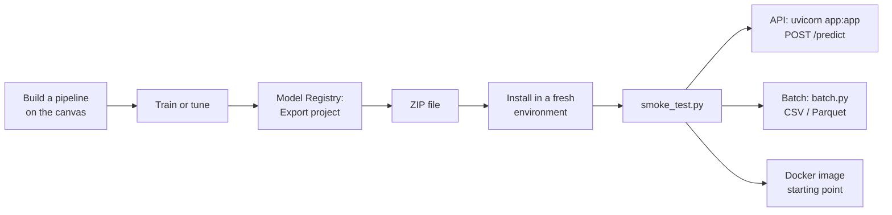
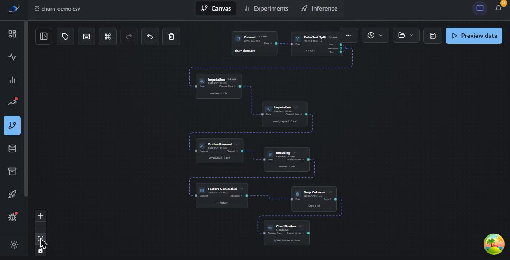
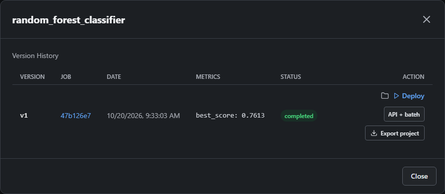
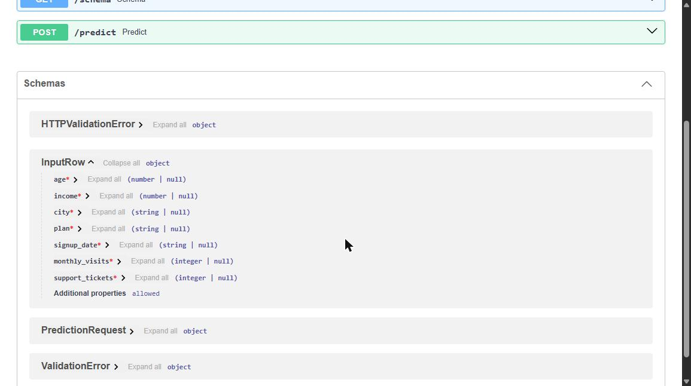
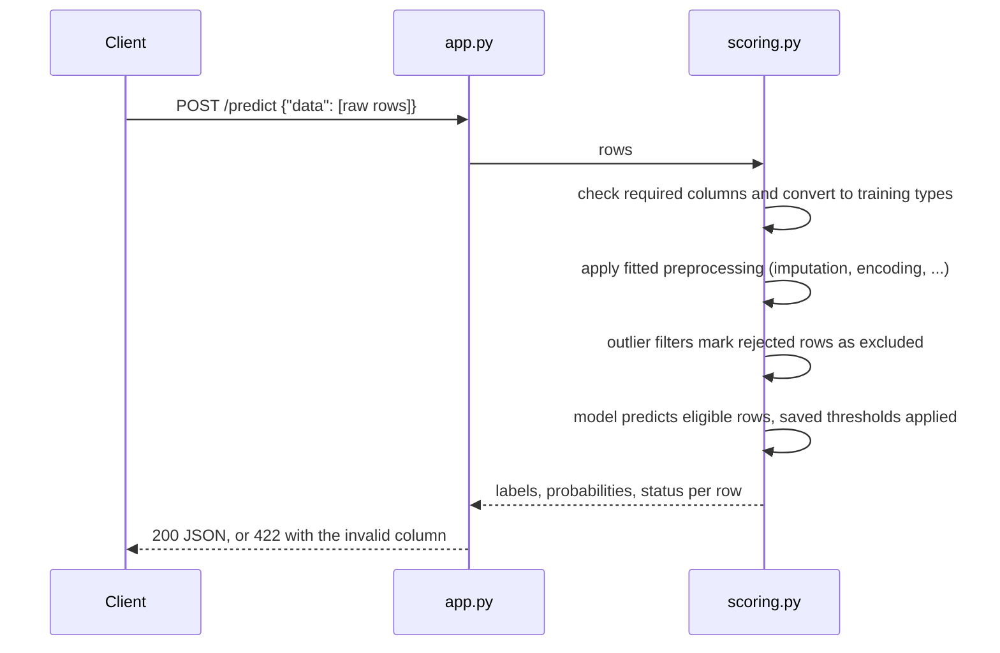

# Project export quickstart

Turn a model you trained in Kayra into a small Python project that runs anywhere:
an HTTP API, a batch scoring command for CSV/Parquet files, or both. The project
does not need the Kayra server, a database or Databricks.

This page walks through the whole flow once. The
[project export reference](model_project_export.md) covers every option in detail.

## How it works



The ZIP freezes the fitted model and its fitted preprocessing. Retraining or
changing thresholds in Kayra later does not change a project you already
downloaded; export again to pick up a new version.

## 1. Build and train a pipeline

Supported canvas pipelines use preprocessing that works row by row. For
example: imputation, outlier handling, one-hot encoding, date features, column
drops, scaling and a classifier or regressor, trained in Basic or Advanced
(tuning) mode. See [What it does not do](#what-it-does-not-do) for restrictions,
including steps that require custom project code.



## 2. Export from the Model Registry

1. Open **Model Registry** and click **View Versions** for your model.
2. Pick the format: **API + batch**, **API only** or **Batch only**.
3. Click **Export project**.



Your browser may ask where to save the ZIP. If the model cannot be exported (see
[What it does not do](#what-it-does-not-do)), the reason appears under the button
instead.

## 3. What is in the ZIP

```text
kayra_model_<job-id>.zip
├── model.pkl              fitted model + preprocessing (checksum in manifest.json)
├── scoring.py             shared prediction code used by API and batch
├── app.py                 FastAPI service (API modes)
├── batch.py               CSV/Parquet scoring command (batch modes)
├── schema.json            raw input columns and their training types
├── manifest.json          job id, version, Python version, pins, checksums
├── requirements.txt       exact package versions
├── wheels/                the matching skyulf-core wheel
├── example_request.json   request shape with placeholder values
├── smoke_test.py          load check, optional test request
├── Dockerfile             container starting point
└── README.md              commands for this export mode
```

## 4. Install and check

Use the Python version recorded in `manifest.json`, in a new environment:

```sh
uv venv
uv pip install -r requirements.txt
uv run --no-project python smoke_test.py
```

`requirements.txt` installs skyulf-core from the bundled `wheels/` folder, so it
works even when that exact Core version is not on PyPI. Keep `wheels/` next to
`requirements.txt`.

## 5. Serve the API

```sh
uv run --no-project uvicorn app:app --host 127.0.0.1 --port 8000
```

Open `http://127.0.0.1:8000/docs`. Swagger lists your model's real input columns
with their types:



What happens on each `/predict` call:



Send raw columns, exactly as in your training data, before encoding or scaling:

```sh
curl -X POST http://127.0.0.1:8000/predict \
  -H "Content-Type: application/json" \
  --data-binary @example_request.json
```

Classifiers return a label for each eligible row and, when the model supports
them, class probabilities. Excluded rows have null predictions and probabilities:

```json
{
  "predictions": ["yes"],
  "probabilities": [{"no": 0.26, "yes": 0.74}],
  "model_version": "the-exported-training-job-id",
  "thresholds_applied": null
}
```

Replace the placeholder values in `example_request.json` before using it; they
only show the request structure.

## 6. Score files in batch

```sh
uv run --no-project python batch.py --input customers.parquet --output scored.parquet
```

The output keeps every input row and column in the original order and adds
`prediction`, plus `prediction_proba_<class>` columns for classifiers that support
probabilities. Large files
are processed in chunks (`--chunk-size`, default 10,000 rows). The output file is
only replaced when the whole run succeeds.

### Running it on a schedule

The project has no scheduler. Run the batch command from the one you already
use, for example a nightly cron entry:

```sh
0 2 * * * cd /opt/churn-model && .venv/bin/python batch.py --input /data/today.parquet --output /data/scored/today.parquet
```

In Airflow use a `BashOperator` with the same command; on Databricks, run it as a
Python script task with the project files uploaded to the workspace.

## Rows removed by outlier filters

If the pipeline contains an outlier filter that removes rows (IQR, Z-Score,
Elliptic Envelope, Isolation Forest, Local Outlier Factor, Manual Bounds) or a
Box-Cox Power Transformer, the project applies the same fitted filter to new
data. A rejected row is never dropped. It stays in place without a prediction:

```json
{
  "predictions": ["no", null, "yes"],
  "scoring_status": ["predicted", "excluded", "predicted"],
  "exclusion_reason": [null, "outlier:IQR", null]
}
```

The reason names the filter that rejected the row (`outlier:<filter>` or, for a
Box-Cox transformer that cannot handle a value, `invalid:PowerTransformer`).

Batch output gets the same `scoring_status` and `exclusion_reason` columns. These
fields only appear for pipelines that contain such a filter. Winsorize and Clip
to Fixed Bounds cap values instead and never exclude rows.

## What it does and does not do

### What it does

| Included | Details |
| --- | --- |
| HTTP API | `/predict`, `/health`, `/schema`, `/docs` with typed inputs |
| Batch scoring | CSV and Parquet, chunked, order-preserving, atomic output |
| Probabilities | per class, for classifiers that support them |
| Input checks | required columns, conversion to training types, clear 422 errors |
| Saved thresholds | tuned thresholds enabled at export time are applied |
| Outlier exclusions | rejected rows kept with `scoring_status` and a reason |
| Portable install | bundled skyulf-core wheel, pinned dependencies, Dockerfile |

### What it does not do

| Not included | Use instead |
| --- | --- |
| Scheduling | cron, Airflow, Databricks jobs (see above) |
| Drift and performance monitoring | Kayra's Data Drift pages or the Databricks template |
| Retraining | retrain in Kayra and export the new version |
| Authentication | put the API behind your own authenticated gateway |
| Reading from databases | load your data to CSV/Parquet or call the API |

The export button refuses pipelines it cannot reproduce exactly outside Kayra.
Use the canvas's notebook export for these:

- lag, rolling-window and other history-dependent time-series features
- project code nodes (`ColumnFunction`, `FittedFunction`, `RowFilterFunction`)
- `sentence_embedder` text embeddings
- unsupervised models and model sets
- older models trained before raw input schemas were recorded (retrain once)

The Dockerfile is a starting point: build and validate the image on your own
platform before deploying it.

## Troubleshooting

| Symptom | Cause and fix |
| --- | --- |
| Error under **Export project** | The pipeline contains a step from the list above; the message names it. |
| `uv pip install` cannot find `skyulf-core` | `wheels/` was not kept next to `requirements.txt`. |
| `Model checksum mismatch` | `model.pkl` changed after export; download the ZIP again. |
| API returns 422 | A required column is missing or a value does not match its training type; the message names the column. |
| Some rows have no prediction | They were rejected by an outlier filter; check `exclusion_reason`. |

Only load projects from people you trust: `model.pkl` is a pickle file and can
run code when loaded. The fitted model can also contain learned values from your
training data, so treat the ZIP as a sensitive artifact.
