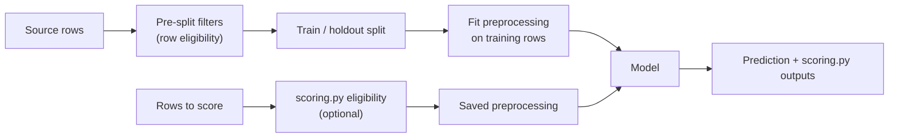
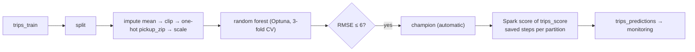
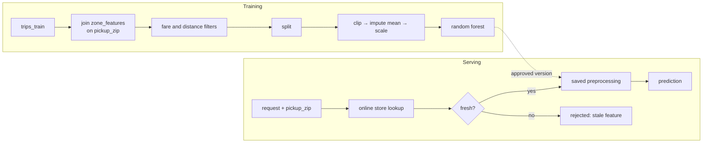
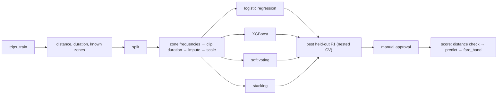
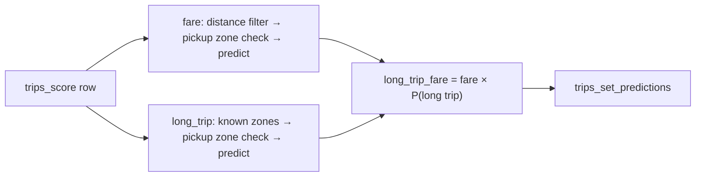

# How the examples prepare features

Every project splits feature work into three places, each with one job:

| Place | Runs | Learns from data | Used at prediction time |
|---|---|---|---|
| `config/pre_split.yml` (+ `src/features/pre_split.py`) | Before the train/holdout split | Never | Only if `scoring.py` reuses it |
| `config/preprocessing.yml` (+ `src/features/preprocessing.py`) | After the split, fitted on training rows | Yes; state is saved with the model | Always, replayed from the saved state |
| `src/features/scoring.py` | When scoring | No | Batch scoring only; Spark scoring and serving endpoints accept no rules |

Custom steps are plain functions wrapped by a factory: `filter_step` for row
filters, `column_step` for a new column with nothing to learn, and `fitted_step`
for a `learn` function on training rows plus an `apply` function that replays the
saved state. YAML selects a factory as `<file>.<factory>`.

## taxi_fare: Spark-scored regression

Inputs `pickup_hour, pickup_dow, trip_distance, duration_min, pickup_zip`;
target `fare_amount`. Scoring runs on Spark workers, so every step must be
partition-safe: it may not depend on other rows of the batch.

- **Pre-split:** none (`default: []`).
- **Preprocessing `spark_safe`** (built-ins only): mean imputation of distance and
  duration, clipping (distance 0-60, duration 0-180 minutes), one-hot encoding of
  `pickup_zip` with unknown zones ignored, scaling of the numeric columns.
- **Scoring:** no rules; every row is scored.

## taxi_fare_online: regression served with feature lookups

Request inputs `pickup_hour, pickup_dow, trip_distance, duration_min` plus the key
`pickup_zip`. Three more inputs come from `zone_features` by `pickup_zip`:
`zone_avg_distance`, `zone_trip_count` and the freshness field `zone_updated_at`.
None of them is derived from the fare, so the target cannot leak.

- **Feature lookup** (`config/training.yml`): training joins a snapshot of
  `zone_features`; the endpoint reads the same values from the online store and
  rejects features older than `max_age_seconds` (7 days).
- **Pre-split `default`:** valid fare (0.01-300) and plausible distance
  (0.01-100), using `pre_split.value_range`. Training rows only.
- **Preprocessing `default`:** clipping, mean imputation (including the zone
  features) and scaling; all admitted by serving.
- **Scoring:** none. Endpoints reject saved scoring rules, so the pre-split
  filters are not reused; the calling application validates requests.

## taxi_high_fare: competition of four classifiers

Inputs add `dropoff_zip`; target `high_fare` (fare above 15). All candidates
share one pre-split and one preprocessing recipe, so they compete on identical rows.

- **Pre-split `default`:** distance 0.01-100, duration 1-240 minutes
  (`pre_split.value_range`), and `trip_rules.known_zips`: both zones recorded.
- **Preprocessing `zones_and_trips`:**
  `preprocessing.frequency_encoding` replaces each zone with its training share;
  `trip_rules.clip_outliers` learns the 1st/99th duration percentiles on training
  rows and clips with them later; median imputation; scaling.
- **Scoring `custom`:** eligibility `plausible_distance` (rows outside 0.01-100
  stay in the table with an empty prediction and a reason); output
  `fare_band` from `probability_1` (`<0.3` low, `<0.7` medium, else high).

## taxi_trips: model set with a combined result

Two models score the same trips: `fare` (regression on `fare_amount`) and
`long_trip` (classification: distance above 5). Each has its own recipes.

| Model | Pre-split | Preprocessing |
|---|---|---|
| `fare` | `valid_fare`: fare 0.01-300 (reads the target), distance 0.01-100 | `fare_inputs`: `log_trip_distance` column, median imputation, `pickup_zip` frequency, scaling |
| `long_trip` | `known_zones`: both zones recorded | `zone_inputs`: zones under 1% become `Other`, then zone frequencies |

- **Scoring `combined`** with `SKIP_TARGET_PRE_SPLIT_STEPS=True`: each model first
  reuses its pre-split filters except those reading its target (the fare filter
  is skipped, the distance filter kept), then the custom `observed_zones` check.
- **Combined rule `long_trip_fare`:** `fare` prediction × `long_trip` probability.
  It needs both models; a row excluded by either gets no combined value. In the
  cloud run, 35 rows outside the distance range had no fare and no combined value.

