# Real data: custom preprocessing on Spark and serving endpoints

These prepared projects exercise the same saved Python code in training and
Spark pandas UDF batches; the first two also use a Databricks Model Serving endpoint. They demonstrate
the custom-step admission added on the development branch: static checks plus
training-time checks across chunks, order changes, empty inputs, changed rows and
freshly loaded project modules. They are not new setup questions in the wizard.

Use a Core build containing the custom-step admission changes. The generated
requirement still tracks the repository's release version; installing the public
`0.9.3` package does not supply unpublished development changes. For development
validation, build this checkout's wheel and replace its one requirement in a
deployment copy. Once released, change the version pin to that release. Do not
add a source-directory placeholder to the project.

| Project | Real source and prediction task | What the example exercises |
| --- | --- | --- |
| `diagnostic_single` | UCI Wisconsin Diagnostic: classify `malignant` (1 = malignant, 0 = benign) from six measured cell-shape features. | A custom circularity column, a fitted percentile clipping step, nested CV with threshold tuning, reusable positive-measurement filter, missing-shape eligibility and a probability-band output. |
| `bike_demand_set` | UCI Bike Sharing: separate hourly `casual` and `registered` demand regressors, then a custom sum. | Custom cyclic hour features, fitted weather medians, chronological CV/holdout, reusable hour filter, component output rules and a combined model-set rule. |
| `air_quality_no2` | UCI Air Quality: estimate the hourly NO2 reference value of an Italian city station from five low-cost sensors, weather and the CO analyzer. | Custom and built-in pre-split filters, custom marker/category/fitted steps with built-in IQR exclusion, Yeo-Johnson, imputation, one-hot and scaling; combined scoring (pre-split reuse, a custom eligibility rule and an NO2 band); SHAP, charts, monitoring with real seasonal drift and a report-only WAPE policy. No endpoint. See [its section](#air-quality-real-seasonal-drift-and-every-exclusion-kind). |

The diagnostic dataset is an educational classification example. The probability
bands describe this fitted model's output; they are not clinical decision rules.

## Data, ownership and leakage boundaries

Run [load_data.py](load_data.py) as a Databricks notebook. It verifies SHA256
hashes of the original UCI archives and creates three Delta tables per project
schema. Its `datasets` widget selects the projects; rerun it with only a new one. It never replaces an existing table. An optional
`archive_directory` widget accepts the same verified ZIP files staged in a UC
volume when compute cannot download from UCI.

| Schema | `observations_train` | `observations_score` | `labels` |
| --- | --- | --- | --- |
| `workspace.diagnostic_single` | 426 actual records; the pipeline makes its own final holdout. | 143 separate, stratified records with no target column. | `record_id`, `malignant`, `result_available_at`. |
| `workspace.bike_demand_set` | 15,211 hourly records before October 2012. Training precedes July 2012; July–September is the final holdout. | 2,168 October–December 2012 records with no demand targets. | `record_id`, `casual`, `registered`, `cnt`, `result_available_at`. |
| `workspace.air_quality_no2` | 5,646 hourly records, March–October 2004, with the raw `-200` marker. Training precedes September; September–October is the final holdout. | 3,711 November 2004–April 2005 records with no `no2_gt`. | 3,452 measured hours: `record_id`, `no2_gt`, `result_available_at`. |

The bike models never read `casual`, `registered` or their observed sum `cnt`
as features. The custom total reads model predictions only. Source clock labels
have no timezone offset; the loader uses UTC as an ordering convention, not as
a reconstruction of the original observation instants. `result_available_at`
records when the example loads known outcomes for monitoring.

All three projects train with pandas in one bounded Python process. Scoring uses
`inference_mode: spark`, which applies the saved model through a Spark UDF.
This does not distribute estimator fitting across Spark workers. Each project's
monitoring store is configured independently: diagnostic and bike keep their
own schemas; air quality uses the shared `workspace.skyulf_monitoring` schema.

Sources: [Wisconsin Diagnostic](https://archive.ics.uci.edu/dataset/17/breast+cancer+wisconsin+diagnostic)
[Bike Sharing](https://archive.ics.uci.edu/dataset/275/bike+sharing+dataset)
and [Air Quality](https://archive.ics.uci.edu/dataset/360/air+quality).
Follow their CC BY 4.0 attribution requirements when redistributing the data.
The repository includes loaders and source hashes, not copies of the records.

## Inspect the custom code

Each project has the same familiar files:

| File | What to change |
| --- | --- |
| `config/pre_split.yml` | Fixed input validity before splitting. Target-only filters are skipped explicitly at scoring. |
| `config/preprocessing.yml` | Ordered built-in steps and custom factories. |
| `src/features/preprocessing.py` | `column_step` and `fitted_step`. Learned statistics belong in `learn`, never in scoring callbacks. |
| `src/features/numeric.py` | A second source module, deliberately included to exercise fresh worker imports. |
| `src/features/scoring.py` | Eligibility reasons, extra outputs, and bike model-set composition. |
| `config/training.yml` | Dataset, targets, temporal boundaries, search, holdout quality and SHAP budgets. |
| `config/inference.yml` | Spark scoring, pinned version, source and destination. |

`inference_context="row"` is deliberately omitted: training infers eligibility
only after the checks pass. No code is allowed merely because it declares itself
row-local. A scoring callback that subtracts the current batch mean is rejected;
a callback that subtracts a mean saved by `learn` can pass.

## Train and score

From the selected project directory:

```powershell
uv run python src/tools/smoke.py
uv run python src/tools/preview.py --action train
uv run python src/tools/preview.py --action score
```

For `diagnostic_single`, a labeled local CSV/Parquet sample can also run the
actual admission pre-check:

```powershell
uv run python src/tools/smoke.py --probe C:/data/diagnostic_sample.parquet
```

The current `--probe` command supports single-model projects. For the model-set,
each branch's real training job runs the admission check; a static smoke success
alone does not mean its callbacks were fitted or probed.

Set the test workspace host and root path in `deployment/targets.yml`, and set
these target variables (replace the schema for the second project):

```yaml
monitoring_label_table: workspace.diagnostic_single.labels
monitoring_result_available_at_column: result_available_at
```

Deploy and run the generated jobs:

```powershell
databricks bundle validate --strict -t test --profile YOUR_PROFILE
databricks bundle deploy -t test --profile YOUR_PROFILE
databricks bundle run train -t test --profile YOUR_PROFILE
```

Inspect **training_report**, the branch training outputs, SHAP tasks and
**generate_charts**. Open the registered model's concrete version and MLflow run:
look for the saved partition probe, cross-validation results, dataset Inputs,
evaluation charts and explanation artifacts. Diagnostic and bike models request
32 SHAP samples and two waterfall plots; air quality requests 64 samples and
three waterfall plots. Each uses a 30-feature guard.

The diagnostic and bike projects use manual promotion. After inspecting the test candidate and its
quality checks, initialize the first champion through a fresh lifecycle run:

```powershell
databricks bundle run train -t test --profile YOUR_PROFILE --params lifecycle_action=approve,candidate_version=1,expected_champion_version=none
databricks bundle run score -t test --profile YOUR_PROFILE --params score_model_version=1
```

Use the actual newly trained version; for the model-set this is the **set**
version, not a component version. Approval prepares monitoring references. A
pinned candidate can also score without promotion; if its references have not
been prepared, follow the generated monitoring guide's `prepare_references`
action before completing the monitoring handoff.

Inspect `predictions` for one result per source key. Excluded rows retain their
keys, null predictions and an exclusion reason. The bike table includes both
component predictions and `total_demand`. Repeating scoring on the unchanged
source/version should report no new rows.

## Create endpoints and compare the execution paths

Import [serve_and_verify.py](serve_and_verify.py) as a Databricks notebook and
use the same Core/dependency environment as training. Set `project`, the concrete
`model_version`, and `action=create`. The notebook creates a new version-pinned
CPU endpoint with scale-to-zero and telemetry logging. It does not overwrite an
existing endpoint. These endpoints take raw feature values; no online feature
store is required for these examples.

Wait until Databricks reports the endpoint ready, then run `action=verify`.
This performs actual requests and checks:

- 32 unmodified scoring records plus three explicitly altered edge records.
- Identical results from the saved pyfunc, three Spark partitions with seven-row
  prediction batches, and the serving endpoint.
- Empty and reversed input; pre-split exclusion, explicit eligibility exclusion
  and saved imputation of an otherwise eligible row.
- For the model-set, total demand equals the two component output columns.
- A typed Unity Catalog function calling `ai_query` on five real records.

The notebook creates versioned `acceptance_inputs`, `acceptance_predictions`
tables and `predict_vN` function, and writes a small result JSON under that
schema's `artifacts` UC volume. Create a managed `artifacts` volume in each
schema before this step. The negative-ID inputs are test cases, not additional
real observations; they never enter training or the ordinary scoring source.

## Monitoring

The generated score job enrolls the concrete model and hands its receipt to the
monitoring job. Use the real `labels` table to obtain observed performance.
An independent performance-loss policy is optional and starts disabled; it needs
an explicit metric, baseline, tolerance and completed observation window.
Missing or immature labels must remain unavailable evidence.

Endpoint telemetry is a separate source. Enroll the endpoint's actual
`serving_vN_payload` table through the generated monitoring job's serving
enrollment parameter as described in
[Serving monitoring](https://www.skyulf.com/manual/user_guide/databricks_serving_monitoring.html).
Databricks ingests telemetry asynchronously; successful REST calls alone do not
prove a saved serving observation exists. Check the persisted monitoring report.

For this acceptance example, run [monitor_serving.py](monitor_serving.py) after
the parity notebook succeeds and its request reaches telemetry. Supply the same
project/version and the generated monitoring job ID. It joins the 32 original
test rows to their actual source outcomes and writes a separate serving-label
table keyed by request ID and row index. It never labels predictions with their
own predicted values and does not label the three altered edge cases. Each
model-set component keeps its own actual target and baseline.
The two components share the same endpoint requests: their request and latency
counts describe the same traffic and must not be added together. Performance
metrics are measured separately for `casual` and `registered`; the combined
`total_demand` output is checked by the parity notebook.

The helper enrolls a **report-only, ten-minute** performance policy, with no
label delay, at least 20 labeled predictions and 80% label coverage. These short
windows make the acceptance observable without backdating requests; choose
production windows and label delays for your real data. After enrollment
finishes, wait until the request's ten-minute UTC window has ended and run the
monitoring job with `monitoring_action=observe`. Enrollment alone does not save
an observation.

```powershell
databricks bundle run monitoring -t test --profile YOUR_PROFILE --params monitoring_action=observe
```

Schedules remain paused for these demonstrations. Enable a schedule only when
you want continuing jobs and endpoint observations. The shared dashboard JSON
already ships in each project; publish one dashboard per isolated monitoring
schema, or deliberately choose one shared monitoring store for a production
installation.

To let each example own its dashboard, run this from that project's directory
with an existing SQL warehouse ID, then validate and deploy the Bundle again:

```powershell
python src/tools/configure_monitoring_dashboard.py --create-dashboard --target test --warehouse-id YOUR_WAREHOUSE_ID
databricks bundle validate --strict -t test --profile YOUR_PROFILE
databricks bundle deploy -t test --profile YOUR_PROFILE
```

The generated monitoring job then refreshes its published dashboard after an
observation. Training and lineage describe the saved model; drift and performance
describe actual scored populations. Online serving describes captured requests.
Batch and endpoint monitoring are separate contexts under the same model/version.

## Regenerate the prepared files

From the repository root:

```powershell
uv run python skyulf-core/templates/databricks/build_example_project.py --check
```

The answer JSON files are ordinary Bundle initialization answers. The builder
uses the real CLI, copies only the listed authored feature/recipe files and
preserves generated comments. Changes to the template should regenerate the
examples through this builder rather than editing generated files independently.

## Air quality: real seasonal drift and every exclusion kind

`air_quality_no2` trains on spring and summer 2004 and scores the following
winter, so its drift and performance changes come from the data, not from a
synthetic shift. The station writes `-200` for an hour without a reading; the
loader keeps that marker so the project's own code handles it.

For ongoing input arrivals, use the [single-table walkthrough](air_quality_single_table.md).
It seeds the summer rows in `observations`, then appends individual winter days
and their separate labels. It reuses this project's features and Spark scoring;
there is no duplicate generated example to maintain.

This project stores its four data/prediction tables in `workspace.air_quality_no2`
and its monitoring objects in `workspace.skyulf_monitoring`. Redeploying with the
new monitoring schema does not remove an older store or copy its historical
reports. Enroll the model and prepare its references in the destination before
observing; review old objects separately before cleanup.

```mermaid
flowchart LR
    R["Raw hour (-200 = no reading)"] --> P1["pre_split: sensors_online (custom)"]
    P1 --> P2["pre_split: measured_no2 (built-in ManualBounds, training only)"]
    P2 --> S["Chronological split: holdout from 2004-09-01"]
    S --> C1["missing_marker: -200 to NaN (custom)"]
    C1 --> C2["day_part (custom) + temperature_anomaly (custom fitted)"]
    C2 --> B1["IQR on pt08_s3_nox: exclude outliers"]
    B1 --> B2["Yeo-Johnson + median imputer on co_gt"]
    B2 --> B3["one-hot day_part + scaling"]
    B3 --> M["random_forest_regressor"]
    M --> O["Scoring: pre-split reuse, plausible_humidity, no2_band"]
```



| Stage | Built-in | Custom |
| --- | --- | --- |
| Pre-split | `ManualBounds` keeps hours with a measured NO2 value. It reads the target, so scoring skips it (`SKIP_TARGET_PRE_SPLIT_STEPS = True`). | `sensors_online` removes hours with an offline sensor; scoring reuses it as `pre_split:sensors_online`. |
| Preprocessing | `IQR` (excluded rows get `outlier:nox_sensor_outliers`), `PowerTransformer` (Yeo-Johnson), `SimpleImputer` (median), `OneHotEncoder`, `StandardScaler`. | `missing_marker` turns `-200` into a real gap; `day_part` adds a category; `temperature_anomaly` learns each hour's mean temperature in training and subtracts it per row. |
| Scoring (`combined`) | Pre-split reuse. | `plausible_humidity` excludes relative humidity outside 10-100 (`humidity_out_of_range`); `no2_band` publishes `low` (< 40), `moderate` and `high` (>= the EU 200 ug/m3 hourly limit). |

Only `co_gt` comes from a reference analyzer. `NOx(GT)` contains the NO2 target and
`C6H6(GT)` is derived from a sensor, so the loader leaves them out; `NMHC(GT)` is
90% missing. Window or history steps are not used: Spark workers and endpoints do
not admit them.

A local run of the shipped recipe on these rows gave: 148 offline-sensor and 1,347
unmeasured-NO2 training hours removed by pre-split; a September-October holdout
RMSE of 20.8 ug/m3 (R2 0.74, WAPE 0.16) with 99.5% coverage; and, on the winter,
3,381 predicted and 330 excluded hours (218 `pre_split:sensors_online`, 111
`outlier:nox_sensor_outliers`, 1 `humidity_out_of_range`) with a winter WAPE of
0.31. Treat these as orientation, not as a promise: retraining changes them.

Unlike the other two projects, this one promotes automatically
(`quality_threshold: 60.0`) and scores the champion after the alias changes, so
one `train` run followed by `score` shows the whole path. `deployment/targets.yml`
binds the `labels` table and a report-only WAPE policy (20% relative tolerance,
daily windows, two consecutive windows); replace its baseline version with the
version you monitor. Run monitoring once with
`--params monitoring_action=observe` instead of unpausing its schedule. Expect
drift on `temperature` and the sensor columns, because winter differs from the
training months.

A Databricks run of this project (2026-10-17) reproduced the local numbers: the
score job wrote 3,381 predicted and 330 excluded rows with the three reasons
above, and the monitoring report flagged drift on 9 of 11 inputs (PSI 3.54 for
`temperature`, 2.15 for `pt08_s4_no2`, 1.52 for `abs_humidity`; `hour` and
`weekday` stayed stable). Measured winter performance was MAE 42.7, RMSE 52.5,
R2 -0.15 and WAPE 0.31, against a holdout WAPE of 0.16, with an exclusion rate of
8.9%. The WAPE policy reports `unavailable` until a daily window has ended and
its six-hour label delay has passed; run monitoring again after that.

Those predictions were committed on October 16, 2026 UTC. Their first daily
policy window becomes eligible after October 17 at 06:00 UTC, subject to label
coverage. That follow-up measurement returned `degraded` with action `report`:
WAPE 0.31408 versus holdout 0.15978 and allowed limit 0.19174, from 3,142 labelled
predictions (92.93% coverage). The consecutive count was one, against the configured
two. Report mode records the first eligible loss; the two-window setting gates
retraining eligibility if `mode` is later changed to `retrain`. No training was
requested. Rerunning the same window cannot count it twice.

Monitoring reads the raw scoring inputs, before the model's preprocessing. The
`-200` marker is therefore a value there, not a missing one: `co_gt` shows a
missing fraction of 0, and its drift statistics include the marker. Convert such
markers upstream when you need input-quality monitoring to see the gaps.
